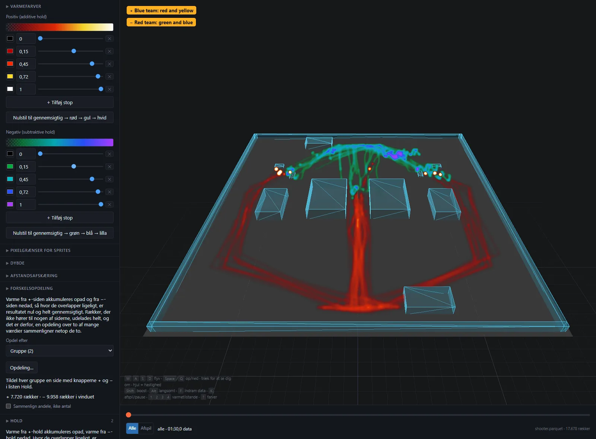

# Forskel

Rødt, hvor hold A var flest, grøn-blåt, hvor hold B var flest, og intet, hvor de var lige.

**Forskel** (tast 2) er fortegnet varme. Rækker fra den ene population lægger varme til; rækker fra en anden trækker den fra. Hvor de to overlapper jævnt, bliver resultatet nul og helt gennemsigtigt; hvor den ene dominerer, vises det i den sides farver – som standard varme (gennemsigtig → rød → gul → hvid) for **+**-siden og kølig (gennemsigtig → grøn → blå → lilla) for **−**-siden.

## Sådan bruger du den {#how-to-use-it}

1. Tryk på `2` (eller vælg **Forskel** i tilstandslinjen).
2. Åbn **Forskelsopdeling** i sidebjælken.
3. Vælg, hvad der skal **Opdel efter**: som regel *Grupper*.
4. Sæt én gruppe (eller værdi) på **+** og en anden på **−**.
5. Læs farverne: varme betyder +-siden, kølig betyder −-siden. Panelet advarer, hvis en side ingen rækker har (se [Meddelelser du kan se](#messages-you-may-see)).

*Hvilke* to populationer der sammenlignes, er hele spørgsmålet, så opdelingen kan være en hvilken som helst bevaret kolonne, ikke kun grupper. Rækker, der falder på **ingen** af siderne, **udelades**, de tælles ikke som nul: det er det, der gør, at en opdeling over to af mange værdier sammenligner præcis de to, og den kombineres med [filtrene](filters.md) – filtrér ned til ét kort, og opdel derefter det efter byggeversion.

Tilstanden kræver to sider: en gruppekolonne med mindst to grupper eller en opdeling over en kolonne, der er bevaret til filtrering. På data med færre end to grupper starter en indlæsning med en kolonneopdeling – først kolonnen *Kildefil* ved en indlæsning af flere filer, ellers den første kategorikolonne med to værdier, ellers den første talkolonne med et spænd – så *sammenlign to indlæsninger* virker på data uden nogen grupper. Kun data uden nogen af dem gør tilstanden utilgængelig; det samme gælder en kolonneopdeling, der står med tom ene side.

## Panelet Forskelsopdeling {#the-difference-split-panel}

Vises i Forskel-tilstand, under varmepanelerne.

**Opdel efter** tilbyder:

| Valg | Vist som | Opdelingsregel |
|---|---|---|
| Grupper | *Gruppe (N)* (når der er en gruppekolonne) | Hver gruppe på +, − eller ingen, sat i [Holdliste](teams-list.md) |
| En kategorikolonne | *kolonne (N værdier)* | Værdier på +, − eller ingen |
| En talkolonne | *kolonne (tal)* | Et værdiinterval for hver side |
| Kildefilen | *Kildefil - sammenlign to indlæsninger* (når flere filer er indlæst) | Filer på +, − eller ingen |

Kun kolonner, der under *Behold til filtrering* er bevaret ved indlæsningen, tilbydes.

### Sammenlign andele, ikke antal {#compare-shares-not-counts}

**Sammenlign andele, ikke antal** (standard fra) vægter hver side med én over sit eget antal rækker, så en side med fem gange så mange rækker ikke vinder på tallene alene. Farven viser så, hvor hver side forholdsmæssigt er mere almindelig end den anden. Brug den, når de to sider har meget forskellige mængder data, for eksempel to sessioner af forskellig længde.

### Meddelelser du kan se {#messages-you-may-see}

Panelet advarer, når billedet ikke er en egentlig forskel:

| Meddelelse | Betydning |
|---|---|
| *N + / M −* (eller *N + / M − / K ubrugte*) | Hvor mange værdier der er på hver side (og på ingen). |
| Ingen række i vinduet er på **+**-siden | Kun **−**-siden tegnes. Flyt tidslinjens vindue, eller skift opdelingen. |
| Ingen række i vinduet er på **−**-siden | Kun **+**-siden tegnes. |
| Ingen værdi er på nogen side | Forskellen tegner intet. Sæt mindst én værdi på **+** eller **−**. |
| *kolonne* kan ikke opdeles på denne måde | Den valgte kolonne passer ikke til opdelingen. Vælg kolonnen igen. |
| Opdelingskolonnen passede ikke i grafikkortets hukommelse for N af M dele | Disse rækker tegnes ikke. Hæv GPU-budgettet under Ydelse → Ressourcebudgetter, eller indlæs færre rækker. |

### Efter gruppe {#by-group}

Panelet peger blot på [Holdlisten](teams-list.md), hvor hver gruppe har en knap **+** og en knap **−**. Ved hver indlæsning sættes den første halvdel af grupperne (rundet op) på +, resten på −; **Del ligeligt** i Holdlisten gør det igen. En gruppe på ingen af siderne, eller skjult med dens afkrydsningsfelt, bidrager ikke med noget.

### Efter kategoriværdier {#by-category-values}

| Del | Betydning |
|---|---|
| `a + / b − / c ubrugte` | Hvor mange værdier der er på hver side og på ingen. |
| **Ryd** | Sætter hver værdi på ingen side. |
| Værdiliste | Hver værdi med en knap **+** og en knap **−** (klik på den aktive igen for at fjerne den fra siden). En tom værdi vises som *(mangler)*. |
| Bemærkning om grænse | Kun de første 200 værdier vises: *Viser de første 200 af N værdier. En så bred kolonne er bedre at indsnævre med et filter først, eller opdele efter interval, hvis værdierne er ordnet.* |

Når du vælger kolonnen, sættes dens første værdi på + og dens anden på −. Når ingen af siderne har nogen værdi, falder opdelingen tilbage til grupper i stedet for at vise en tom ramme. *Kildefil* virker på samme måde, med én værdi pr. fil – sådan sammenlignes to eksporter, to testkørsler eller to byggeversioner.

### Efter interval {#by-range}

| Del | Betydning |
|---|---|
| Hint | Kolonnens mindste og største værdi. |
| **Positivt interval (+)**, **fra** / **til** | Rækker med en værdi i dette interval, inklusive i begge ender, lægges til. |
| **Negativt interval (−)**, **fra** / **til** | Rækker i dette interval trækkes fra. |
| **Del ved midtpunktet** | Sætter + til [mindste, midte] og − til [midte, største] – det samme, som valget af kolonnen gør. |

En værdi i begge intervaller tæller som +. Intervallerne behøver ikke dække kolonnen; værdier i ingen af dem udelades. *De første to minutter mod de sidste to* er en intervalopdeling på en tidslignende kolonne.

## Farver {#colours}

Afsnittet **Varmefarver** viser to rampeeditorer i denne tilstand: **Positiv (additive hold)** og **Negativ (subtraktive hold)**, hver med sin egen nulstillingsknap (*Nulstil til gennemsigtig → rød → gul → hvid*, *Nulstil til gennemsigtig → grøn → blå → lilla*). Sammensætningen tager den absolutte værdi af nettovarmen gennem [mætningspunktet og responsen](colour-and-exposure.md) og vælger den negative rampe, hvor nettoen er under nul. Se [Farve og eksponering](colour-and-exposure.md#the-ramp-editor).

Brug den *lineære* tæthedsrespons, når forskellens størrelse har betydning: det er den eneste respons, hvor samme farve betyder samme antal.

## Sådan virker det {#how-it-works}

Hver række får et fortegn på +1, -1 eller 0 i vertex-shaderen ([`POINT_HEAT_VS`](https://github.com/Holdi601/3DHeat/blob/main/src/render/webgl2/shaders.ts)); en 0 afviser rækken, før noget fragment tegnes.

- Efter gruppe kommer fortegnet fra en gruppetabel med 4.096 indgange, indekseret efter rækkens gruppe-id (gruppe-id'et ligger i den fjerde kanal i rækkens positionstexel).
- Efter kategori kommer fortegnet fra en anden tabel med 4.096 indgange, fyldt pr. kategoriværdi, og rækkens værdi læses fra kolonnens filtertekstur; en værdi forbi tabellens ende afvises på begge backends.
- Efter interval sammenlignes rækkens værdi med de to intervaller.

Ændrer du opdelingen, genstartes akkumuleringen.

**Skjulte grupper forbliver skjult ved enhver opdeling.** Under en opdeling efter en kolonne bærer gruppetabellen ikke længere fortegn; den holder 1 for en vist gruppe og 0 for en skjult ([`frameSignTables`](https://github.com/Holdi601/3DHeat/blob/main/src/render/filterTables.ts)), og begge tabeller når shaderen samtidig – to rækker i én fortegnstekstur på WebGL2, to halvdele af én storage buffer på WebGPU. En række tegnes kun, når dens gruppe vises *og* dens kolonneværdi er på en side. En gruppe, der er fjernet markering for i [Holdliste](teams-list.md), eller som udelades af fanen Kamps sidefokus, bidrager altså med intet, uanset hvordan forskellen opdeles.
