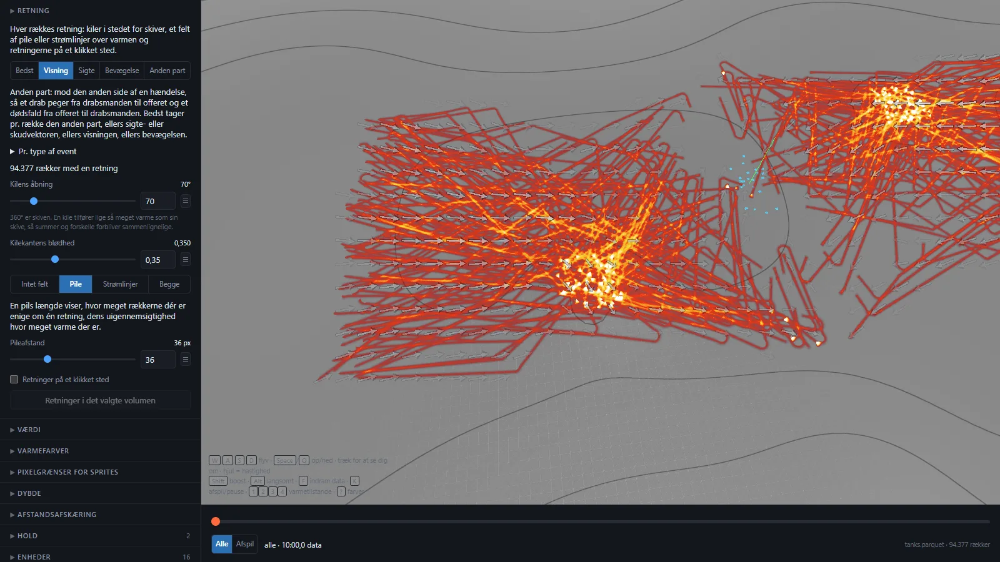

# Retningsvarme

Almindelig varme siger **hvor** ting sker. Retningsvarme siger også **hvilken vej**: hvilken vej folk kiggede, sigtede, bevægede sig, eller hvor den anden side i et slagsmål var.

En almindelig sprite er en fuld skive (360 grader). Med en **Kilens åbning** på 70 grader bliver den samme sprite til en smal kile, der peger den vej rækken vendte, og den lægger lige så meget varme til i alt.

## Sådan bruges den {#how-to-use-it}

1. Indlæs data med en retning i (se [Hvad giver en række en retning](#what-gives-a-row-a-direction)).
2. Vælg **Varme**, **Forskel** eller **Holdvarme** på tilstandslinjen.
3. Åbn afsnittet **Retning** i sidepanelet.
4. Vælg en **kilde** (hvilken retning der skal bruges), og tænd så tegningen:
   - sænk **Kilens åbning** under 360° for at tegne hver række som en kile, der peger sin vej, i stedet for en skive;
   - vælg et **Felt** for at tegne pile eller strømlinjer hen over varmen;
   - sæt kryds ved **Retninger på et klikket sted** og klik på varmen for at få et polardiagram over det sted.

Statuslinjen siger, hvor mange rækker der har en retning fra den valgte kilde.

## Indstillinger {#settings}

| Indstilling | Standard | Betydning |
|---|---|---|
| Kilde: **Bedst**, **Visning**, **Sigte**, **Bevægelse**, **Anden part** | Bedst | Hvilken retning hver række får. *Bedst* tager, pr. række, den anden part, ellers sigtet, ellers visningen, ellers bevægelsen. |
| **Pr. hændelsestype** | som ovenfor | En forskellig kilde for hver hændelsestype, for eksempel *Anden part* for drab og *Visning* for positioner. Vises, når dataene har en hændelseskolonne med højst 40 værdier. |
| **Kilens åbning** | 360° | 360° er den normale skive (fra). Mindre er en smallere kile. En kile lægger lige så meget varme til som sin skive, så summer og forskelle forbliver sammenlignelige. |
| **Kilekantens blødhed** | 0,35 | 0 er en kile med skarp kant, 1 en blød vifte. |
| **Felt**: Intet felt, Pile, Strømlinjer, Begge | Intet felt | Pile: en piles længde er, hvor enige rækkerne der er om én retning, dens opacitet er, hvor meget varme der er. Pile vises kun, hvor der er varme. |
| **Pileafstand** | 28 px | Afstand mellem pile på skærmen. |
| **Animér strømlinjerne** | til | Strømlinjer flyder, mens den er til. |
| **Retninger på et klikket sted** | fra | Klik på varmen for at se retningerne der (nedenfor). |
| **Retninger i det valgte volumen** | | Det samme diagram for alt inden for det valgte [volumen](volumes.md). |

## Polardiagrammet på et sted {#the-polar-chart-at-a-spot}

Med **Retninger på et klikket sted** til klikker du på varmen. Rækkerne tæt på det punkt (inden for 1,5 sprite-radier) samles i en rose med 24 skiver á 15°:

- **orange** blade: udgående retninger (hvor rækkerne peger hen);
- **blå** blade: indgående retninger (hvor de kom fra);
- et blads **areal** vokser med dets antal; en pil viser den vigtigste retning;
- linjerne under diagrammet giver den vigtigste pejling, hvor stærkt rækkerne er enige (R, 0 til 1), spredningen i grader og antallet af rækker.

0° er op på diagrammet, som er verdens −Z (nord for Tacview-optagelser). Stedet er også markeret i 3D-visningen med en pil og en ring.

## Hvad giver en række en retning {#what-gives-a-row-a-direction}

| Kilde | Kræver i dataene |
|---|---|
| Visning | en gir-kolonne (kortlagt som kigretning): `yaw`, `heading`, `azimuth`, `view_yaw`, `rot_z` |
| Sigte | talpar såsom `aim_x`/`aim_y`, `shot_x`/`shot_y`, `fire_x`/`fire_y`, `hit_dir_x`/`hit_dir_y` (en valgfri `…_z`) |
| Bevægelse | intet ekstra: trinnet fra samme persons forrige måling (højst 10 s tidligere, samme session) |
| Anden part | en kolonne, der nævner den anden side i en hændelse (`other`, `victim`, `target`, `killer`, `attacker`, `shooter`, `other_player` ...), hvis værdier er personnavne; et drab peger fra dræber til offer, en død fra offer til dræber |

## Tips {#tips}

- Kiler skal have en vis størrelse på skærmen; under få pixels tegnes de igen som skiver.
- Brug *Anden part* på drabsrækker for at se **hvorfra** kampe blev vundet, og *Visning* på positionsrækker for at se **hvor folk kigger**.
- Med **Forskel** peger kilerne for de to sider i deres egne retninger, så omstridte skudlinjer træder frem.
