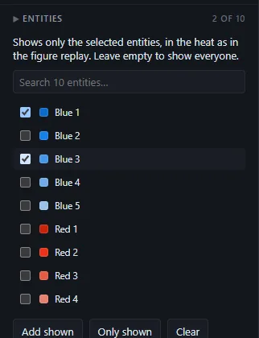

# Enheder

**Enheder** lader dig vælge én spiller (eller nogle få) og se kun, hvor den spiller var. Brug det til at følge din egen bevægelse eller én modstander.

Panelet vises, når datasættet har en personkolonne. Dets overskrift viser antallet af personer, eller `valgt af i alt`, mens et valg er aktivt. En *person* er én spiller eller AI, se [ordlisten](glossary.md).

## Vælg en spiller {#pick-a-player}

1. Åbn **Enheder** i sidebaren.
2. Skriv en del af navnet i søgefeltet.
3. Sæt kryds i spilleren. Overskriften siger fx `2 af 10`, og alt andet forsvinder.
4. **Ryd** viser alle igen.

Valget viser kun de valgte personer. Det gælder i varmetilstandene (punkter, linjer, forskel, holdvarme) og i sporene, figurerne og halerne i [figuroverlejringen](box-replay.md). Lad feltet være tomt for at vise alle. At vælge alle er det samme som ikke at vælge nogen.

## Panelet {#the-panel}

| Del | Betydning |
|---|---|
| Søgefelt | *Søg i N enheder ...*: filtrerer listen efter en del af navnet, uden hensyn til store og små bogstaver. Viser `N træf` eller `N træf, viser de første 200`. *Intet passer til "..."*, når søgningen ikke finder noget. |
| Liste | Op til 200 personer (de første 200, der passer), hver med et afkrydsningsfelt, en farveprøve for personens farve og navnet (*(unavngivet)* for et tomt navn). |
| Hjælp for spil i gang | Når tiden spiller, indeholder listen dem, der er *i spil ved afspilningshovedet*. En søgning finder alle. |
| **AI (n)** | En sammenklappelig gruppe med de AI-styrede enheder, adskilt fra spillerne. |
| **Tilføj viste** | Tilføjer alle, der står på listen, til valget. |
| **Kun viste** | Gør valget præcis til dem, der står på listen. |
| **Ryd** | Tømmer valget. |

## Begrænsninger {#limits}

I varmen er valget et filter, og det bruger et af de fire [filterpladser](filters.md#rules). Når de andre filtre allerede bruger alle fire, siger panelet *Ikke anvendt på varmen: alle filterpladser er optaget. Figurreplayet viser stadig kun disse enheder. Ryd et filter under Filtre for at frigøre en.* Ryd et filter for at frigøre en plads.

Valget ryddes ved hvert nyt datasæt. Fanen Kamp sætter det samme valg, når den fokuserer på én spiller.

## Til udviklere {#for-developers}

Valget gemmes som et *persons*-filter ([Filtre](filters.md#for-developers)). Shaderens maske rummer 65.536 person-id'er. En person ud over det tegnes ikke i varmen, mens et valg er aktivt.
