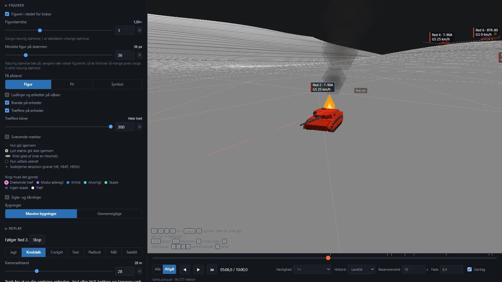

# Figurer

En **figur** er en lille 3D-model af, hvad en enhed egentlig er: en tank, et jetfly, et skib, en soldat. [Replayet](match-replay.md) tegner hver enhed som sin figur i sand størrelse i stedet for en simpel boks.

Der er cirka 2.000 navngivne køretøjer, fly, skibe, våben og soldater. Alle er bygget af fremviseren selv.

## Hvad der er i kataloget {#what-is-in-the-catalogue}

| Område | Eksempler |
|---|---|
| Mennesker | soldat stående, knælende, liggende; snigskytte, panserværnssoldat, sanitet, besætning |
| Jord | kampvogne, infanterikampkøretøjer, luftværn, artilleri, lastbiler og biler, tog og sporvogne |
| Luft | jagerfly, angrebsfly, bombefly, transportfly, helikoptere, fra biplaner til moderne jetfly |
| Hav | krigsskibe efter klasse, hangarskibe, ubåde, både, handelsskibe |
| Våben | missiler, raketter, bomber, torpedoer, signalblus og chaff |
| Markører | røg-, blitz- og brandgranater, plantede bomber, flag, spawnpunkter, vejpunkter |

## Sådan laves figurerne {#how-the-figures-are-made}

- **Bygget ud fra offentliggjorte mål.** De fleste figurer er lavet af fremviserens egen figurbygger ud fra offentlige tal: længde, bredde, højde, vejhjul, tårn og kanon, vinger og hale. Deres form tilpasses derefter offentlige fotos, tegninger og offentliggjorte mål. Ingen spils modeller bruges.
- **Frie modeller.** Nogle få figurer bruger frie 3D-modeller (CC0 eller CC BY), hvor de er mere korrekte. Nogle gange kombineres de med det byggede skrog. Ophavsmænd til CC BY-værker krediteres på [Figurkreditter](figure-credits.md). CC0-værker kræver ingen kreditering og står ikke listet der.
- Hver figur har en fuld, en grov og en fjern version (detaljeniveauer, LOD), så tusindvis kan tegnes på én gang.

## Hvilken figur en enhed får {#which-figure-a-unit-gets}

Fremviseren ser på dataenes egne kolonner:

1. **Navne**: kolonner, der hedder *Name*, *Vehicle*, *Unit*, *Unit type*, *Model*, *Aircraft*, *Plane*, *Tank*, *Ship*, *Craft*, *Loadout*, *Kit* eller *Figure*, matches mod kataloget. Matchet sker præcist, gennem omkring 4.000 aliasser (spilenes enheds-id'er), ved det længste kendte begyndelsesstykke (`F-16C_50` er F-16C) eller ved det korteste figurnavn, der starter med det.
2. Et navn, hvis figur ikke passer til enhedens **type**, bruges ikke. En lastbil ved navn *Typhoon* er ikke jagerflyet.
3. **Typer**: kolonner, der hedder *Type*, *Class*, *Kind*, *Category*, *Icon*, *Role* eller *Domain*, giver en klassefigur. Det kan være Tacview-tags (`Air+FixedWing`, `Ground+Heavy+Armor+Vehicle+Tank`, `Sea+Watercraft+Warship`, `Weapon+Missile`), kortikoner eller almindelige ord (tank, helikopter, infanteri).
4. Data uden nogen af dem er data om mennesker. Alle er en soldat.

Den nemmeste måde at få de rigtige figurer på er altså en `vehicle`-kolonne med de rigtige navne eller en `type`-kolonne med Tacview-tags.

**Min enhed vises som en boks eller en soldat.** Tilføj en `vehicle`-kolonne med det rigtige navn, eller en `type`-kolonne med et Tacview-tag. Hold musen over enheden for at se, hvilket navn der blev matchet. Data, der har sådanne kolonner, men intet siger om en enhed, lader den stå som en boks. Data uden nogen af dem tegnes som soldater.

## Indstillinger {#settings}

Afsnittet **Figurer** i replay-sidebaren sætter størrelsen, den mindste størrelse på skærmen, hvad fjerne enheder bliver til (figur, pil eller symbol) og de effekter, der tegnes på dem. Se [Kamp-replay](match-replay.md#figures). Røg, ild og andre tidsbestemte effekter: [Figurer i figuroverlejringen](figure-replay.md).

## En valgfri lokal figurpakke {#an-optional-local-figure-pack}

Du kan have en valgfri pakke med egne figurer på din egen maskine. Dens figurer træder i stedet for kataloget-figurer med samme navne. Pakken er aldrig en del af repositoryet eller en udgivet build. Uden en pakke ændres intet.
