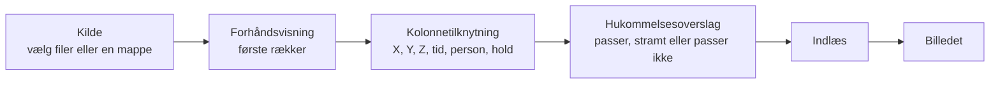

# Indlæs data

Før 3DHeat kan tegne noget, har den brug for en tabel: hver række siger, hvor noget var, og hvis du har det, hvornår og hvem. Dette afsnit viser, hvordan en fil bliver til et billede. Ingen data endnu? Prøv [demodataene](demo-data.md).

**Gør dette nu:**

1. I Heatmap-sidebjælken åbner du **Kilde** og trykker på **Filer …** (eller slipper en fil eller mappe på slipzonen).
2. Kig på **Kolonnetilknytning**: felterne er som regel allerede udfyldt.
3. Tjek, at **Hukommelsesoverslag** siger *passer*.
4. Tryk på **Indlæs**.

Alt, som Heatmap-fanen viser, kommer fra ét **datasæt**: en tabel med rækker, hver med en position og, valgfrit, et tidspunkt, en person, en gruppe, en session, en kigretning og et vilkårligt antal ekstra kolonner, der gemmes til filtrering. Dette afsnit forklarer, hvordan et datasæt laves.

## Vejen fra filer til billede {#the-path-from-files-to-picture}

1. **Vælg filer** i panelet **Kilde** – én fil, flere, et mappetræ eller ved at slippe dem. Parquet, CSV, Tacview, GPS-spor og mere accepteres; den ene fulde liste findes i [Dataformater](data-formats.md#files). Se [Indlæsning af filer](loading-files.md).
2. **Forhåndsvisning.** Den første fil i valget åbnes: dens kolonnenavne, dens første 50 rækker, hvilke kolonner der ser numeriske ud, og (for Parquet) hver kolonnes logiske type og filens egne læseinstruktioner, posten `heat3d` i footeren.
3. **Automatisk tilknytning.** Kolonner tildeles roller – X, Y, Z, tid, person, session, gruppe, kigretning – og nogle få gemmes til filtrering. Hvert gæt vises i panelet **Kolonnetilknytning** og kan ændres. Se [Kolonnetilknytning](column-mapping.md) og [Akser, enheder og tid](axes-units-and-time.md).
4. **Optælling.** Hver fils antal rækker læses (præcist fra Parquet-footere, estimeret for CSV), så panelet kan sige, før noget indlæses, hvor meget hukommelse indlæsningen kræver, og om den passer. Hvis ikke, foreslår det at indlæse hver *N*te række. Se [Hukommelse og budgetter](memory-and-budgets.md).
5. **Indlæs.** En baggrundsworker parser kun de tilknyttede kolonner i hver fil – flere filer ad gangen, op til budgettet for [parser-tråde](memory-and-budgets.md#parser-threads) – og samler dem i valgets rækkefølge til ét datasæt: ét fælles ordbog over personer, grupper og sessioner på tværs af alle filer, ét fælles tidsudgangspunkt og alle rækker sorteret efter tid. Se [Sessioner, personer og grupper](sessions-persons-groups.md).
6. **Upload.** Hovedtråden melder "Uploader N rækker til GPU'en" i ét billede og pakker derefter rækkerne ind i grafikkortets hukommelse inden for GPU-budgettet. Se [GPU-hukommelse](gpu-memory.md).
7. **Første billede.** Kameraet indrammer dataene, sprite-radius og mætning sættes ud fra dataenes omfang og antal rækker, og efter 8 tegnede billeder måles mætningen ud fra selve billedet ([Farve og eksponering](colour-and-exposure.md)).

## Krav, tjekket før en indlæsning {#requirements-checked-before-a-load}

| Behov | Hvad der sker uden det |
|---|---|
| **Mindst to af X / Y / Z** | Indlæsningen afvises. Med præcis to er den tredje akse 0, og dataene tegnes som et fladt plan i 3D-scenen – hvilket et varmekort set oppefra har brug for. |
| En tidskolonne | Valgfri. Uden den er tidslinjen slået fra, visningen bliver i tilstanden **Alle**, og sidebjælken siger det. |
| En personkolonne | Valgfri. Nødvendig for [figuroverlejringen](box-replay.md) (en figur for hver person), [linjevarme](line-heat.md) (stien hver person gik), interpolation, spor og historikken **Levetid**. |
| En gruppekolonne | Valgfri. Nødvendig for [holdvarme](team-heat.md) og for [forskel](difference.md)-tilstanden (mindst to grupper). |

En tilstand, de indlæste data ikke kan understøtte, er nedtonet i tilstandslinjen; holder du musen over den, siger den hvorfor.

## Uden egne data {#without-your-own-data}

Panelet **Datasæt** (under **Kilde**) har en [syntetisk generator](synthetic-generator.md), der laver et datasæt i battle-royale-form i vilkårlig størrelse – nyttigt til at prøve vieweren og til at teste, hvad en maskine kan klare.

## Sider i dette afsnit {#pages-in-this-section}

- [Indlæsning af filer](loading-files.md) – filvælgere, mapper, træk og slip, sammenlægning af flere filer, bevægelsesfil-reglen, fremskridt og afbrydelse
- [Kolonnetilknytning](column-mapping.md) – hvert felt i tilknytningspanelet, hvordan den automatiske tilknytning gætter, `heat3d`-hints
- [Akser, enheder og tid](axes-units-and-time.md) – op-akse, vendinger, enhedsskala, tidsenheder, kigretning
- [Sessioner, personer og grupper](sessions-persons-groups.md) – hvad hver gør, grænserne, delte navne, enhedsstørrelse, panelet Datasæt
- [Syntetisk generator](synthetic-generator.md)
- [Hukommelse og budgetter](memory-and-budgets.md) – fodaftryksmodellen, pasningstjekket, decimering, sorteringsloftet, ressourcebudgetter
