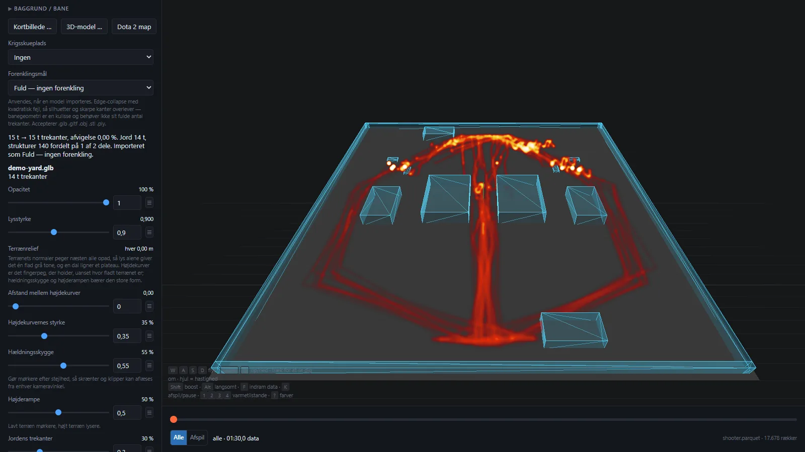
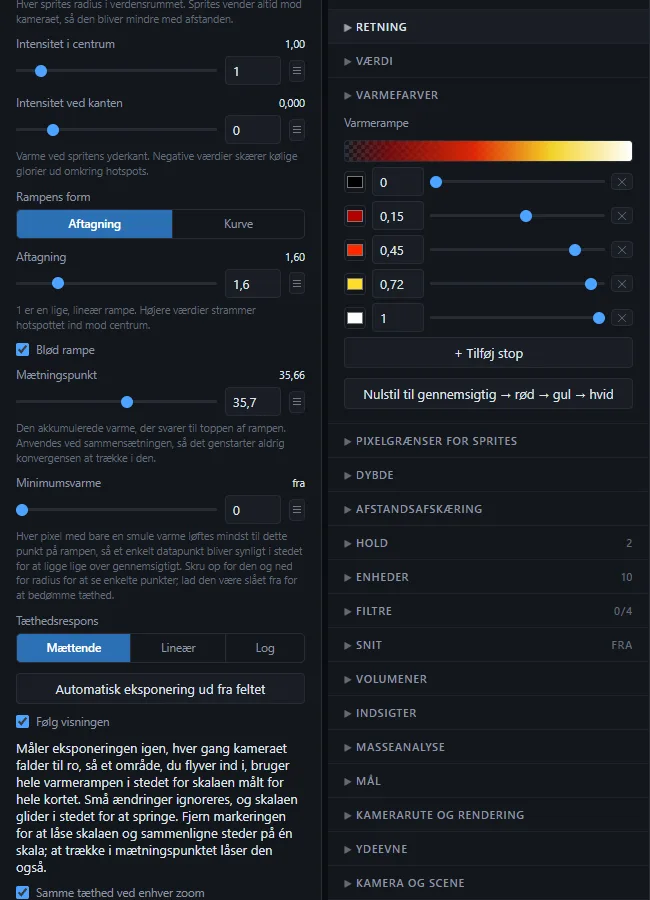

# Varme

Varme maler de steder, hvor der skete mange ting: rødt, hvor det skete lidt, hvidglødende, hvor det skete meget. Den svarer på "hvor sker dette, og hvor meget".

**Varme** (tast 1) er standardtilstanden. Hver synlig [række](glossary.md) bidrager med en rund [sprite](glossary.md), der vender mod kameraet; overlappende sprites lægges sammen i en buffer med flydende komma; summen omdannes via en farverampe - som standard gennemsigtig → rød → gul → hvid - og tegnes ovenpå scenen.

Billedet viser varmen fra en skydeomgang på en bane med bygninger: hotspots sidder i rummene og på trapperne, ikke kun på jorden.

## Sådan bruges den {#how-to-use-it}

1. Indlæs data og tryk på `1` (eller vælg **Varme** på tilstandslinjen).
2. Er alt hvidt eller tomt, så tryk på **Automatisk eksponering ud fra feltet** i afsnittet **Varmeform**.
3. Ændr **Sprite-radius**, til nabopunkterne smelter sammen til bånd: mindre viser enkeltstående pletter, større viser områder.
4. Åbn **Varmefarver** for at ændre farverne, eller **Dybde** for at lade bakker og vægge skjule varmen bag dem.

De samme paneler former [Forskel](difference.md), [Holdvarme](team-heat.md) og [Linjevarme](line-heat.md); de adskiller sig i, hvad der lægges til (med fortegn, farvet eller langs linjer), ikke i hvordan.

## Panelerne og deres standardværdier {#the-panels-and-their-defaults}

Hver indstilling forklares på sin egen side; kolonnen Detaljer linker dertil. Skydere har en skrivbar boks ved siden af sig og et træk-håndtag (det lille greb til højre: træk op eller ned, længere træk er hurtigere, Shift for finjustering); hvor en skyders spor slutter før en reel grænse, kan håndtaget skubbe længere ud til den *skyder-loft*, der er angivet her. Værdier markeret *ved indlæsning* genberegnes for hvert nyt datasæt.

### Varmeform (åben) {#heat-shape-open}

| Indstilling | Standard | Interval (skyder-loft) | Detaljer |
|---|---|---|---|
| **Sprite-radius** | 6 m; ved indlæsning udstrækning / 120 | 0,05-2000 m, logaritmisk (50.000) | [Sprite-form](sprite-shape.md#sprite-radius) |
| **Intensitet i centrum** | 1 | 0-10 (1000) | [Sprite-form](sprite-shape.md#centre-and-edge-intensity) |
| **Intensitet ved kanten** | 0 | -2-10 (1000) | [Sprite-form](sprite-shape.md#centre-and-edge-intensity) |
| **Rampens form** | *Aftagning* | *Aftagning* / *Kurve* | [Sprite-form](sprite-shape.md#ramp-shape-falloff-or-curve) |
| **Aftagning** (kun Aftagning) | 1,6 | 0,1-8 (64) | [Sprite-form](sprite-shape.md#falloff) |
| **Blød rampe** (kun Aftagning) | til | | [Sprite-form](sprite-shape.md#falloff) |
| Kurveeditor (kun Kurve) | forudindstillingen *Blød* | | [Sprite-form](sprite-shape.md#the-curve-editor) |
| **Mætningspunkt** | 24; ved indlæsning et skøn, derefter målt | 0,1-4000, logaritmisk (10.000.000) | [Farve og eksponering](colour-and-exposure.md#saturation-point) |
| **Minimumsvarme** | fra (0) | 0-100 % | [Farve og eksponering](colour-and-exposure.md#minimum-heat) |
| **Tæthedsrespons** | *Mættende* | *Mættende* / *Lineær* / *Log* | [Farve og eksponering](colour-and-exposure.md#density-response) |
| **Automatisk eksponering ud fra feltet** | | knap | [Farve og eksponering](colour-and-exposure.md#auto-exposure) |
| **Følg visningen** | til | | Måler eksponeringen igen, hver gang kameraet står stille, så et område, du flyver ind i, bruger hele farverampen. Små ændringer ignoreres, og skalaen glider. Fjern markeringen, eller træk i **Mætningspunkt**, for at låse skalaen og sammenligne steder på én skala. [Farve og eksponering](colour-and-exposure.md#follow-the-view) |
| **Samme tæthed ved enhver zoom** | til | | En farve betyder det samme antal rækker pr. areal af jord, uanset hvor tæt du er. En sprite, som pixelgrænserne forstørrer (langt væk) eller formindsker (tæt på), beholder den varme, dens sande størrelse ville tilføje, så et billede eksponeret langt fra ikke bleger, når du flyver ind i det. Fra tilføjer en begrænset sprite hele sin vægt i sin begrænsede størrelse. [Sprite-form](sprite-shape.md#pixel-clamps) |
| **Flad ud på jordplanet** | fra | | [Sprite-form](sprite-shape.md#flatten-onto-ground-plane) |

### Varmefarver (lukket) {#heat-colours-closed}

| Indstilling | Standard | Detaljer |
|---|---|---|
| Gruppefarver og **Farveadskillelse** (kun Holdvarme) | 1,4 | [Holdvarme](team-heat.md) |
| Editoren for **Varmerampe** (*Positiv (additive hold)* i Forskel, *Opacitetsrampe* i Holdvarme) | gennemsigtig → rød → gul → hvid | [Farve og eksponering](colour-and-exposure.md#the-ramp-editor) |
| **Nulstil til gennemsigtig → rød → gul → hvid** | | |
| Rampen **Negativ (subtraktive hold)** (kun Forskel) | gennemsigtig → grøn → blå → lilla | [Forskel](difference.md#colours) |

### Sprite-pixelgrænser (lukket) {#sprite-pixel-clamps-closed}

| Indstilling | Standard | Interval (skyder-loft) | Detaljer |
|---|---|---|---|
| **Min. pixelradius** | 1 px | 0-16 (512) | [Sprite-form](sprite-shape.md#pixel-clamps) |
| **Maks. pixelradius** | 96 px | 2-1024, logaritmisk (8192) | [Sprite-form](sprite-shape.md#pixel-clamps) |

### Dybde (åben) {#depth-open}

| Indstilling | Standard | Detaljer |
|---|---|---|
| **Skjul bag terræn** | til | [Dybde og culling](depth-and-culling.md#hide-behind-terrain) |
| **Skjult bag geometri** | 0,8 (*80 % mørkere*) | [Dybde og culling](depth-and-culling.md#hidden-behind-geometry) |

### Afstandsafskæring (lukket) {#distance-culling-closed}

| Indstilling | Standard | Interval (skyder-loft) | Detaljer |
|---|---|---|---|
| **Nær** | fra (0) | 0,5-5000 m, logaritmisk, nederst på skinnen = fra (200.000) | [Dybde og culling](depth-and-culling.md#distance-culling) |
| **Fjern** | fra (0) | 1-200.000 m, logaritmisk, nederst = fra (10.000.000) | [Dybde og culling](depth-and-culling.md#distance-culling) |
| **Skær ved et plan** | til | | [Dybde og culling](depth-and-culling.md#distance-culling) |
| **Skær også banen** | til | | [Dybde og culling](depth-and-culling.md#distance-culling) |

Taster: `[` og `]` skubber den fjerne grænse ind og ud, `\` skifter den ([Dybde og culling](depth-and-culling.md#keyboard)).

### Retning og Værdi {#direction-and-value}

To flere afsnit ligger under Varmeform. **Retning** tegner hver række som en kile og tilføjer pile: se [Retningsvarme](directional-heat.md). **Værdi** vægter varmen efter, hvad hver række kostede eller indbragte: se [Værdivægtning](value-weighting.md).

## Hvad der gemmes {#what-is-saved}

Varmeindstillingerne ovenfor gemmes ikke mellem sessioner: genindlæser du siden, gendannes standardværdierne. To ting gemmes i browseren: den sidst brugte afspilningshastighed (`heat3d.speed`, se [Tidslinje](timeline.md)) og indstillingerne for de fjerne figurer i [figuroverlejringen](box-replay.md) (symbolstil, størrelse, træfmærker og så videre). Det samme gælder sproget, de [inverterede verdensakser](camera.md#invert-world-axis), løbsfanens huskede bilnavne og [banebiblioteket](level-library.md). Den fulde liste findes under [Gemte indstillinger](ref-settings-storage.md).
