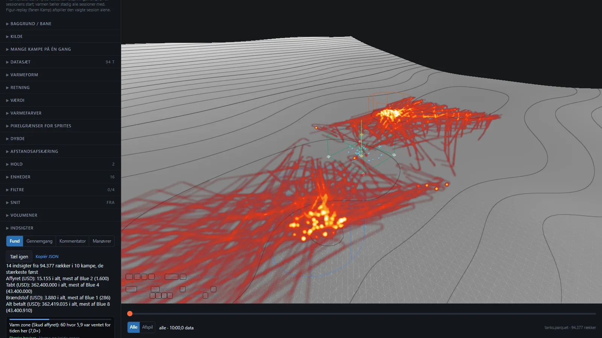
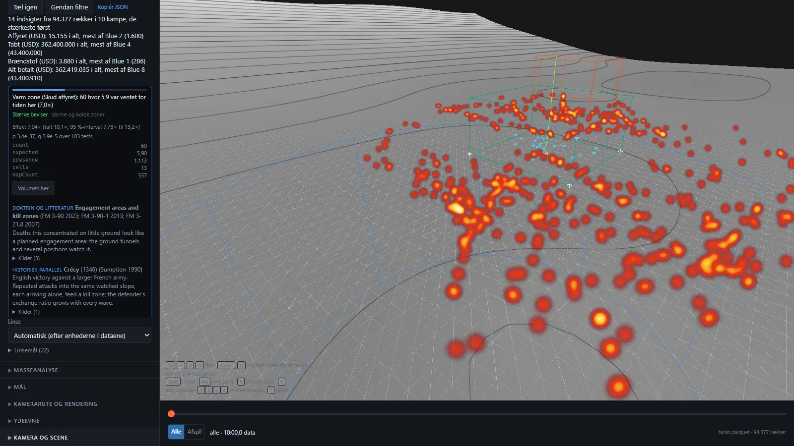
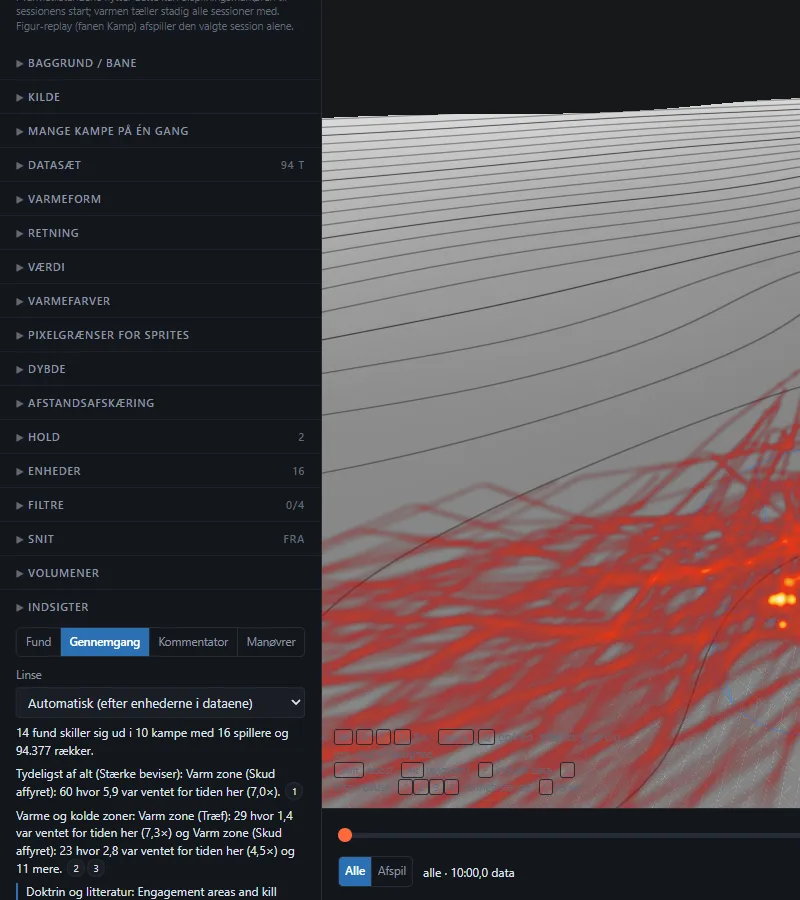
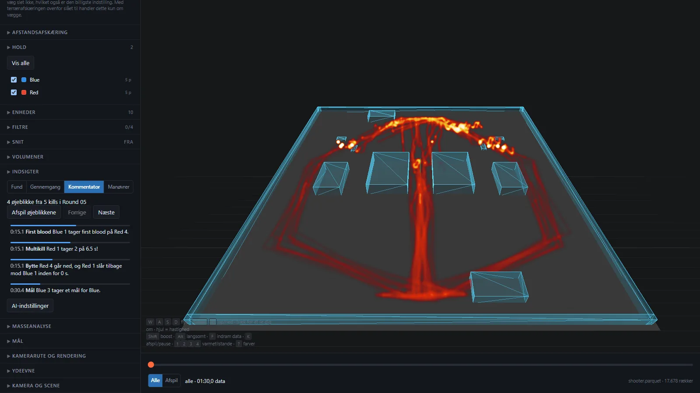

# Indsigter

**Indsigter** gennemser de indlæste data for det, der skiller sig ud – stærke positioner, farligt terræn, spawn-fælder, flaskehalse, spillere langt over deres jævnaldrende – og fortæller dig det, stærkeste først, med beviserne. Brug den til at lære på et minut, hvor en kamp blev vundet eller tabt. Derefter kan den skrive en gennemgang, og i et enkelt replay kan den optræde som kommentator, der springer til de store øjeblikke.

Alt tælles i din browser. Intet forlader din computer, medmindre du slår en ekstern AI til (se [Ekstern AI](#external-ai)).

Afsnittet **Indsigter** findes i sidebjælken på fanerne Heatmap og Kamp. Det har tre faner: **Fund**, **Gennemgang** og **Kommentator**.

## Fund {#findings}

1. Indlæs data, og åbn **Indsigter**. Tryk på **Find indsigter** ("Tæller… n %" viser fremskridtet).
2. Læs listen. Hvert fund har en styrkebjælke, en sætning, hvor god evidensen er (*Stærk evidens*, *God evidens* eller *Nogen evidens*), hvilken detektor der fandt det, og køretøjsklassen, hvor det har betydning.
3. **Klik på et fund**: vieweren anvender dets filtre, flyver kameraet hen til stedet og springer til tidspunktet, og åbner detaljerne: effekten med dens 95 % interval, p- og q-værdierne, de talte beviser og **Volumen her**, som tegner et [volumen](volumes.md) rundt om stedet.
4. **Gendan filtre** sætter dine filtre tilbage. **Kopiér JSON** kopierer hele rapporten.

Optællingen bruger de aktuelle filtre, skjulte grupper og den valgte kamp over hele tidsintervallet. Ændrer du filtrene bagefter, siger en note det; tryk på **Tæl igen**.

Linjerne øverst på listen (for eksempel pengetotalerne) opsummerer hele datasættet før fundene.

### Detektorerne {#the-detectors}

| Detektor | Hvad den finder | Kræver i dataene |
|---|---|---|
| **Magtpositioner** | Steder med langt bedre forhold mellem drab og dødsfald end resten af kortet, og *sikkert terræn*, hvor få dør i forhold til den tid, der bruges | drab- og dødshændelser |
| **Varme og kolde zoner** | Steder, hvor en hændelsestype (skud, træffere, erobringer ...) sker langt oftere eller sjældnere, end tiden der forudsiger | en hændelseskolonne |
| **Åbent terræn og dækning** | Døde i det åbne mod nær banegeometri, og langsomt mod hurtig bevægelse | dødsfald; en 3D-bane til geometridelen |
| **Spawns** | Stærke spawns, spawn-fælder, sikre spawns, tid til første kontakt | tid og personer |
| **Klasse efter sted** | En køretøjsklasse, eller spillere mod AI, der klarer sig langt bedre eller dårligere i et område | drab plus en køretøjsklasse- eller spiller/AI-kolonne |
| **Spillere** | Spillere, der dræber eller dør langt oftere eller sjældnere end andre i samme klasse | personer og drab |
| **Flaskehalse og flanker** | Flaskehalse (langt flere passager end terrænet omkring) og flankeruter (sjældent brugt, men fører til drab) | personer |
| **Værdi** | *Dyrt terræn* og *Indbringende terræn* | [værdikolonner](value-weighting.md) |
| **Hvad der afgjorde runderne** | Hvad der adskilte vundne fra tabte runder, og de spillere, der tilføjede eller kostede mest vindersandsynlighed (se [Hvem vandt](#who-won-what-decided-the-rounds)) | runder, drab og dødsfald, og [udfaldskolonnerne](data-formats.md#outcome-columns) (`won`) |

Detektorer, der ikke kan køre på dataene, listes nederst med grunden.

### Sådan rangeres fund {#how-findings-are-ranked}

Hvert sted eller hver gruppe testes mod resten af kortet (eksakte binomial- eller rate-tests). Den falske opdagelsesrate holdes på 5 % (Benjamini-Hochberg). Tilfældigheder kan ligne et mønster; dette holder falske alarmer nede: blandt de viste fund forventes højst omkring én ud af tyve at være tilfældighed. Effekter fra få hændelser trækkes mod "ingen effekt", før rangeringen. Højst 60 fund vises, og hver detektor får nogle steder højt på listen.

### Hvem vandt: hvad der afgjorde runderne {#who-won-what-decided-the-rounds}

Hvor dataene siger, hvem der vandt hver runde ([udfaldskolonnen](data-formats.md#outcome-columns) `won`: CS2, Rainbow Six Siege, War Thunder ...), handler Indsigter om resultatet. For hver side deler den runderne efter, hvad der skete i dem, og sammenligner vinderaterne:

| Faktor | Sidens runder med det | ... og uden det |
|---|---|---|
| Åbningsduel | den fik det første drab | den døde først |
| Køb | dens køb var bedre end den anden sides | dårligere |
| Byttet første død | dens første død blev byttet inden for 5 s | ikke byttet |
| Plantning | den plantede | ingen plantning |
| Udstyr | flere granater end i dens sædvanlige runde | færre |
| Tidlig kontakt | den første duel kom før kampens mediantid | senere |
| Et sted holdt | en spiller stod på stedet 5 s eller mere | ingen gjorde |
| Et sted nået tidligt | en spiller kom derhen i de første 25 s (ruten) | ingen gjorde |

Hver sammenligning er en forskel mellem to vinderater med sit 95 %-interval (Newcombe), Fishers eksakte p og et q over alle afprøvede faktorer (Benjamini-Hochberg). En arm med færre end 8 runder markeres *få runder*. Dem under falsk-opdagelsesraten på 5 % bliver til fund; de stærkeste rangeres over de andre detektorers (et udfaldsfund vejer 1,35 gange et fund med samme effekt og evidens).

Et opdigtet eksempel over 40 runder:

> **T** vandt 79 % af de 19 runder, hvor den holdt **Mid**, mod 24 % af 21 uden (55 point, 95 % 26 til 74) – q 0,004.

Den følger også rundens **vindersandsynlighed** – den chance, hver side havde i hvert øjeblik, ud fra de levende mænd, plantningen og uret: tilpasset runderne, når der er 30 eller flere, ellers en fast prior-model (og teksten siger hvilken). Ud fra den kommer **vendepunkterne** (de drab og plantninger, der flyttede chancen mest) og hver spillers **tilføjede vindersandsynlighed**: de drab og plantninger, spilleren lavede, tæller for spilleren, dødsfaldene imod, i runders værdi over kampen, en runde i gennemsnit med sit interval, testet mod nul. Stederne får samme regnskab: hvilken side der vandt mest i duellerne, der blev udkæmpet der.

Dataene skal have runder, drab og dødsfald med begge sider, og kolonnen `won`; navngivne steder (`place`) for holdte steder, en kolonne `buy` for købet.

## Gennemgang {#debrief}

Fanen **Gennemgang** skriver fundene op som en kort tekst: en indledning, det tydeligste fund, ét om taktik, ét om balance, derefter – hvor dataene siger, hvem der vandt – hvad der afgjorde runderne, resten grupperet efter detektor, og hvor mange der hviler på svagere evidens.

Hvad der afgjorde runderne kommer i fire afsnit: stillingen og hvor vindersandsynlighederne kommer fra; de stærkeste faktorer med deres tal, interval og q (når ingen består falsk-opdagelsesraten, siger teksten *intet af det er sikkert endnu* og nævner stadig den stærkeste); de tre største vendepunkter; og de spillere, der tilføjede og kostede mest vindersandsynlighed, med de steder, der vandt mest. Et opdigtet eksempel:

> T vandt 23 og CT vandt 17 af 40 runder med kendt resultat (T: 58 %, 95 % 42 % til 72 %). Vindersandsynlighederne kommer fra en model tilpasset disse runder.
>
> Hvad der adskilte vundne fra tabte runder: T vandt 79 % af de 19 runder, hvor den holdt Mid, mod 24 % af 21 uden (55 point, 95 % 26 til 74) (q 0,004), ...
>
> Vendepunkter: runde 17 ved 48 s, et drab af CT ved B site flyttede dens chance fra 31 % til 58 %, og den tog runden, ...

Hvert afsnit har nummererede knapper, der viser dets fund. **Kopiér tekst** kopierer den.

Den indbyggede fortæller virker offline, på dit sprog. Vælgeren **Linse** over den (se [Vidensobjektivet](knowledge.md)) bestemmer, hvilken litteratur afsnittene citerer.

### Ekstern AI {#external-ai}

**AI-indstillinger** lader en AI-model efter dit valg skrive gennemgangen i stedet:

| Indstilling | Betydning |
|---|---|
| **Udbyder** | Anthropic (Claude), OpenAI (ChatGPT), OpenRouter, Ollama (lokal), LM Studio (lokal), llama.cpp-server (lokal) eller ethvert OpenAI-kompatibelt endepunkt |
| **Basis-URL**, **Model** | Udfyldes af udbyderen; **Vis modeller** spørger serveren |
| **API-nøgle** | Sendes kun til basis-URL'en. Logges aldrig, gemmes aldrig i visninger, eksporter eller `.3dheat`-filer. De fleste lokale servere kræver ingen. |
| **Husk nøglen i denne browser** | Fra som standard: nøglen glemmes, når siden lukkes |
| **Brug en ekstern AI** | Fra som standard |
| **Send spillernavne** | Fra som standard: spillere sendes som P1, P2 ... |

Skriv derefter et valgfrit spørgsmål, og tryk på **Skriv med AI**. Kun fundene og deres tal sendes – aldrig rækkerne i dine data. Svaret strømmer ind; citerede fund bliver til knapper. Hvor dataene siger, hvem der vandt, får modellen besked på at begynde med, hvad der afgjorde runderne, med hvert tals interval og q, og at sige det, når en faktor hviler på få runder, eller vindersandsynlighederne kommer fra prior-modellen.

## Kommentator {#caster}

For **én kamp** (vælg en, hvis flere er indlæst) finder **Kommentatoren** de øjeblikke, der er værd at se: første blod, multidrab, byttehandler, clutches, skift i mål, comebacks, markante spillere, lange skud og **vendepunkter** – de drab, der flyttede en sides chance for at vinde runden mest (ud fra de spillere, der er tilbage i live på hver side, i runder uden respawn).

Hvor dataene siger, hvem der vandt hver runde, siger hvert øjeblik det: *"Anna nedlægger Ben: T's chance for at vinde runden går fra 38 % til 62 % – og de tager runden."* Et øjeblik for den side, der endte med at vinde, tæller mere, når kommentatoren vælger, hvilke der skal beholdes, og et comeback tælles i vundne runder.

- Klik på et øjeblik: visningen skifter til replayet, springer til lige før det, flyver derhen og følger spilleren.
- **Afspil øjeblikkene** afspiller hvert til enden og går videre; **Forrige** / **Næste** går igennem dem.
- Med en ekstern AI slået til skriver **Kommentarer fra AI** en kommentar ud fra øjeblikslisten (typer, tidspunkter, navne eller pseudonymer, hold, klasser, afstande).

Den kræver personer og drab/dødsfald (eller erobringer) som hændelser; en `other`-/`victim`-kolonne gør byttehandler og lange skud mulige.

## Vidensobjektivet {#knowledge-lens}

Et fund kan læses gennem en **linse** af etableret viden: militær doktrin, luft- og søkamp, byoperationer, spildesign og esport (eller *Auto*, valgt af enhederne i dataene). Et åbnet fund viser så det nærmeste **doktrin- og litteraturpunkt** og et **historisk paralleltilfælde** med referencer, og **Linsemål** beregner mål fra den litteratur på dataene (Lanchester-tilpasninger, udvekslingsforhold, styrkeforhold, skudfelter, nøgleterræn, byttehandler, initiativ). Gennemgangen og AI-prompten inkluderer dem. Alt om det: [Vidensobjektivet](knowledge.md).

Linsemålene måler også, hvordan spillerne opfører sig som en menneskemængde og som en gruppe – justering og rundkørsler, rutestyring, baner og spor, trængsel, ledere og følgere, efterslæbere, brudpunktet under tab, risiko efter et tabt liv, serier, enighed om køb og reaktionen på indkommende ild – hver mod sin egen nulmodel: [Kollektiv adfærd](collective-behaviour.md).

## Data, der får indsigterne til at virke {#data-that-makes-insights-work}

- positioner med en **tid**-, en **person**- og en **hold**-kolonne;
- en **hændelse**-kolonne med drab og dødsfald (`kill`, `death`) og andre (`hit`, `fire`, `capture` ...);
- en **modpartskolonne** (`other`, `victim`) til byttehandler og retninger;
- en **køretøjs**- eller **type**-kolonne til klasser; en `ai`-kolonne til spillere mod AI;
- en **session**- / **kamp**- / **runde**-kolonne, når der er flere kampe.

[Demodataene](demo-data.md) har dem alle.
