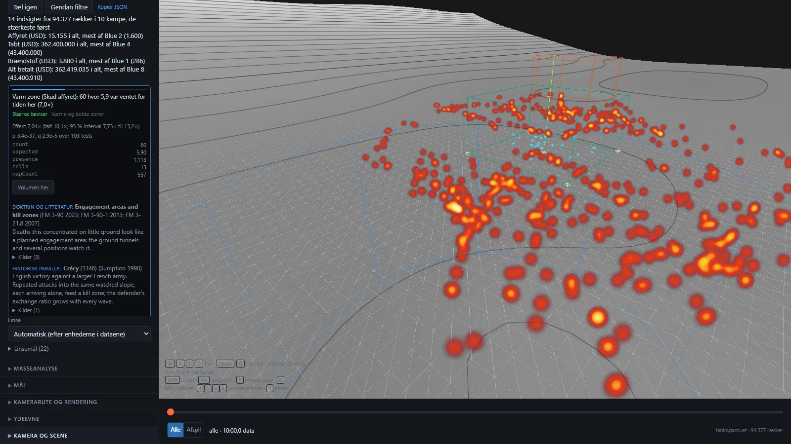

# Vidensobjektivet

Når [Indsigter](insights.md) finder noget, forklarer denne del det med ideer fra militærhistorie, spildesign og sportsanalyse, og nævner den bog eller artikel, det kommer fra. Brug den til at lære *hvorfor* et mønster er vigtigt, ikke kun at det findes.

## Prøv det {#try-it}

1. Indlæs data og åbn **Indsigter**, og tryk derefter på **Find indsigter**.
2. Klik på et fund for at åbne det.
3. Læs **Doktrin og litteratur** og **Historisk parallel**; de fulde referencer er foldet sammen nedenunder.
4. Skift **Linse** (for eksempel til *Militær doktrin*) for at læse det samme fund gennem en anden litteratur.

## Sådan virker det {#how-it-works}

Indsigt-panelet vurderer sine fund, som en professionel analytiker ville: gennem militær doktrin og operationsanalyse, historiske træfninger og litteraturen om spildesign, banedesign og analyse. Det gør det offline, ud fra en udvalgt vidensbase i vieweren, og giver det samme materiale til en ekstern model, når en skriver gennemgangen.

## Hvad panelet viser {#what-the-panel-shows}

- **Linse** vælger den litteratur, fundene læses gennem: *Auto* (valgt efter de enhedstyper, dataene har: fly, skibe, landkøretøjer, infanteri), *Militær doktrin*, *Luftkamp*, *Søkrig*, *By*, *Spildesign og balance*, *E-sport*. Poster uden for den valgte linse udelades.
- Hvert åbnet fund viser sin nærmeste **doktrin- og litteraturpost** og sin nærmeste **historiske parallel**, med de fulde referencer foldet sammen nedenunder.
- **Linsemål** lister de målinger af operationsanalyse, der beregnes over de samme rækker (nedenfor), hver med hvad den betyder og dens litteratur.
- **Gennemgang** tilføjer linjer for de førende fund og linsemålene: "Doktrin og litteratur: ..." og "Historisk parallel: ...", hver med forfatter-år-citater og referencerne foldet ind under.
- **Skriv med AI** sender de mest relevante poster (resumé, lektion, de fund de hænger sammen med, fulde referencer) med rapporten og beder modellen citere dem med id - `{concept.lanchester-square}` - og ikke bruge andre kilder.

Etiketterne er oversat; selve videnet er på engelsk.

## Linsemål {#lens-metrics}

Beregnes i indsigt-workeren, i samme gennemløb af rækkerne som detektorerne (`src/insights/lensMetrics.ts`). Hvert udelades, når dataene ikke kan bære det.

| Mål | Hvad det måler | Kræver |
|---|---|---|
| Lanchester-tilpasning | Hver sides tab pr. 20 s regresseret på begge siders levende styrke (Poisson, kvasi-sandsynlighedsfejl); eksponenterne på fjendens og egen styrke, testet mod kvadratloven (målrettet ild) og den lineære lov (områdeild) | tid, hold, drab og dødsfald |
| Udvekslingsforhold | Drab pr. dødsfald efter side og sted; andelen af dødsfald på det dødeligste jordstykke, der har 5 % af den brugte tid, mod den andel, chancen alene giver med så mange dødsfald; Gini af dødsfald mod tid; Morans I af dødsratere | drab og dødsfald |
| Lokalt styrkeforhold | Venlige og fjendtlige enheder i live inden for engagementsafstand af hvert drab (afstanden sat ud fra dataene: dobbelt medianafstanden til nærmeste fjende); andelen af drab begået af den lokalt overlegne side og dens overskud ud over, hvad tallene alene forudsiger | tid, hold, personer |
| Skudfelter | Synsfelter fra de travleste drabssteder på en 2,5D-forhindringsflade (banegeometri op til vægthøjde, eller jorden man går på) mod det gennemsnitlige sted, og rangkorrelationen mellem udsyn og drabsandel | positioner; en indlæst bane gør det skarpere; ikke for luft |
| Energitilstand | Specifik energi (højde plus den højde farten kunne købe) hos luftdrabere og luftofre, sammenlignet med Mann-Whitney-statistikken | flyklasser, tid, højde |
| Nøgleterræn | Hvor ofte hvert sted er blandt en kamps tre travleste drabssteder | flere kampe |
| Gensidig støtte (byttehandler) | Dødsfald besvaret af et holdkammerats drab inden for engagementsafstanden og 5 s | tid, hold |
| Første slag | Engagementer - drab grupperet efter kamp, efter 20 s ro og efter tre engagementsafstande i afstand - vundet af den side, der scorede først | tid, hold |
| Salvemodel | Hughes' salveligning tilpasset 20 s-perioder med skibe i kontakt: skibe sat ud af kraft pr. angribende skib, og reddede pr. forsvarende skib; en Lanchester-tilpasning på kun skibe | skibsklasser, tid, hold |
| Kampeffektivitet | Drab pr. enhedstime i kamp for hver side og forholdet mellem de to største (en kampeffektivitetsværdi i Dupuys forstand) med dets 95 %-interval, og hver sides andel af drab ved jævne lokale tal | tid, hold |
| Engagementsafstande | Afstand til nærmeste fjende ved drab, ved affyringer og ved hvert livs første skud (opdagelse til engagement), efter enhedstype | tid, hold; affyringer hvor dataene har dem |
| Drabskæde | Sekunder fra dræberens sidste affyring til drabet, og fra dens første skud i kampen til drabet | tid; affyringer eller skudhændelser |
| Koncentration eller spredning | I hver 20 s-periode: spredningen af de to største sider og andelen af drab taget af den tætteste | tid, hold |
| Udflyvninger | Pr. side: udflyvninger (start, eller luftfartøjs-spawns), landinger, tabte fly og drab af fly; tabsrate og drab pr. udflyvning | flyklasser; start eller spawns |

Data med runder tilføjer nærkamp- og e-sportsmålene - sandsynlighed for rundesejr, handlingers værdi, åbningsduel, byttehandler, den der kigger frem mod holderen, sigte, krydsild, hjælpemidler, mandsfordel, clutches, opsætninger, efter plantning, dødelige tragter og spillerens påvirkning: se [Nærkamp og runder](close-quarters.md).

Spor og hold tilføjer adfærdsmålene fra folkemængdeforskning, kollektiv bevægelse, adfærdsøkonomi og militærpsykologi - justering og kredsning, flokning langs ruter, baner og spor, tæthed, ledere og følgere, efterslæbere, brydningspunktet, risiko efter tab, serier, købsaftale og undertrykkelse, hver mod sin egen nulmodel: se [Kollektiv adfærd](collective-behaviour.md).

Våben, lokkemidler og bygninger tælles ikke som enheder. Hvor våbenrækker navngiver deres affyrende enhed (en kolonne `Shooter` eller `Launcher`, som data afledt af Tacview har), krediteres affyringen til den enhed, matchet efter navn eller objekt-id.

## Hvordan fund møder litteraturen {#how-findings-meet-the-literature}

Poster og fund mødes gennem en **mønstertaksonomi** (`src/insights/knowledge/patterns.ts`): koncentration, lokal overlegenhed, målrettet og områdeild, flaskehalse, dødszoner, skudfelter, omvendt skråning, flankering, gensidig støtte, energifordel, spawn-pres, balance og så videre. Hver detektortype og hvert linsemål siger, hvilke mønstre dets tal viser (`src/insights/lens.ts`); hver videnspost siger, hvilke mønstre den taler til, med en vægt. Relevansen af en post for et fund er den vægtede overlapning, skaleret efter hvor godt postens domæne (land, luft, hav, by) passer til dataene, og efter fundets egen styrke. Begrundelsen, der vises, er fundets tal i en sætning efterfulgt af postens lektion.

## Katalog {#catalogue}

Hvert mønster, begreb, metode, historisk tilfælde, designprincip og undersøgelse, med bibliografien: se [Vidensoversigt](knowledge-catalogue.md).

## Til udviklere {#for-developers}

### Tilføjelse af poster {#adding-entries}

1. Vælg filen efter type: `concepts.ts` og `concepts-more.ts`, `methods.ts`, `cases.ts`, `cases-land.ts`, `cases-air-sea.ts`, `cases-esports.ts`, `design.ts` (designprincipper) eller `studies.ts` i `src/insights/knowledge/`.
2. Giv den et nyt id `<type>.<slug>` (genbrug aldrig et), dens linser, domæner og de mønstre, den taler til, med vægte 0..1. Tilføj et mønster til `patterns.ts` kun, når et fund kan vise det, og kortlæg det fra et fund eller mål i `lens.ts`.
3. Skriv resuméet og lektionen **med egne ord**. Citater kun fra værker i det offentlige domæne (`pd: true` i referencen), og korte.
4. Citér: tilføj ethvert nyt værk til `refs.ts` med forfattere, år, titel og udgiver (tidsskrift med bind og sider); en URL eller DOI, hvor der findes en offentlig registrering.
5. Kør `npx vitest run src/insights/lens.test.ts` (unikke id'er, kendte mønstre, referencer der løser sig, citater fra det offentlige domæne, tilfælde med dato og udfald) og `node tools/knowledge-doc.mjs` for at opdatere [kataloget](knowledge-catalogue.md).
