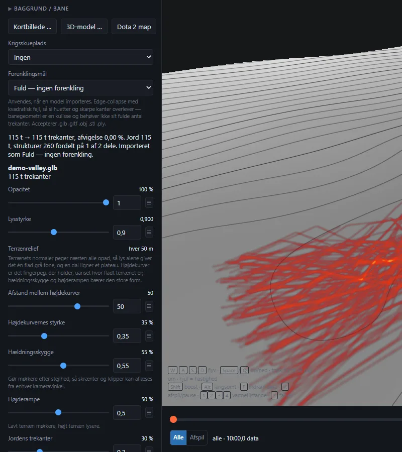

# Baner og baggrundsgeometri

En bane er det 3D-sted, spillet foregik på - et kort, en by, en bane. Sætter du en bag dine data, kan du se, *hvor* varmen er. Panelet **Baggrund / bane** (se [Ordliste](glossary.md) for "bane") giver dig tre slags kontekst:

- et **kortbillede**, georefereret med to ankre - se [Kortbilleder](map-images.md);
- en **3D-bane** - `.glb`, `.gltf`, `.obj`, `.stl` eller `.ply` - delt i jord, konstruktioner og vand og forenklet ved import - se [3D-baner](model-levels.md) og [Banens udseende](level-appearance.md).
- en **verdensbaggrund** - for en optagelse, der siger, hvor på jorden den er (en Tacview ACMI-fil): det virkelige terræn, veje, vand, flyvepladser og bygninger, hentet fra åbne data - se [Verdensbaggrund](world-backdrop.md).

Uden noget indlæst er scenen mørk med et gitter og farvede akser (**Gitter** og **Akser** i [Kamera og scene](camera.md)), og panelet siger *Intet indlæst - scenen viser et gitter og akser. Tilføj et kortbillede eller en banemesh for at give varmen kontekst.*

Banen deles af alle tre faner: et forløb indlæst på fanen Løbsanalyse er den samme bane, varmekortet viser.

## Læg en bane bag dine data {#put-a-level-behind-your-data}

1. Indlæs dine data først ([Hent data ind](getting-data-in.md)), så banen tilpasses dem.
2. Åbn **Baggrund / bane** i sidepanelet.
3. Tryk på **Kortbillede …** for et billede eller **3D-model …** for en 3D-bane, og vælg filen. For en optagelse fra den virkelige verden bruger du i stedet **Virkelig verden som baggrund** eller **Krigsskueplads**.
4. Vent, til fremskridtslinjen er færdig. En stor model forenkles først (se **Forenklingsmål** nedenfor).
5. Tryk på **F** i visningen for at indramme alt. Brug **Opacitet** og **Lysstyrke**, til varmen træder frem fra banen.
6. Tryk på **Gem i biblioteket**, hvis du vil bruge banen igen ([Banebiblioteket](level-library.md)).

## Hvad en bane gør for varmen {#what-a-level-does-for-the-heat}

- Den **skjuler**: datapunkter bag den dæmpes pr. flade, og datapunkter bag terrænet skjules ([Dybde og culling](depth-and-culling.md)). Uden bane er der ingen skjulning.
- Den **skæres** af [Udsnittet](slice.md) og, med *Skær også banen*, af [afstandsafskæring](depth-and-culling.md#distance-culling), sammen med varmen.
- Den er det eneste, [dybdeskarphed](camera.md#depth-of-field) slører ud over gitteret og boksene.
- En 3D-bane **udvider kameraets fjerne plan**, når den er større end dataene: nær og fjern kalibreres ud fra datasættet, og et eksporteret kort flere kilometer på tværs ville ellers ligge helt bag det fjerne plan og efterlade en tom visning. Det fjerne plan bliver 3 × banens vandrette udstrækning, når den er større, det nære plan flytter sig med (mindst fjern / 100.000) for at bevare den dybdepræcision, dækningen afhænger af, og flyvehastigheden hæves til mindst udstrækning / 12. Den udvides kun, aldrig indsnævres.

## Panelet, oppefra og ned {#the-panel-top-to-bottom}

| Del | Detaljer |
|---|---|
| **Kortbillede …**, **3D-model …** | Indlæs en; den erstatter den nuværende bane. |
| **Virkelig verden som baggrund**, **Glem kortfliser** | Kun for et datasæt med en geografisk reference: byg det virkelige sted under det som bane, eller slet de hentede fliser. [Verdensbaggrund](world-backdrop.md) |
| **Forenklingsmål** | Trekantbudgettet for næste modelimport: *Fuld - ingen forenkling* (standard), *Høj - 8M*, *Middel - 3M*, *Lav - 800k*, *Silhuet - 100k*. [3D-baner](model-levels.md#simplification) |
| Fremskridt og **Annullér** | Under afkodning eller import. |
| Importnote | Trekanter før og efter, delingen i jord / konstruktioner / vand, det anvendte detaljeniveau. |
| Navn og størrelse | `bredde×højde px · x × z m/px` for et billede, `N trekanter (fra M)` for en model. |
| **Opacitet**, **Lysstyrke** | Begge slags. |
| Billedindstillinger | **Afmæt**, **Vend nord/syd**, **Placering** (to ankre), **Tilpas til dataenes grænser**, **Højde**. [Kortbilleder](map-images.md) |
| Modelindstillinger | Terrænrelief, vand, jordens trekanter, wireframe, tekstur, optaget farve, konstruktioner, delklassifikation. [Banens udseende](level-appearance.md) |
| **Gem i biblioteket**, **Fjern** | [Banebiblioteket](level-library.md); Fjern tager banen ud. |
| **Bibliotek** | Baner gemt i denne browser. [Banebiblioteket](level-library.md) |

## Sider i dette afsnit {#pages-in-this-section}

- [Kortbilleder](map-images.md)
- [3D-baner](model-levels.md) - formater, dele, klassifikation, forenkling, teksturer
- [Banens udseende](level-appearance.md) - alle indstillinger for en 3D-bane
- [Banebiblioteket](level-library.md)
- [Verdensbaggrund](world-backdrop.md) - den virkelige verden under en optagelse, fra åbne data

Hvordan man får baner ud af spil og motorer, er de separate eksportværktøjers opgave (se repositoriets [README](https://github.com/Holdi601/3DHeat/blob/main/README.md)); kontrakten, de skriver til, er opsummeret i [3D-baner](model-levels.md#the-exporter-contract).
