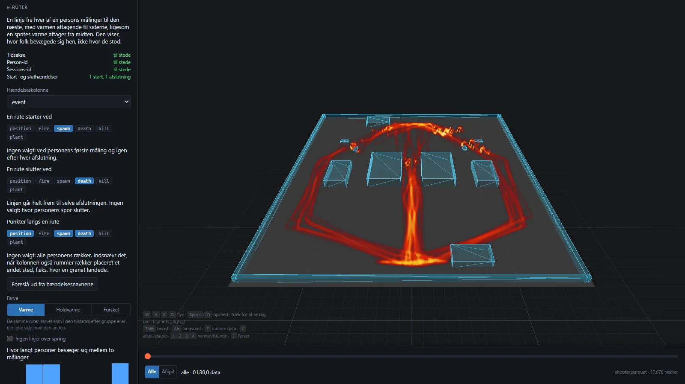

# Linje-varme

Varme viser, hvor folk stod. Linjer viser de veje, de gik.

**Linjer** (tast 4) er linje-varme: en linje fra hver af en [persons](glossary.md) prøver til deres næste, udsmurt med det samme fald, som en [sprite](glossary.md) har - tværs over linjen i stedet for rundt om et punkt. Den viser, hvor folk *gik hen*, frem for hvor de stod: en gang, der er løbet igennem én gang, er lige så synlig som et rum, man har slået sig ned i, og en hurtig spillers glisne prøver går sammen til en sammenhængende rute i stedet for et prikket spor. Den kræver en personkolonne og en tidskolonne.

## Sådan bruges den {#how-to-use-it}

1. Tryk på `4` (eller vælg **Linjer** i tilstandslinjen).
2. Åbn **Ruter** og tjek den grønne tjekliste: tidsakse og person-id skal være til stede.
3. Tryk på **Foreslå ud fra hændelsesnavnene** for at udfylde, hvor ruterne starter og slutter.
4. Læs statistiklinjen: "N ruter, M af dem når en ende".
5. Hvis linjer springer hen over kortet, så juster **Længste skridt** (se [Spring-grænsen](#the-jump-limit)).

En linje giver kun mening mellem en begyndelse og en ende, så panelet **Ruter** siger, hvad der afgrænser en rute. Alt fra [En rutes regler](#the-rules-of-a-route) og frem er detaljer, du kan springe over.

## Panelet Ruter {#the-routes-panel}

Vises over varmepanelerne i Linje-tilstand.

### Hvad dataene har {#what-the-data-has}

En tjekliste, grøn når noget er til stede, gul når det ikke er:

| Linje | Tilstande |
|---|---|
| **Tidsakse** | *til stede* / *mangler - nødvendig* |
| **Person-id** | *til stede* / *mangler - nødvendig* |
| **Sessions-id** | *til stede* / *ingen - alle rækker er én session* |
| **Start- og sluthændelser** | *N starter, M slutninger* / *ingen valgt - hele spor* (grøn kun med en hændelseskolonne og mindst én start og én slutning) |

### Styring {#controls}

| Styring | Betydning |
|---|---|
| **Hændelseskolonne** | En kategorikolonne, hvis værdier er hændelser (fremkomst, død, position ...). *Ingen - hele spor*: hver persons spor i hver session er én rute, brudt der, hvor sporet har et hul. Kun kolonner, der beholdes til filtrering ved indlæsning, tilbydes. |
| **En rute starter ved** | Hændelsesværdier, der begynder en rute (fremkomst, genopstandelse, udsætning). Ingen valgt: en rute starter ved en persons første prøve og igen efter hver ende. |
| **En rute slutter ved** | Hændelsesværdier, der afslutter en rute (død, udtrækning, teleportering). Linjen går op til selve slutrækken. Ingen valgt: en rute slutter, hvor personens spor slutter. |
| **Punkter langs en rute** | Hændelsesværdier, hvis rækker ligger langs ruten. Ingen valgt: hver række for personen. Indsnævr det, når kolonnen også har rækker placeret andre steder, som hvor en granat landede. |
| **Foreslå ud fra hændelsesnavnene** | Udfylder de tre lister ud fra værdiernes navne (nedenfor). |
| **Farve** | *Varme*, *Holdvarme* eller *Forskel*. De samme ruter i den farvning, den tilstand har: hver gruppe i sin egen nuance, eller den ene side mod den anden, med gruppelisten, delingen og skalaerne, der virker som i disse tilstande. Standard *Varme*. Holdvarme og forskel kræver en gruppekolonne. |
| **Ingen linjer over spring** / **Længste skridt** | En persons næste prøve længere væk end dette er en genopstandelse, en teleportering eller et fald frem for et sted, de gik hen, så ingen linje forbinder de to. Udfyldes ved indlæsning, når dataene viser et tydeligt hul (nedenfor), og er fra, når det ikke gør. Virker med eller uden en hændelseskolonne. |
| Statistiklinje | `N ruter, M af dem når en ende, K segmenter`, opdateret et par gange i sekundet. |

Hver liste er en række af til/fra-brikker, én pr. værdi, hyppigste først; når du holder musen over en brik, vises dens antal rækker. Højst 120 værdier tilbydes (*N flere værdier ikke vist*).

Hvis man vælger en anden hændelseskolonne, anvendes forslaget, når forslaget vælger netop den kolonne, og ellers starter listerne tomme.

### Forslaget {#the-suggestion}

Ved hver indlæsning og ved **Foreslå ud fra hændelsesnavnene** ([`suggestLineSettings`](https://github.com/Holdi601/3DHeat/blob/main/src/data/lines.ts)):

- **Hændelseskolonne:** den første beholdte kategorikolonne ved navn `event`, `eventname` eller `eventtype`; ellers `kind`, `type` eller `action`; ellers en hvilken som helst med *event*, *kind*, *action* eller *type* i navnet.
- **Starter:** værdier, der indeholder *spawn, deploy, join, enter, start, begin, respawn, revive, land/landed/landing, drop* - medmindre de også passer med et slutord.
- **Slutninger:** værdier, der indeholder *death, died, dead, kill/killed, eliminat…, extract, evac, teleport, leave, left, disconnect, quit, exit, end, finish, downed* - undtagen værdierne `kill` og `kills` (et drab er noget, dræberen gør, ikke enden på deres rute).
- **Punkter:** værdier, der præcist er *position, location, player location, move, movement, tick, sample* eller *pos*; når nogen findes, lægges starter og slutninger også til punkterne. Når ingen findes, forbliver punkterne tomme (hver række).

### Spring-grænsen {#the-jump-limit}

Hvor folk springer, falder længderne af skridtene i to grupper med næsten intet imellem: hvad en person dækker mellem to prøver, og kortets bredde. Ved indlæsning ([`suggestMaxJump`](https://github.com/Holdi601/3DHeat/blob/main/src/data/lines.ts)) tælles skridtene pr. fordobling af deres kvadrerede længde, op til 16 millioner af dem, og grænsen lægges midt i det første interval over medianen, der er mindst én fordobling af længde bredt, holder under 0,02 % af skridtene pr. interval, og har skridt ud over sig. Uden et sådant interval skæres intet, da man ikke kan skelne et spring fra en hurtig bil; at slå grænsen til selv starter så ved en tiendedel af dataenes diagonal.

Diagrammet over grænsen viser, hvor lange skridtene virkelig er, med en linje ved grænsen: bjælkerne til højre for den tegnes ikke. Begge akser er logaritmiske, fordi springene kan være en hundredel af skridtene og tusind gange så lange. Hold musen over en bjælke for dens interval og andel; klik på diagrammet for at sætte grænsen der. Under det vises andelen af skridt over grænsen.

## En rutes regler {#the-rules-of-a-route}

Rækker gennemløbes i tidsorden, pr. person ([`buildLines`](https://github.com/Holdi601/3DHeat/blob/main/src/data/lines.ts)):

1. Rækker med et [delt navn](sessions-persons-groups.md#names-worn-by-several-things-at-once) springes helt over.
2. Med punkter valgt springes en række over, der hverken er en start, en ende eller et punkt.
3. Rækker følges pr. person pr. session, så en person, hvis sessioner flettes sammen i tidsorden, har én rute i hver. En rute lukkes, når den forrige række ikke havde nogen efterfølger (dens [levetid](sessions-persons-groups.md#person) er "ingen") - en rute krydser aldrig en sessionsgrænse eller et hul, indlæsningen har besluttet ikke har en næste prøve. Hvilken rute en række er på, regnes ud én gang og gemmes, 4 bytes pr. række, så en ændring af længste skridt ikke gentager den del.
4. En **start**-række lukker enhver åben rute og åbner en ny der.
5. Med starter valgt ignoreres en række uden for en rute. Uden starter åbner enhver ikke-ende-række uden for en rute en.
6. Enhver anden række inde i en rute tilføjer et **segment** fra ruten's forrige række til denne.
7. En **ende**-række, der forlænger en rute, lukker den efter sit segment; den rute tæller som *når en ende*.
8. Et skridt længere end **Længste skridt** lukker ruten, hvor den var, og en ny starter i den fjerne ende, medmindre den række er en ende. Der tegnes ingen linje hen over det, og statistiklinjen tæller det.

Hvert segment gemmes på sin *ende*-række, så segmenterne forbliver i tidsorden, og [tidslinjens](timeline.md) vindue, samplingen, [filtrene](filters.md), gruppesynligheden og forskelsfortegnet virker på dem som på punkter. Et filter gælder derfor for den række, et segment ender på.

## Afspilning {#playback}

I tilstanden **Alle** tegnes hver rute hel. I tilstanden **Afspil** er hver person et punkt, der bevæger sig mellem deres prøver og tegner deres rute bag dem:

- et segment, der starter efter afspilningshovedet, tegnes ikke;
- segmentet, personen er midt i, tegnes op til deres interpolerede position, med en endekappe ved hovedet;
- varmen toner ud over **halen**: med historikken *Kumulativ* er halen ubegrænset, og hele ruten indtil nu bliver; med *Vindue* toner den ud til intet over *Spændet* (standard 30 s). Med *Levetid* er halen også *Spændet*, og i Linje-tilstand viser tidslinjen *Spændet*-boksen for den historik også (i stedet for *Reservelevetid* og *Udtoning*, som linje-varme ikke bruger).

Under afspilning tegnes hvert billede helt i stedet for akkumuleret, fordi hovederne bevæger sig hvert billede, og et glidende gennemsnit ville udsmøre hver til en stribe.

## Til udviklere {#for-developers}

### Hukommelse {#memory}

Ruterne bygges på hovedtråden, når Linje-tilstanden åbnes (eller ruteindstillingerne ændres), og frigives, når den forlades: 5 bytes pr. række i hukommelsen og 8 bytes pr. række på GPU'en (hvert segments startposition, kvantiseret til 16 bit pr. akse inden for dataenes afgrænsningsboks, og dets flag).

### Sådan tegnes en linje {#how-a-line-is-drawn}

Begge backends tegner hvert segment fra dets ende-række som **18 hjørnepunkter** ([`lineHeatVs`](https://github.com/Holdi601/3DHeat/blob/main/src/render/webgl2/shaders.ts) og dens WGSL-tvilling):

- Halvbredden i hver ende er [sprite-radius](sprite-shape.md#sprite-radius) ved den endes afstand, med pixel-grænserne anvendt. En linje smallere end 2,5 px tegnes 2,5 px bred med sin varme skaleret ned til at passe, så tynde linjer hverken forsvinder eller lysner.
- Varmen falder **tværs over** linjen med samme skala som en sprite - fald eller kurve, centrums- og kantintensitet.
- Runde kapper tegnes **kun** der, hvor en rute begynder eller slutter, så samlingerne mellem på hinanden følgende segmenter ikke bliver til en perlekæde.
- Geometrien bygges i skærmrum og interpoleres lineært der, så faldet forbliver centreret på linjen, uanset hvordan den løber ind i dybden. Et segment, der krydser nærplanet, skæres der i stedet for at droppes.

Punkt-varme og linje-varme lægger meget forskellige mængder varme pr. række, så mætningen måles igen, når du skifter mellem dem ([Farve og eksponering](colour-and-exposure.md#auto-exposure)).
