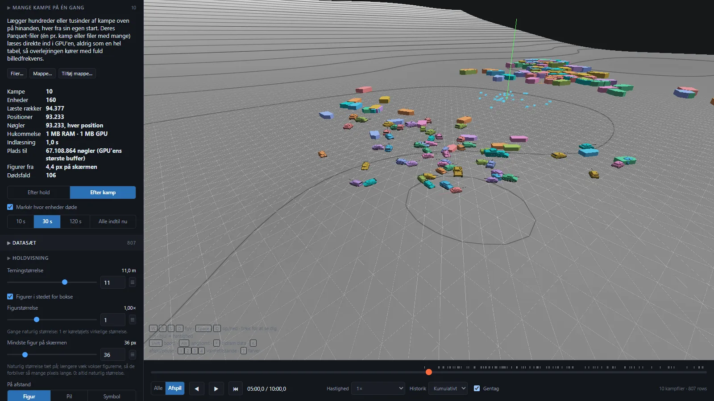

# Mange kampe på én gang

**Mange kampe på én gang** afspiller mange kampe oven på hinanden, så du kan se, hvor hver kamps spillere normalt går. Brug den til at sammenligne hundredvis eller tusindvis af kampe i ét billede.

Hver kamp starter ved sin egen begyndelse, og dens enheder bevæger sig som figurer. Filerne går direkte ind i grafikkortet, og der bygges ingen fuld tabel. Derfor afspilles den jævnt der, hvor en normal indlæsning ville løbe tør for hukommelse.

## Sådan bruges den {#how-to-use-it}

1. Åbn **Mange kampe på én gang** i varmesidebaren.
2. Tryk på **Filer …** (vælg mange filer), **Mappe …** (en mappe og dens undermapper) eller **Tilføj mappe …** (føj til det, der er indlæst).
3. Fremviseren skifter til figuroverlejringen og starter fra begyndelsen. Tryk på **Afspil**.

Hver fil er én kamp (eller rummer flere). Parquet-filer og [`.3dheat`](container.md)-containere virker. En fil skal have en positions-, en tids- og en enhedskolonne. Navne-, type- og sidekolonner beholdes. Andre filer og sidefilerne fra konvertere (flyvning, beskeder, hændelser, chat, mål) springes over. For en almindelig tabel, se [Indlæs data](getting-data-in.md).

## Indstillinger {#settings}

| Indstilling | Hvad den gør |
|---|---|
| **Efter hold** / **Efter kamp** | Farve efter side, eller en farve pr. kamp. |
| **Markér hvor enheder døde** | En markering, hvor hver enhed døde, i 10 s, 30 s, 120 s eller alt indtil nu. |

Panelet viser, hvor mange kampe, enheder, rækker og positioner der blev læst, den brugte hukommelse og indlæsningstiden. *Plads til* er, hvor mange flere positioner grafikkortet stadig kunne tage. *Figurer fra* er den størrelse på skærmen, under hvilken en enhed tegnes som en lille pil i stedet for sin figur.

Figurernes udseende bruger de samme styringer som [kamp-replayet](match-replay.md#figures): **Figurstørrelse**, **Mindste figur på skærmen** og **På afstand**.

## Tips {#tips}

- Når alt ikke ville passe i hukommelsen, tyndes positionerne ud (kun en position hver få meter beholdes), og panelet siger det.
- Varmetilstandene virker også på overlejringens data.
- Til statistik over tusindvis af kampe uden at tegne dem, se [Massanalyse](mass-analysis.md).
