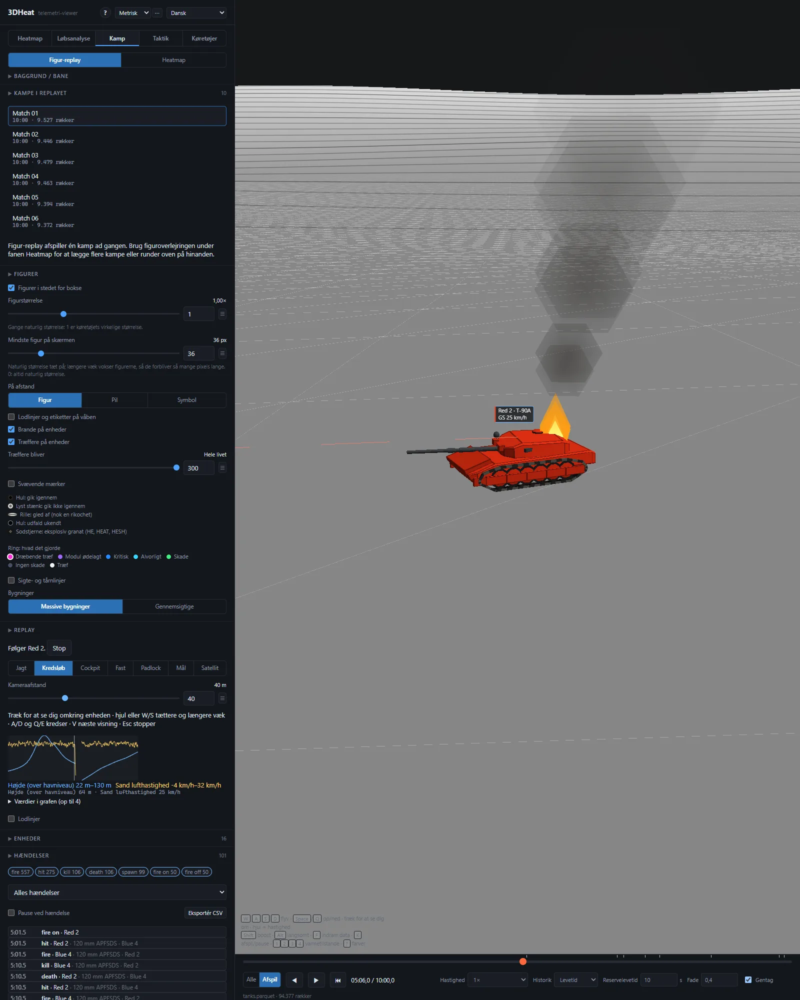
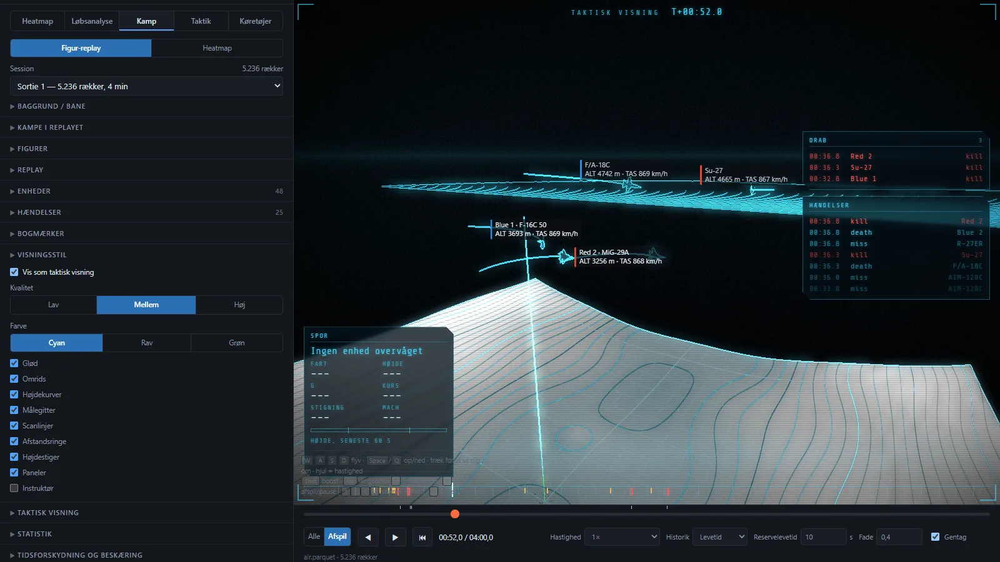

# Kamp-replay

Replayet er en film af kampen, hvor hver spiller tegnes som det, vedkommende kørte. Brug det til at se et slag igen, følge én enhed og se, hvem der ramte hvem.

Skud, træffere, brande og vrag tegnes på enhederne og målene på banen. Kameraer, etiketter og en taktisk visning hjælper dig med at læse slaget. Kender du Tacview? [Tacview-paritet](tacview-parity.md) viser, hvor hvert af dets værktøjer findes.

## Start et replay {#start-a-replay}

1. Indlæs en optagelse med **Kilde → Filer …** eller ved at slippe den på panelet Kilde (enhver tabel med en **person**- og en **tid**-kolonne, en Tacview-fil, et konverteret replay, en [`.3dheat`](container.md)-kamp). Se [Indlæs data](getting-data-in.md).
2. Åbn fanen **Kamp**, og vælg **Figur-replay**, eller vælg **Figuroverlejring** i tilstandslinjen i Heatmap-fanen.
3. Under **Kampe i replayet** vælger du én kamp, alle på én gang, eller flere.
4. Tryk på **Afspil** på tidslinjen (eller `K`). Træk i tidslinjen for at springe.

Figurer erstatter bokse for hver enhed, hvis navn eller type er kendt (se [Figurer](figures.md)). Data uden navne- eller typekolonne tegnes som soldater.

## Figurer {#figures}

| Indstilling (afsnittet **Figurer**) | Standard | Hvad den gør |
|---|---|---|
| **Figurer i stedet for bokse** | til | Fra tegner almindelige bokse. |
| **Figurstørrelse** (gange rigtig størrelse) | 1 | 1 er rigtig størrelse; 0,25 til 20 gange (logaritmisk skala). Større hjælper på afstand. |
| **Mindste figur på skærmen** | 36 px | Figurer langt væk vokser, så de forbliver så store, 0 til 200 px; 0 beholder den rigtige størrelse. |
| **På afstand**: Figur, Pil, Symbol | Figur | Hvad en enhed langt væk bliver til. |
| **Symboler** | NATO (APP-6) | NATO (APP-6), russiske taktiske tegn, ikoner i **Spilkort**-stil, eller **Kun former (farveblind-sikker)**. |
| **Symbolstørrelse**, **Min side**, **Fjendtlig / Neutral**, **Kursstreger** | 28 px (12 til 64), automatisk, fjendtlig, til | Hvordan symbolerne ser ud, og hvilken side der er venlig. |
| **Lodlinjer** | til | En linje fra hver enhed lige ned til jorden, så højder kan aflæses i 3D. |
| **Lodlinjer og etiketter på våben** | fra | Linjer til jorden og etiketter på missiler og bomber. |
| **Brande på enheder** | til | Flammer fra det øjeblik, en enhed står i brand, til den slukkes. |
| **Træffere på enheder** | til | Mærker, hvor skud ramte (nedenfor). **Træffere bliver**: 1 til 300 sekunder, eller **Hele livet**. **Svævende mærker**: mærker tegnet over overfladen. |
| **Sigte- og tårnlinjer** | fra | Stiplet: hvor spilleren kigger; massiv: hvor kanonen peger. |
| **Bygninger** | massiv | Massive eller gennemsigtige bygninger, når banen tegner dem. |

### Symboler på afstand {#symbols-at-a-distance}

Når en enhed ville være mindre end **Mindste figur på skærmen**, kan den blive til et symbol, der forbliver læseligt. Formen fortæller typen (for eksempel en afrundet boks med et beltemærke for panser); farven fortæller siden. Åbn menuen **Symboler** for at ændre stilen.

### Træfmærker, vrag og brande {#hit-marks-wrecks-and-fires}

- **Træfmærker** sidder på den overflade, skuddet mødte, i figurens skala. Deres udseende fortæller, hvad der skete: et hul (gik igennem), en lys stænk (gik ikke igennem), en rift (gled af) eller en sodstjerne (eksplosiv ammunition). En farvet ring siger, hvad det gjorde: dræbende skud, modul ødelagt, kritisk, alvorlig, skade, ingen skade, træf. Hold musen over et mærke for runde-navnet.
- En ødelagt enhed tegnes **forkullet** som et vrag fra sin død, indtil den genopstår eller fjernes; dens symbol er overstreget.
- **Brande** brænder på en enhed fra det øjeblik, den står i brand, til den slukkes.
- **Tårne** drejer hen dertil, hvor dataene siger, at kanonen peger (eller, uden det, hvor spilleren kigger).

### Våben, lokkemidler og sporstoffer {#weapons-decoys-and-tracers}

Med **Våben, skud og træffere** slået til (afsnittet Holdvisning): flyver missiler, raketter, bomber og torpedoer som deres egne figurer med et røgspor; kugler og granater er sporstoffer; nedslag og eksplosioner blinker. Et sporstof tegnet **stiplet** er regnet ud fra en træf, fordi dataene ikke havde noget skud. Flares og chaff tegnes som lokkemidler; de skjules på enhedslisten, medmindre *Lokkemidler og granater* er markeret.

## Kameraer {#cameras}

Klik på en enhed eller dens etiket for at **følge** den; afsnittet **Replay** tilbyder **Jagt**, **Kredsløb**, **Cockpit** (med et head-up-display, `H`), **Fast**, **Padlock**, **Mål** og **Satellit**. `V` skifter mellem dem, **Kameraafstand** sætter hvor langt væk. Esc stopper.

- **Visning af to enheder**: vælg et **Mål** (eller Ctrl/Alt-klik på en enhed) for at se den fra den, der følges; **Byt** bytter dem.
- **Mål**: Shift-klik på to enheder for pejling, afstand og højdeforskel mellem dem.
- **2D-kort** (`M`): hjørne- eller fuld visning, med spor og navne.
- **Bogmærker** (`B`): gem øjeblikket og kameraet; optagelsens egne drab, dødsfald og mærker vises også i listen.
- **Hændelser**: hver hændelse i tidsrækkefølge; et klik springer dertil. `Page Up` / `Page Down` springer mellem hændelser; **Pause ved hændelse** stopper ved hver.

## Taktisk visning {#tactical-display}

Afsnittet **Taktisk visning** tegner, for ingen enhed, de valgte, alle eller én type (fly, land, skibe, våben): hastighedsvektorer og banen forude, næse- og løftelinjer, radarkegler, låsninger, datalinks, engagementszoner og -linjer, sigtelinjer, hvor spillerne kigger (synskegler), tårnsigte og det optagne kamera.

### Visningsstil {#display-style}

`T` (eller kontakten **Vis som taktisk visning**) skifter udseendet til en radarskærmsstil: glød, konturer, højdekurver, et målegitter, scanlinjer, afstandsringe, højdestiger, paneler med drab og hændelser og en **Instruktør**, der selv flytter kameraet til hændelser.

## Mål {#objectives}

Når en kamp følger med sine mål, tegner afsnittet **Mål** dem på banen: erobringszoner (med ejer og erobringsfremskridt), spawns, flyvepladser, områder og bombemål, hvert lag kan slås til og fra, med etiketter. De ses gennem jorden. Når flere spiltilstande er indlæst, filtrerer **Tilstand** kampene efter tilstand. Mål kommer fra en konverters kampfil ved siden af optagelsen eller inde i en [`.3dheat`](container.md)-beholder.

## Etiketter og statistik {#labels-and-statistics}

- **Etiketter**: regler pr. type (**Valgte**, **Fly**, **Land**, **Skibe**, **Våben**, **AI**): vist eller ej, hvilke værdier, og en **Prioritet** for, hvem der får pladsen, når etiketter overlapper. **Hold etiketterne adskilt** flytter en etiket ved siden af sin enhed, når den ville dække en anden, og udelader den, hvor der ikke er plads. **Etiketstørrelse** er 60 til 250 %. **Tilbage til navn, køretøj, højde og fart** nulstiller reglerne.
  - Landenheder starter med navn, køretøj og fart.
  - Fly starter med navn, køretøj, højde og fart.
  - Skibe starter med navn, køretøj, fart og kurs.
  - Hold musen over en enhed for at se alle dens værdier.
- **Statistik**: pr. hold og enhed: drab, dødsfald, skud, træffere, træfprocent, starter, landinger, tid i luften, topfart, højde og G, afstand. CSV-eksport.
- **Diagrammer**: en enheds værdier over tid, to enheder sammenlignet, eller én værdi mod en anden.

## Mange kampe på én gang {#many-matches-at-once}

For at lægge hundreder eller tusinder af kampe over hinanden, se [Mange kampe på én gang](many-matches.md). Detaljer om figurer (røg, ild og andre tidsbestemte effekter): [Figurer i figuroverlejringen](figure-replay.md). Liste over Tacview-funktioner: [Tacview-paritet](tacview-parity.md), en underside af denne.
