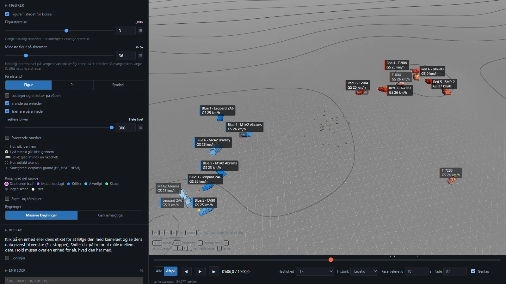
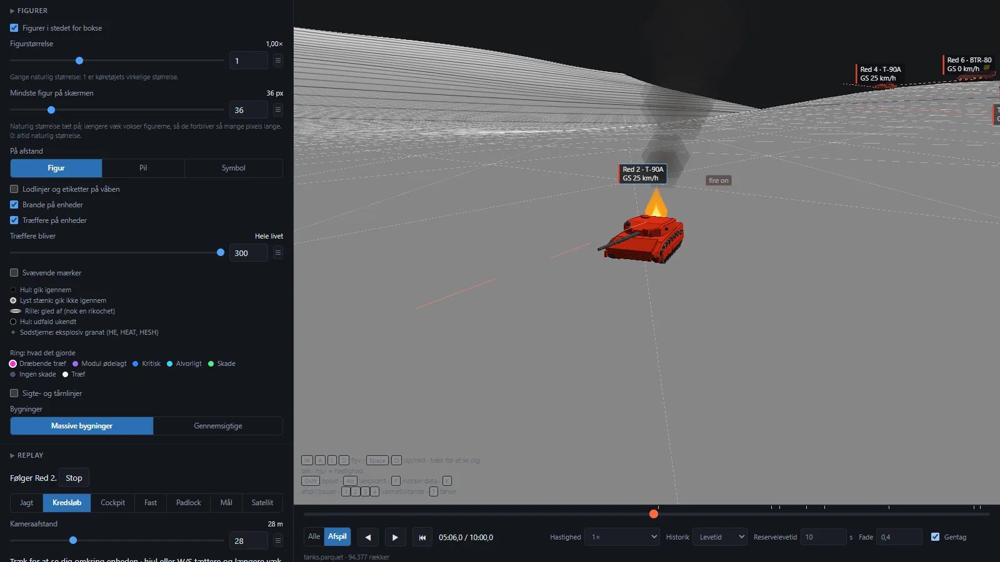
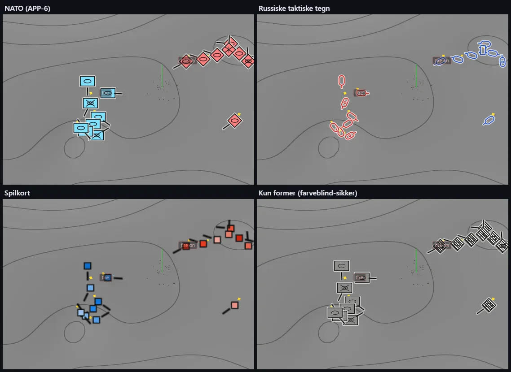
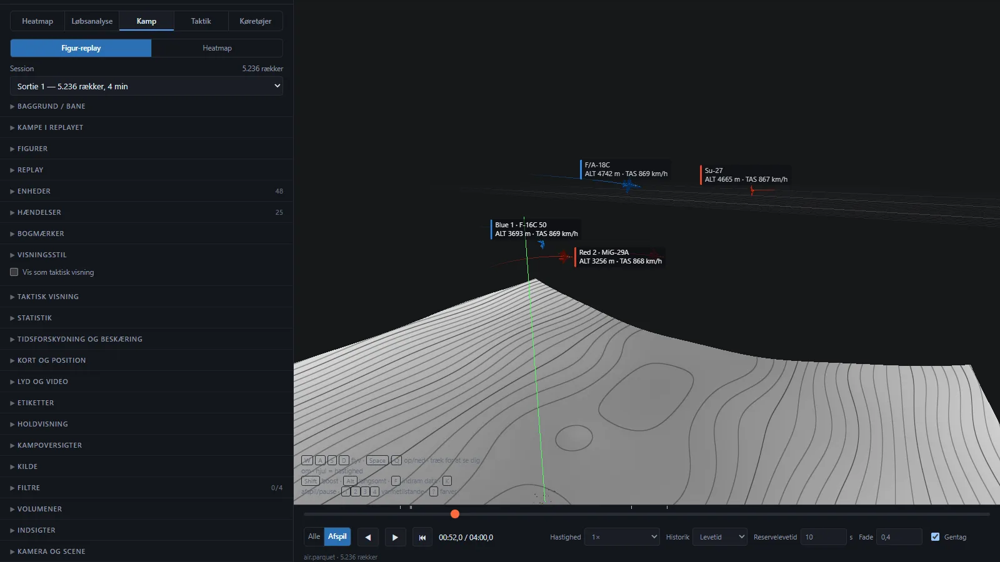

# Kamp-replay

Replayet er en film af kampen, hvor hver spiller er tegnet som det, de kørte. Brug den til at se et slagsmål igen, følge én enhed og se, hvem der ramte hvem.

Skud, træffere, brande og vrag tegnes på enhederne og målene på banen. Kameraer, etiketter og en taktisk visning hjælper dig med at læse slaget. Kender du Tacview? [Tacview-paritet](tacview-parity.md) viser, hvor hvert af dets værktøjer findes.

## Start et replay {#start-a-replay}

1. Indlæs en optagelse med **Kilde → Filer…** eller ved at trække den ind på kildepanelet (enhver tabel med en kolonne **person** og en kolonne **tid**, en Tacview-fil, et konverteret replay, en [`.3dheat`](container.md)-kamp). Se [Hent data ind](getting-data-in.md).
2. Åbn fanen **Kamp** og vælg **Figur-replay**, eller vælg **Figuroverlejring** i tilstandslinjen på fanen Varmekort.
3. Under **Kampe i replayet** vælger du én kamp, alle på én gang eller flere.
4. Tryk på **Afspil** på tidslinjen (eller `K`). Træk i tidslinjen for at springe.

Figurer erstatter bokse for hver enhed, hvis navn eller type er kendt (se [Figurer](figures.md)). Data uden kolonne for navn eller type tegnes som soldater.

## Figurer {#figures}

| Indstilling (afsnittet **Figurer**) | Standard | Hvad den gør |
|---|---|---|
| **Figurer i stedet for bokse** | til | Fra tegner almindelige bokse. |
| **Figurstørrelse** (gange rigtig størrelse) | 1 | 1 er rigtig størrelse; 0,25 til 20 gange (logaritmisk skala). Større hjælper på afstand. |
| **Mindste figur på skærmen** | 36 px | Figurer langt væk vokser, så de forbliver så store, 0 til 200 px; 0 beholder rigtig størrelse. |
| **På afstand**: Figur, Pil, Symbol | Figur | Hvad en enhed langt væk bliver til. |
| **Symboler** | NATO (APP-6) | NATO (APP-6), russiske taktiske tegn, ikoner fra **Spilkort**, eller **Kun former (farveblind-sikker)**. |
| **Symbolstørrelse**, **Min side**, **Fjendtlig / Neutral**, **Kursstreger** | 28 px (12 til 64), automatisk, fjendtlig, til | Hvordan symboler ser ud, og hvilken side der er venlig. |
| **Lodlinjer** | til | En linje fra hver enhed lige ned til jorden, så højder kan læses i 3D. |
| **Lodlinjer og etiketter på våben** | fra | Linjer til jorden og etiketter på missiler og bomber. |
| **Brande på enheder** | til | Flammer fra det øjeblik en enhed står i brand, til den er slukket. |
| **Træffere på enheder** | til | Mærker, hvor skud ramte (nedenfor). **Træffere bliver**: 1 til 300 sekunder, eller **Hele livet**. **Svævende mærker**: mærker tegnet over overfladen. |
| **Sigte- og tårnlinjer** | fra | Stiplet: hvor spilleren kigger; fuldt optrukket: hvor kanonen peger. |
| **Bygninger** | fuld | Faste eller gennemsigtige bygninger, når banen tegner dem. |

### Symboler på afstand {#symbols-at-a-distance}

Når en enhed ville være mindre end **Mindste figur på skærmen**, kan den blive til et symbol, der forbliver læseligt. Formen viser typen (for eksempel en afrundet boks med et beltemærke for panser); farven viser siden. Åbn menuen **Symboler** for at ændre stilen.

### Træfmærker, vrag og brande {#hit-marks-wrecks-and-fires}

- **Træfmærker** sidder på den overflade, skuddet ramte, i figurens skala. Deres udseende viser, hvad der skete: et hul (gik igennem), et lyst stænk (gik ikke igennem), en rift (gled af) eller en sodstjerne (eksplosiv ammunition). En farvet ring viser, hvad det gjorde: dræbende skud, modul ødelagt, kritisk, alvorlig, skade, ingen skade, træffer. Hold musen over et mærke for ammunitionens navn.
- En ødelagt enhed tegnes **forkullet** som et vrag fra dens død, indtil den genopstår eller fjernes; dens symbol er overstreget.
- **Brande** brænder på en enhed fra det øjeblik, den står i brand, til den er slukket.
- **Tårne** drejer hen dér, dataene siger, at kanonen peger (eller, uden det, dér spilleren kigger).

### Våben, lokkemidler og sporskud {#weapons-decoys-and-tracers}

Med **Våben, skud og træffere** til (afsnittet Holdvisning): missiler, raketter, bomber og torpedoer flyver som deres egne figurer med en røgsti; kugler og granater er sporskud; nedslag og eksplosioner blinker. Et sporskud tegnet **stiplet** er regnet ud fra en træffer, fordi dataene ikke havde noget skud. Blus og chaff tegnes som lokkemidler; de er skjult på enhedslisten, medmindre *Lokkemidler og granater* er markeret.

## Kameraer {#cameras}

Klik på en enhed eller dens etiket for at **følge** den. Afsnittet **Replay** tilbyder **Jagt**, **Kredsløb**, **Cockpit** (med en head-up-visning, `H`), **Fast**, **Padlock**, **Mål** og **Satellit**. `V` skifter mellem dem, og **Kameraafstand** sætter, hvor langt væk. Esc stopper.

- **Visning af to enheder**: vælg et **Mål** (eller Ctrl/Alt-klik på en enhed) for at se på den fra den, du følger; **Byt** bytter dem om.
- **Mål**: Shift-klik på to enheder for pejling, afstand og højdeforskel mellem dem.
- **2D-kort** (`M`): hjørnevisning eller fuld visning, med stier og navne.
- **Bogmærker** (`B`): gem øjeblikket og kameraet; optagelsens egne drab, dødsfald og markeringer vises også.
- **Hændelser**: alle hændelser i tidsrækkefølge; et klik springer derhen. `Page Up` / `Page Down` springer mellem hændelser; **Pause ved hændelse** stopper ved hver.

## Taktisk visning {#tactical-display}

Afsnittet **Taktisk visning** tegner for ingen enhed, de valgte, alle eller én type (fly, land, skibe, våben): hastighedsvektorer og stien frem, næse- og løftelinjer, radarkegler, låsninger, datalinks, engagementszoner og -linjer, synslinjer, hvor spillerne kigger (synskegler), tårnsigte og det optagede kamera.

### Visningsstil {#display-style}

`T` (eller kontakten **Vis som taktisk visning**) skifter udseendet til en radarskærm-stil: glød, konturer, højdekurver, et målenet, scanlinjer, afstandsringe, højdestiger, paneler med drab og hændelser og en **Instruktør**, der selv flytter kameraet til hændelser.

## Mål {#objectives}

Når en kamp kommer med sine mål, tegner afsnittet **Mål** dem på banen: erobringszoner (med ejer og erobringsfremskridt), spawnpunkter, flyvepladser, områder og bombemål, hvert lag kan tændes og slukkes, med etiketter. De ses gennem jorden. Når flere spiltilstande er indlæst, filtrerer **Tilstand** kampene efter tilstand. Mål kommer fra en konverters kampfil ved siden af optagelsen eller inde i en [`.3dheat`](container.md)-beholder.

## Etiketter og statistik {#labels-and-statistics}

- **Etiketter**: regler pr. type (**Valgte**, **Fly**, **Land**, **Skibe**, **Våben**, **AI**): vist eller ej, hvilke værdier, og en **Prioritet** for, hvem der får pladsen, når etiketter overlapper. **Hold etiketterne adskilt** flytter en etiket ved siden af sin enhed, når den ville dække en anden, og udelader den, hvor der ikke er plads. **Etiketstørrelse** er 60 til 250 %. **Tilbage til navn, køretøj, højde og fart** nulstiller reglerne.
  - Landenheder starter med navn, køretøj og fart.
  - Fly starter med navn, køretøj, højde og fart.
  - Skibe starter med navn, køretøj, fart og kurs.
  - Hold musen over en enhed for at se alle dens værdier.
- **Statistik**: pr. hold og enhed: drab, dødsfald, skud, træffere, træfforhold, start, landinger, tid i luften, topfart, højde og G, afstand. CSV-eksport.
- **Diagrammer**: en enheds værdier over tid, to enheder sammenlignet, eller én værdi mod en anden.

## Mange kampe på én gang {#many-matches-at-once}

For at lægge hundreder eller tusinder af kampe over hinanden, se [Mange kampe på én gang](many-matches.md). Figurdetaljer (røg, ild og andre tidsbestemte effekter): [Figurer i figuroverlejringen](figure-replay.md). Liste over Tacview-funktioner: [Tacview-paritet](tacview-parity.md), en underside til denne.
