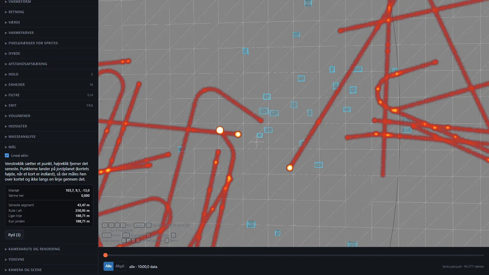

# Måling

**Mål** gør musen til en lineal og fortæller dig, hvor travlt stedet under markøren er. Brug den til at finde ud af, hvor langt to steder ligger fra hinanden, eller hvor meget trafik et sted har.

## Prøv det {#try-it}

1. Åbn **Mål** i sidebaren, og sæt kryds i **Lineal aktiv**.
2. Venstreklik tre steder på kortet. Hvert klik lægger et punkt.
3. Læs **Rute i alt** (længden af hele ruten) og **Seneste segment** (det sidste ben).
4. Højreklik for at fjerne det sidste punkt, eller tryk **Ryd (3)** for at fjerne alle.

| Handling | Virkning |
|---|---|
| Venstreklik | Lægger et punkt, hvor markøren møder jordplanet. Et klik, der flyttede sig mere end 4 pixel mellem tryk og slip, er et kameratræk og ikke et punkt. |
| Højreklik | Fjerner det sidste punkt. |
| Bevæg | Markørens position og varmen under den opdateres live. |

Kameraet virker stadig, mens linealen er tændt: at trække kigger stadig rundt, og taster flyver stadig. Mens linealen er tændt, tager den hvert klik. [Klik for at vælge](camera.md#click-to-pick) venter derfor, til den er slukket.

**Jordplanet** er [kortbilledets](map-images.md) højde, når et kortbillede er indlæst. Ellers er det datasættets laveste Y (0 uden et). Punkterne lander på det, så linealen måler hen over kortet og ikke langs en linje gennem det. Med en 3D-bane er planet stadig datasættets laveste Y og ikke banens overflade. For et punkt på den rigtige overflade slukkes linealen, og man klikker der ([klik for at vælge](camera.md#click-to-pick)). Det læser koordinaterne ud fra banens egne trekanter.

## Aflæsninger {#readouts}

| Linje | Betydning |
|---|---|
| **Markør** | Verdens X, Y, Z for punktet under markøren, på planet. |
| **Varme her** | Hvor meget varme der er ved markørens pixel. Et større tal betyder mere trafik på det sted. Det er værdien, farveskalaen får, før mætningspunktet deler den. Så kan du sammenligne den med [Mætningspunkt](colour-and-exposure.md#saturation-point). |
| **Seneste segment** | Afstand fra det sidste punkt til markøren (eller mellem de to sidste punkter). |
| **Rute i alt** | Længden af polylinjen gennem hvert punkt og markøren. |
| **Lige linje** | 3D-afstand fra det første punkt til markøren (eller til det sidste punkt). |
| **Kun jorden** | Det samme, kun på X og Z. |
| **Ryd (N)** | Fjerner alle punkter. |

Afstande vises i centimeter under 1 enhed, i meter under 1.000 og i kilometer over. Det antager, at én verdensenhed er en meter ([Akser, enheder og tid](axes-units-and-time.md#unit-scale)). Koordinater er verdenskoordinater, også når en akse er [vendt til visning](camera.md#invert-world-axis).

Punkterne og linjen mellem dem tegnes som et overlæg i visningen og tilpasses efter gitterafstanden. Linealens punkter gemmes ikke i visninger. De bliver, når du indlæser andre data.

## Til udviklere {#for-developers}

**Varme her** læses fra GPU'en højst hvert 120. ms, fordi en aflæsning af en enkelt pixel stopper pipelinen. Den bruger den samme sti som `engine.readHeatProbe()`: divideret med den forstærkning, billedet blev skrevet med. På akkumuleringsstien i halv præcision (`?heat=f16`) er den derfor i samme enheder som på et 32-bit-mål ([Akkumulering i halv præcision](half-float-accumulation.md)).
