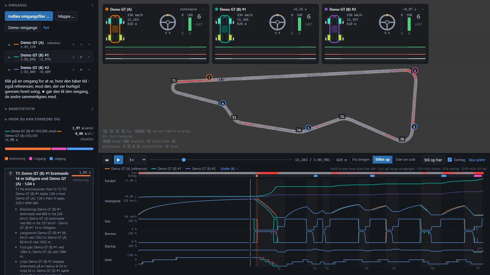

# Løbsanalyse

Du kørte den samme bane to gange. Fanen **Løbsanalyse** afspiller begge kørsler sammen i 3D, viser hvor den ene omgang var langsommere og fortæller dig hvorfor. Ingen omgange endnu? Tryk på **Demo-omgange**.

Fanen sammenligner to eller flere omgange af én bane. Den deler lærredet, kameraet og den indlæste banemodel (**Baggrund / bane**) med heatmappet; alt andet er sit eget: sit eget sidepanel og sin egen bjælke under visningen. Ord som *omgang*, *reference* og *toppunkt* står i [ordlisten](glossary.md).

Denne side er fanens kort. Hver del har sin egen side:

| Side | Hvad den dækker |
|---|---|
| [Indlæs omgange](race-loading-laps.md) | hvert filformat, mapper og baner, bilnavne, demo-omgange, omgangslisten, reference og fokus |
| [Replay og 3D-scenen](race-replay-and-scene.md) | transportbjælken, de tre replay-tilstande, opstilling af biler, jagtkameraet, linjer, kort, biler, etiketter, spejlede verdener |
| [Diagrammer og HUD](race-charts-and-hud.md) | afstandsdiagrammerne, grafvælgeren, hold musen og zoom, bilkortene, kanaltabellen |
| [Bilkontrol-hændelser](race-control-events.md) | blokeringer, hjulspin, oversturing, snurren, understuring, træf, styrt, ABS/TC, håndbremse, luft - hvordan hver findes, med hver tærskel |
| [Sving for sving-analyse](race-corner-analysis.md) | justering efter afstand, sving og segmenter, tidsregnskabet for et sving, hver årsag og rækkefølgen de prøves i, linjeformen og rådet |
| [Bilprofiler og sammenligning](race-car-profiles.md) | hvad hver bil kan, målt ud fra dens omgange; *Biler sammenlignet*; hvad bilen afgør i hvert sving |
| [Banestatistik](race-course-statistics.md) | mange omgange af én bane: fejl pr. sving og pr. type, fejlkortet, heatmap-eksporten, ydelsesgrænser |
| [Løbsanalyse: metoden](race-analytics.md) | forskningen bag reglerne, med kilder |
| [Andre racerspil](other-games.md) | hvad vieweren gør med omgange fra hvert spil: slip og drift regnet ud, hvor et spil ikke sender dem, spejlede verdener, de ekstra kanaler |

## Skærmen {#the-screen}

**Sidepanelet**, fra top til bund (afsnit kan foldes sammen):

1. **Omgange** - indlæs, liste, vis/skjul, reference, fokus, jagt.
   Se [Indlæs omgange](race-loading-laps.md).
2. **Banestatistik** - først fra tre indlæste omgange.
   Se [Banestatistik](race-course-statistics.md).
3. **Hvor du kan forbedre dig** - den fokuserede omgangs fund, sving for sving.
   Se [Sving for sving-analyse](race-corner-analysis.md).
4. **Sving for sving** (eller *Sving for sving - klasse X* med flere
   klasser) - den hurtigste omgang gennem hvert sving og dens linje. Vises med
   to eller flere omgange.
5. **Bilkontrol** - den fokuserede omgangs blokeringer, udglidninger, skub og træf.
   Se [Bilkontrol-hændelser](race-control-events.md).
6. **Biler sammenlignet** (eller **Bilen** med én bil) - se
   [Bilprofiler og sammenligning](race-car-profiles.md).
7. **Visning** - hvilket kort der males på banen, og hvad der tegnes.
   Se [Replay og 3D-scenen](race-replay-and-scene.md).
8. De delte paneler **Bane** og **Kamera og scene** (banemodel, akseinversion,
   kamera) - dokumenteret sammen med heatmappet og [Kamera](camera.md).

**Visningen** viser banen, de kørte linjer, kortet, bilerne, etiketter fastgjort
til banen og op til seks bilkort øverst til venstre (se
[Diagrammer og HUD](race-charts-and-hud.md)). Uden indlæste omgange står der
"Ingen omgange indlæst - slip to eller flere omgangsfiler her, eller indlæs
demo-omgangene fra sidepanelet."

**Bjælken under visningen** rummer replay-transporten og, medmindre den er skjult,
afstandsdiagrammerne.

## Hurtig start {#quick-start}

1. Åbn fanen **Løbsanalyse** (ved siden af **Heatmap** øverst i
   sidepanelet).
2. Få omgange ind. Tryk på **Demo-omgange** for at se, hvad fanen gør med tre
   opdigtede omgange. For dine egne omgange, optag dem først
   ([filformater og optagere](race-loading-laps.md#file-formats)), tryk derefter på
   **Indlæs omgangsfiler …** eller **Mappe …**, eller slip filer eller mapper på
   visningen.
3. Den hurtigste fulde omgang bliver referencen; den langsomste anden omgang
   sættes i fokus. Klik på en omgang i listen for at sætte den i fokus; ★ gør en
   omgang til referencen.
4. Læs **Hvor du kan forbedre dig**. Klik på et fund: bilerne stilles op 40 m
   før det, kameraet indrammer det, replayet spiller igennem det, og målingerne
   åbnes.
5. Hold musen over diagrammerne for at flytte hver bil til den meter; Shift+klik for
   at stille dem op der.

## Tastatur {#keyboard}

Mens fanen Løb er åben:

| Tast | Gør |
|---|---|
| **K** | afspil / pause replayet |
| **Home** | tilbage til replayets start |
| talltaster | intet (i heatmappet skifter de tilstand) |

Taster skrevet i et tekstfelt eller en rullemenu ignoreres. Kameratasterne virker
som i heatmappet (**W A S D**, **Mellemrum** op, **Q** ned, **Shift** hurtigere,
**Alt** langsommere, musen til at kigge; alt i [Kamera](camera.md)); **F** indrammer
de indlæste omgange (som indlæsning af omgange gør).

## Mange omgange {#many-laps}

- Alle indlæste omgange analyseres og tælles; snesevis tager et sekund eller to.
- Ud over **8** omgange (`SHOW_ALL_UP_TO`) tegnes tilføjede omgange kun, når de er
  referencen, den fokuserede omgang, eller den bedste omgang i den fokuserede omgangs
  klasse. *Vis alle* / *Kun dem, du kigger på* skifter.
- Ud over **10** synlige biler (`PLAIN_PAST`) tegnes de omgange, der ikke kigges på
  (ikke fokus, den forfulgte bil eller referencen) med linjer tyndet til et punkt
  hver 6 m i stedet for 1,5 m, og med almindelige biler.
- Diagrammerne tegner højst **8** omgange; HUD'et viser højst **6** kort.
- Banestatistikken vises fra **3** omgange.

Detaljer: [Banestatistik](race-course-statistics.md#performance-with-many-laps).

## Standard visningsindstillinger {#default-view-settings}

| Indstilling | Standard |
|---|---|
| Kort | Tidskort |
| Kørte linjer, Biler, Dæk og affjedring, Etiketter, Bane fra omgangene | til |
| Alle værdier på kortene | fra |
| Bilstørrelse | 1× |
| Diagrammer | vist |
| Replay-tilstand | Fra linjen |
| Replay-hastighed | 1× |
| Gentag | til |

Intet af dette gemmes; en genindlæsning starter fra standardindstillingerne. Det
browseren husker: sproget, og bilnavnene lært fra omgangsfiler (se
[Indlæs omgange](race-loading-laps.md#car-names)).

## Til udviklere {#for-developers}

### Hvad der sker, når omgange indlæses {#what-happens-when-laps-are-loaded}

Hver gang sættet af omgange, referencen eller sproget ændres, køres hele analysen igen
(`analyse` i [`src/race/analysis.ts`](https://github.com/Holdi601/3DHeat/blob/main/src/race/analysis.ts)):

1. Afledte kanaler tilføjes til hver omgang, hvor spillet ikke sender dem: driftvinkel,
   hjulslip ud fra hjulhastigheder, i luften, løst underlag, giringshastighed
   ([`derive.ts`](https://github.com/Holdi601/3DHeat/blob/main/src/race/derive.ts)).
2. Referencen vælges, og hver omgang projiceres på dens sti og gensamples hver 2 m
   ([`align.ts`](https://github.com/Holdi601/3DHeat/blob/main/src/race/align.ts)).
3. Det afgøres ud fra omgangene, om spillets verden er spejlet
   ([`handedness.ts`](https://github.com/Holdi601/3DHeat/blob/main/src/race/handedness.ts)).
4. Sving findes på referencen og grupperes i segmenter fra én bremsezone til den næste
   ([`segments.ts`](https://github.com/Holdi601/3DHeat/blob/main/src/race/segments.ts)).
5. Pr. bil: dens hylster (greb, bremsning, træk pr. fart), dens profil, dens dækkurver
   ([`envelope.ts`](https://github.com/Holdi601/3DHeat/blob/main/src/race/envelope.ts),
   [`profile.ts`](https://github.com/Holdi601/3DHeat/blob/main/src/race/profile.ts),
   [`control.ts`](https://github.com/Holdi601/3DHeat/blob/main/src/race/control.ts)).
6. Pr. omgang og segment: hvad den gjorde (bremsepunkt, langsomste punkt, fuld gas ...)
   og linjen den kørte ([`line.ts`](https://github.com/Holdi601/3DHeat/blob/main/src/race/line.ts)).
7. Pr. omgang: dens bilkontrol-hændelser, hver lagt op mod den omgang, den sammenlignes
   med der.
8. Pr. omgang og segment: tidsregnskabet mod dens sammenligningsomgang og fundet i ord.
9. Tidskortet og årsagskortet pr. omgang.

Teksterne produceres på det aktuelle sprog; et sprogskift kører analysen igen (og
omdøber demo-omgangene). En fejl i analysen vises under knapperne **Omgange** som en
fejl, og omgangene forbliver indlæst.

### Kildefiler {#source-files}

| Fil | Rolle |
|---|---|
| `src/race/adapters.ts`, `ibt.ts` | læsning af omgangsfiler |
| `src/race/lap.ts`, `carNames.ts`, `synthetic.ts` | omgangstypen, navngivning, demo-omgange |
| `src/race/derive.ts`, `handedness.ts` | afledte kanaler, spejlede verdener |
| `src/race/align.ts`, `segments.ts`, `line.ts` | afstandsakse, sving, linjer |
| `src/race/analysis.ts` | sammenlignede sving, årsager, fund |
| `src/race/envelope.ts`, `profile.ts` | hvad en bil kan |
| `src/race/control.ts`, `impacts.ts` | bilkontrol, træf og styrt |
| `src/race/stats.ts` | mange omgange |
| `src/race/replay.ts`, `scene.ts`, `glyph.ts`, `geometry.ts` | replay og tegning |
| `src/race/schema.ts`, `graphs.ts` | kanaltabellen, diagrammernes rækker |
| `src/ui/race/*` | sidepanelet, diagrammerne, HUD'et, etiketterne |
| `src/state/raceStore.ts` | fanens tilstand og replay-uret |
