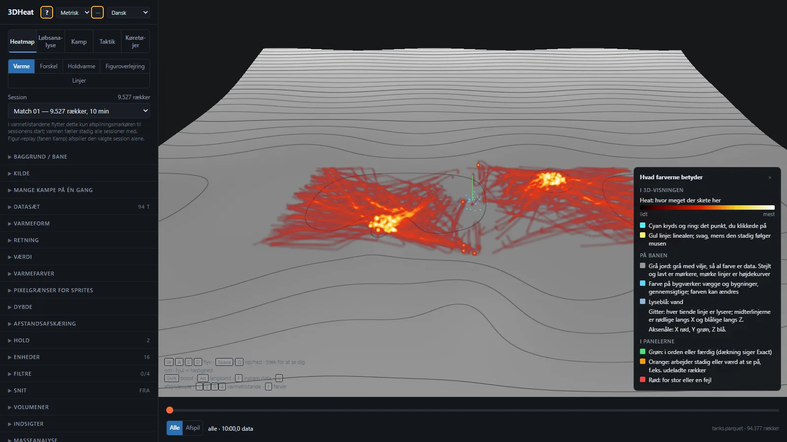

# Indstillinger, enheder og taster

De små styringer øverst i sidebjælken ændrer, hvordan vieweren taler til dig: sproget, enhederne (meter eller fod, km/t eller knob) og en hjælpetilstand, der forklarer farverne. Dine valg huskes i din browser.

## Headeren {#the-header}

Øverst i sidebjælken:

| Styring | Hvad den gør |
|---|---|
| **?** | Hjælpetilstand: hvad hver farve betyder (også `?` eller `F1`) |
| Menuen **Enheder** | Metrisk, Imperial, Luftfart eller Søfart |
| Knappen **...** ved siden af **Enheder** | Åbner "Vælg en enhed for hver størrelse": én rullemenu pr. størrelse |
| Menuen **Sprog** | Viewerens sprog: [40 sprog](languages.md), eller browserens |

Tal, du skriver i en boks, må bruge enten et punktum eller et komma (`0.35` eller `0,35`). Vieweren læser begge og viser tal, som viewerens sprog skriver dem.

## Enheder {#units}

1. Vælg en forudindstilling i menuen **Enheder**. Alle størrelser skifter sammen.
2. For kun at ændre én størrelse klikker du på knappen **...** ved siden af den og vælger en enhed for den størrelse. Menuen viser så et `*` efter forudindstillingen.
3. En størrelse, du ikke har sat, følger forudindstillingen. Vælg "Som forudindstilling" for at gå tilbage.

| Størrelse | Metrisk (standard) | Imperial | Luftfart | Søfart |
|---|---|---|---|---|
| Afstand | km | mi | NM | NM |
| Højde, længde | m | ft | ft | m |
| Fart | km/t | mph | kt | kt |
| Lodret fart | m/s | ft/min | ft/min | m/s |
| Temperatur | °C | °F | °C | °C |
| Tryk | hPa | inHg | hPa | hPa |
| Masse, brændstof | kg, l | lb, gal | lb, gal | t, m³ |
| Vinkel | grader | grader | grader | grader |

Andre enheder, du kan vælge for én størrelse: afstand km, mi, NM; fart km/t, m/s, kt, mph; lodret fart m/s, ft/min, m/min; temperatur °C, °F, K; tryk hPa, inHg, mmHg, psi; masse kg, lb, t; vinkel grader eller NATO-mil (6400 pr. cirkel). Enhederne er de samme overalt i vieweren: etiketter, kort, diagrammer, statistik.

## Hjælpetilstand {#help-mode}

Tryk på `?` eller `F1`, eller klik på knappen **?**. Den viser *Hvad farverne betyder*: forklaringer til 3D-visningen, varmerampene, holdfarverne, banens farver, panelernes statusfarver, kamppanelet og løbsvisningen. Den bliver, til du slår den fra. På fanen Kamp forklarer den også kamppanelets farver.

## Hvad browseren husker {#what-the-browser-remembers}

Disse indstillinger gemmes i din browser mellem besøg (intet sendes nogen steder hen):

- sproget, enhederne og hjælpetilstanden;
- replayets indstillinger for figurer, symboler, etiketter, kamera og taktisk visning;
- afspilningshastigheden og spejlvendingen;
- bogmærker pr. optagelse, volumener pr. datasæt, mållag;
- indstillingerne for ekstern AI (nøglen kun, hvis du sætter *Husk* kryds).

Varmeindstillinger, filtre og tilstanden starter forfra ved hver indlæsning. Den fulde, genererede liste: [Gemte indstillinger](ref-settings-storage.md).

## Taster, vieweren beholder fra browseren {#keys-the-viewer-keeps-from-the-browser}

En session med store data tager tid at indlæse, så vieweren forhindrer browseren i at smide den væk ved en fejl:

- `Ctrl`/`Cmd` + bogstaver, der ville udskrive, gemme, åbne, genindlæse, lukke eller åbne nye vinduer, gør ingenting uden for tekstbokse; `F1`, `F3`, `F5`, `F6` og `F7` gør ingenting.
- Lukning eller genindlæsning af fanen med data eller en bane indlæst spørger først.
- I fuld skærm låser vieweren de taster, den bruger (W, T, N, S, R, P, Q, Esc), så browseren ikke tager dem.

Den præcise liste: [Browsertaster](ref-browser-keys.md). Alle vieweren egne taster: [Reference for tastatur og mus](keyboard-reference.md).
