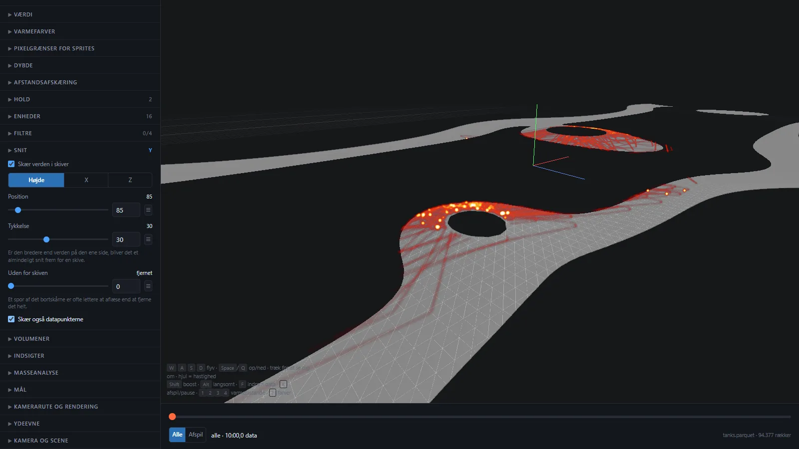

# Snit

**Snit** skærer verden over som en skive kage, så du kan se ind i bygninger. Brug det, når mure skjuler den interessante varme, fx for at se én etage i en bygning.

## Prøv det {#try-it}

1. Indlæs en bane og nogle data, og åbn **Snit**.
2. Sæt kryds i **Skær verden i skiver**. Aksen er **Højde**.
3. Træk **Position** op og ned. Skiven bevæger sig gennem banen.
4. Gør **Tykkelse** tynd til en plantegning, eller bred til "alt under her".
5. Hold **Uden for skiven** på 0 for at fjerne resten, eller hæv den for at beholde et svagt spor.



Skiven skærer **banens geometri og datapunkterne sammen**. Kun at skære banen ville lade varmen svæve, hvor bygningen var. Det er modstykket til [dybdeokklusion](depth-and-culling.md): når banen korrekt skjuler det, der er bag den, er bygningens indre også skjult. Panelet vises, når der er noget at skære i (et datasæt eller en 3D-bane). Dets overskrift viser aksen, når den er til, og *fra*, når den ikke er.

```
sidevisning       Position = hvor skiven er
 ----------       Tykkelse = hvor høj skiven er
 | etage 3 |
 |=========|  <--- skive (beholdes)
 | etage 2 |  <--- uden for: fjernet (eller svag)
 | etage 1 |
 ----------
```

## Styring {#controls}

| Styring | Standard | Betydning |
|---|---|---|
| **Skær verden i skiver** | fra | Tænder skiven. Mens positionen stadig er på sin oprindelige 0, og tykkelsen på sin oprindelige 500, flytter tænding dem til midten af aksen og 15 % af dens spænd. |
| Akse | **Højde** | *Højde* (Y), *X* eller *Z*. Når aksen skiftes, flyttes skiven til midten af den nye akse. |
| **Position** | midten | Skivens centrum, i verdensenheder, hen over aksens spænd (500 trin). |
| **Tykkelse** | 15 % af spændet | Fra 1/500 af spændet til to gange spændet, i logaritmiske trin. Viser *ud over verden*, når den er lige så bred som spændet. Så når den ene side ud over verden, og det er et almindeligt snit i stedet for en skive. |
| **Uden for skiven** | 0, *fjernet* | Hvor meget af det, der ligger uden for, forbliver synligt, 0-100 %. Et svagt spor af det, der blev skåret væk, er ofte lettere at læse end at fjerne det helt. |
| **Skær også datapunkterne** | til | Fra lader varmen være hel, så den vises gennem snittet. Det er nyttigt for at se, hvad der er over og under skiven. |

Aksens spænd er det for 3D-banen, når en er indlæst. Ellers er det datasættets spænd.

Snit er uafhængigt af [afstandsculling](depth-and-culling.md#distance-culling), som skærer langs visningsretningen i stedet for en verdensakse. De to kombineres. En ændring af en snitindstilling genstarter varmeakkumuleringen.

## Til udviklere {#for-developers}

Skiven testes for hver rækkes verdensposition i vertex-shaderen. En række uden for den har sit bidrag ganget med værdien *Uden for*, så den ved 0 forkastes, før noget fragment tegnes. Banens shadere anvender den samme test på hvert fragment af jorden, strukturerne og vandet.
