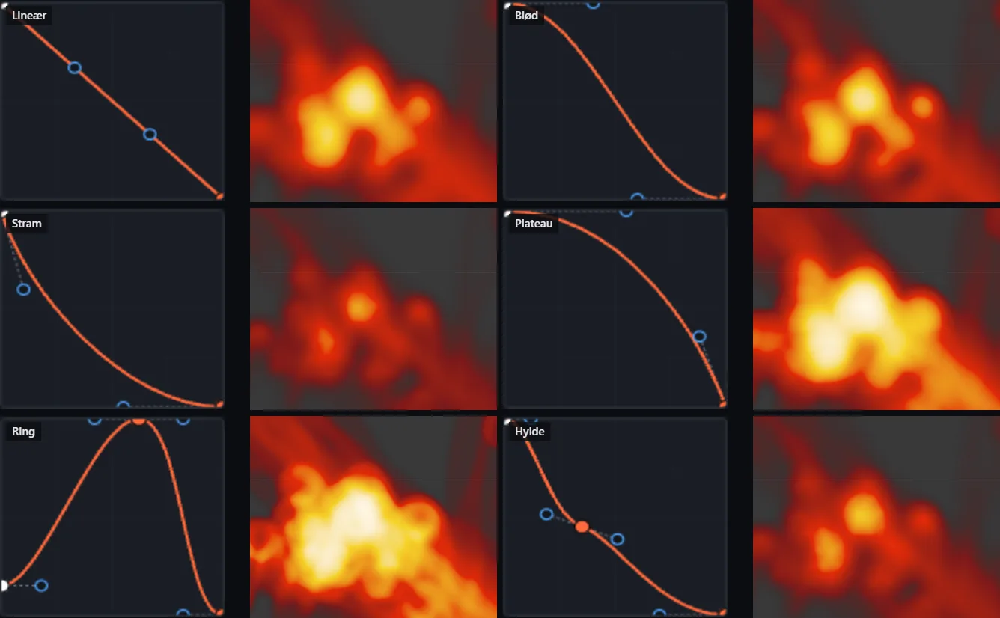

# Sprite-form

Hver række tegnes som en rund sprite, der altid vender mod kameraet. Dens størrelse og profilen fra dens centrum til dens kant - **rampen** - afgør, om et hotspot læses som en stram prik, en blød sky, en skive eller en ring. Disse indstillinger findes i sidepanelets afsnit **Varmeform** og **Pixelgrænser for sprites**, og de gælder for [Varme](heat.md), [Forskel](difference.md), [Holdvarme](team-heat.md) og, som halv bredde af en linje, [Linjevarme](line-heat.md).

Ændrer du en af dem, starter akkumuleringen forfra (feltet skal tegnes om med den nye form).

Tænk på hver prik som et blødt lysklump. Et lille klump viser enkeltstående punkter; et stort klump smelter naboer sammen til en sky. Formen afgør, hvor blød kanten er.



## Sprite-radius {#sprite-radius}

Spritens radius i **verdensenheder** (mærket meter). Standard 6, og ved hver indlæsning den vandrette udstrækning af dataene / 120 - stor nok til at naboprøver langs en sti smelter sammen til et bånd i stedet for at læses som en hårlinje. Logaritmisk skyder 0,05-2000, håndtaget kan trækkes op til 50.000.


Ting langt væk ser mindre ud, så en sprite skrumper på skærmen med afstanden. Under den parallelle projektion er den lige stor overalt, og det er en del af grunden til, at den parallelle visning er den rigtige til at sammenligne hotspots ([Kamera](camera.md#projection)).

## Pixelgrænser {#pixel-clamps}

**Pixelgrænser for sprites** (lukket som standard) begrænser radiussen på skærmen efter omregningen ovenfor.

| Indstilling | Standard | Interval (skyder) | Hvorfor |
|---|---|---|---|
| **Min. pixelradius** | 1 px | 0-16 (512) | Holder fjerne data fra at forsvinde under én pixel. |
| **Maks. pixelradius** | 96 px | 2-1024, logaritmisk (8192) | Vagten mod overtegning. En sprite, der dækker N pixels, koster N blandingsoperationer, så en ubegrænset radius tæt på kameraet er det, der gør et hurtigt billede langsomt. Over visningens højde begrænser den ikke længere noget. |

**Samme tæthed ved enhver zoom** (i afsnittet Varmeform, standard til) virker sammen med grænserne. En sprite, som en grænse gør større (langt væk) eller mindre (tæt på), beholder den varme, dens sande størrelse ville tilføje, så en farve betyder det samme antal rækker pr. areal af jord ved enhver zoom. Med den fra tilføjer en begrænset sprite hele sin vægt i sin begrænsede størrelse, og billedet ændrer sig, når du flyver ind.

## Intensitet i centrum og ved kanten {#centre-and-edge-intensity}

Den varme en sprite tilføjer i sit præcise centrum (**Intensitet i centrum**, standard 1, 0-10, skyder 1000) og ved sin kant (**Intensitet ved kanten**, standard 0, -2-10, skyder 1000). Rampeværdien *t* (1 i centrum, 0 ved kanten, formet af aftagningen eller kurven nedenfor) blander mellem dem (formlen står under [For udviklere](#for-developers)).

En **negativ intensitet ved kanten** gør, at kanten trækker fra, hvilket skærer en kølig glorie ud omkring hvert hotspot og skærper klynger over for hinanden. Synlighed omfatter [dækning](depth-and-culling.md) og [udsnittet](slice.md); udtoning er [Levetid](timeline.md#history)-udtoningen; fortegnet er ±1 i [Forskel](difference.md).

## Rampens form: Aftagning eller Kurve {#ramp-shape-falloff-or-curve}

**Rampens form** skifter mellem to måder at forme *t* over spritten på. Med *d* som afstanden fra centrum (0) til kanten (1):

### Aftagning {#falloff}

Vises, når *Aftagning* er valgt (standard).

- **Aftagning** (standard 1,6, 0,1-8, skyder 64): `t = (1 - d) ^ aftagning`. 1 er en ret lineær rampe; højere trækker varmen mod centrum og stram hotspotet; under 1 flader den ud til en skive.
- **Blød rampe** (standard til): lægger en smoothstep-S-kurve over *t*, så spritten toner ind ved sin kant i stedet for at slutte i en synlig kant.

### Kurveeditoren {#the-curve-editor}

Vises, når *Kurve* er valgt. Et bogstaveligt tværsnit af en sprite: afstand fra centrum på tværs (*centrum* til venstre, *kant* til højre), varme op. Kurven er en stykkevis kubisk Bézier-kurve gennem kontrolpunkter, hvert med to håndtag.

| Handling | Virkning |
|---|---|
| Dobbeltklik på grafen | Tilføjer et punkt ved den afstand (holdes mellem 0,02 og 0,98), på kurven og med kurvens hældning der, så tilføjelsen intet ændrer, før du trækker i det. |
| Træk et punkt | Flytter det. Højder holdes mellem 0 og 1. |
| Træk en lille cirkel | Bøjer segmentet ved siden af den (flytter det håndtag). |
| Alt-klik eller højreklik på et punkt | Fjerner det. De to endepunkter kan ikke fjernes. |
| En forudindstillingsknap | Erstatter kurven med forudindstillingen. |

Endepunkterne er fastlagt i centrum og ved kanten; deres højde er stadig din.

**Forudindstillinger** ([`curve.ts`](https://github.com/Holdi601/3DHeat/blob/main/src/state/curve.ts)):

| Forudindstilling | Form | Brug |
|---|---|---|
| **Lineær** | Ret fra 1 til 0 | Identisk med *Aftagning* 1 med *Blød rampe* fra. |
| **Blød** | S-kurve | Standardkurven; det *Blød rampe* giver ved aftagning 1. |
| **Stram** | Et stejlt kerne, en lang svag skørt | Spredte data. |
| **Plateau** | Fladt, derefter et hurtigt fald | Læses som en skive i stedet for et klump. |
| **Ring** | 0,15 i centrum, 1 ved 62 % af radius, 0 ved kanten | En hul sprite: viser, hvor stier går forbi i stedet for, hvor de stopper. |
| **Hylde** | Aftagning i to trin, 0,45 ved 35 % | Skiller en tæt kerne fra dens omgivelser. |

## Flad ud på jordplanet {#flatten-onto-ground-plane}

**Flad ud på jordplanet** (standard fra) ignorerer hver rækkes højde og tegner al varme i én højde - datasættets laveste Y - det klassiske 2D-kort-varmekort. Med den til er dybdedækning og *Skjul bag terræn* fra (hvert punkt ville sidde præcis på den flade, det testes mod), og afsnittet Dybde siger det.

## For udviklere {#for-developers}

### Formler {#formulas}

Radius på skærmen i pixels: `radius × P[1][1] / w × visningens højde / 2`, hvor `P` er projektionsmatricen, og `w` er punktets visningsdybde.

Den varme en sprite tilføjer:

```
tilføjet varme = mix(kant, centrum, t) × prøvevægt × fortegn × udtoning × synlighed
```

### Kurven {#the-curve}

Håndtag begrænses vandret til deres eget segment, så kurven altid er en funktion af afstand: trækker du et håndtag langt forbi det næste punkt, fladt det ud mod det i stedet for at folde kurven tilbage, hvilket ville gøre resultatet afhængigt af hvilken rod en løser tilfældigvis fandt.

### Sådan tegnes kurven {#how-the-curve-is-drawn}

Kurven bages ind i en tabel med 256 elementer, hver gang den ændres, uploades som en 16-bit flydende tekstur og samples pr. fragment med lineær filtrering og et halv-texel-indrykning, så begge ender forbliver præcise. At løse en Bézier for x kræver iteration, som ikke hører til i programmets varmeste shader, og et tabelopslag er også billigere end den `pow()`, aftagningen bruger. 16-bit i stedet for 8-bit, fordi 8 bit viser bånd, når tusinder af sprites har lagt sig sammen; 16-bit halvflydende kan filtreres i core WebGL2, hvor 32-bit kræver en udvidelse.
