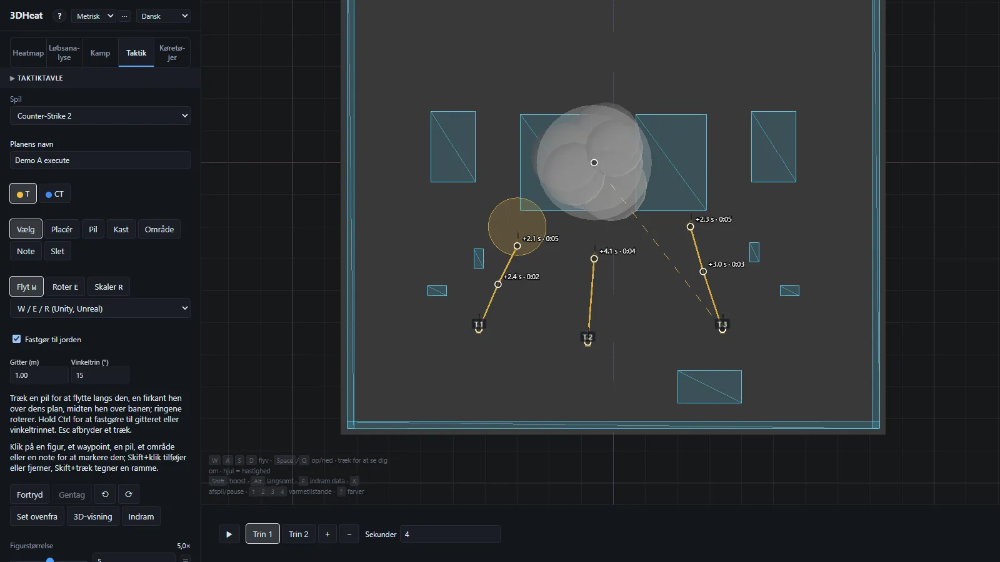

# Taktiktavle

Fanen **Taktik** er en tegnetavle til en holdplan: du sætter små figurer på et kort, tegner pile for, hvor de skal hen, og trykker på afspil for at se det ske. Brug den til at planlægge en runde eller et angreb, før du spiller. Den deler lærred, kamera og [bane](levels.md) med de andre faner og intet andet; en plan er ikke data og tegner ingen varme.

## Din første plan {#your-first-plan}

1. Åbn fanen **Taktik**. Vælg **Spil** (for eksempel Counter-Strike 2), og for Valorant tryk på **Indlæs Valorant-kort** og vælg et **Kort**. Eller indlæs først en [bane](levels.md).
2. Vælg en **Side** (den sætter farven), og tryk på **Set ovenfra**.
3. Vælg **Sted**, vælg en figur i **Figurer** (brug **Søg i figurer** for at finde en), og klik på kortet. Sæt to eller tre.
4. Vælg **Pil**, klik på en figur, klik langs den vej, den skal gå, og tryk på **Enter** for at afslutte pilen.
5. Tryk på **+** under visningen for at tilføje trin 2. Hver figur starter, hvor dens pil sluttede. Tegn flere pile dér.
6. Tryk på **▶** (eller `K`) for at afspille planen fra det viste trin til enden.
7. Navngiv planen i **Planens navn**, og tryk på **Gem**.

## Start en plan {#starting-a-plan}

| Styring | Hvad den gør |
|---|---|
| **Spil** | Vælger de sider og figurer, paletten tilbyder: Counter-Strike 2 (T, CT; spillere og utility), Valorant (Angreb, Forsvar; spillere og generiske evner), Battlefield, Squad, Arma (infanteri, landkøretøjer, luftfartøjer, både), DCS / War Thunder / IL-2 (jetfly, propelfly, helikoptere, luftværn, land, skibe, våben) og Andet. En plan, der allerede har figurer, beholder sine sider, når spillet skifter. |
| **Planens navn** | Navnet planen gemmes under. |
| **Kort**, **Indlæs Valorant-kort** | Med Valorant valgt: **Indlæs Valorant-kort** henter listen over kort fra [valorant-api.com](https://valorant-api.com); **Kort** lægger så det valgte kort's minikort ned som bane, indrammet ovenfra. Billedet hentes, når det vælges, og leveres aldrig med. Riots bemærkning vises, mens den er på skærmen (se nedenfor). |
| **Side** | Siden, den næste figur, pil eller det næste område hører til; den tager sidens farve. |

Uden en bane er tavlen det flade jordplan. Indlæs en bane under **Bane** for at planlægge på et rigtigt kort: et CS2-kort eksporteret med CS2-værktøjet, en bane fra biblioteket eller et kortbillede.

## Værktøjer {#tools}

| Værktøj | Klik | Noter |
|---|---|---|
| **Vælg** | En figur, et waypoint, en pil, et område eller en note markerer den. | Shift+klik tilføjer eller fjerner; Shift+træk tegner en boks om det, der skal tilføjes. Markeringen får et transformationsgreb (se nedenfor); `Delete` eller `Backspace` fjerner den. `M` flytter den valgte figur til næste klik. |
| **Sted** | Sætter den valgte figur ned. | En figur vælges i paletten **Figurer** (med **Søg i figurer**). Uden markering drejer `R` den næste figur 15° før den sættes (`Shift+R` den anden vej). |
| **Pil** | Hvert klik tilføjer et punkt; Enter, et dobbeltklik eller et højreklik afslutter den, Esc kasserer den. | **Bevæg**, **Angreb** (bredere spids) eller **Hold øje** (en tynd linje i øjenhøjde). En pil startet på en figur er den figurs rute i dette trin: når den afspilles, går figuren den, og næste trin starter, hvor den sluttede. |
| **Kast** | Kasteren, derefter hvor det lander. | En stiplet bue fra den ene til den anden, og den valgte utility (røg, blænd, molotov ...) vises, hvor den lander, og bliver fra dette trin og frem. |
| **Område** | Midten, derefter kanten. | En skive i sidens farve. |
| **Note** | Hvor noten skal stå; spørger om dens tekst. | Vises som en nål, og dens tekst over den. |
| **Slet** | En figur, pil, et område eller en note. | Fjerner den fra dette trin og frem; på dets første trin fjerner den det helt. |

**Fortryd** og **Gentag** (`Ctrl+Z`; `Ctrl+Y` eller `Ctrl+Shift+Z`) gennemløber hver ændring. En linje under planen viser, hvor mange figurer, pile og trin den har. **Set ovenfra** kigger lige ned (ortografisk), **3D-visning** vender tilbage til perspektiv, **Indram** tilpasser planen, eller banen når planen er tom.

**Figurstørrelse** skalerer hver figur på tavlen; 1× er ægte størrelse, hvilket set oppefra er et par pixels for en person.

## Flyt, drej og skaler {#moving-turning-and-scaling}

Alt på tavlen kan flyttes som i en 3D-editor: figurer, utility, markører, enkelte waypoints og hele pile, områder og noter. Det, der er markeret, får et greb midt på:

| Tilstand | Taster | Håndtag |
|---|---|---|
| **Flyt** | W (eller G) | En pil pr. akse (X rød, Y grøn og op, Z blå) flytter langs den; en firkant flytter hen over sit plan; midten flytter hen over banen under markøren. |
| **Roter** | E (eller R) | En ring pr. akse drejer om den. En enkelt figurs ringe er dens egen krøjning, stigning og rulning; en gruppe drejer om verdens akser midt i den. |
| **Skaler** | R (eller S) | Spreder eller samler markeringen fra dens midte langs en akse eller på alle måder; et områdes radius vokser med den. |

**Taster** skifter mellem W / E / R (Unity, Unreal) og G / R / S (Blender); tasterne vælger kun tilstand, når noget er markeret, og flyver ellers kameraet. Så betyder `R` **Skaler** med W / E / R-tasterne og **Roter** med G / R / S-tasterne, når noget er markeret, og drejer den næste figur, der skal sættes, når intet er. Alle tavlens taster er listet i [tastaturreferencen](keyboard-reference.md#tactics-board). Hold **Ctrl** nede, mens du trækker, for at fastgøre en flytning til **Gitter** (meter) eller en drejning til **Vinkeltrin**. **Fastgør til jorden** (til som standard) sætter flyttede personer, køretøjer, markører, waypoints og områder på banens overflade; fly og helikoptere beholder deres højde, og et træk langs Y-pilen fastgøres aldrig. Træk i et håndtag flytter aldrig kameraet. **Esc** annullerer et træk, og hver ændring er ét trin i Fortryd.

Waypoints vises som prikker på det viste trins pile: klik på en for at markere den, træk for at flytte den, Delete for at fjerne den. Afsnittet **Valgte** viser markeringens placering i meter, en figurs krøjning, stigning og rulning i grader og et områdes radius, hver kan skrives direkte ind.

## Timing {#timing}

En figurs rute har tid: hvert segment tager sin længde hen over banen – samplet på overfladen hver par meter, så en bakke eller en trappe mellem to punkter tæller med – ved hastigheden for figurens bevægelses**tilstand** i det spil, plus eventuel **ventetid** ved et waypoint. Infanteri kravler, sidder på hug, går (lydløst), løber eller sprinter; køretøjer og både kravler, kører forsigtigt, normalt eller hurtigt; fly og helikoptere flyver langsomt, i marchfart, i kampfart eller på maksimum. En tilstand, spillet ikke har (CS2 har ingen sprint), tager den nærmeste, det har. Hvordan en skråning bremser afhænger af spillet: i CS2 og Valorant tæller kun den vandrette afstand, som i spillene; militærsimulatorer bremser infanteri op ad bakke (Toblers vandrefunktion) og køretøjer efter hældning.

Hastighederne kommer fra tabeller pr. spil med deres kilder (se [Bevægelseshastigheder](tactics-speeds.md)): CS2 efter det våben, der holdes, fra spillets våbendefinitioner; Valorant efter våben; Battlefield, Squad, Arma og luftspillene efter køretøjstype og klasse. **Bevæger sig som** vælger en figurs profil (et våben, en køretøjstype); **Egen (m/s)** overskriver enhver tilstand for den figur. Tilstande hedder som på tavlen: *Kravle*, *Sidde på hug*, *Gå (lydløst)*, *Løb*, *Sprint*; *Forsigtig*, *Normal*, *Rush*; *Langsom*, *Marchfart*, *Kamp*, *Maksimum*.

Hvert waypoint viser tiden fra det forrige og tiden siden planens start ("+3,9 s · 0:12"). Den valgte figurs rute lister hvert segment med sin tilstand, længde og tid, ventetiden og ankomsten. **Ankomster** under **Timing** sætter hver ruteplanlagt figur på én tidslinje, første ankomst øverst. Med **Afspil i realtid** (til som standard) varer et trin, til den langsomste rute er fremme, og hver figur bevæger sig med sin egen hastighed; **Sekunder** er så trinets korteste længde. **Baneenheder pr. meter** siger, hvad banen er i: 39,37 for CS2-kort (spilenheder), 1 for kort i meter.

## Sammenlign med kampdata {#compare-with-match-data}

**Indlæs kampfiler …** læser CS2-kampdata for kortet (CS2-værktøjets Parquet-filer, så mange man vil; kun de nødvendige kolonner, i baggrunden); **Brug indlæste data** tager de data, der er indlæst i vieweren. Derefter:

- **Tidligste ankomst på kortet** farver kortet efter den tid siden rundens start, hvor en spiller først nåede hvert sted – knappen **Hurtigst** viser den hurtigste over alle runder, **Typisk (median)** den midterste runde – fra grøn tidlig til rød sen, for den ene side eller begge. Den viser, hvad der er muligt, og hvornår.
- Den valgte rute sammenlignes med, hvad spillere opnåede fra dens start (eller fra rundens start) til dens ende, hver ende en skive med den indstillede radius: "Hurtigst observeret 14,2 s, p10 15,0 s, median 18,3 s over 41 kørsler; din plan 15,1 s".
- De hastigheder, spillere faktisk bevægede sig med – løb, gang, krybning, fra tabellernes kolonner for gang og hug – i m/s.

## Trin {#steps}

Linjen under visningen rummer trinene. En plan starter med ét; **+** tilføjer et, og hver figur starter der, hvor dens rute i det sidste trin sluttede; **−** fjerner det viste. **Sekunder** er, hvor lang tid det viste trin tager, når det afspilles. **▶** (K) afspiller fra det viste trin til enden: figurer med en rute går den, figurer flyttet til et nyt sted i næste trin glider derhen, resten står. Mens et trin vises, tegnes hver figurs plads i næste trin som et svagt spøgelse, og sidste trins pile svagt under dette trins.

## Gem {#saving}

Afsnittet **Fil** rummer **Gem**, **Åbn** og **Ryd**. **Gem** skriver planen som `<name>.h3dplan.json` (almindelig JSON: sider, trin, figurer med en plads pr. trin, pile, områder, noter); **Åbn** læser en tilbage. En fil fra en anden version, eller en der ikke er en plan, afvises med grunden. **Ryd** tømmer planen; Fortryd henter den tilbage.

## Figurer {#figures}

Hver figur bygges af vieweren selv: enkle former i en typens offentliggjorte størrelse, med de træk, der skiller den fra naboerne – en stridsvogns vejhjul og tårn, kanonerne, missilerne og radarerne på et luftværnskøretøj, et flys vingeplan, hale og motorer, en helikopters rotorer og stumpvinger. Intet tages fra et spil. Et design, et spil har opfundet, vises som den generiske figur for sin klasse. Se [Figurer](figures.md#which-figure-a-unit-gets) for, hvordan data finder sin figur.

## Riots bemærkning {#riots-notice}

Valorant-kort vises under Riot Games' politik "Legal Jibber Jabber", som tillader gratis fællesskabsprojekter at bruge dem og beder om denne bemærkning, hvor de vises. Bemærkningen står her på engelsk, som politikken kræver: *3DHeat was created under Riot Games' "Legal Jibber Jabber" policy using assets owned by Riot Games. Riot Games does not endorse or sponsor this project.* Evnerne på tavlen er generiske former, ikke Riots kunst.
