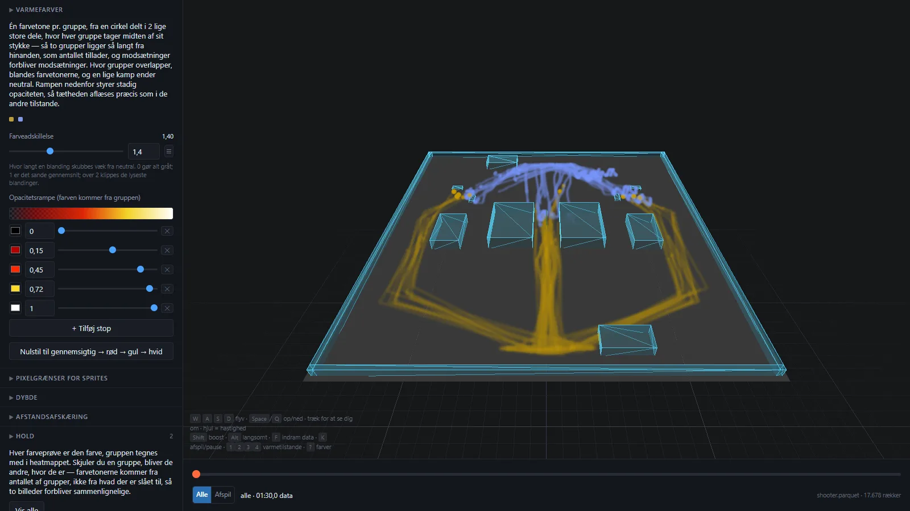

# Holdvarme

Holdvarme viser, hvor hvert hold var, og hvert hold har sin egen farve. Hvor holdene overlapper, blandes farverne.

**Holdvarme** (tast 3) er tæthedsfeltet fra [Varme](heat.md), hvor hver [gruppe](glossary.md) har fået sin egen farvetone. Hvor grupper overlapper, blandes deres toner. En lige kamp bliver neutral. Opacitet bærer stadig tætheden præcis som i de andre tilstande, så billedet svarer på *hvor meget* og *hvis* på én gang. Den kræver en gruppekolonne.

Den er ikke [figuroverlejringen](box-replay.md). Den tegner én figur pr. person. Dette er et varmefelt, farvet af den samme kolonne.

## Sådan bruges den {#how-to-use-it}

1. Tryk på `3` (eller vælg **Holdvarme** i tilstandslinjen).
2. Åbn **Varmefarver**. Farveprøverne viser hver gruppes farve. Hold musen over en prøve for at se holdnavnet.
3. Hvis alt ser gråt ud, så hæv **Farveadskillelse**.
4. Fravælg en gruppe i [Holdliste](teams-list.md) for at fjerne den. De andre farver bliver, hvor de var.

## Styring {#controls}

I sektionen **Varmefarver**:

| Styring | Standard | Betydning |
|---|---|---|
| Farveprøver | | Hver gruppes farve for de første 12 grupper, derefter *+N flere*. Hold musen over for gruppenavnet og farven. |
| **Farveadskillelse** | 1,4 | Hvor langt en blanding skubbes væk fra neutral, 0-4. 0 gør alt gråt. 1 er det sande gennemsnit. Ud over cirka 2 forlader de klareste blandinger det viselige område og klippes pr. kanal, hvilket forskyder deres tone. |
| **Opacitetsrampe (farven kommer fra gruppen)** | standardvarmerampen | Kun rampens **alfa** bruges her: gennemsigtig, hvor der intet er, uigennemsigtig i toppen. Dens farver ignoreres. |

En gruppe, hvis navn betyder "ingen gruppe" (`0`, tom, `none`, `unknown`, `null` eller `-1`), tegnes gråt.

Alle de andre varmestyringer (form, mætning, respons, mindste varme, dybde, culling) virker som i [Varme](heat.md).

[Holdliste](teams-list.md) viser hver gruppes holdvarmefarve som dens prøve i denne tilstand. Når en gruppe skjules, bliver hver anden gruppes farve, hvor den var. Tonerne kommer fra det samlede antal grupper, ikke fra hvad der er slået til, så to billeder forbliver sammenlignelige.

## For udviklere {#for-developers}

### Paletten {#the-palette}

Fra [`colors.ts`](https://github.com/Holdi601/3DHeat/blob/main/src/render/colors.ts):

- Farverne ligger på **Oklab**-farveplanet med fast lysstyrke (0,7) og kroma (0,115), så hver gruppe er lige lys, og en rød gruppe ikke virker varmere end en blå.
- Med *n* grupper deles tonecirklen i *n* lige dele, og gruppe *i* tager **centrum** af sin del, `(i + 0,5) / n` af et omløb. To grupper er så langt fra hinanden, som antallet tillader, og modsatte forbliver modsatte, uanset antallet.
- Højst **16** forskellige toner bruges. Med flere grupper placeres id'er ved gentagen halvering (bitvendte id'er: 0, ½, ¼, ¾, ⅛ …), så nabo-id'er ikke deler tone. Grupper ud over 16 deler nødvendigvis tone.
- En gruppe, hvis navn betyder "ingen gruppe" (`0`, tom, `none`, `unknown`, `null` eller `-1`, uden hensyn til store og små bogstaver), tegnes i **neutral grå** i stedet for at tage en skive af cirklen. Kun den første sådan etiket i grupperlisten behandles på den måde.

Standardadskillelsen er 1,4 og ikke 1. Ved 1 *er* en blanding af fem jævnt fordelte toner grå: korrekt og ulæselig. Lidt over 1 holder uafgjorte stillinger ærlige og gør samtidig en fordeling på 60/40 synlig.

### Sådan virker det {#how-it-works}

Varmemålet har fire kanaler i denne tilstand. Hver sprite lægger sin tæthed *v* til den første kanal og *v* × gruppens Oklab-koordinater *a* og *b* til den anden og tredje. Ved sammensætning er pixelens blanding det tæthedsvægtede gennemsnit: *a* = G / R, *b* = B / R, skaleret med farveadskillelsen og omregnet til sRGB ved paletens lysstyrke. Division med den akkumulerede tæthed holder tonen uafhængig af, hvor meget data der er. Det er grunden til, at alle tæthedsstyringer stadig kun virker på opaciteten.

Målet med fire kanaler koster fire gange så meget GPU-hukommelse som varmemålet med én kanal ved samme opløsning.
