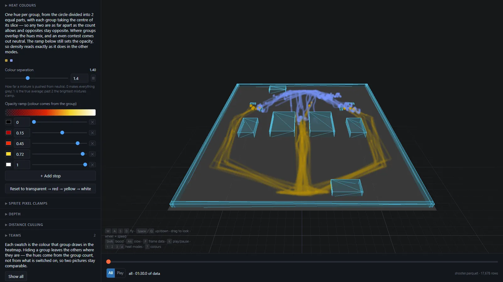

# Holdvarme

Holdvarme viser, hvor hvert hold var, med hvert hold i sin egen farve. Hvor holdene overlapper, blandes farverne.

**Holdvarme** (tast 3) er tæthedsfeltet fra [Varme](heat.md), med hver [gruppe](glossary.md) givet sin egen nuance. Hvor grupper overlapper, blandes deres nuancer; en jævn kamp bliver neutral. Opacitet bærer stadig tætheden præcis som i de andre tilstande, så billedet svarer på *hvor meget* og *hvis* på samme tid. Den kræver en gruppekolonne.

Det er ikke [figuroverlejringen](box-replay.md): den tegner én figur pr. person; dette er et tæthedsfelt farvet efter den samme kolonne.

## Sådan bruger du den {#how-to-use-it}

1. Tryk på `3` (eller vælg **Holdvarme** i tilstandslinjen).
2. Åbn **Varmefarver**. Farveprøverne viser hver gruppes farve; hold musen over en prøve for holdnavnet.
3. Hvis alt ser gråt ud, hæv **Farveadskillelse**.
4. Fjern markeringen ved en gruppe i [Holdliste](teams-list.md) for at tage den ud; de andre farver bliver, hvor de var.

## Styringer {#controls}

I afsnittet **Varmefarver**:

| Styring | Standard | Betydning |
|---|---|---|
| Farveprøver | | Farven for hver gruppe, for de første 12 grupper, derefter *+N flere*. Hold musen over for gruppens navn og farven. |
| **Farveadskillelse** | 1,4 | Hvor langt en blanding skubbes væk fra neutral, 0-4. 0 gør alt gråt; 1 er det sande gennemsnit; over omkring 2 forlader de lyseste blandinger det viselige område og klemmes pr. kanal, hvilket forskyder deres nuance. |
| **Opacitetsrampe (farven kommer fra gruppen)** | standard-varmerampen | Kun rampens **alfa** bruges her: gennemsigtig, hvor der intet er, uigennemsigtig øverst. Dens farver ignoreres. |

Alle de andre varmestyringer – form, mætning, respons, minimumsvarme, dybde, udsnit – virker som i [Varme](heat.md).

[Holdlisten](teams-list.md) viser hver gruppes holdvarmefarve som dens prøve i denne tilstand. Skjuler du en gruppe, bliver hver anden gruppes farve, hvor den var: nuancer kommer fra det samlede antal grupper, ikke fra hvad der er slået til, så to billeder forbliver sammenlignelige.

## Paletten {#the-palette}

Fra [`colors.ts`](https://github.com/Holdi601/3DHeat/blob/main/src/render/colors.ts):

- Farver ligger på **Oklab**-farveplanet ved en fast lysstyrke (0,7) og kroma (0,115), så hver gruppe er lige lys, og en rød gruppe ikke virker varmere end en blå.
- Med *n* grupper deles farvecirklen i *n* lige store dele, og gruppe *i* tager **midten** af sin del, `(i + 0,5) / n` af et omløb. To grupper er så langt fra hinanden, som antallet tillader, og modsatte forbliver modsatte, uanset antallet.
- Højst **16** forskellige nuancer bruges. Med flere grupper placeres id'er ved gentagen halvering (bit-vendte id'er: 0, ½, ¼, ¾, ⅛, …), så naboid'er ikke deler en nuance; grupper ud over 16 deler nødvendigvis.
- En gruppe, hvis navn betyder "ingen gruppe" – `0`, tom, `none`, `unknown`, `null` eller `-1`, uanset store og små bogstaver – tegnes i **neutral grå** i stedet for at tage en del af cirklen. Kun den første sådan etiket i grupperækken behandles på denne måde.

Standardadskillelsen er 1,4 og ikke 1, fordi en blanding af fem jævnt fordelte nuancer ved 1 *er* grå: korrekt og ulæselig. Lidt over 1 holder uafgjorte forhold ærlige, samtidig med at en fordeling på 60/40 bliver synlig.

## Sådan virker det {#how-it-works}

Varmemålet har fire kanaler i denne tilstand. Hver sprite lægger sin tæthed *v* til den første kanal og *v* × gruppens Oklab-koordinater *a* og *b* til den anden og tredje. Ved sammensætningen er pixelens blanding det tæthedsvægtede gennemsnit: *a* = G / R, *b* = B / R, skaleret med farveadskillelsen og omregnet til sRGB ved paletens lysstyrke. Division med den akkumulerede tæthed gør nuancen uafhængig af, hvor meget data der er, og det er grunden til, at alle tæthedsstyringer fortsat kun virker på opaciteten.

Målet med fire kanaler koster fire gange så meget grafikkortshukommelse som det enkeltkanals varmemål ved samme opløsning.
