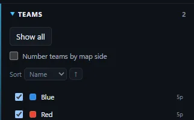

# Holdliste

Panelet **Hold** lader dig skjule et hold eller sætte det på den ene side af en sammenligning. Brug det til at se kun på Blue eller til at spørge "hvor går Blue hen, som Red ikke gør?".

En *gruppe* er et hold eller en side, fx Blue og Red ([Grupper](sessions-persons-groups.md#group)). Panelet vises, når datasættet har en gruppekolonne. Antallet af grupper står i dets overskrift. I holdvarmetilstand har sidebaren også et afsnit ved navn **Holdvisning** med sine egne indstillinger. Denne side dækker listen **Hold**.

## Skjul et hold {#hide-a-team}

1. Åbn **Hold** i sidebaren.
2. Fjern krydset i afkrydsningsfeltet (*Synlig*) for det hold, der skal skjules. Billedet opdateres med det samme.
3. Tryk på **Vis alle** for at få alle hold tilbage.

## Hver række {#each-row}

| Del | Betydning |
|---|---|
| Afkrydsningsfelt (*Synlig*) | Viser eller skjuler gruppen. |
| Farveprøve | Gruppens farve: dens [holdvarme](team-heat.md)-farve i holdvarmetilstand og dens grundfarve i de andre tilstande. |
| Navn | Gruppens etiket (fuld etiket ved musen over). |
| **+** / **-** (forskelstilstand) | Sætter gruppen på den positive eller negative side af [forskellen](difference.md). Klik på den aktive knap igen for at sætte den på ingen af siderne. |
| `Np` (andre tilstande) | Antallet af personer, hvis første række er i denne gruppe. |

## Knapper {#buttons}

| Knap | Virkning |
|---|---|
| **Vis alle** | Gør alle grupper synlige igen. |
| **Del ligeligt** (forskelstilstand) | Første halvdel af grupperne (rundet op) på +, resten på -. Den samme deling starter hver indlæsning. |

## Hvad det gør at skjule en gruppe {#what-hiding-a-group-does}

- I **Varme**, **Holdvarme** og **Linjer** bidrager gruppens rækker med intet.
- I **Forskel** bidrager en skjult gruppe med intet, uanset hvilken side den står på. Det gælder også ved en opdeling efter en anden kolonne (se [Forskel](difference.md#for-developers)).
- I **figuroverlejringen** tegnes personer, hvis første række er i den gruppe, ikke.
- I **Holdvarme** beholder de andre grupper deres farver. Tonerne tildeles ud fra det samlede antal grupper og ikke ud fra det, der er synligt, så to billeder forbliver sammenlignelige.

En ændring af synligheden genstarter akkumuleringen. Ved hvert nyt datasæt er alle grupper synlige igen.

Panelets hjælpetekst skifter med tilstanden. I Forskel forklarer den + og -. I Holdvarme forklarer den, at farveprøverne er de farver, hver gruppe tegnes i.
