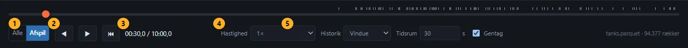

# Tidslinje og afspilning

Linjen under billedet fungerer som en videoafspiller: du kan afspille dataene som en film, sætte på pause, springe rundt og ændre hastigheden.

Linjen under visningen er tidslinjen ([`Timeline.tsx`](https://github.com/Holdi601/3DHeat/blob/main/src/ui/Timeline.tsx)). Den bestemmer, hvilke rækker der er synlige på ethvert tidspunkt. Den kræver en tidskolonne; uden en er hele linjen slået fra, visningen bliver i **Alle**, og sidebjælken siger *Ingen tidskolonne i disse data - tidslinjen er slået fra, og alle datapunkter vises på én gang.*

## Alle og Afspil {#all-and-play}

To hovedtilstande, fordi de besvarer forskellige spørgsmål.

- **Alle** (standard ved hver indlæsning) ser helt bort fra playhead og viser alle rækker, der passerer filtrene. Det er visningen "hvor sker dette", og den er ikke det samme som at skubbe til slutningen. Positionsskyderen er slået fra, og uret viser `alle ·  af data`.
- **Afspil** kører dataene som en tidsraffer. Positionsskyderen, transporten og historikindstillingerne vises.

Valget af **Alle** stopper også afspilningen.

## Styringerne {#the-controls}

| Styring | Standard | Betydning |
|---|---|---|
| Positionsskyder | starten | Playhead. Træk for at springe; 20.000 trin over intervallet. |
| **Alle** / **Afspil** | Alle | Se ovenfor. |
| ▶ / ❚❚ | pauset | Afspil eller pause; også `K`. |
| ◀ **Afspil baglæns (J)** | | Afspiller dataene baglæns. Vises kun i tilstanden **Figuroverlejring**; den samme tast `J` virker også der (se [Tastatur](#keyboard)). |
| ⏮ | | Tilbage til starten af intervallet. |
| Ur | | `forløbet / i alt` som `mm:ss.s` (eller `t:mm:ss`), og når tidskolonnen er et absolut tidsstempel, playheadens klokkeslæt som `TT:MM:SSZ` (UTC). |
| **Hastighed** | 1× | Datasekunder pr. rigtigt sekund. Menuen har 17 trin fra 0,01× til 1800× (0,01, 0,02, 0,05, 0,1, 0,25, 0,5, 1, 2, 4, 8, 16, 32, 64, 128, 256, 600, 1800), samt **Brugerdefineret…**: skriv en vilkårlig hastighed fra 0,001× til 3600× (for eksempel 0,3 eller 12) og tryk på Enter; Esc beholder den aktuelle hastighed. Den sidste hastighed huskes til næste besøg (se [Gemte indstillinger](ref-settings-storage.md)). |
| **Historik** | Kumulativt | Hvad der tæller som synligt ved playhead: *Kumulativt*, *Vindue* eller *Levetid* (nedenfor). |
| **Tidsrum** (Vindue; i Linjer-tilstand også Levetid) | 30 s | Længden af vinduet, der slutter ved playhead; mindst 0,01 s. I [Linjevarme](line-heat.md#playback) er det længden af halen. |
| **Reservelevetid** (kun Levetid, ikke i Linjer-tilstand) | 10 s | Hvor længe et datapunkt uden næste prøve for sin person forbliver synligt. |
| **Fade** (kun Levetid, ikke i Linjer-tilstand) | 0,4 | Den brøkdel af hvert datapunkts levetid, der går med at tone ud, 0-1. |
| **Gentag** | til | Ved slutningen starter den forfra; fra stopper ved slutningen. |
| Højre side | | Datasættets navn. |

**Intervallet** er datasættets tidsspænd – eller, i [figuroverlejringen](box-replay.md) med en session valgt, den sessions spænd.

## Historik {#history}

I Afspil-tilstand:

- **Kumulativt** – alt fra starten af intervallet op til playhead. Varmen bygger sig op, mens det afspilles.
- **Vindue** – et fast tidsrum af historik, der slutter ved playhead (*Tidsrum*).
- **Levetid** – hvert datapunkt lever, indtil **den samme persons næste prøve** (i samme session), så præcis én position pr. person er aktuel på ethvert tidspunkt. Et datapunkt, hvis person aldrig optræder igen – en død, en afbrydelse, slutningen af loggen – har ingen næste prøve og lever i *Reservelevetiden* i stedet for at forsvinde med det samme eller vare evigt. Datapunkter **toner ud** i den sidste *Fade*-brøkdel af deres levetid i stedet for at poppe af: med én levende prøve pr. person ville et datapunkt, der forsvinder fra ét billede til det næste, få hele feltet til at flimre i prøvefrekvensen. *Fade* 0 gendanner det hårde klip.

Levetid kræver både en personkolonne og en tidskolonne; uden en personkolonne falder historikken tilbage til Kumulativt ved indlæsningen. I [Linjevarme](line-heat.md#playback) sætter historikken, hvor længe en rutes hale forbliver synlig; i [figuroverlejringen](box-replay.md) er *Reservelevetid* den tid, en person uden flere prøver holdes i.

## Afspilningsadfærd {#playback-behaviour}

Fra billedløkken ([`engine.ts`](https://github.com/Holdi601/3DHeat/blob/main/src/render/engine.ts)):

- Playhead rykker frem med *billedtid × hastighed*. Billedtiden begrænses til 0,1 s, så et skift af faner ikke får playhead til at springe.
- Trykker du på afspil ved slutningen af intervallet, starter det fra begyndelsen, som en mediaafspiller gør. Ved hver indlæsning står playhead i starten, så første tryk på afspil spiller.
- Ved slutningen af intervallet springer playhead tilbage til starten (Gentag til) eller stopper der, og afspilningen slutter (Gentag fra).
- Positionsskyderen læser motorens playhead direkte hvert billede; applikationens tilstand opdateres ved spring, start, stop og gentagelser.
- Valg af en session i sessionsvælgeren springer til den sessions start.

## Hvorfor afspilningen er jævn og billig {#why-playback-is-smooth-and-cheap}

Rækker lagres sorteret efter tid, så et tidsvindue er to binære søgninger i tidskolonnen: at rykke playhead frem flytter to heltal og berører ingen række, og afspilningsomkostningen følger antallet af rækker i vinduet, ikke datasættets størrelse.

Hvordan varmen holdes stabil, mens vinduet flytter sig, afhænger af historikken ([Akkumulering](accumulation.md)):

- **Kumulativt** vokser kun, så hvert billede lægger kun de rækker til, der er blevet synlige siden det forrige, med fuld vægt. Feltet bygger sig op monotont, og pause ændrer intet, fordi der ikke er noget tilbage at komme. (At estimere igen ville få hvert billede til at tænde en anden tilfældig delmængde og så tone den ud, hvilket ser ud som udbrud, der blusser op og forsvinder.)
- **Vindue** og **Levetid** ændrer sig virkelig hvert billede og estimeres igen, blandet som et eksponentielt glidende gennemsnit (vægt 0,34 for det nye billede), som er uden bias i stationær tilstand og langt roligere end at starte forfra.
- I Levetid-tilstand er kandidatrækkerne dem fra *playhead - største af det længste hul i dataene og Reservelevetid* op til playhead; shaderen fjerner så hver række, hvis egen levetid er forbi, og anvender udtoningen.

Skifte mellem Alle og Afspil, eller ændring af historikken, genstarter akkumuleringen.

## Tastatur {#keyboard}

| Tast | Virkning |
|---|---|
| `K` | Afspil / pause |
| `J` | Afspil baglæns; trykker du igen, pauses det (kun Figuroverlejring) |
| `L` | Afspil forlæns; trykker du igen, pauses det (kun Figuroverlejring) |

`J` og `L` skifter også tidslinjen til **Afspil**. Tasterne ignoreres, mens en tekstboks eller menu har fokus. I fanen Løbsanalyse styrer `K` i stedet den fanes eget replay.

