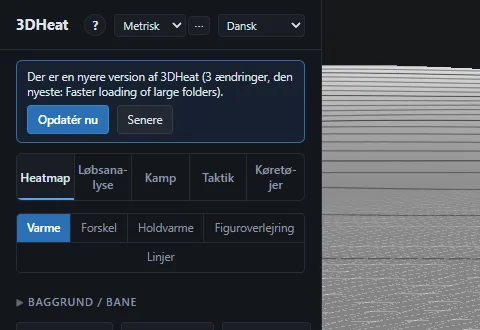

# Opdateringer

Vieweren fortæller dig, når en nyere version findes, og opdaterer sig selv kun, når du siger ja. Intet ændres på din computer uden dit svar.

## Opdater vieweren {#update-the-viewer}

1. **På siden.** Når en nyere version findes, dukker en boks op under navnet øverst i sidepanelet: "En nyere version af 3DHeat er tilgængelig". Klik på **Opdatér nu**. Siden genindlæses selv, når det er færdigt. **Senere** skjuler boksen, indtil du genindlæser siden.
2. **Hvis den siger at køre restart.bat**, luk servervinduet (det sorte vindue, `start.bat` åbnede), og dobbeltklik på `restart.bat`.
3. **Når du starter vieweren.** `start.bat` tjekker også. Findes en nyere version, spørger den **Opdatér nu? [J/N]**. Tryk `J` for at opdatere. Tryk `N`, eller vent 60 sekunder uden svar, for at starte den version, du har.



En kopi med dine egne ændringer opdateres aldrig for dig; boksen fortæller kun, at en opdatering venter, og siger, at du skal committe eller gemme dine ændringer og køre `git pull`. En kopi, der ikke blev installeret med git (en zip-fil, for eksempel), viser intet.

Sådan virker tjekket, trin for trin:

```
side ---(efter 4 s, derefter hver 6. time)---> udviklerserver ---> git fetch
   bagud?  nej  -> intet vises
           ja   -> dine egne ændringer eller commits?  ja -> fortæl kun
                                                      nej -> [Opdatér nu] -> git pull
                                                        -> genindlæs, eller "kør restart.bat"
```

## Sikkerhedsreglerne {#the-safety-rules}

- **Kun fremadspoling** (`git pull --ff-only`): en opdatering flettes aldrig,
  rebaseres aldrig og omskriver aldrig noget.
- **Ingen lokale ændringer**: en kopi med ucommittede ændringer i sporede filer
  (`git status --porcelain --untracked-files=no` er ikke tom) opdateres aldrig
  automatisk - nogens eget arbejde er ikke en opdatering, der skal overskrive
  det. Den får kun at vide, at en opdatering venter. Usporede filer (data,
  eksporter) tæller ikke som ændringer.
- **Ingen lokale commits**: en kopi med commits, opstrøms ikke har ("divergeret"),
  opdateres ikke - en fremadspoling kan ikke hente den op, og sammenfletning er
  for `git pull` i hånden. Siden og `start.bat` siger det begge med de samme ord,
  og `start.bat` starter den version, der er der.
- **Kun fra siden selv**: udviklerserverens opdateringsanmodning skal bære en
  særlig header og, når browseren sender en `Origin`, komme fra serverens egen
  vært (nedenfor).
- Kun en git-kopi med en opstrøms-gren opdateres nogensinde; alt andet (en kopi
  uden `.git`, ingen git installeret, en statisk build) lades i fred og siger
  ingenting.

## Hvad start.bat gør {#what-startbat-does}

`start.bat` (dobbeltklik på den; vinduet er serveren) gør, i rækkefølge:

1. Finder Node.js - på `PATH`, ellers i `%ProgramFiles%\nodejs`,
   `%ProgramFiles(x86)%\nodejs` eller `%LOCALAPPDATA%\Programs\nodejs` - og
   tilbyder at installere det med `winget install -e --id OpenJS.NodeJS.LTS`,
   når det mangler (spurgt, J/N; bagefter skal vinduet åbnes igen, så Windows
   henter den nye `PATH`).
2. **Opdateringer**, når git er installeret og mappen har `.git`:
   - `git fetch --quiet` (intet netværk eller ingen opstrøms: springes stille over);
   - tæller `git rev-list --count HEAD..@{u}`; intet bagud: intet siges;
   - local changes: "A newer version of 3DHeat is available (N changes), but this copy has local changes, so it is not updated. Commit or stash them, then run git pull." - og den starter den version, der er der;
   - egne commits (`git rev-list --count @{u}..HEAD` er ikke 0): "A newer version of 3DHeat is available (N changes), but this copy has commits of its own that the newest version does not, so it is not updated. Update it with git pull." - og den starter den version, der er der;
   - ellers "A newer version of 3DHeat is available (N changes)." og spørgsmålet **Update now? [Y/N]**. `N`, eller intet svar i 60 sekunder, skriver "Not updated; starting the version you have." og starter den version, der er der. Ved `Y`: "Updating...", noterer om `package.json` eller `package-lock.json` ændres, kører `git pull --ff-only` (skulle det stadig fejle - netværket, for eksempel: "The update did not go through; starting the version you have."), derefter
     `git submodule update --init` (de fastlåste værktøjer, se
     [Vedligeholdelse af dokumentationen](maintaining.md#the-tools-under-exporters)),
     derefter `npm install`, når pakkefilerne ændrede sig, og `node_modules` findes,
     og "Updated."
3. Nægter at starte en anden server: når noget allerede lytter på port **5273**,
   siger den det og peger på `restart.bat` / `stop.bat`.
4. Ved første kørsel (ingen `node_modules`) spørger den, før den henter
   afhængighederne (omkring 300 MB i `node_modules\`, intet systemomfattende).
5. Starter udviklerserveren på `127.0.0.1:5273` (`--strictPort`) og åbner browseren,
   når den er klar.

`restart.bat` stopper serveren (via porten) og kører `start.bat` igen, så den stiller
det samme spørgsmål. `stop.bat` stopper blot.

## Til udviklere {#for-developers}

### Mens den kører: opdateringsruten {#while-it-runs-the-update-route}

Udviklerserveren (Vite-pluginet `heat3d-self-update` i `vite.config.ts`) leverer
`/__heat3d/update`. Den findes kun på udviklerserveren - ikke i en statisk build
og ikke i `vite preview`.

**`GET /__heat3d/update`** svarer på, om kopien er bagud:

```json
{ "checkout": true, "upstream": "origin/main", "behind": 3, "ahead": 0, "dirty": false, "latest": "den nyeste commits emne" }
```

- `checkout: false`, når mappen ikke er en git-kopi;
- den kører `git fetch --quiet` **højst hver 30. minut** (forespørgsler imellem svarer
  ud fra det, der sidst blev hentet);
- `behind` / `ahead` fra `git rev-list --count HEAD..@{u}` / `@{u}..HEAD`, `dirty` fra
  `git status --porcelain --untracked-files=no`, `latest` emnet på opstrømsgrenens
  nyeste commit;
- uden opstrømsgren er `upstream: null` og `behind: 0`.

**`POST /__heat3d/update/apply`** bringer kopien op:

1. Afvist med `403 { ok: false, reason: "forbidden" }`, medmindre anmodningen har
   headeren `X-Heat3d-Update: 1`, og når den bærer en `Origin`, er den origins vært
   anmodningens `Host`. En formular fra et andet sted kan ikke sende en særlig header
   uden en CORS-preflight, og den server giver aldrig en.
2. Intet at gøre (ikke en kopi, ingen opstrøms, ikke bagud):
   `{ ok: true, updated: false }`.
3. Lokale ændringer: `{ ok: false, reason: "dirty" }`; lokale commits:
   `{ ok: false, reason: "diverged" }`.
4. Ellers: noterer de filer, der ændres (`git diff --name-only HEAD @{u}`),
   `git pull --ff-only` (2 min timeout), `git submodule update --init`
   (fejl ignoreres), `npm install`, når `package.json` eller `package-lock.json`
   ændrede sig (15 min timeout), og svarer
   `{ ok: true, updated: true, restart }` - `restart` siger, hvorfor den kørende
   server ikke kan hente opdateringen: `"dependencies"`, når de blev geninstalleret,
   `"config"`, når kun en `vite.config`-fil ændrede sig, `false`, når intet kræver en
   genstart.
5. En fejlende git- eller npm-kommando svarer `{ ok: false, reason: "<fejlen, op til
   300 tegn>" }`.

Svar er JSON med `Cache-Control: no-store`. Serveren lytter kun på `127.0.0.1`, så
ruten kan ikke nås fra netværket.

### Meddelelsen på siden {#the-notice-in-the-page}

`UpdateBanner`, under navnet øverst i sidepanelet:

- Den spørger ruten **4 sekunder** efter siden er indlæst (ikke i de første sekunder:
  siden har et datasæt at indlæse og en GPU at starte) og igen **hver 6. time**, mens
  siden er åben.
- Den viser **intet**, når der ikke er nogen sådan rute (en statisk build), mappen
  ikke er en kopi, eller intet er nyere - en meddelelse ved hver start er en, folk
  lærer at ignorere.
- Bagud, uden lokale ændringer: "En nyere version af 3DHeat er tilgængelig (N
  ændringer, den nyeste: <emne>)." med **Opdatér nu** og **Senere** (*Senere* skjuler
  den, indtil siden genindlæses).
- Bagud, med lokale ændringer: den samme sætning og "Denne kopi har lokale ændringer,
  så den opdateres ikke automatisk; committ eller gem dem, og kør derefter git pull." -
  ingen knap.
- **Opdatér nu** sender til `/apply` ("Opdaterer..."). Derefter:
  - "Opdateret. Siden genindlæses." - og den genindlæses 1,5 s senere (serveren leverer
    allerede de nye filer);
  - når afhængighederne blev geninstalleret: "Opdateret. Dens afhængigheder ændrede
    sig: luk serverens vindue og kør **restart.bat** for at afslutte.";
  - når kun serverens indstillinger ændrede sig: "Opdateret. Dens serverindstillinger
    ændrede sig: luk serverens vindue og kør **restart.bat** for at afslutte.";
  - intet at hente alligevel (`updated: false` - kopien blev bragt op imens, for
    eksempel af `start.bat`): "Intet at opdatere: denne kopi er allerede den nyeste
    version." - og ingen genindlæsning;
  - afvist: den *dirty*-sætning, eller "Denne kopi har commits af sin egen, som den
    nyeste version ikke har; opdatér den med git pull.", eller "Opdateringen gik ikke
    igennem: <årsag>".
