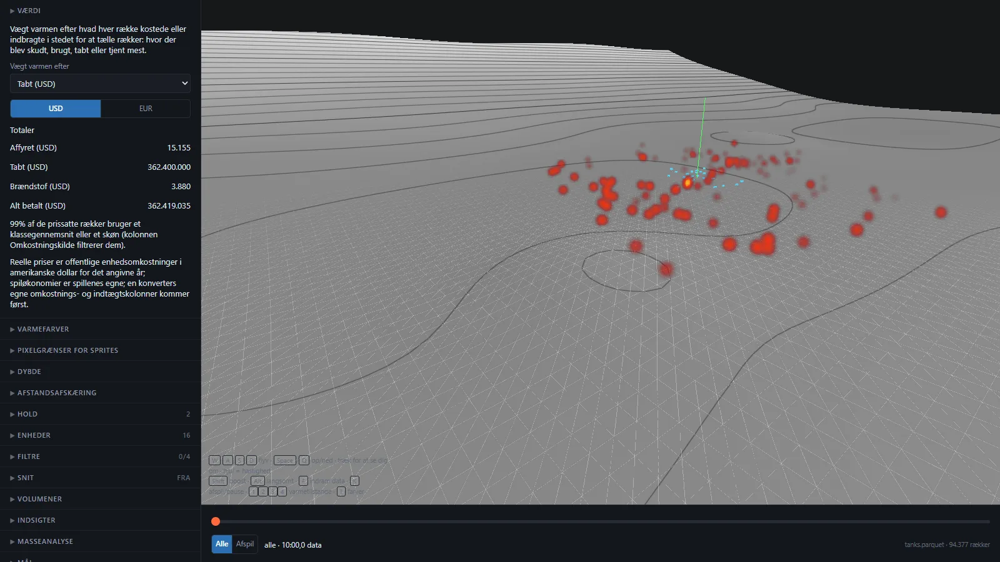

# Værdivægtning

Hvert skud, hver ammunition, hvert tabt køretøj og hver liter brændstof har en pris. Fremviseren regner ud, hvad hver række kostede eller indbragte, og den kan vægte varmen efter det. Kortet viser dermed **hvor pengene gik hen**, i stedet for hvor rækkerne ligger.

## Sådan bruges den {#how-to-use-it}

1. Indlæs data med hændelser (skud, nedskydninger, dødsfald) og køretøjs- eller våbennavne.
2. Åbn **Værdi** i varmesidebaren.
3. Vælg **Vægt varmen efter**, fx *Tabt (USD)*. Varmen lægger nu hver rækkes pris til i stedet for 1.
4. Læs **Totaler**: summen af hver værdikolonne for det, der vises. Filtre og tidsvindue gælder.
5. Hvor priserne er rigtige penge, vises en **USD / EUR**-kontakt.

Vælg det tomme første punkt i menuen for at tælle rækker igen.

## Hvad der kan vægtes {#what-can-be-weighed}

De værdikolonner, der tilføjes ved indlæsning, er én pr. slags og valuta:

| Slags | Rækker, den rammer | Sådan prissættes |
|---|---|---|
| **Affyret** | skud og affyringer | våbenet, ellers et gennemsnit for ammunitionstypen |
| **Brugt** | køb, spawn | penge-kolonnerne i spillet (fx en skyttes købemenu) |
| **Tabt** | dødsfald, ødelagt | eget køretøj, ellers gennemsnittet for dets klasse |
| **Ødelagt** | nedskydninger | målkøretøjet |
| **Påført skade** | træffer | en andel af målets værdi |
| **Brændstof** | positioner | brugt brændstof, fra en brændstofkolonne eller estimeret ud fra klassen og tiden |
| **Alt betalt** | | affyret + brugt + tabt + brændstof |
| **Tjent** | belønninger | spillets egne belønningskolonner (`earn_…`) |
| **Netto** | | tjent minus betalt. Tegnes som fortegnsvarme: positiv rampe, hvor der blev tjent mest, og negativ, hvor der blev betalt mest |

Kolonnenavnene er `cost_<kind>_<currency>`, `earn_<currency>` og `net_<currency>`. En konverter, der kender spillets egen valuta (fx en replay-konverter, der skriver i spillets kreditter), vinder over de indbyggede prislister.

## Prislisterne {#the-price-tables}

| Tabel | Valuta |
|---|---|
| Virkelige militære våben: missiler, bomber, runder, modforanstaltninger, fly, helikoptere, køretøjer på land, skibe, brændstof | USD (EUR = USD × 0,92, den faste `EUR_PER_USD` i [`cost.ts`](https://github.com/Holdi601/3DHeat/blob/main/src/data/cost.ts). Det er ikke en levende kurs) |
| Skytters købemenuer og drabsbelønninger | spillets kreditter |
| Tank- og skibsspil | spillets kreditter |
| Strategispil (flere ressourcer) | én kolonne pr. ressource plus en samlet |
| Krigsspil | point |

Spillet genkendes ud fra navne i dataene. Virkelige priser kommer fra offentlige kilder (budgetdokumenter, leksika) eller er markeret som estimater. De er ikke justeret for inflation. Den genererede liste over tabellerne står på [Værditabeller](ref-value-tables.md).

## Estimater {#estimates}

Den ekstra kategorikolonne **Priskilde** siger, hvordan hver række blev prissat: `table`, `class average`, `estimate` eller `none`. Afsnittet Værdi viser, hvilken andel af de prissatte rækker der er gennemsnit eller estimater. For kun at beholde præcist prissatte rækker fravælges *estimate* og *class average* under **Priskilde** i [Filtre](filters.md).

## Hvor ellers værdi vises {#where-else-value-shows}

- [Indsigter](insights.md): fund om *Dyr jord* og *Indtjenende jord*.
- [Opdeling](breakdown.md): Tjent, Tabt og Netto penge pr. hold, spiller eller våben.
- [Volumener og sammenligning](volumes.md): værdikolonner i statistikken og sammenligningen.
