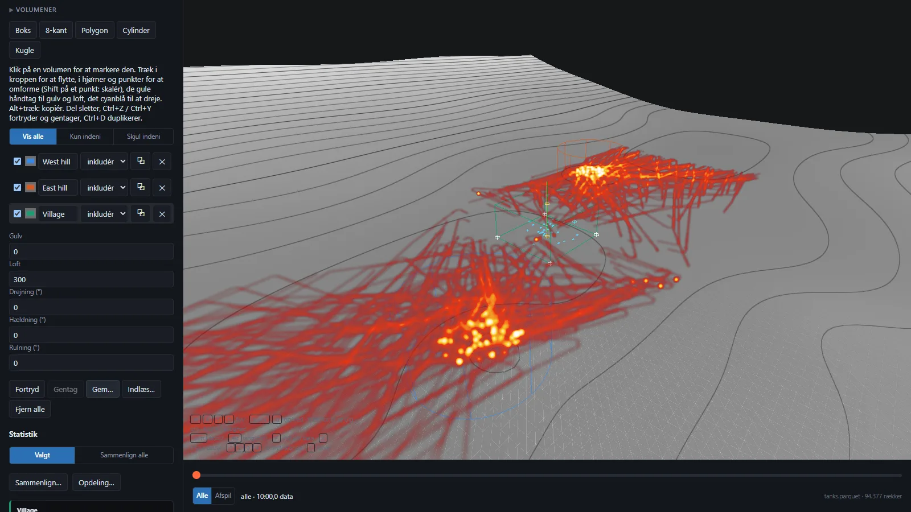
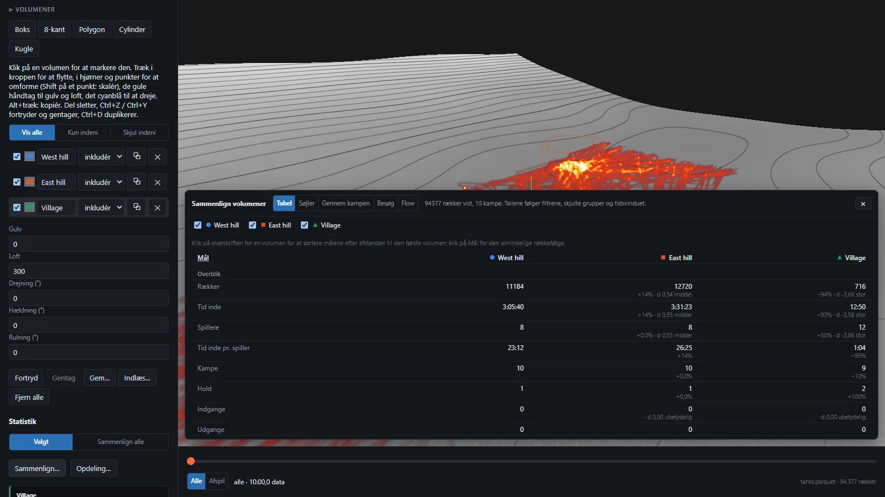
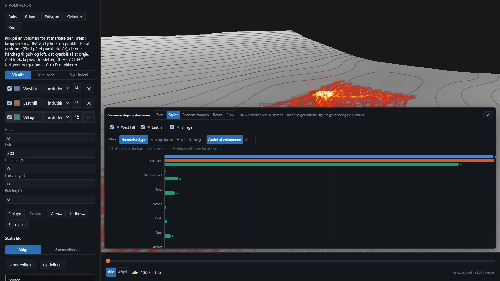

# Volumener og sammenligning

Et **volumen** er en usynlig boks (eller cylinder, eller kugle), du tegner rundt om et sted for at spørge: hvad skete der herinde? Brug det til at tælle drab ved en bro, til at sammenligne to bakker eller til kun at vise aktiviteten i ét område.

```
set ovenfra              Du tegner en form ->  viewer tæller
+------------+           det, der er indeni:
|   ( A )    |            rækker, spillere, drab, tid ...
|        [B] |           Sammenlign A med B side om side.
+------------+
```



Volumener måler, hvad der sker indeni dem, filtrerer visningen til dem, eksporterer deres rækker og kan sammenlignes side om side. Se også [ordlisten](glossary.md) for række, person og kamp.

## Tegn et volumen {#draw-a-volume}

1. Åbn **Volumener** i sidebjælken.
2. Vælg et værktøj, og tegn i 3D-visningen eller på 2D-kortet. Gulv og loft starter ud fra dataene under det. Esc annullerer.
3. Klik på volumenet for at vælge det; dets **Statistik** vises.

| Værktøj | Sådan tegner du |
|---|---|
| **Boks** | Træk et rektangel (Shift: en kvadrat). Et klik sætter en standardboks. |
| **n-kant** | Træk fra midten (Shift holder den regelmæssig). *Hjørner* sætter n, fra 3 til 64 (standard 8, så knappen viser **8-kant**). |
| **Polygon** | Klik på hjørnerne; luk med et dobbeltklik, Enter eller et klik på det første hjørne. Backspace fjerner det sidste hjørne. |
| **Cylinder** | Træk radius. |
| **Kugle** | Træk radius; den hviler på jorden. |

## Rediger {#edit}

- Klik på et volumen for at vælge det. Træk i dets krop for at flytte det, i hjørnerne for at forme det om (Shift på et hjørne skalerer).
- De **gule** håndtag sætter gulv og loft, det **cyan** håndtag drejer det.
- Alt+træk kopierer, Del fjerner, Ctrl+Z / Ctrl+Y fortryder og gentager, Ctrl+D dublerer. **Fjern alle** sletter alle volumener.
- Præcise værdier: Gulv, Loft, Drej / Hæld / Rul (bokse), Radius (kugler, cylindre).

Hver volumenrække har et afkrydsningsfelt for visning, en farve, et navn, **inkludér** eller **udeluk**, dublering og sletning. Volumener gemmes i browseren for hvert datasæt, og **Gem...** / **Indlæs...** skriver og læser en fil `volumes.json`.

## Filtrer visningen {#filter-the-view}

| Filter | Virkning |
|---|---|
| **Vis alle** (standard) | Volumener måler kun. |
| **Kun indeni** | Varme, replay og [træfanalyse](hit-analysis.md) tegner kun det, der er inde i de inkluderede volumener og uden for de udelukkede. |
| **Skjul indeni** | Det modsatte. |

GPU-filteret tager op til 8 volumener med 64 konturpunkter i alt; et "!" markerer et volumen ud over det. Statistik og eksport tæller det stadig med.

## Statistik {#statistics}

Området **Statistik** følger filtrene, tidsvinduet og skjulte grupper. *Valgt* viser det valgte volumen, *Sammenlign alle* sætter alle volumener side om side. Det viser:

- **Rækker indeni (vist)** og **Rækker indeni (alle data)**, **Spillere**, **Hold**, **Kampe**, **Tid inde**, **Ind- / udgange**, **Spidsvarme**, **Middelvarme**, **Volumen / fodaftryk** og et histogram over **Hvornår**;
- **Sejrsandel**, hvor dataene siger, hvem der vandt ([resultatkolonner](data-formats.md#outcome-columns)): af runderne med en spiller indeni, hver spillers runde talt én gang, den andel, deres side vandt - trukket mod andelen over alt det viste med 4 runder, som [opdelingen](breakdown.md) gør - med de vundne og spillede runder og den samlede andel;
- pr. kolonne: kategorier med **Løft** (andel inde divideret med andelen i alle viste data), og tal med interval, median og 5.-95. percentil.

**Statistik som CSV / JSON** gemmer dem. **Eksportér dataene indeni** skriver rækkerne inde i volumenet som CSV eller Parquet (*Kun de viste rækker* er til som standard), ét volumen eller alle med en kolonne, der siger, hvilket volumen hver række ligger i.

## Sammenlign volumener {#compare-volumes}

Med to eller flere synlige volumener trykker du på **Sammenlign...**.

1. Tegn tre volumener, for eksempel Vestbakken, Østbakken og Landsbyen.
2. Tryk på **Sammenlign...** under Statistik.
3. I **Tabel** læser du hver værdis forskel fra det første volumen.
4. Skift til **Søjler** for at se andelene som søjler.



| Visning | Viser |
|---|---|
| **Tabel** | Rækker, tid inde, spillere, kampe, hold, indgange, udgange, besøg, besøgslængde, drab, dødsfald, drab pr. død, drab pr. minut, tid pr. spiller, værdikolonner; grupperet efter hændelser, køretøjsklasse, spiller eller AI, hold og retning. Hver værdi viser sin forskel fra det første volumen og en effektstørrelse (ubetydelig, lille, mellem, stor). Klik på et volumens overskrift for at sortere efter afstand fra det første. |
| **Søjler** | Antal eller andele efter hændelse, klasse, aktør, hold eller retning. Klik på en søjle for at filtrere visningen til den. |
| **Gennem kampen** | Ét diagram pr. volumen over kampens minutter: tilstedeværelse, rækker eller drab. Klik for at springe dertil. |
| **Besøg** | Boks- og violindiagrammer over, hvor længe besøgene varer (logaritmisk skala). |
| **Flow** | Hvor sporene går, efter de forlader hvert volumen: en overgangsmatrix eller flow-bånd. |



## Tips {#tips}

- Start fra et fund: i [Indsigter](insights.md) tilføjer **Volumen her** en cylinder rundt om fundets sted.
- **Opdeling...** åbner [Opdeling](breakdown.md) for det valgte volumen: hvem og hvad der klarer sig bedst indeni.
- [Retningsvarme](directional-heat.md) kan tegne retningerne inde i det valgte volumen som diagram.
- [Fanen Køretøjer](hit-analysis.md#restrict-to-an-area) bruger de samme volumener som sit områdefilter.
