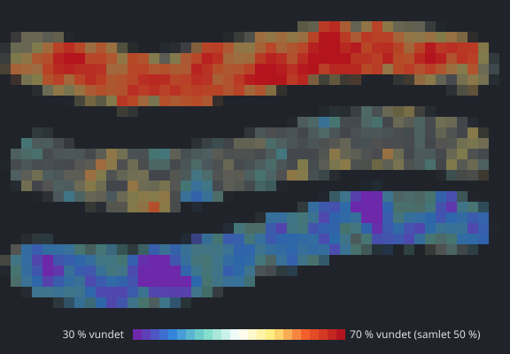

# Sejrsandel: hvor ofte et sted, en rute eller et træk vinder

Hvor en spiller står, hvilken vej de går, hvor de kaster deres udstyr - og hvor ofte deres side så vinder runden. **Sejrsandelskortet** farver hvert sted efter andelen af rækkerne der, som hører til runder, rækkens side vandt, set mod andelen over alt det viste: varmt, hvor den er højere, koldt, hvor den er lavere, intet, hvor den er den samme.

*Billedet er opdigtede data: tre ruter på en tom bane, med 68 %, 50 % og 33 % af deres rækker i vundne runder.*

Det kræver data, der siger, hvem der vandt: [resultatkolonnerne](data-formats.md#outcome-columns) (`won`, `matchWon`, `roundEndReason`). CS2- og War Thunder-konverterne skriver dem, Tacview-konverteren for en DCS-servers kampagner ([DCS-servere](tacview-acmi.md#dcs-servers-who-won-and-how-each-sortie-ended)); enhver fil kan.

## Prøv det {#try-it}

1. Indlæs kampe med en resultatkolonne, og tryk på `2` (**Forskel**).
2. I **Forskelsopdeling** trykker du på **Sejrsandel pr. runde** (eller **Sejrsandel pr. kamp**). Den lægger de vundne runder på **+** og de tabte på **−** og skifter panelet til **Andel +**.
3. Aflæs farverne. Panelet siger den samlede andel: *I alt ligger 52,0 % af 1.200.000 rækker på +.*
4. Indsnævr det med [filtrene](filters.md): én side (T eller CT), én hændelsestype (*Position* for, hvor folk stod, *Skud affyret* eller *Affyring* for, hvor de skød eller kastede fra), ét køb, ét kort.

Et sted, der er varmt med *Position*-rækker, er et sted, hvor dem, der holdt det, plejede at vinde runden. Med *Drab*-rækker er det et sted, hvor de drab, der blev lavet, førte til vundne runder.

## Indstillingerne {#the-settings}

| Indstilling | Hvad den gør | Standard |
|---|---|---|
| **Forskel** / **Andel +** | selve forskellen, eller + sidens andel af rækkerne på begge sider | Forskel |
| **Fuld farve ved** | hvor langt over eller under den samlede andel et sted vises i fuld farve, i point | ± 20 point |
| **Færrest rækker for at farve et sted** | et sted med færre rækker farves ikke; det toner ind fra det halve | 12 |
| **Træk mod den samlede andel (rækker)** | hvert sted starter med så mange rækker på den samlede andel, så et sted med 3 rækker, alle vundet, ikke vises som 100 % | 12 |

Alle tre virker på det færdige billede: at trække i dem genstarter aldrig akkumuleringen.

Andelen er enhver opdelings, ikke kun sejre: *Andel +* med en opdeling efter side viser, hvor T'erne var den største del af tilstedeværelsen, og med en opdeling efter to korts filer, hvor den ene fils rækker vejer mere end den andens.

## Rækker, ikke runder {#rows-not-rounds}

Kortet tæller rækker. En spiller, der står på ét sted i tyve sekunder, tilføjer en række for hver prøve, alle fra én runde, så beviset på et sted er rækkerne nær det, ikke runderne. Derfor er minimum og træk angivet i rækker, og derfor er de større end det, én runde giver.

For selve runderne:

- **[Opdeling](breakdown.md)** på et punkt, visningen eller et volumen: *Sejr %* tæller hver spillers runde én gang, trukket mod stedets samlede andel på samme måde (4 runder).
- **[Volumener](volumes.md)**-statistik: *Sejrsandel* - runderne med en spiller inde i volumenet, hver én gang, trukket mod andelen over alt det viste, med antallene.

## Resultatfiltre {#outcome-filters}

Panelet [Filtre](filters.md) viser resultatkolonnerne lige efter viewerens egne: **Rundens resultat** og **Kampens resultat** (*Alle*, *Vundet*, *Tabt*) og **Hvordan runden sluttede** (Eliminering, Bomben sprang, Bomben desarmeret, Tiden løb ud, Opgivelse, Uafgjort, Mål, Zoner holdt, Billetter tabt, Alle køretøjer tabt), på viewerens sprog.

## Til udviklere {#for-developers}

Varmepasset skriver tre summer ind i det firekanals mål, som holdvarme bruger: varmen `R = Σ|v|`, + sidens varme `P` og `S = Σ v²/w`, hvor `w` er passets vægt (samplingvægt gange billedforstærkning). Sammensætningen læser andelen `P/R` (et kernevægtet gennemsnit) og de rækker, den hviler på, `n = R²/S` (Kishs effektive stikprøvestørrelse), trækker andelen mod den samlede, `p = (n·P/R + m·r0)/(n + m)`, og farver `p - r0` over spændet på forskelsskalaerne.

`n` dividerer enhver faktor ud, som rækkerne ved en pixel har til fælles - billedforstærkningen, samplingvægten, en afklippet sprites arealvægt - så billedet er det samme ved enhver zoom og samplingtæthed, og billeder af hver k'te række smelter sammen til helheden, uden at farverne hopper. Den samlede andel kommer fra CPU'ens sidetællinger, holdt til tiendedele af en procent; intet læses tilbage fra GPU'en. Regningen og dens kontroller: [`render/rateMap.ts`](https://github.com/Holdi601/3DHeat/blob/main/src/render/rateMap.ts) og dens test.

Det koster det samme som holdvarme: det firekanals mål firedobler varmepassets blend-båndbredde, kun mens *Andel +* er slået til.
