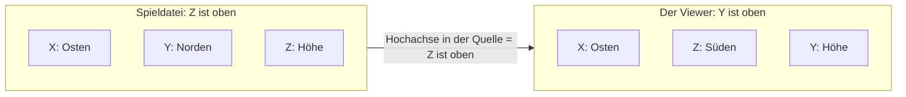

# Achsen, Einheiten und Zeit

Spiele und Karten sind sich nicht einig, wo oben ist, wie lang eine Einheit ist und wie Zeit geschrieben wird. Diese Seite zeigt die drei Einstellungen, die dafür sorgen, dass deine Daten richtig stehen, richtig skaliert sind und richtig ablaufen.

Steht deine Karte wie eine Wand statt wie ein Boden, schalte **Hochachse in der Quelle** um.

Mit der falschen **Hochachse in der Quelle** steht die Karte wie eine Wand; mit der richtigen liegt sie wie ein Boden.

## Die Welt, in der der Viewer zeichnet {#the-world-the-viewer-draws-in}

Die Welt des Viewers ist **Y-oben**: X und Z bilden die Bodenebene, Y ist die Höhe. Die meisten Spiel-Engines sind **Z-oben**: Für sie sind X und Y der Boden und Z die Höhe. Manche Engines sind außerdem gespiegelt (linkshändig). Die Zuordnung legt fest, wie die Achsen der Datei in die des Viewers umgedreht werden. (Technisch ist der Viewer rechtshändig, die Konvention von three.js.)

### Hochachse {#up-axis}

**Hochachse in der Quelle** in der [Spaltenzuordnung](column-mapping.md):

| Einstellung | Datei (x, y, z) wird Welt (X, Y, Z) |
|---|---|
| *Z ist oben (die meisten Spiel-Engines)* - der Standard | (x, **z**, **y**): Die Z-Achse der Datei wird die Höhe, und die Y-Achse der Datei wird die Z-Achse der Welt |
| *Y ist oben (Grafikkonvention)* | (x, y, z) unverändert |

Bei Z-oben-Daten werden die drei Felder neu beschriftet statt kopiert ([`remapAxesInPlace`](https://github.com/Holdi601/3DHeat/blob/main/src/data/ingest.ts)), was bei großen Ladevorgängen hunderte Megabyte spart. Die Vermutung wird aus der Stichprobe gebildet: Welche der Spalten Y und Z die kleinere Streuung hat, ist oben.

### Spiegelungen {#flips}

**X spiegeln**, **Y spiegeln**, **Z spiegeln** kehren die Achse *der Datei* mit diesem Namen um, bevor die Neubeschriftung erfolgt - bei Z-oben kehrt also *Y spiegeln* um, was am Ende die Z-Achse der Welt ist. Eine Spiegelung ändert die geladenen Daten: Koordinaten, die das [Lineal](measure.md), der Schnitt und die Kamerapose zeigen, sind die gespiegelten.

Um eine gespiegelte Welt richtig herum zu zeichnen, **ohne** die Daten zu ändern, nutze stattdessen **Kamera & Szene → Weltachse invertieren** ([Kamera](camera.md#invert-world-axis)). Das ist die bessere Wahl für Spiele mit linkshändiger Welt, weil jede Koordinate, die die Werkzeuge zeigen, die eigene des Spiels bleibt.

### Einheitenmaßstab {#unit-scale}

**Einheitenmaßstab** multipliziert jede Position. *1 (m)* setzt 1, *0,01 (cm→m)* setzt 0,01 (Unreal-Engine-Einheiten sind Zentimeter, also nimm 0,01; Source-Engine-Einheiten sind Zoll, also nimm 0,0254; keines von beiden sind Meter), und das Feld nimmt jeden Wert an. Eine eingetippte 0 oder ein Wert, der keine Zahl ist, wird durch 1 ersetzt.

Der Viewer beschriftet Entfernungen in Metern (Sprite-Radius, Culling-Entfernungen, Lineal, Fluggeschwindigkeit), was nur stimmt, wenn die skalierte Welteinheit ein Meter ist. Es bricht nichts, wenn sie keiner ist; die Beschriftungen zeigen dann einfach „m“ für was auch immer die Einheit ist.

## Zeit {#time}

### Zeiteinheiten {#time-units}

Faustregel: Werte wie 17000000000 (zehn oder mehr Stellen) sind ein Unix-Zeitstempel; Werte wie 0, 0,25, 0,5 sind Sekunden seit dem Start.

| Zeiteinheit (Menübeschriftung) | Gelesen als | Angezeigte Uhrzeit |
|---|---|---|
| *Sekunden (relativ)* | Wert × 1 s | nein |
| *Millisekunden (relativ)* | Wert × 0,001 s | nein |
| *Mikrosekunden (relativ)* | Wert × 10^-6 s | nein |
| *Nanosekunden (relativ)* | Wert × 10^-9 s | nein |
| *Unix-Zeitstempel (s)* | Sekunden seit 1970-01-01 UTC | ja |
| *Unix-Zeitstempel (ms)* | Millisekunden seit 1970-01-01 UTC | ja |
| *ISO-8601-Datumstext* | Text wie `2026-03-14T18:02:11.250Z`, geparst mit `Date.parse` des Browsers | ja |

Bei einer absoluten Einheit (die letzten drei) behält der Datensatz den Zeitpunkt der Uhr seiner frühesten Zeile, und die Zeitleiste zeigt neben dem Abspielkopf die aktuelle UTC-Tageszeit (`HH:MM:SSZ`).

**Parquet-Spalten `TIMESTAMP` und `DATE`** werden zu echten Zeitpunkten dekodiert; deshalb wird ihre Einheit ignoriert, und das Feld sagt das. Eine `DATE`-Spalte ist ein ganzer Tag: Jede Zeile eines Tages hat denselben Zeitpunkt, und die Wiedergabe springt tageweise, wovor das Feld warnt.

**ISO-8601-Texte funktionieren in CSV und Parquet gleich.** Eine Textspalte mit ISO-Einheit wird für jeden verschiedenen Text einmal geparst; parst keiner, scheitert das Laden mit *Keine lesbaren ISO-8601-Zeitstempel in der zugeordneten Zeitspalte.* - und die Zuordnung verweigert den Start schon, wenn keiner der gesampelten Werte parst. Eine Parquet-Spalte `TIMESTAMP` wird als Zeitstempel gelesen, egal welche Einheit gesetzt ist, und eine numerische Parquet-Spalte mit ISO-Einheit wird als Unix-Millisekunden gelesen. Eine Textspalte mit numerischer Einheit wird vor dem Laden abgelehnt: Jeder Wert würde als NaN gelesen.

### Wie Zeit gespeichert wird {#how-time-is-stored}

Beim Zusammenführen der Dateien sind Zeiten 64-Bit-Sekunden, so dass eine absolute Epoche ihre Sekundenbruchteile behält. Wenn alle Dateien da sind, wird die früheste Zeit der ganzen Auswahl zu 0, und jede Zeile speichert 32-Bit-Sekunden ab dieser Zeit. Eine 32-Bit-Gleitkommazahl hat 24 Bit Mantisse: Zeitspannen von bis zu etwa eineinhalb Tagen lösen sich auf besser als 1/100 s auf, Spannen von einem halben Jahr auf etwa eine Sekunde. Eine Zeile, deren Zeit fehlt oder keine Zahl ist, wird auf 0 gesetzt, den Start.

Die Zeilen werden dann nach Zeit sortiert, was die Zeitleiste günstig macht: Ein Zeitfenster wird mit zwei binären Suchen gefunden (siehe [Abtastung und Budgets](sampling-and-budgets.md)).

### Verstrichene Zeit gegenüber Uhrzeit {#elapsed-time-versus-wall-clock}

Eine Zeitspalte wie `match_time` oder `round_time` zählt ab dem eigenen Start jedes Matches. Wählst du sie, liegt jedes Match auf einer gemeinsamen Achse - gut, um zu vergleichen, was in Minute 3 jedes Matches passiert -, und das Feld weist darauf hin. Eine Uhrzeit-Spalte zeigt die Matches in der Reihenfolge, in der sie wirklich stattfanden, und überlappt dort, wo sie sich überlappten.

## Blickrichtung {#look-direction}

Die Blickrichtung wird nur vom [Box-Replay](box-replay.md) benutzt (die Strahlen aus jeder Box). Sie wird als zwei Winkel gespeichert, Gier und Nick, in Radiant.

- **Spalten für Gier-/Nickwinkel** werden unverändert gelesen, bei *Grad* gewählt von Grad umgerechnet. Sie werden nicht an die Hochachse oder die Spiegelungen angepasst.
- **Spalten für Richtungsvektor** durchlaufen dieselbe Neubeschriftung und Spiegelung wie die Positionen und werden dann zu Gier = atan2(x, -z) und Nick = atan2(y, √(x² + z²)) in Weltachsen, so dass der Strahl auch in einer gespiegelten Quellwelt dorthin zeigt, wohin die Box schaut.

Zeigen Gier-/Nickwinkel nach einer Spiegelung, einem Richtungsvektor oder angepassten Winkeln in die falsche Richtung, ist das die Stelle zum Nachsehen.
