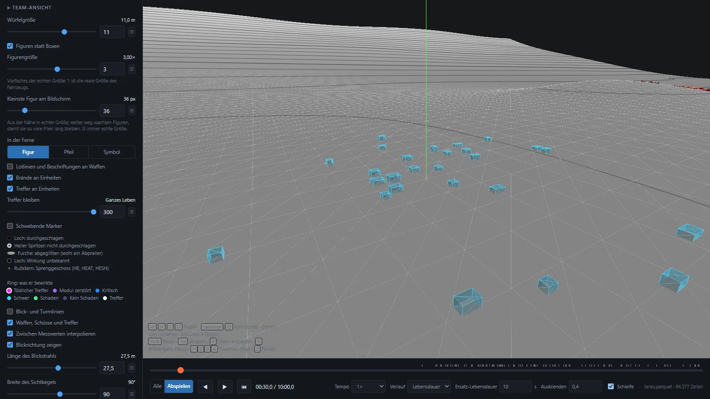

# Figuren-Overlay (Box-Replay)

Ein kleiner Film: eine Figur für jede Person, die sich mit der Zeit bewegt, mit einer Spur dahinter.

Der Modus heißt in der Modusleiste **Figuren-Overlay**. Diese Seite hieß früher „Box-Replay“, weil jede Person ein Kasten war, bevor es Figuren gab; „Figuren-Replay“ und „Box-Replay“ meinen dasselbe. **Figuren-Overlay** hat keine Zifferntaste: Wähle es in der Modusleiste. Es zeichnet eine Figur (oder einen Kasten) pro [Person](glossary.md), die sich entlang der [Zeitleiste](timeline.md) bewegt, mit optionalen Blickstrahlen und Spuren. Es ist eine Wiedergabe statt einer Dichte: *wer war wann wo*. Es braucht eine Personenspalte; ohne Zeitspalte wird jede Stichprobe auf einmal gezeichnet.

## So benutzt du es {#how-to-use-it}

1. Lade Daten mit einer Personenspalte und einer Zeitspalte.
2. Wähle **Figuren-Overlay** in der Modusleiste.
3. Stelle die Zeitleiste auf **Abspielen** und drücke Play (`K`).
4. Öffne **Team-Ansicht**, um **Schweiflänge**, die Figurengröße oder die Blickstrahlen zu ändern.

In diesem Modus wird keine Heatmap gezeichnet, und das adaptive Sprite-Budget ruht.

Standardmäßig wird jede Person als Figur dessen gezeichnet, was sie ist, nicht als Kasten - siehe [Figuren](figures.md), welche Figur eine Einheit bekommt, und [Match-Replay](match-replay.md) für Beschriftungen, die Verfolgungskamera, das Messen zwischen zwei Einheiten und die Ereignisliste.

## Das Feld Team-Ansicht {#the-team-viewer-panel}

Wird in diesem Modus anstelle der Heatmap-Felder angezeigt.

| Regler | Standard | Bereich (Schrittweite) | Bedeutung |
|---|---|---|---|
| **Figuren statt Boxen** | an | | Jede Person als Figur dessen, was sie ist: ein Soldat zu Fuß, der Panzer oder das Flugzeug, die die Daten nennen. Was die Daten nicht sagen, bleibt ein Kasten. |
| **Figurengröße** | 1× | | 1× ist die wahre Größe. |
| **Kleinste Figur am Bildschirm** | 36 px | 0 = immer wahre Größe | Wahre Größe aus der Nähe; weiter weg wachsen Figuren, damit sie so viele Pixel lang bleiben. |
| **Waffen, Schüsse und Treffer** | an | | Waffen im Flug mit Rauch, Leuchtspur, Einschlägen, Treffern und Abschüssen. Aus einem Treffer abgeleitete Leuchtspuren sind gestrichelt. |
| **Würfelgröße** | Größe der Entität, oder Ausdehnung / 500, beim Laden | 0,05-200 m, logarithmisch (5000) | Kantenlänge jedes Kastens. Siehe [Größe der Entität](sessions-persons-groups.md#entity-size). |
| **Zwischen Messwerten interpolieren** | an | | Zwischen zwei Messwerten derselben Person in derselben Session wird der Kasten anteilig dazwischen platziert. Nie über eine Session-Grenze hinweg. |
| **Blickrichtung zeigen** | an | | Ein Strahl von jedem Kasten in die Blickrichtung der Person (braucht [Blickspalten](axes-units-and-time.md#look-direction)). |
| **Länge des Blickstrahls** | Größe der Entität × 4, oder Ausdehnung / 200, beim Laden | 0,5-500 m, logarithmisch (20.000) | Wird angezeigt, solange die Blickrichtung an ist. |
| **Schweiflänge** | 8 s | 0-300 s (86.400); 0 = aus | Sekunden Verlauf, die hinter jeder Person gezeichnet werden. |
| **Jeden Rohmesswert zeichnen** | aus | | Ein Kasten pro gespeichertem Messwert im Fenster statt eines interpolierten Kastens pro Person. Wird unterabgetastet, damit es flüssig bleibt. |

Hinweise im Feld erklären, dass Interpolation und Spuren Messwerte nur innerhalb einer Session verbinden, und, wenn die Daten [geteilte Namen](sessions-persons-groups.md#names-worn-by-several-things-at-once) haben, wie viele Namen als einzelne Messwerte gezeichnet werden.

## Die gespielte Session {#the-session-being-played}

Mit einer Session-Spalte entscheidet die **Session**-Auswahl oben in der Seitenleiste ([Sessions](sessions-persons-groups.md#the-session-picker)), welches Match abgespielt wird. Beim Laden wird das aktivste gewählt. Nur Zeilen dieser Session werden zu Kästen und Spuren, und die Zeitleiste läuft über die Spanne dieser Session statt über den ganzen Datensatz. *Alle Sessions* spielt alle Sessions gleichzeitig, verbindet Messwerte aber trotzdem nie über Sessions hinweg.

## Was wann gezeichnet wird {#what-is-drawn-when}

Aus [`TrackCursor`](https://github.com/Holdi601/3DHeat/blob/main/src/data/tracks.ts):

**Live-Kästen** (Modus Abspielen, Rohmesswerte aus). Für jede sichtbare Person ihr letzter Messwert am oder vor dem Abspielkopf:

- Hat die Person einen nächsten Messwert, liegt er in derselben Session, und der Name ist nicht geteilt, wird der Kasten zwischen den beiden Messwerten anteilig zur Zeit platziert, mit dem Gierwinkel auf dem kürzeren Weg interpoliert und dem Nickwinkel linear (wenn *Interpolieren* an ist).
- Sonst bleibt der Kasten am letzten Messwert für die **Ersatz-Lebensdauer** der Zeitleiste (Standard 10 s) und wird dann entfernt, damit ausgeschiedene Spieler nicht stehen bleiben.

**Modus Alle** ignoriert den Abspielkopf und zeichnet jeden Messwert im Bereich als Kasten.

**Rohmesswerte** zeichnet einen Kasten pro gespeichertem Messwert im Fenster: die *Spanne* beim Verlaufsmodus *Fenster*, sonst alles bis zum Abspielkopf. Höchstens 65.536 Kästen; bei mehr Messwerten wird jeder *k*-te gezeichnet.

**Spuren** (wenn die Schweiflänge über 0 liegt und Rohmesswerte nicht gezeichnet werden): eine Linie zwischen jedem Paar aufeinanderfolgender Messwerte einer Person innerhalb der letzten *Schweiflänge* Sekunden bis zum Abspielkopf, die mit dem Alter von 80 % Deckkraft nach durchsichtig verblasst. Eine Spur endet bei einem Session-Wechsel und wird für geteilte Namen nicht gezeichnet. Höchstens 131.072 Eckpunkte; bei mehr werden Zeilen gleichmäßig übersprungen.

**Wer sichtbar ist:** Eine Person ist verborgen, wenn ihre Gruppe in der [Teamliste](teams-list.md) abgewählt ist (ihre Gruppe ist die ihrer ersten Zeile), wenn ein Gruppenfilter sie ausschließt, oder wenn das Feld [Entitäten](entities.md) eine Auswahl hat, die sie nicht enthält. Die Spaltenfilter ([Filter](filters.md)) gelten nicht für Kästen.

## Farben {#colours}

Eine Farbfamilie pro Gruppe und ein Farbton pro Mitglied, so dass ein Blick zeigt, auf welcher Seite jemand steht ([`teamMemberColor`](https://github.com/Holdi601/3DHeat/blob/main/src/render/colors.ts)). Die Gruppenfarbtöne laufen durch eine feste Liste von zehn - Blau, Rot, Grün, Bernstein, Violett, Cyan, Magenta, Limette, Orange, Indigo -, und die Mitglieder einer Gruppe verteilen sich über eine Helligkeit von 42-76 % und eine Sättigung von 90-65 %.

## Hinweise {#notes}

- Das Figuren-Overlay baut seine Figuren nur neu, wenn sich etwas ändert; ein ruhendes Bild zeichnet die letzten neu.
- Die Zeile *Würfel* der [Statistik-Überlagerung](performance-and-stats.md) zählt die Kästen auf dem Bildschirm.
- Das Figuren-Overlay zeichnet in derselben Szene wie das Level, deshalb verwischt die [Tiefenschärfe](camera.md#depth-of-field) die Kästen, aber nie die Heatmap.
