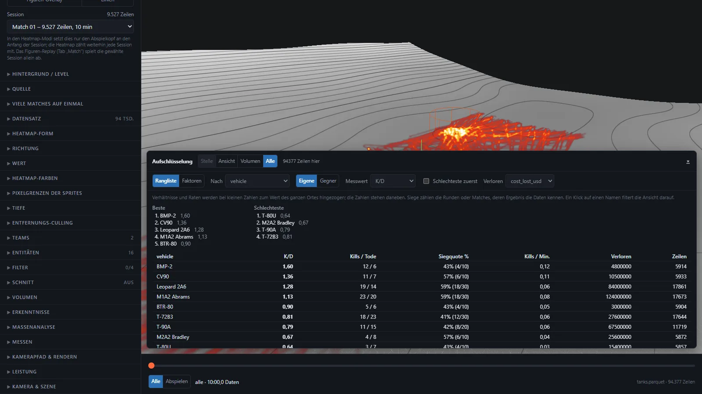
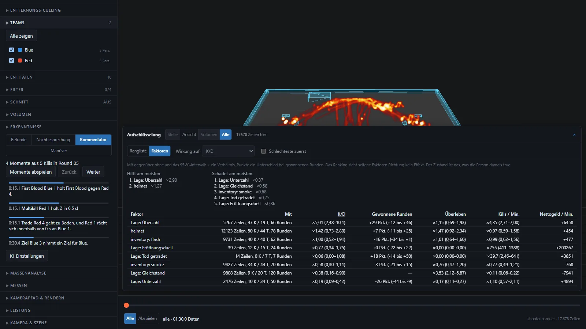

# Aufschlüsselung: wer und was an welcher Stelle am besten ist

Die **Aufschlüsselung** beantwortet eine Frage: Welches Fahrzeug, welcher Spieler oder welche Waffe ist an diesem Ort am besten? Benutze sie, um den Panzer zu finden, der an der Brücke gewinnt, oder um zu sehen, ob ein Helm wirklich hilft.

Sie ordnet, was an einem Ort geschieht (eine gewählte Stelle, die Ansicht, ein Volumen oder alles Angezeigte), nach jeder Kategorie, und sie misst jeden Zustandsfaktor mit und ohne.

## Ausprobieren {#try-it}

1. Lade ein Match mit Abschüssen und Toden und öffne **Volumen**.
2. Zeichne ein Volumen um die Stelle, die dich interessiert, und wähle es aus.
3. Drücke unter Statistik auf **Aufschlüsselung…**.
4. Wähle unter **Nach** *Fahrzeug* und den Maßstab *K/D* (Abschüsse pro Tod).
5. Lies die Liste, die Besten zuerst. Drücke **Schlechteste zuerst**, um sie umzudrehen. Klicke einen Namen an, um die Ansicht darauf zu filtern; klicke noch einmal, um ihn loszulassen.

## Öffnen {#open-it}

| Von | Bereich, mit dem sie beginnt |
| --- | --- |
| **Aufschlüsselung…** in [Volumen](volumes.md) (Statistik) | das gewählte Volumen |
| **Aufschlüsselung hier** auf der Auswahlkarte, nach einem Klick auf einen Punkt | eine Kugel um diesen Punkt (**Radius**, Standard 3 % der Größe der Daten) |
| das geteilte Feld **Differenz** | die Ansicht |

Der Kopf wechselt den Bereich: **Stelle**, **Ansicht** (was die Kamera beim letzten Zählen sah; **Neu zählen** nach einer Bewegung), **Volumen** (eines wählen) oder **Alle**. Es zählt im Hintergrund; die Statuszeile sagt, wie viele Zeilen im Bereich liegen.

## Rangliste {#ranking}

Wähle, wonach geordnet wird, und einen Maßstab:

| Maßstab | Was es ist |
| --- | --- |
| A, B | Zeilen auf jeder Seite der Differenzkarte, geteilt so, wie die Heatmap sie teilt |
| A / B, A - B, A / (A + B) | die beiden Ebenen gegeneinander |
| K/D | Abschüsse gegen Tode |
| Siegquote | gewonnene Runden (oder Matches), wenn die Daten sagen, wer gewonnen hat |
| Abschüsse / Min. | Abschüsse pro Minute, die anwesend waren (Lücken der Bewegungsmesswerte) |
| Verdient, Verloren, Netto-Geld | Summen der Spalten `earn_*` und `cost_*`; eine Auswahl bestimmt die Währung |

Abschüsse, Tode, Anwesenheit, Siege und Geld zählen jede Zeile, die die Ansicht an dem Ort zeigt, auf beiden Seiten der Teilung oder auf keiner.

Verhältnisse und Raten werden bei kleinen Zählungen zum Wert des ganzen Ortes hingezogen, so dass 2 Abschüsse in 1 Leben nicht an der Spitze der Liste landen. Die Zählungen stehen daneben.

Du kannst nach den Gruppen, Spielern und Matches ordnen, nach jeder Kategoriespalte (einem Fahrzeug, einer Waffe, einer Seite, einer Kaufart, einem Agenten oder einer Ausrüstung), nach jeder Zahlenspalte in Bereichen (Panzerung, Wert einer Ausrüstung), nach der **Klasse** einer Waffenspalte (Gewehr, Scharfschützen, MP, Pistole ...) und danach, wie viele Stücke **Hilfsmittel** eine Listenspalte wie `inventory` enthält.

**Eigene** ordnet nach dem eigenen Wert der Zeile. **Gegner** ordnet nach dem Wert der anderen Partei: der Waffe des Opfers bei einem Abschuss, der des Mörders bei einem Tod (braucht eine Spalte `other` / `victim`, die sie nennt).

## Zustand zur Zeit {#state-at-the-time}

Der Wert einer Zeile ist ihr eigener, es sei denn, die Zeile hält keinen fest (eine Ereigniszeile ohne Ausrüstung) oder es ist ein Tod (dessen Waffenspalte die Waffe des Mörders nennen kann); dann ist es das, was dieselbe Person zuletzt früher im Match bei sich trug.

## Faktoren: mit gegen ohne {#factors-with-against-without}

Wechsle von **Rangliste** zu **Faktoren**, wähle **Wirkung auf** und lies *Hilft am meisten* und *Schadet am meisten*:

Die Wirkung jedes Faktors auf K/D, gewonnene Runden, Überleben (Minuten pro Tod), Abschüsse pro Minute und Netto-Geld pro Minute, mit einem 95-%-Intervall: Verhältnisse als x, gewonnene Runden als Differenz in Punkten. Die Rangliste zieht jede Schätzung je nach ihrer eigenen Unsicherheit zur Wirkung null hin, so dass ein seltener Faktor eine klare Wirkung braucht, um hoch zu ranken; das gezeigte Intervall ist das unverschobene.

Daten mit Runden fügen die Nahkampf-**Situationen** hinzu ([Nahkampf und Runden](close-quarters.md)), die einmal pro Datensatz berechnet werden: *geblendet* (die Spalte `state_flashed` der Zeile, oder ein gegnerischer Blitz innerhalb von 15 m in den letzten 3 s), *Tod getauscht*, *Eröffnungsduell*, und *Überzahl*, *gleiche Zahl* oder *Unterzahl* (lebende Spieler auf der Seite der Zeile gegen den Gegner). Ein Tod zählt in der Situation, in der sein Opfer kurz davor war.

In einem Durchgang werden höchstens 256 Faktoren gemessen.

## Für Entwickler {#for-developers}

### Kleine Stichproben hinziehen {#pulling-small-samples}

Der Wert der Rangliste ist `(n + m*r0) / (d + m)`: `n` und `d` sind die Zählungen, `r0` das Verhältnis des ganzen Ortes und `m` das Gewicht dieser Vorannahme.

### Für Konverter-Autoren: Faktor-Spalten benennen {#for-converter-authors-naming-factor-columns}

Ein Konverter fügt einen Faktor hinzu, indem er seine Spalte benennt:

| Spalte | Faktor |
| --- | --- |
| `state_<Name>` Zahl | an, solange ungleich null (`state_scoped`, `state_suppressor`) |
| `state_<Name>` Kategorie | ein Faktor pro Wert (`state_ammo` = AP, HE...) |
| `active_<Name>` | dasselbe, für etwas, das eingeschaltet oder kürzlich benutzt wurde: eine Fähigkeit, ein Ultimate, ein Gadget, ein Buff (`active_ult`, `active_stim`) |
| Listenspalte (`inventory`, `loadout`, `perks`, `abilities`, `attachments`, `modules`, `buffs`, `debuffs`, `upgrades`, oder ein Name `state_`/`active_`, der auf `s` endet) | ein Faktor pro Eintrag eines Wertes `a\|b\|c` |
| Ausrüstungsmerkmale, die schon üblich sind (`helmet`, `defuser`, `armor`, `scoped`, `airborne`, `duck`, `flashed`...) | an, solange ungleich null |
| `ammoType`, `shellType`, `ammoName` | die zuletzt abgefeuerte Munition |

Ergebnisse: eine Spalte `won` mit 0/1 (die Seite der Zeile hat die Runde oder das Match gewonnen) und eine Spalte `round`. Geld: `earn_<Währung>` und `cost_<Art>_<Währung>`; ein Einkommen nur nach Art (`earn_round_cs2`, die genauen Rundenprämien eines Konverters) ersetzt nur das Einkommensmodell des Kostenmodells für diese Art (`round` umfasst auch Platzieren und Entschärfen), und das Modell bepreist den Rest weiterhin.

Die Zuordnung lädt diese Spalten von selbst, neben der eigenen Liste der Datei: jede Spalte `state_*`, `active_*`, `won`, `round` und jede Listenspalte, außer denen, die die Statistik einer Parquet-Datei als einen einzigen durchgehenden Wert ausweist (jede geladene Spalte kostet 4 Byte pro Zeile).
