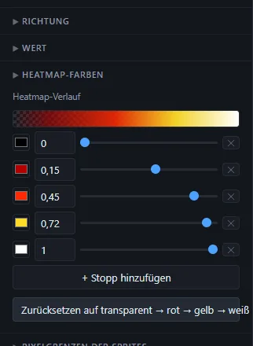

# Farbe und Belichtung

Diese Regler bestimmen, welche Menge Wärme welche Farbe bekommt. **Sättigungspunkt** ist die Wärmemenge, die als weißglühend gilt.

## Schnelle Lösungen {#quick-fixes}

- Alles ist weiß: Erhöhe den **Sättigungspunkt**, oder drücke **Belichtung automatisch aus dem Feld**.
- Man sieht nichts: Verringere den **Sättigungspunkt**, oder drücke **Belichtung automatisch aus dem Feld**.
- Nur ein paar einzelne Punkte sind zu sehen: Dreh die **Mindestintensität** hoch.

Jeder Regler auf dieser Seite wirkt, wenn die Wärme in eine Farbe umgewandelt wird. Wenn du einen davon verschiebst, wird das Bild sofort neu gezeichnet, und die **Akkumulation startet nie neu**.

## Sättigungspunkt {#saturation-point}

**Sättigungspunkt** (Abschnitt Heatmap-Form): die akkumulierte Wärme, die dem oberen Ende des Farbverlaufs entspricht (bei der Antwort *Linear*; zu den anderen Antworten weiter unten). Logarithmischer Regler von 0,1 bis 4000, Griff bis 10.000.000, weil die akkumulierte Wärme mit der Zeilenzahl wächst. Standard ist 24. Bei jedem Laden gibt es zuerst eine **analytische Schätzung** und danach eine **gemessene** Angabe aus dem Bild.

Ein falscher Wert macht den Unterschied zwischen einer Heatmap und einem leeren (oder weißen) Bild. Er lässt sich nicht zuverlässig berechnen: Telemetrie bündelt sich so stark - ein Spawn, eine Tür, ein Engpass - dass das Verhältnis von Spitzen- zu Mitteldichte bei verschiedenen Datensätzen und bei verschiedenen Kamerawinkeln um eine Größenordnung schwankt.

## Belichtung automatisch {#auto-exposure}

**Belichtung automatisch aus dem Feld** misst das Feld, das der Shader tatsächlich erzeugt hat. Leere Pixel werden ignoriert, der 98. Perzentilwert der beleuchteten Pixel wird genommen und auf 85 % des Weges zum Sättigungspunkt gelegt. So bleibt das obere Ende des Farbverlaufs für die echten Spitzen frei.

Das Feld zeigt dann an: *gemessen X % des Bildes; 98. Perzentil R nahe dem oberen Ende des Farbverlaufs*. Bei der Antwort *Sättigend* landet ein Wert bei 85 % des Sättigungspunkts bei etwa 57 % des Farbverlaufs statt bei 85 %.

Sie läuft auch **automatisch**:

- 8 gerenderte Bilder, nachdem ein Datensatz geladen wurde;
- 8 Bilder, nachdem sich die [Filter](filters.md) ändern (wenn man jede Position auf hundert Ereignisse filtert, ändert sich die Dichte um Größenordnungen);
- 8 Bilder nach dem Wechsel zwischen Punkt-Wärme und [Linien-Wärme](line-heat.md) oder nach dem Ändern, welche Routen die Linien-Wärme zeichnet, weil eine Linie pro Messpunkt viel weniger Wärme verteilt als ein Sprite.

Wenn nichts leuchtet, lässt der automatische Lauf die Sättigung unverändert. Der Knopf greift dann auf die analytische Schätzung zurück und meldet *nichts zum Messen beleuchtet - analytische Schätzung benutzt*.

### Der Ansicht folgen {#follow-the-view}

**Der Ansicht folgen** (Abschnitt Heatmap-Form, standardmäßig an) misst neu, sobald die Kamera zur Ruhe kommt. So nutzt eine Gegend, in die du hineinfliegst, den ganzen Farbverlauf, statt der Skala, die für die ganze Karte gemessen wurde. Kleine Änderungen werden ignoriert, und die Skala gleitet, statt zu springen. Das läuft in den vier Heatmap-Modi, nicht bei der Figuren-Überlagerung.

Schalte es aus, um die Skala festzuhalten und Orte auf einer Skala zu vergleichen. Wenn du den **Sättigungspunkt** von Hand ziehst, wird sie ebenfalls festgehalten.

## Dichteverhalten {#density-response}

**Dichteverhalten** - wie *k* (Wärme / Sättigungspunkt) auf den Farbverlauf abgebildet wird:

| Antwort | Formel | Verwendung |
|---|---|---|
| **Sättigend** (Standard) | t = 1 - e^(-k) | Nähert sich asymptotisch dem oberen Ende des Farbverlaufs, so wie sich gestapelte durchscheinende Sprites verhalten. Nichts wird auf ein flaches Weiß abgeschnitten, deshalb ist das der sichere Standard bei unbekannten Daten. |
| **Linear** | t = k | Die einzige Abbildung, bei der gleiche Farbe gleiche Anzahl bedeutet. Benutze sie, um zwei Datensätze oder zwei Zeitfenster zu vergleichen. |
| **Log** | t = log₂(1 + 7k) / 3 | Staucht einen langen Ausläufer, so dass ein extremer Hotspot nicht mehr alles andere auf das untere Ende des Farbverlaufs drückt. Hebt dünn besetzte Bereiche an. |

## Mindestintensität {#minimum-heat}

**Mindestintensität** (standardmäßig aus, 0-100 %): Jedes Pixel mit irgendeiner Wärme wird auf mindestens diesen Punkt des Farbverlaufs angehoben. Dreh sie auf und den Sprite-Radius herunter, um zu sehen, *wo irgendetwas jemals passiert ist* - einzelne Datenpunkte werden deutlich sichtbar, statt knapp über dem Transparenten zu liegen. Lass sie aus, wenn du die Dichte beurteilen willst, denn sie flacht das untere Ende des Farbverlaufs absichtlich ab. Der Schwellenwert (k > 0,0001) hält wirklich leere Pixel leer.

## Der Farbverlauf-Editor {#the-ramp-editor}

Im Abschnitt **Heatmap-Farben**. Sein Titel sagt, wofür der Farbverlauf da ist: *Heatmap-Farbverlauf* in Intensität und Linien, *Positiv (additive Teams)* in Differenz, *Deckkraft-Verlauf (Farbe kommt von der Gruppe)* in [Team-Heatmap](team-heat.md), wo nur sein Alpha-Wert benutzt wird.



Die Leiste oben zeigt eine Vorschau des Farbverlaufs. Darunter gibt es eine Zeile pro Stopp:

| Teil | Bedeutung |
|---|---|
| Farbfeld | Die Farbe des Stopps (der Farbwähler des Browsers). |
| Zahl | Die Position des Stopps entlang des Farbverlaufs, 0 bis 1 (0 = keine Wärme). |
| Regler | Die Deckkraft des Stopps, 0-100 %. |
| ✕ | Entfernt den Stopp; ausgegraut, wenn nur noch zwei übrig sind. |

**+ Stopp hinzufügen** fügt einen Stopp genau in der Mitte zwischen den letzten beiden Stopps hinzu, mit der Farbe und Deckkraft des letzten Stopps. **Zurücksetzen auf transparent → rot → gelb → weiß** stellt den Standard wieder her.

Die Stopps dürfen in beliebiger Reihenfolge stehen; sie werden beim Aufbau des Farbverlaufs sortiert. Das **Alpha** legt fest, wie sich die Wärme über die Szene legt. Deshalb ist das Null-Ende des Standard-Farbverlaufs vollständig transparent.

### Die Standard-Farbverläufe {#the-default-ramps}

| Position | Positiv (Intensität, Linien, Differenz +) | Negativ (Differenz −) |
|---|---|---|
| 0,00 | Schwarz, Alpha 0 | Schwarz, Alpha 0 |
| 0,15 | rgb(180, 0, 0), Alpha 0,55 | rgb(0, 170, 60), Alpha 0,55 |
| 0,45 | rgb(255, 40, 0), Alpha 0,85 | rgb(0, 190, 200), Alpha 0,85 |
| 0,72 | rgb(255, 220, 40), Alpha 0,95 | rgb(40, 80, 255), Alpha 0,95 |
| 1,00 | Weiß, Alpha 1 | rgb(170, 60, 255), Alpha 1 |

## Während sich die Kamera bewegt {#while-the-camera-moves}

Wenn sich die Kamera bewegt, startet die Akkumulation in jedem Bild neu. Mit **Jede Zeile in jedem Frame zeichnen** (standardmäßig an) ist jedes bewegte Bild trotzdem genau. Ist es aus, zeigt ein bewegtes Bild eine einzige gesampelte Schätzung - heller, mit gewichteten Klumpen - die sich beim Anhalten zum glatteren, wahren Bild annähert. Das ist so gewollt; siehe [Akkumulation](accumulation.md).

## Für Entwickler {#for-developers}

### Der Composite-Durchlauf {#the-composite-pass}

Nachdem die Wärme akkumuliert wurde, wird der Wert jedes Pixels in einem Composite-Durchlauf in eine Farbe umgewandelt ([`COMPOSITE_FS`](https://github.com/Holdi601/3DHeat/blob/main/src/render/webgl2/shaders.ts)). Die Schritte sind:

```
k = |Wärme| / Sättigungspunkt
t = Antwort(k)                          auf 0..1 begrenzt
wenn Mindestintensität > 0 und k > 0.0001:  t = Minimum + (1 - Minimum) × t
Farbe, Alpha = Farbverlauf(t)           (der negative Farbverlauf, wenn Wärme < 0, nur bei Differenz)
Pixel = mix(Szene, Farbe, Alpha)
```

### Die analytische Schätzung {#the-analytic-estimate}

**Die analytische Schätzung** ([`estimateSaturation`](https://github.com/Holdi601/3DHeat/blob/main/src/data/calibrate.ts)) geht davon aus, dass sich die Zeilen über die X-Z-Grundfläche der Daten verteilen: mittlere Wärme = Zeilen × (π r² / Grundflächen-Fläche) × 1/3 × Mittelpunkt-Intensität (1/3 ist der Scheibenmittelwert einer linearen Rampe), multipliziert mit einem angenommenen Spitze-zu-Mittel-Verhältnis von 25, begrenzt auf 0,1 bis 1.000.000. Sie muss nur innerhalb einer Größenordnung stimmen.

### Messung {#metering}

[`exposure.ts`](https://github.com/Holdi601/3DHeat/blob/main/src/render/exposure.ts):

1. Das Wärme-Ziel wird von der GPU zurückgelesen und auf höchstens 40.000 Werte verkleinert;
2. leere Pixel (Wärme ≤ 0,0001) werden verworfen - der größte Teil eines Wärmefelds ist leer, und würde man sie mitmitteln, wäre alles zu dunkel belichtet, so wie ein Belichtungsmesser, der auf einen schwarzen Hintergrund zeigt;
3. der 98. Perzentilwert der beleuchteten Pixel ist der Bezugswert;
4. der Sättigungspunkt wird zu Bezugswert / 0,85, so dass der Bezugswert bei 85 % des Weges zum Sättigungspunkt liegt und das obere Ende des Farbverlaufs für die echten Spitzen frei bleibt.

### Die Farbtabelle {#the-colour-table}

Der Farbverlauf wird in eine 256 × 2 RGBA-Tabelle gebacken (positiver Verlauf in der ersten Zeile, negativer in der zweiten) ([`buildColorLut`](https://github.com/Holdi601/3DHeat/blob/main/src/render/colors.ts)). Die Farben werden im linearen Licht interpoliert und als sRGB gespeichert; die Deckkraft wird linear interpoliert.
