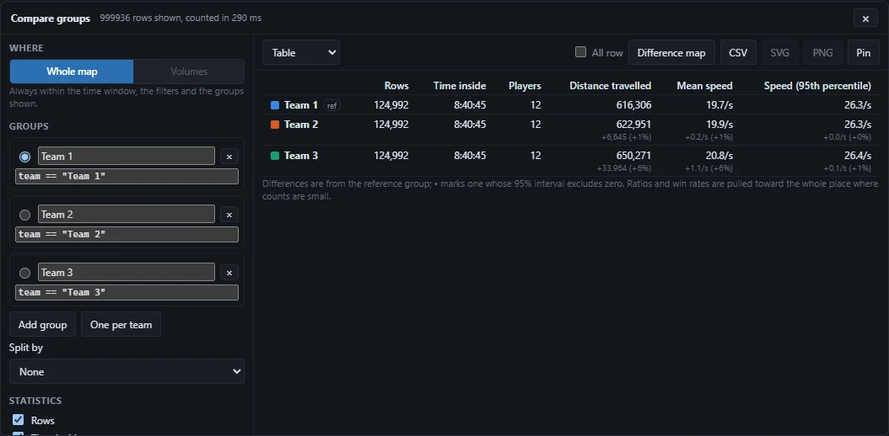
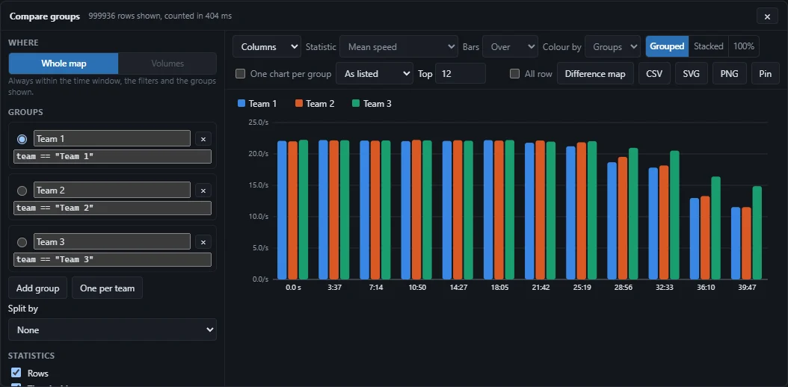

# Gruppen vergleichen: Team gegen Team, Fahrzeug gegen Fahrzeug

**Gruppen vergleichen** stellt Gruppen von Zeilen nebeneinander: ein Team gegen das andere, den T-34 gegen den Panther, die T-34 jedes Teams, diese Datei gegen jene. Wähle, wo (die ganze Karte oder deine Volumen), die Gruppen und die Statistiken – die eingebauten oder deine eigenen – und lies die Tabelle oder ein Diagramm.

Es zählt immer nur, was die Ansicht zeigt: das Zeitfenster, die [Filter](filters.md) und die angezeigten Gruppen.

*Ausgedachte Daten: das synthetische Battle Royale des Viewers.*

## Ausprobieren {#try-it}

1. Lade einen Datensatz und öffne **Volumen** in der Seitenleiste.
2. Drücke **Gruppen vergleichen…**. Hat die Datei Teams, sind die ersten beiden Teams die Gruppen.
3. Hake unter **Statistiken** die gewünschten Statistiken an.
4. Lies die Tabelle: jeden Wert und darunter seinen Unterschied zur Referenzgruppe (der mit dem Punkt links).
5. Wähle in der Diagrammliste (oben links über den Ergebnissen) ein anderes Diagramm, zum Beispiel **Balken**.

## Wo {#where}

| Einstellung | Was gezählt wird |
|---|---|
| **Ganze Karte** | jede Zeile, die die Ansicht zeigt |
| **Volumen**, **Zusammen** | die Zeilen in irgendeinem angehakten [Volumen](volumes.md), jede Zeile einmal, auch wo sich Volumen überlappen |
| **Volumen**, **Jedes Volumen** | jedes angehakte Volumen für sich: jede Gruppe erscheint einmal pro Volumen, so lassen sich die Volumen miteinander vergleichen |

## Gruppen {#groups}

Eine Gruppe ist ein Filter über beliebige Spalten, geschrieben in der kleinen Sprache des Panels (siehe [Ausdrücke](#expressions)):

| Filter | Die Gruppe |
|---|---|
| `team == "Allies"` (oder `team = Allies`) | eine Seite |
| `vehicle == "T-34"` | ein Fahrzeug, alle Seiten |
| `vehicle == "T-34" and team == "Allies"` | die T-34 der Alliierten |
| `vehicle in ["T-34", "KV-1"]` | zwei Fahrzeuge zusammen |
| `contains(vehicle, "Panther")` | jedes Fahrzeug, dessen Name „Panther“ enthält |
| `alt > 1000` | Zeilen über 1000 Einheiten |
| (leer) | jede Zeile |

- **Quelle** beschränkt eine Gruppe auf einige geladene Dateien (die Spalte `Source file` beim [Laden mehrerer Dateien](loading-files.md#several-files-become-one-dataset)) oder einige Matches: *Match A gegen Match B*, *die Dateien dieser Saison gegen die der letzten*. Quelle und Filter wirken zusammen.
- **Eine pro Team** macht eine Gruppe pro Team (bis zu 8).
- **Aufteilen nach** teilt jede Gruppe nach den Werten einer Spalte: die **Top** häufigsten Werte bekommen je eine Zeile, der Rest wird als *Sonstige* zusammengezählt. *Fahrzeuge pro Team* sind Gruppen nach Team, aufgeteilt nach Fahrzeug.
- Der Optionsknopf markiert die **Referenz**: Unterschiede werden von ihr aus gemessen.
- **Zeile Alle** fügt Tabelle und Diagrammen die Gruppe *Alle* des Ortes hinzu (jede Zeile der Region).

## Statistiken {#statistics}

Die Liste enthält, was die Daten beantworten können:

| Statistik | Was sie ist |
|---|---|
| Zeilen | gezählte Zeilen |
| Zeit darin | Sekunden Anwesenheit, aus dem Abstand jeder Zeile zur nächsten Probe (gekappt wie in der [Volumenstatistik](volumes.md#statistics)) |
| Spieler, Matches, Runden | wie viele verschiedene |
| Abschüsse, Tode, K/D, Abschüsse pro Minute | aus der Ereignisspalte; K/D und Abschüsse pro Minute bei kleinen Zahlen zum Wert des ganzen Ortes gezogen, wie es die [Aufschlüsselung](breakdown.md#pulling-small-samples) tut |
| Siegquote | gewonnene Runden, wo die Daten es sagen ([Ergebnisspalten](data-formats.md#outcome-columns)), die Runde jedes Spielers einmal, um 4 Runden zur Quote über alles Angezeigte gezogen |
| Zurückgelegte Strecke, Mittlere Geschwindigkeit, Geschwindigkeit (95. Perzentil), Mittlere Höhe | aus den Bewegungsproben jeder Spur, in den Einheiten der Daten |
| Verdient, Ausgegeben, Netto | pro Währung, aus den [Wertspalten](value-weighting.md) `earn_*` und `cost_*` |
| Ereignisse: *Art* | Zeilen einer Ereignisart |
| Anteil der Zeilen | die Zeilen der Gruppe im Verhältnis zu denen des Ortes |

### Eigene Statistiken {#your-own-statistics}

**Neue Statistik…** öffnet den Editor: ein Name, eine Einheit (`%`, `s`, `count`, `ratio` oder ein beliebiges Wort) und ein Ausdruck. Der Editor prüft den Ausdruck beim Tippen und sagt, was falsch ist und wo. *Funktionen und Spalten* listet jede Spalte; ein Klick fügt sie ein.

| Ausdruck | Was er zählt |
|---|---|
| `countIf(event == "kill" and weaponClass(weapon) == "smg") / countIf(event == "death")` | MP-Abschüsse pro Tod |
| `sum(earn_usd) - sum(cost_spent_usd)` | verdientes minus ausgegebenes Geld |
| `avg(speed) where alt > 1000` | mittlere Geschwindigkeit über 1000 Einheiten |
| `perMinute(kills())` | Abschüsse pro Minute Anwesenheit |
| `shrink(kills(), deaths(), 4)` | K/D, um 4 Tode zum Wert des Ortes gezogen |
| `distinct(person) / matches()` | Spieler pro Match |
| `percentile(speed, 90)` | das 90. Perzentil der Geschwindigkeit |
| `ofAll(count())` | der Anteil der Gruppe an den Zeilen des Ortes |

Deine Statistiken bleiben in diesem Browser. **Exportieren…** speichert sie als JSON-Datei, **Importieren…** fügt die Statistiken einer Datei hinzu – so wandern sie zwischen Rechnern und Personen.

## Ausdrücke {#expressions}

| Teil | Geschrieben |
|---|---|
| Spalten | mit Namen: `team`, `person`, `match`, `x`, `y` (auch `alt`), `z`, `time`, `matchTime`, `speed`, `step` (Strecke seit der letzten Probe), `dwell` und jede geladene Spalte. Ein Name mit Leerzeichen in Backticks: `` `Source file` ``. `event`, `class` und `actor` sind die [Spalten, die der Viewer hinzufügt](filters.md#columns-the-viewer-adds); `event == "kill"` trifft die Ereignisart, wie auch immer das Spiel sie nannte ([Ereignisarten](ref-event-types.md)). |
| Werte | Text in Anführungszeichen (`"T-34"`), Zahlen; ein bloßes Wort nach `==` gilt als Text (`team = Allies`) |
| Vergleiche | `==` (oder `=`), `!=`, `<`, `<=`, `>`, `>=`, `in [...]`; `and`, `or`, `not` |
| Rechnen | `+ - * / %`, Klammern; `abs`, `sqrt`, `log`, `exp`, `round`, `floor`, `ceil`, `min(a, b)`, `max(a, b)`, `clamp(x, lo, hi)`, `if(c, a, b)` |
| Texttests | `contains(col, "s")`, `startsWith(col, "s")`, `endsWith(col, "s")`, `weaponClass(col)` (rifle, sniper, smg, shotgun, mg, pistol, melee, utility, launcher, vehicle, other) |
| Aggregate | `count()`, `count(cond)`, `countIf(cond)`, `sum(x)`, `sumIf(x, cond)`, `avg(x)`, `avgIf(x, cond)`, `min(x)`, `max(x)`, `median(x)`, `percentile(x, p)`, `stdev(x)`, `distinct(col, ...)`, `presence()`, `players()`, `matches()`, `rounds()`, `kills()`, `deaths()`, `wins()`, `played()`, `winRate()` |
| Raten | `perMinute(v)`, `perMatch(v)`, `perRound(v)`, `perPlayer(v)`, `ofAll(v)`, `shrink(a, b, m)` |
| `where` | am Ende, filtert jedes Aggregat: `avg(speed) where alt > 1000` |

Eine Statistik ist Rechnen mit Aggregaten; eine Spalte allein muss in einem stehen (`avg(speed)`, nicht `speed`). Nichts wird als Code ausgeführt: Das Panel liest den Text selbst.

## Die Unterschiede lesen {#reading-the-differences}

Jeder Wert in der Tabelle zeigt seinen Unterschied zur Referenzgruppe, in der Einheit der Statistik und in Prozent.

- **•** und eine Farbe markieren einen Unterschied, dessen 95-%-Intervall die Null nicht enthält: grün, wo er besser ist, rot, wo er schlechter ist (weniger Tode ist besser).
- Das Intervall kommt aus 200 Neuziehungen der Matches (oder, bei nur einem Match, der Spieler), dieselben Ziehungen für jede Gruppe; so werden zwei Gruppen derselben Matches paarweise verglichen. Eine reine Zählung ohne Matches bekommt ein Poisson-Intervall, eine Siegquote ein Wilson-Intervall.
- **wenig** markiert eine Gruppe mit weniger als 30 Zeilen oder weniger als 3 Matches oder Spielern: mit Vorsicht lesen.
- Fahre über einen Wert für sein Intervall und wie es bestimmt wurde.

## Diagramme {#charts}

| Diagramm | Zeigt |
|---|---|
| **Tabelle** | Gruppen (und ihre Aufteilung) gegen die Statistiken, mit den Unterschieden |
| **Balken**, **Säulen** | eine Statistik: **Balken** nach Gruppen, Aufteilung oder **Über**; **Färben nach** einem anderen davon; gruppiert, gestapelt oder 100 % |
| **Linien**, **Flächen** | eine Statistik über **Über** (Zeit im Match, Zeit, Runde, Match, Tag): eine Linie pro Gruppe oder Aufteilungswert; Flächen gestapelt |
| **Kreis**, **Ring** | die Anteile einer Statistik nach Gruppen, Aufteilung oder **Über** |
| **Streuung** | ein Punkt pro Gruppe: x und y zwei Statistiken, **Größe** eine dritte |
| **Histogramm** | Zeilen (oder eine beliebige Statistik) in jedem Bereich einer Zahlenspalte: Wähle unter **Über** *Spalte in Bereichen* |
| **Boxplot** | das 5., 25., 50., 75. und 95. Perzentil einer Spalte pro Gruppe |
| **Heat-Tabelle** | Gruppen gegen **Über** oder gegen die Statistiken, nach Wert gefärbt |
| **Radar** | mehrere Statistiken pro Gruppe, jede Achse auf ihren größten Wert skaliert |
| **Wasserfall** | Einnahmen hinauf und Kosten hinab für eine Gruppe (in der Legende wählen) |
| **Trichter** | die angehakten Statistiken der Reihe nach als Anteil der ersten (Spawns, Schüsse, Treffer, Abschüsse) |
| **Karten** | der Wert jeder Statistik für die Referenzgruppe und die Unterschiede der anderen |

- **Ein Diagramm pro Gruppe** zeichnet dasselbe Diagramm für jede Gruppe (Small Multiples).
- Fahre über eine Marke für ihre Werte; ein Klick auf einen Legendeneintrag hebt ihn hervor.
- Ein Klick auf eine Gruppe (eine Tabellenzeile, einen Balken, ein Segment, einen Punkt) filtert die Ansicht darauf – ihr Filter wird zu den [Filtern der Ansicht](filters.md), wo er aus einfachen Spaltenwerten besteht. Ein weiterer Klick stellt die Filter der Ansicht wieder her.
- **Differenzkarte** zeigt die ersten beiden Gruppen gegeneinander als [Differenz-Heatmap](difference.md), wenn jede Werte derselben Spalte wählt (zwei Teams, zwei Fahrzeuge).
- **CSV** speichert die Zahlen hinter Tabelle und Diagrammen; **SVG** und **PNG** speichern das Diagramm.

## Andere Datensätze {#other-datasets}

Es ist immer nur ein Datensatz geladen. Um mit einem anderen zu vergleichen, hefte die Tabelle mit **Anheften** an: Sie bleibt in diesem Browser. Lade den anderen Datensatz, öffne **Gruppen vergleichen** und hake die angeheftete Tabelle unter **Angeheftete Ergebnisse** an: Ihre Gruppen erscheinen neben den neuen, nach Statistik zugeordnet. Innerhalb eines Ladens vergleichen Gruppen mit einer **Quelle** dessen Dateien und Matches direkt.

## Animationen {#animations}

Diagramme wachsen, zeichnen sich und gehen ineinander über, wenn sich die Daten ändern. **Animationen** unter [Leistung](performance-and-stats.md) stellt sie ein: **Auto** (die Vorgabe) schaltet sie und visuelle Extras aus, solange die 3D-Ansicht unter 30 Bildern pro Sekunde läuft (der Median über eine Sekunde über 33 ms), und nach drei Sekunden unter 25 ms wieder ein; **An**; **Aus**. Eine Systemeinstellung für reduzierte Bewegung schaltet sie immer aus.

## Für Entwickler {#for-developers}

- Der Durchlauf läuft in einem Worker ([`versus/engine.ts`](https://github.com/Holdi601/3DHeat/blob/main/src/versus/engine.ts)) über Stücke der Spalten, die er braucht, Scheibe für Scheibe vom Datensatz kopiert ([`versus/run.ts`](https://github.com/Holdi601/3DHeat/blob/main/src/versus/run.ts)); eine Änderung bricht den laufenden Durchlauf ab. Der Hauptthread kopiert nur Speicher und zeichnet das aggregierte Ergebnis. `node tools/probe-versus.mjs [url] [rows]` misst die Bildzeiten der 3D-Ansicht, während das Panel zählt und seine Diagramme animiert.
- Die Sprache ([`versus/expr.ts`](https://github.com/Holdi601/3DHeat/blob/main/src/versus/expr.ts)) wird von Hand in einen Baum gelesen, gegen die Spalten geprüft und dem Worker als Daten übergeben; der Worker macht daraus Closures. Gleiche Aggregate werden über Statistiken hinweg einmal gezählt.
- Perzentile behalten eine Stichprobe von 4.096 Werten pro Zelle; der Tooltip sagt, wann ein Wert aus einer stammt.
- Bewegung ([`ui/motion.ts`](https://github.com/Holdi601/3DHeat/blob/main/src/ui/motion.ts)): Dauer- und Easing-Tokens (auch als CSS-Eigenschaften `--motion-*`), eine Animationsschleife für jeden Tween (`useTween`) und der Qualitätszustand (`data-motion`, `data-quality` an der Wurzel), den andere Panels lesen können.
