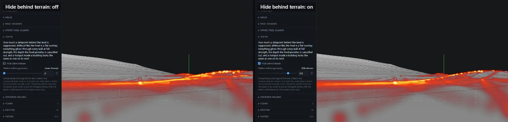

# Tiefe und Culling

Die Tiefe sorgt dafür, dass Hügel und Wände die Intensität dahinter verbergen, so wie eine echte Wand einen Menschen verbirgt. Das Entfernungs-Culling behält nur die Intensität zwischen einer nahen und einer fernen Distanz von der Kamera.




Ohne Tiefe ist eine Heatmap über einem 3D-[Level](levels.md) eine flache Überlagerung: Alles, was der Datensatz enthält, leuchtet mit voller Stärke durch jede Wand, die Tiefenhinweise, die das Level liefert, werden aufgehoben, und ein Hotspot im Gebäude sieht genauso aus wie einer auf dem Dach. Der Abschnitt **Tiefe** lässt das Level verbergen, was dahinter liegt; **Entfernungs-Culling** beschränkt die Intensität auf eine Hülle oder Scheibe um die Kamera; der [Schnitt](slice.md) schneidet eine Scheibe aus der Welt. Alle drei wirken auf die Intensitätsmodi und ändern, welche Zeilen mitzählen. Deshalb startet jede Änderung die Akkumulation neu.

## Tiefe {#depth}

Beide Regler brauchen ein [Level](levels.md) - ein Kartenbild oder ein 3D-Modell. Ohne geladenes Level gibt es nichts, das verborgen werden könnte, und sie tun nichts. Beide sind ausgeschaltet, solange [Auf die Bodenebene abflachen](sprite-shape.md#flatten-onto-ground-plane) an ist.

### Hinter Gelände verbergen {#hide-behind-terrain}

**Hinter Gelände verbergen** (standardmäßig an): Ein Datenpunkt, dessen nächste Fläche zur Kamera hin das *Gelände* ist (keine Struktur), wird ganz verworfen, nicht nur abgedunkelt.

Gelände und Wände sind auf verschiedene Weise undurchsichtig. Du siehst *absichtlich durch* eine Wand, um zu sehen, auf welchem Stockwerk der Verkehr war; durch einen Hügel willst du nie sehen, denn dahinter liegt die ferne Seite der Karte - die auf einer kilometerweiten Karte den größten Teil der Daten ausmacht und sich am Horizont zu einem Band aufsummiert, das heller ist als alles im Vordergrund. Ein einziger Abdunkelungswert kann beides nicht leisten, deshalb bekommt das Gelände eine Abschaltschwelle, und Wände behalten die Abdunkelung darunter.

### Hinter Geometrie verborgen {#hidden-behind-geometry}

**Hinter Geometrie verborgen** (standardmäßig 0,8): wie stark ein Datenpunkt hinter der Geometrie des Levels unterdrückt wird. Der Wert bedeutet *scheint durch* bei 0, *N % dunkler* dazwischen (die Position des Reglers, nicht die gemessene Abdunkelung), *ganz verborgen* bei 1.

Jede Wand oder jeder Boden zwischen einem Punkt und der Kamera dunkelt ihn weiter ab: Eine Wand lässt bei der Standardeinstellung ein paar Prozent übrig, und jede weitere Fläche halbiert den Rest, bis zu vier Flächen. Bei 1 wird nichts hinter der Geometrie gezeichnet, und das ist die günstigste Einstellung.

Siehe auch [Levelaussehen](level-appearance.md).

## Entfernungs-Culling {#distance-culling}

**Entfernungs-Culling** (standardmäßig geschlossen) beschränkt die Intensität auf Zeilen zwischen einer nahen und einer fernen Grenze von der Kamera. Setze eine ferne Grenze, um die Dichte in einem Gebäude zu lesen, ohne dass sich die ferne Seite der Karte darüberlegt; setze eine nahe Grenze, um *durch* einen Hotspot zu fliegen, statt in ihn hinein.

| Regler | Standard | Bereich (Schrittweite) | Bedeutung |
|---|---|---|---|
| **Nah** | aus | 0,5-5000 m, logarithmisch; die untersten 5 % der Leiste = aus (200.000) | Zeilen, die näher sind, werden übersprungen. |
| **Fern** | aus | 1-200.000 m, logarithmisch; ganz unten = aus (10.000.000) | Zeilen, die weiter weg sind, werden übersprungen. |
| **An einer Ebene schneiden** | an | | Die Grenzen entlang der Blickachse messen statt vom Auge aus, so dass der Schnitt eine Ebene parallel zum Bildschirm ist und keine Kugel um dich herum. Der Rand einer Kugel wölbt sich über das Bild weg und verschiebt sich, sobald du dich drehst; eine Ebene bleibt dort, wo du sie hinlegst. |
| **Auch das Level schneiden** | an | | Schneide auch Boden, Strukturen und Wasser an denselben Grenzen. Bleibt das Level ganz, entfernt der Schnitt die Datenpunkte und lässt das Gebäude vor ihnen stehen; werden beide geschnitten, ist es ein Schnitt durch die Karte, und die Punkte sitzen an ihren Wänden und Böden. Dieser Regler zeichnet nur neu; er startet die Akkumulation nicht neu. |

### Tasten {#keyboard}

Die ferne Grenze ist ein Regler, den du durchfährst - geh damit durch ein Gebäude und sieh, auf welchem Stockwerk der Verkehr erscheint -, deshalb liegt er beim Fliegen auf der Tastatur ([`App.tsx`](https://github.com/Holdi601/3DHeat/blob/main/src/App.tsx)):

| Taste | Wirkung |
|---|---|
| `]` | Die ferne Grenze um den Faktor 1,12 nach außen schieben (Umschalt: 1,35) |
| `[` | Sie um denselben Faktor nach innen ziehen |
| `\` | Die ferne Grenze ausschalten oder wieder einschalten, bei der Entfernung, an der sie verlassen wurde (beim ersten Mal 6000) |

Die Schritte sind geometrisch, weil der nützliche Bereich vier Größenordnungen umfasst, von einem Raum bis zu einer Karte. Die Tasten halten die ferne Grenze zwischen 100 und 400.000. Die Tasten tun nichts, solange ein Textfeld oder ein Menü den Fokus hat.

## Für Entwickler {#for-developers}

### Hinter Gelände verbergen {#hide-behind-terrain}

Die Strukturen werden in eine eigene Tiefentextur gezeichnet. Ein Fragment, das hinter der Tiefe der Szene, aber *nicht* hinter der Tiefe der Strukturen liegt, liegt hinter dem Gelände und wird verworfen. Das kostet einen Tiefendurchgang über die Strukturen, der übersprungen wird, wenn der Schalter aus ist.

### Hinter Geometrie verborgen {#hidden-behind-geometry}

Es wird **pro Fläche** gezählt. Ein einziger Tiefenvergleich kann nur sagen „etwas liegt davor“, daher würden ein Punkt hinter einer Wand und ein Punkt vier Räume tief in einem Gebäude gleich abgedunkelt, und das Innere würde als ein einziger blasser Schmier erscheinen. Stattdessen wird die Strukturgeometrie **tiefen-geschält** in bis zu 3 weitere Schichten ([`HEAT_DEPTH_LAYERS`](https://github.com/Holdi601/3DHeat/blob/main/src/render/types.ts)). Jedes Fragment zählt, wie viele Flächen vor ihm liegen (die eigene Tiefe der Szene plus die geschälten Schichten: bis zu vier), und die Abdunkelung verstärkt sich:

```
Stärke        = 1 - (1 - Regler)²                  (Regler 1 → 1)
Sichtbarkeit  = (1 - Stärke) × 0,5 ^ (Flächen - 1)
Sichtbarkeit  = max(Sichtbarkeit, 0,006)            (keine Untergrenze bei Regler 1)
```

| Regler | 1 Fläche | 2 | 3 | 4 |
|---|---|---|---|---|
| 0,5 | 25 % | 12,5 % | 6,25 % | 3,1 % |
| 0,8 (Standard) | 4 % | 2 % | 1 % | 0,6 % (Untergrenze) |
| 1,0 | nicht gezeichnet | nicht gezeichnet | nicht gezeichnet | nicht gezeichnet |

Warum zwei Faktoren: Der Regler ist so kalibriert, dass eine Wand ein paar Prozent übrig lässt - die Optik, die als „hinter etwas“ gelesen wird -, und ein paar Prozent, die sich verstärken, wären bei der dritten Wand nichts; das Halbieren pro weiterer Fläche hält vier unterscheidbare Stufen. Warum quadriert: Linear blieb ein gesättigtes Feld hinter einer Wand gesättigt; eine vierte Potenz hat es bei 0,8 ausgelöscht. Warum eine Untergrenze: Verborgene Wärme ganz zu verbergen lässt einen Raum voller verdeckten Verkehrs wie einen leeren Raum aussehen, ohne Hinweis, nach dem [Schnitt](slice.md) zu greifen. Nur ein auf 1 festgesetzter Regler verbirgt sie vollständig - und ist die günstigste Einstellung, weil verdeckte Punkte dann verworfen werden.

So funktioniert es ([`engine.ts`](https://github.com/Holdi601/3DHeat/blob/main/src/render/engine.ts), die Shader für Punkt-Intensität): Der Vergleich geschieht pro Fragment gegen die Tiefentextur der Szene, in **Fenstertiefe** statt in Weltentfernung. Ein Tiefentextur-Zugriff in der Vertex-Stufe liest auf manchen Treibern überall „fern“ (unter anderem im Software-Rasterizer von ANGLE), und das Umrechnen beider Tiefen in Meter verliert die Trennung an Genauigkeit, wenn der Nah-Fern-Bereich weit ist. Die Verschiebung ist ein Sprite-Radius, umgerechnet in Fenstereinheiten, plus einige der niedrigstwertigen Bits, damit ein Datenpunkt, der auf einer Fläche liegt, nicht sich selbst verschattet.

Strukturen werden durchscheinend gezeichnet, aber in die Tiefe geschrieben, die das Verdecken liest; ein Level, dessen Strukturen die Tiefentextur nicht erreichten, würde nur gegen das Gelände verdecken.

### Entfernungs-Culling {#distance-culling}

Beide Grenzen werden im Vertex-Shader ausgewertet, so dass eine weggeschnittene Zeile einen Vertex kostet und kein Fragment.
