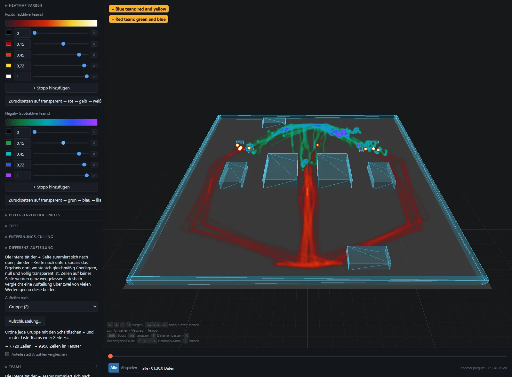

# Differenz

Rot, wo Team A mehr war, grün-blau, wo Team B mehr war, nichts, wo beide gleich waren.

**Differenz** (Taste 2) ist vorzeichenbehaltene Intensität. Zeilen einer Population addieren Intensität; Zeilen einer anderen subtrahieren sie. Wo sich beide gleichmäßig überlagern, ist das Ergebnis null und ganz durchsichtig; wo eine Seite überwiegt, zeigt es sich in deren Farben – standardmäßig warm (durchsichtig → rot → gelb → weiß) für die **+**-Seite und kühl (durchsichtig → grün → blau → lila) für die **−**-Seite.

## So wird sie benutzt {#how-to-use-it}

1. Drücke `2` (oder wähle **Differenz** in der Modusleiste).
2. Öffne **Differenz-Aufteilung** in der Seitenleiste.
3. Wähle, **Aufteilen nach**: meist *Gruppen*.
4. Lege eine Gruppe (oder einen Wert) auf **+** und eine andere auf **−**.
5. Lies die Farben: Warm heißt die +-Seite, kühl heißt die −-Seite. Das Feld warnt, wenn eine Seite keine Zeilen hat (siehe [Meldungen, die du sehen kannst](#messages-you-may-see)).

*Welche* zwei Populationen es sind, ist die ganze Frage; die Aufteilung kann daher jede behaltene Spalte sein, nicht nur Gruppen. Zeilen, die auf **keine** der Seiten fallen, werden **weggelassen**, nicht als null gezählt: Das ist es, was eine Aufteilung über zwei von vielen Werten genau diese zwei vergleichen lässt, und sie setzt sich mit den [Filtern](filters.md) zusammen – filtere auf eine Karte und teile dann danach nach Version auf.

Der Modus braucht zwei Seiten: eine Gruppenspalte mit mindestens zwei Gruppen oder eine Aufteilung über eine zum Filtern behaltene Spalte. Bei Daten mit weniger als zwei Gruppen startet eine Ladung mit einer Spaltenaufteilung – zuerst die Spalte *Source file* einer Ladung aus mehreren Dateien, sonst die erste Kategoriespalte mit zwei Werten, sonst die erste numerische Spalte mit einer Spanne –, damit *zwei Ladungen vergleichen* auch bei Daten ohne Gruppen funktioniert. Nur Daten ohne beides lassen den Modus nicht verfügbar; ebenso eine Spaltenaufteilung, bei der eine Seite leer bleibt.

## Das Feld Differenz-Aufteilung {#the-difference-split-panel}

Im Differenz-Modus gezeigt, unter den Intensitätsfeldern.

**Aufteilen nach** bietet:

| Option | Angezeigt als | Aufteilungsregel |
|---|---|---|
| Gruppen | *Gruppe (N)* (wenn es eine Gruppenspalte gibt) | Jede Gruppe auf +, − oder keine, in der [Teamliste](teams-list.md) gesetzt |
| Eine Kategoriespalte | *Spalte (N Werte)* | Werte auf +, − oder keine |
| Eine numerische Spalte | *Spalte (numerisch)* | Ein Wertebereich für jede Seite |
| Die Herkunftsdatei | *Source file – zwei Ladungen vergleichen* (wenn mehrere Dateien geladen wurden) | Dateien auf +, − oder keine |

Angeboten werden nur Spalten, die beim Laden unter *Zum Filtern behalten* stehen.

### Anteile statt Anzahlen vergleichen {#compare-shares-not-counts}

**Anteile statt Anzahlen vergleichen** (standardmäßig aus) gewichtet jede Seite mit eins durch ihre eigene Zeilenzahl, sodass eine Seite mit fünfmal so vielen Zeilen nicht allein durch Zahlen gewinnt. Die Farbe zeigt dann, wo jede Seite im Verhältnis häufiger ist als die andere. Nutze es, wenn die beiden Seiten sehr verschieden viele Daten haben, etwa zwei Sitzungen unterschiedlicher Länge.

### Meldungen, die du sehen kannst {#messages-you-may-see}

Das Feld warnt, wenn das Bild keine echte Differenz ist:

| Meldung | Bedeutung |
|---|---|
| *N + / M −* (oder *N + / M − / K ungenutzt*) | Wie viele Werte auf jeder Seite liegen (und auf keiner). |
| Keine Zeile im Fenster liegt auf der **+**-Seite | Nur die **−**-Seite wird gezeichnet. Verschiebe das Zeitleistenfenster oder ändere die Aufteilung. |
| Keine Zeile im Fenster liegt auf der **−**-Seite | Nur die **+**-Seite wird gezeichnet. |
| Kein Wert liegt auf einer der Seiten | Die Differenz zeichnet nichts. Lege mindestens einen Wert auf **+** oder **−**. |
| *Spalte* kann so nicht aufgeteilt werden | Die gewählte Spalte passt nicht zur Aufteilung. Wähle die Spalte erneut. |
| Die Aufteilungsspalte passte nicht in den GPU-Speicher für N von M Blöcken | Diese Zeilen werden nicht gezeichnet. Erhöhe das GPU-Budget unter Leistung → Ressourcenbudgets oder lade weniger Zeilen. |

### Nach Gruppe {#by-group}

Das Feld verweist nur auf die [Teamliste](teams-list.md), wo jede Gruppe eine Schaltfläche **+** und **−** hat. Bei jedem Laden kommt die erste Hälfte der Gruppen (aufgerundet) auf +, der Rest auf −; **Gleichmäßig aufteilen** in der Teamliste macht dasselbe noch einmal. Eine Gruppe auf keiner Seite oder mit ihrem Kästchen ausgeblendet trägt nichts bei.

### Nach Kategoriewerten {#by-category-values}

| Teil | Bedeutung |
|---|---|
| `a + / b − / c ungenutzt` | Wie viele Werte auf jeder Seite und auf keiner liegen. |
| **Leeren** | Setzt jeden Wert auf keine Seite. |
| Werteliste | Jeder Wert mit einer Schaltfläche **+** und **−** (klicke den aktiven erneut an, um ihn von der Seite zu nehmen). Ein leerer Wert wird als *(fehlt)* aufgelistet. |
| Hinweis zur Obergrenze | Nur die ersten 200 Werte werden aufgelistet: *Die ersten 200 von N Werten werden gezeigt. Eine so breite Spalte wird besser zuerst mit einem Filter eingegrenzt oder nach Bereich aufgeteilt, wenn ihre Werte geordnet sind.* |

Die Wahl der Spalte setzt ihren ersten Wert auf + und ihren zweiten auf −. Hat keine Seite einen Wert, fällt die Aufteilung auf Gruppen zurück, statt einen leeren Rahmen zu zeigen. *Source file* funktioniert genauso, ein Wert pro Datei – so werden zwei Exporte, zwei Testläufe oder zwei Versionen verglichen.

### Nach Bereich {#by-range}

| Teil | Bedeutung |
|---|---|
| Hinweis | Das Minimum und Maximum der Spalte. |
| **Positiver Bereich (+)**, **von** / **bis** | Zeilen mit einem Wert in diesem Bereich, an beiden Enden eingeschlossen, addieren. |
| **Negativer Bereich (−)**, **von** / **bis** | Zeilen in diesem Bereich subtrahieren. |
| **In der Mitte teilen** | Setzt + auf [Minimum, Mitte] und − auf [Mitte, Maximum] – das passiert auch bei der Wahl der Spalte. |

Ein Wert in beiden Bereichen zählt als +. Die Bereiche müssen die Spalte nicht abdecken; Werte in keinem bleiben weg. *Die ersten zwei Minuten gegen die letzten zwei* ist eine Bereichsaufteilung auf einer zeitartigen Spalte.

## Farben {#colours}

Der Abschnitt **Heatmap-Farben** zeigt in diesem Modus zwei Verlaufs-Editoren: **Positiv (additive Teams)** und **Negativ (subtraktive Teams)**, jeder mit eigenem Zurücksetzen-Knopf (*Auf durchsichtig → rot → gelb → weiß zurücksetzen*, *Auf durchsichtig → grün → blau → lila zurücksetzen*). Die Zusammensetzung nimmt den Absolutwert der Nettointensität durch [Sättigungspunkt und Antwort](colour-and-exposure.md), und wählt den negativen Verlauf, wo die Netto unter null liegt. Siehe [Farbe und Belichtung](colour-and-exposure.md#the-ramp-editor).

Nutze die *lineare* Dichteantwort, wenn die Größe der Differenz zählt: Sie ist die einzige Antwort, bei der gleiche Farbe gleiche Anzahl bedeutet.

## Für Entwickler {#for-developers}

Jede Zeile bekommt im Vertex-Shader ein Vorzeichen von +1, -1 oder 0 ([`POINT_HEAT_VS`](https://github.com/Holdi601/3DHeat/blob/main/src/render/webgl2/shaders.ts)); eine 0 verwirft die Zeile, bevor irgendein Fragment gezeichnet wird.

- Nach Gruppe kommt das Vorzeichen aus einer Gruppentabelle mit 4.096 Einträgen, indiziert über die Gruppenkennung der Zeile (die Gruppenkennung reitet im vierten Kanal des Positions-Texels der Zeile).
- Nach Kategorie kommt das Vorzeichen aus einer zweiten Tabelle mit 4.096 Einträgen, pro Kategoriewert gefüllt, und der Wert der Zeile wird aus der Filtertextur der Spalte gelesen; ein Wert hinter dem Ende der Tabelle wird auf beiden Backends verworfen.
- Nach Bereich wird der Wert der Zeile mit den beiden Bereichen verglichen.

Eine Änderung der Aufteilung startet die Akkumulation neu.

**Ausgeblendete Gruppen bleiben bei jeder Aufteilung ausgeblendet.** Bei einer Aufteilung nach einer Spalte trägt die Gruppentabelle keine Vorzeichen mehr; sie hält 1 für eine gezeigte Gruppe und 0 für eine ausgeblendete ([`frameSignTables`](https://github.com/Holdi601/3DHeat/blob/main/src/render/filterTables.ts)), und beide Tabellen erreichen den Shader gemeinsam – zwei Zeilen einer Vorzeichentextur auf WebGL2, zwei Hälften eines Storage-Buffers auf WebGPU. Eine Zeile wird nur gezeichnet, wenn ihre Gruppe gezeigt wird *und* ihr Spaltenwert auf einer Seite liegt. Eine Gruppe, die in der [Teamliste](teams-list.md) abgewählt ist oder durch den Seitenfokus des Match-Tabs wegfällt, trägt daher nichts bei, egal wie die Differenz aufgeteilt ist.
