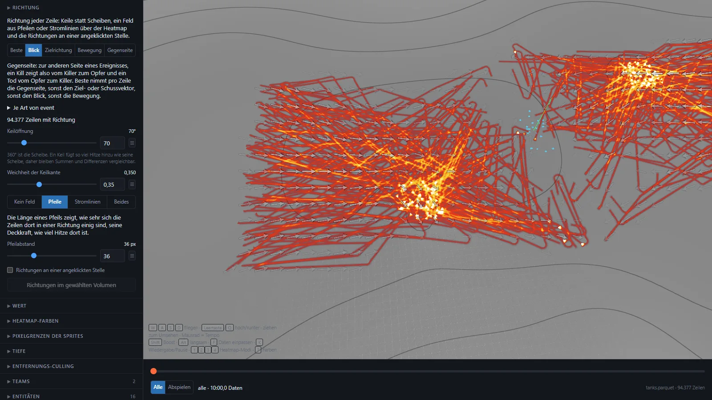

# Gerichtete Intensität

Einfache Intensität sagt, **wo** etwas passiert. Die gerichtete Intensität sagt auch, **in welche Richtung**: in welche Richtung die Leute geschaut, gezielt oder sich bewegt haben, oder wo die Gegenseite eines Gefechts war.

Ein normaler Sprite ist eine volle Scheibe (360 Grad). Mit einer **Keilöffnung** von 70 Grad wird derselbe Sprite zu einem schmalen Keil, der in die Richtung zeigt, in die die Zeile blickte, und er fügt dieselbe Gesamtwärme hinzu.

## So benutzt du es {#how-to-use-it}

1. Lade Daten mit einer Richtung darin (siehe [Was einer Zeile eine Richtung gibt](#what-gives-a-row-a-direction)).
2. Wähle in der Modusleiste **Intensität**, **Differenz** oder **Team-Intensität**.
3. Öffne den Abschnitt **Richtung** in der Seitenleiste.
4. Wähle eine **Quelle** (welche Richtung benutzt werden soll), dann schalte das Zeichnen ein:
   - senke **Keilöffnung** unter 360°, um jede Zeile als Keil zu zeichnen, der in ihre Richtung zeigt, statt als Scheibe;
   - wähle ein **Feld**, um Pfeile oder Stromlinien über die Intensität zu zeichnen;
   - setze das Häkchen bei **Richtungen an einer angeklickten Stelle** und klicke auf die Intensität, um ein Polardiagramm dieser Stelle zu bekommen.

Die Statuszeile sagt, wie viele Zeilen aus der gewählten Quelle eine Richtung haben.

## Einstellungen {#settings}

| Einstellung | Standard | Was sie tut |
|---|---|---|
| Quelle: **Beste**, **Ansicht**, **Zielrichtung**, **Bewegung**, **Gegenseite** | Beste | Welche Richtung jede Zeile bekommt. *Beste* nimmt pro Zeile die Gegenseite, sonst die Zielrichtung, sonst die Ansicht, sonst die Bewegung. |
| **Pro Art des Ereignisses** | wie oben | Eine andere Quelle für jede Ereignisart, zum Beispiel *Gegenseite* für Abschüsse und *Ansicht* für Positionen. Wird angezeigt, wenn die Daten eine Ereignisspalte mit höchstens 40 Werten haben. |
| **Keilöffnung** | 360° | 360° ist die normale Scheibe (aus). Kleiner ist ein schmalerer Keil. Ein Keil fügt genauso viel Wärme hinzu wie seine Scheibe, so dass Summen und Differenzen vergleichbar bleiben. |
| **Weichheit der Keilkante** | 0,35 | 0 ist ein Keil mit scharfer Kante, 1 ein weicher Fächer. |
| **Feld**: Kein Feld, Pfeile, Stromlinien, Beides | Kein Feld | Pfeile: Die Länge eines Pfeils zeigt, wie sehr die Zeilen dort in eine Richtung übereinstimmen, seine Deckkraft, wie viel Wärme dort ist. Pfeile erscheinen nur, wo Wärme ist. |
| **Pfeilabstand** | 28 px | Abstand zwischen den Pfeilen auf dem Bildschirm. |
| **Stromlinien animieren** | an | Die Stromlinien fließen, solange es an ist. |
| **Richtungen an einer angeklickten Stelle** | aus | Klicke auf die Intensität, um die Richtungen dort zu sehen (unten). |
| **Richtungen im gewählten Volumen** | | Dasselbe Diagramm für alles innerhalb des gewählten [Volumens](volumes.md). |

## Das Polardiagramm an einer Stelle {#the-polar-chart-at-a-spot}

Mit **Richtungen an einer angeklickten Stelle** an klickst du auf die Intensität. Die Zeilen nahe bei diesem Punkt (innerhalb von 1,5 Sprite-Radien) werden zu einer Rose aus 24 Segmenten zu je 15° zusammengefasst:

- **orange** Blütenblätter: abgehende Richtungen (wohin die Zeilen zeigen);
- **blaue** Blütenblätter: ankommende Richtungen (woher sie kamen);
- die **Fläche** eines Blütenblatts wächst mit seiner Anzahl; ein Pfeil zeigt die Hauptrichtung;
- die Linien unter dem Diagramm nennen die Hauptpeilung, wie stark die Zeilen übereinstimmen (R, 0 bis 1), die Streuung in Grad und die Anzahl der Zeilen.

0° ist oben im Diagramm, also die Welt −Z (Norden bei Tacview-Aufnahmen). Die Stelle wird auch in der 3D-Ansicht mit einem Pfeil und einem Ring markiert.

## Was einer Zeile eine Richtung gibt {#what-gives-a-row-a-direction}

| Quelle | Braucht in den Daten |
|---|---|
| Ansicht | eine Gierspalte (als Blickrichtung zugeordnet): `yaw`, `heading`, `azimuth`, `view_yaw`, `rot_z` |
| Zielrichtung | Zahlenpaare wie `aim_x`/`aim_y`, `shot_x`/`shot_y`, `fire_x`/`fire_y`, `hit_dir_x`/`hit_dir_y` (optional ein `…_z`) |
| Bewegung | nichts Weiteres: der Schritt vom vorherigen Messwert derselben Person (höchstens 10 s früher, gleiche Session) |
| Gegenseite | eine Spalte, die die andere Seite eines Ereignisses nennt (`other`, `victim`, `target`, `killer`, `attacker`, `shooter`, `other_player` ...), deren Werte Personennamen sind; ein Abschuss zeigt vom Mörder zum Opfer, ein Tod vom Opfer zum Mörder |

## Tipps {#tips}

- Keile brauchen eine gewisse Größe auf dem Bildschirm; unter ein paar Pixeln werden sie wieder als Scheiben gezeichnet.
- Benutze *Gegenseite* bei Abschuss-Zeilen, um zu sehen, **von wo aus** Gefechte gewonnen wurden, und *Ansicht* bei Positions-Zeilen, um zu sehen, **wo Leute hinsehen**.
- Bei **Differenz** zeigen die Keile der beiden Seiten in ihre eigenen Richtungen, so dass umkämpfte Schusslinien hervorstechen.
