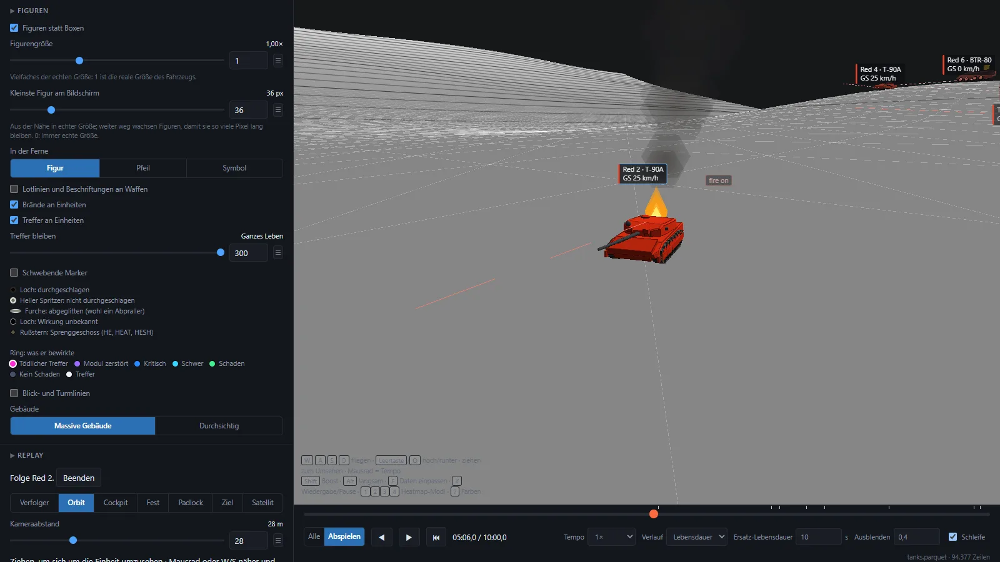

# Figuren

Eine **Figur** ist ein kleines 3D-Modell dessen, was eine Einheit wirklich ist: ein Panzer, ein Jet, ein Schiff, ein Soldat. Die [Wiedergabe](match-replay.md) zeichnet jede Einheit als ihre Figur in wahrer Größe, statt als einfache Box.

Es gibt etwa 2.000 benannte Fahrzeuge, Flugzeuge, Schiffe, Waffen und Soldaten. Alle wurden vom Viewer selbst gebaut.

## Was im Katalog ist {#what-is-in-the-catalogue}

| Bereich | Beispiele |
|---|---|
| Personen | Soldat stehend, kniend, liegend; Scharfschütze, Panzerabwehr, Sanitäter, Besatzung |
| Boden | Panzer, Schützenpanzer, Flugabwehr, Artillerie, Lastwagen und Autos, Züge und Straßenbahnen |
| Luft | Jäger, Erdkampfflugzeuge, Bomber, Transporter, Hubschrauber, von Doppeldeckern bis zu modernen Jets |
| See | Kriegsschiffe nach Klasse, Flugzeugträger, U-Boote, Boote, Handelsschiffe |
| Waffen | Raketen, Flugkörper, Bomben, Torpedos, Leuchtmittel und Düppel |
| Markierungen | Rauch-, Blend- und Brandgranaten, gelegte Bomben, Flaggen, Spawns, Wegpunkte |
| Nahkampf | Soldaten in Plattenträgern mit Sturmgewehr, MP, Schrotflinte, DMR, LMG, Pistole oder Schild; Drohnen, Kameras, Stacheldraht, Schilde, Wandverstärkung, Barrikaden, Sprengladungen, Fallen, Fenster, Granaten, der Entschärfer |

## Wie die Figuren entstehen {#how-the-figures-are-made}

- **Aus veröffentlichten Maßen gebaut.** Die meisten Figuren entstehen im eigenen Figuren-Baukasten des Viewers aus öffentlichen Zahlen: Länge, Breite, Höhe, Laufrollen, Turm und Kanone, Flügel und Leitwerk. Ihre Form wird dann an öffentlichen Fotos, Zeichnungen und veröffentlichten Maßen abgestimmt. Keine Modelle eines Spiels werden verwendet.
- **Freie Modelle.** Einige Figuren nutzen freie 3D-Modelle (CC0 oder CC BY), wo diese wahrer sind. Manchmal werden sie mit dem gebauten Rumpf kombiniert. Die Urheber der CC-BY-Werke stehen auf [Figur-Nachweise](figure-credits.md). CC0-Werke brauchen keinen Nachweis und stehen dort nicht.
- Jede Figur hat eine volle, eine grobe und eine ferne Version (Detailstufen, LOD), damit Tausende zugleich gezeichnet werden können.

## Welche Figur eine Einheit bekommt {#which-figure-a-unit-gets}

Der Viewer schaut auf die eigenen Spalten der Daten:

1. **Namen**: Spalten namens *Name*, *Vehicle*, *Unit*, *Unit type*, *Model*, *Aircraft*, *Plane*, *Tank*, *Ship*, *Craft*, *Loadout*, *Kit* oder *Figure* werden mit dem Katalog verglichen. Genau, über etwa 4.000 Aliasnamen (Einheiten-IDs mehrerer Spiele), über den längsten bekannten Anfang (`F-16C_50` ist die F-16C) oder über den kürzesten Figurennamen, der damit beginnt.
2. Ein Name, dessen Figur nicht zum **Typ** der Einheit passt, wird nicht verwendet (ein Lkw namens *Typhoon* ist nicht der Jäger).
3. **Typen**: Spalten namens *Type*, *Class*, *Kind*, *Category*, *Icon*, *Role* oder *Domain* ergeben eine Klassenfigur. Das sind Tacview-Tags (`Air+FixedWing`, `Ground+Heavy+Armor+Vehicle+Tank`, `Sea+Watercraft+Warship`, `Weapon+Missile`), Kartensymbole oder einfache Wörter (Panzer, Hubschrauber, Infanterie).
4. Daten mit keinem von beiden sind Daten über Personen: Jeder ist ein Soldat.

Der einfachste Weg zu den richtigen Figuren ist deshalb eine Spalte `vehicle` mit den echten Namen oder eine Spalte `type` mit Tacview-Tags.

**Meine Einheit erscheint als Box oder als Soldat.** Füge eine Spalte `vehicle` mit dem echten Namen hinzu oder eine Spalte `type` mit einem Tacview-Tag. Fahre mit der Maus über die Einheit, um zu sehen, welcher Name gefunden wurde. Daten mit solchen Spalten, die aber nichts über eine Einheit sagen, lassen sie als Box. Daten mit keinem von beiden werden als Soldaten gezeichnet.

## Nahkampf-Figuren (Rainbow Six Siege) {#close-quarters-figures-rainbow-six-siege}

Tabellen, die so aufgebaut sind wie die des Rainbow-Six-Siege-Replay-Lesers (Spalten `operator`, `pawn`, `primaryClass`, `side`), bekommen eigene Figuren:

- **Spieler** sind ihr Operator: Jeder der 78 Operator hat eine eigene Figur, etwa 1,8 m groß, in eigener Kleidung. Zwei oder drei Farben für Jacke, Hose und Ausrüstung folgen ihrem üblichen öffentlichen Aussehen (Schwarz, Oliv, Sandbraun, Stadtgrau, Weiß, Marineblau, mit roter, oranger oder petrolfarbener Ausrüstung). Dazu kommen eigene Formen, ein Drittel größer als in echt, wo sie von oben zu sehen sein müssen: Kopfbedeckung (Helme, ein Visier oder schwerer Helm, Kappen, Mützen, Baskenmützen, ein breiter Buschhut oder eine Pelzmütze, Kapuzen, Schals, Haare), das Gesicht (Schutzbrille, Gasmaske, Brille, Maske, Bart, Brille mit drei Linsen), ein leichter, mittlerer oder schwerer Körperbau (schwere sind breit, mit großen Schulterplatten und einem Kragen), ein langer Mantel oder ein Anzug, ein Ghillie-Anzug, was sie auf dem Rücken tragen (einen Hammer, Ladungen, Drohnen, Kanister, einen Treibstofftank, ein Werferrohr, eine Armbrust, Platten, einen Störsender, einen Schild) oder am Arm (einen Werfer, einen Metallarm), ihr eigener Schild (ein hoher, ein Einsatzschild, einer mit Lichtern) und eine Akzentfarbe auf den Schultern. Sie halten die Klasse ihrer Primärwaffe. Ein Operator, den der Viewer nicht kennt, ist ein einfacher Soldat im Plattenträger in der Farbe des Teams.
- **Die Seite** ist getrennt von der Kleidung zu sehen: ein Ring am Boden unter jedem Operator, **Bernstein für Angriff, Hellcyan für Verteidigung**, mit der Farbe des Teams darin, und Arm- und Kopfbänder in derselben Farbe. Eine Spalte `stance` (stand, crouch, prone) gibt ihnen die Haltung. Ohne sie stehen sie.
- **Auf Replay-Abstand unterscheidbar:** Gezeichnet mit 48 Pixeln Höhe, von oben und in Dreiviertelansicht, unterscheiden sich je zwei Operator einer Seite durch einen deutlichen Farbunterschied oder eine andere Form (von den Tests des Viewers geprüft).
- **Beschriftungen** nennen den Spieler und den Operator, den er in diesem Moment spielt, mit der Rolle des Operators als Symbol: ✸ harter Breacher, ⚒ weicher Breacher, ➤ Entry, ✦ Fragger, ✚ Unterstützung, ⬟ Schild, ◉ Aufklärung, ◇ Flex, ↺ Flankenwache, ⚓ Anker, ✕ Fallensteller, ⇄ Roamer, ↯ Anti-Gadget, ▣ Anti-Breach.
- **Drohnen** sind eine zweirädrige Wurfdrohne, etwa 30 cm breit. Jede ist eine eigene Spur, benannt nach ihrem Besitzer („Ash · drone 2“).
- **Platzierte Gadgets** stehen dort, wo sie hingestellt wurden, von da an bis zum Ende der Runde. Jedes ist die Figur dessen, was es tut: eine Kamera, Stacheldraht, ein aufstellbarer Schild, eine Sprengladung, eine harte Sprengladung, eine kleine Haftladung, eine Bodenfalle, eine Claymore mit ihrem Auslöselaser, ein Einwegfenster, eine Panzerplatte, eine Granate, ein Gaskanister, ein Störsender, ein Sensor, ein Lasertor, eine Nachschubkiste. Eine Figur dient für jedes Gadget mit derselben Aufgabe. Ein Gadget, dessen Art die Daten nicht nennen, ist ein kleines Gerät mit einem Licht.
- **Der Entschärfer** steht 45 Sekunden lang dort, wo er gelegt wurde.

Jede Drohne und jedes Gadget wird beim Laden der Datei zu einer eigenen Spur. So bleibt die Figur des Spielers an seinem Körper. Die Operator sind vereinfachte Formen nach ihren öffentlichen Beschreibungen und Bildern (was sie tragen, das Gerät, das ihre Fähigkeit ist). Die Gadgets sind nach ihrer Aufgabe geformt. Alle sind eigene Entwürfe des Viewers in der echten Größe des Dings (eine Claymore etwa 22 cm breit, eine türgroße Platte 1 m mal 2,1 m), keine Modelle aus dem Spiel.

## Einstellungen {#settings}

Das Fenster **Figuren** in der Seitenleiste der Wiedergabe legt die Größe fest, die kleinste Größe am Bildschirm, was ferne Einheiten werden (Figur, Pfeil, Symbol) und die Effekte, die auf ihnen gezeichnet werden. Siehe [Match-Wiedergabe](match-replay.md#figures). Rauch, Feuer und andere zeitgebundene Effekte: [Figuren im Figuren-Overlay](figure-replay.md).

## Ein optionales lokales Figurenpaket {#an-optional-local-figure-pack}

Du kannst auf deinem eigenen Rechner ein optionales Paket eigener Figuren halten. Seine Figuren nehmen den Platz der Katalogfiguren mit denselben Namen ein. Es ist nie Teil des Repositorys oder eines veröffentlichten Builds. Ohne ein solches Paket ändert sich nichts.
