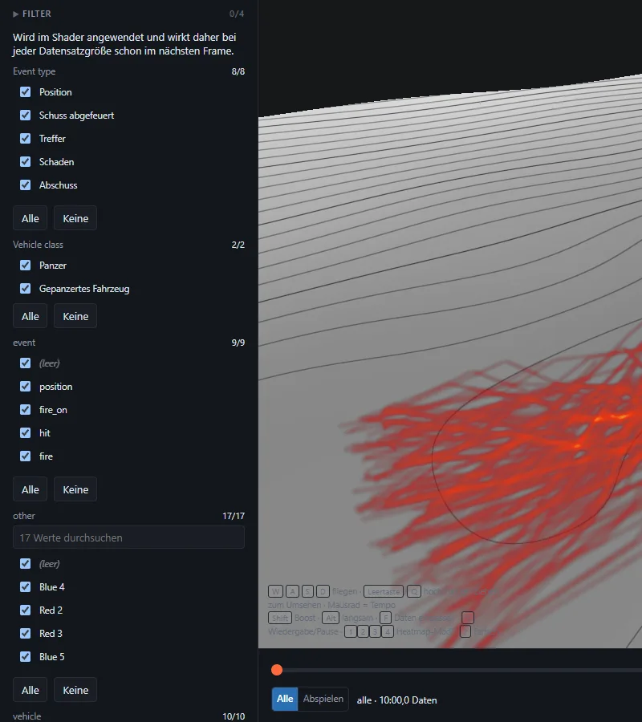
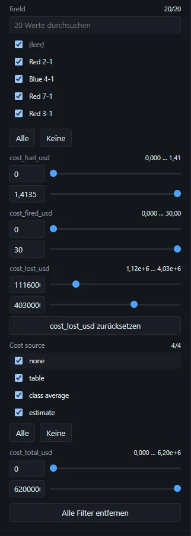

# Filter

**Filter** blendet die Zeilen aus, die dich nicht interessieren, etwa eine Fahrzeugklasse oder eine Art von Ereignis, und das Bild aktualisiert sich sofort. Das Panel listet die beim Laden unter *Zum Filtern behalten* markierten Spalten auf ([Spaltenzuordnung](column-mapping.md)), dazu *Quelldatei*, wenn mehrere Dateien geladen wurden.

## Ausprobieren {#try-it}

1. Lade einen Datensatz und öffne **Filter** in der Seitenleiste.
2. Wähle unter **Fahrzeugklasse** *Panzer* ab. Das Bild ändert sich sofort.
3. Drücke **Alle Filter entfernen**, um es rückgängig zu machen.

Die ersten Zeilen sind die eigenen Spalten des Viewers (unten). Die Zeilen danach stammen aus deiner Datei.

## Spalten, die der Viewer ergänzt {#columns-the-viewer-adds}

Beim Laden ermittelt der Viewer vier eigene Spalten und listet sie **zuerst** auf, mit Namen und Werten in deiner Sprache, damit derselbe Filter für jedes Spiel und jede Datenquelle funktioniert:

| Spalte | Werte | Ermittelt aus |
|---|---|---|
| **Ereignistyp** | 23 Arten: Position, Schuss abgegeben, Start (Lenkwaffe, Rakete, Bombe), Treffer, Fehlschuss (Waffe endete nahe keinem Ziel), Explosion, Schaden, Abschuss, Tod, Zerstört, Absturz, Schleudersitz / Notausstieg, Erscheinen, Verschwinden, Abheben, Landung, Bodenkontakt, Stillstand am Boden, Nachladen / Auftanken, Erobern / Ziel, Köder, Nachricht, Sonstiges | eine Spalte namens `event`, `events`, `event_type` oder `event_name`; die eigenen Begriffe jedes Spiels (`shot`, `burst`, `fired`, `struck`, `flare`, `plant` ...) werden auf diese Arten abgebildet. Die vollständige Tabelle: [Ereignistypen und Klassen](ref-event-types.md). |
| **Spieler oder KI** | Spieler, KI | eine Spalte `ai`, `is_ai`, `bot` oder `actor`; sonst `is_player` / `human`; sonst eine Konto-ID (`user_id`, `steam_id`; leer oder 0 heißt KI); bei Tacview-Aufnahmen, ob das Objekt einen Piloten hat |
| **Fahrzeugklasse** | 17 Klassen: Jäger, Erdkampfflugzeug, Bomber, Sonstiges Flugzeug, Hubschrauber, Panzer, Panzerfahrzeug, Luftverteidigung, Artillerie, Lkw / Auto, Schiff, U-Boot, Infanterie, Waffe, Köder, Bauwerk, Sonstiges | der Name des Fahrzeugs oder der Einheit (abgeglichen mit dem [Figurenkatalog](figures.md)) und Typspalten |
| **Zielklasse** | dieselben Klassen | das Fahrzeug der Gegenseite (`other_vehicle`, `target_vehicle`, `victim_type` ...) |

Nur Arten, die vorkommen, werden aufgelistet. Wertspalten (`cost_*`, `earn_*`, `net_*` und *Kostenquelle*, siehe [Wertgewichtung](value-weighting.md)) lassen sich wie jede Zahlenspalte filtern: Wähle zum Beispiel *Schätzung* unter *Kostenquelle* ab, um nur bepreiste Zeilen zu behalten.

Eine Kategorieliste mit mehr als 12 Werten bekommt ein Suchfeld (*N Werte suchen*) und eine Schaltfläche **Nur diese**, die genau die passenden Werte zulässt.

Welche Spalten gefiltert werden können, wird beim Laden entschieden, weil sie dann gelesen werden müssen. Ohne behaltene Spalte sagt das Panel es und verweist auf *Zum Filtern behalten*.

## Zahlenspalten (Bereich) {#numeric-columns-range}

| Teil | Bedeutung |
|---|---|
| Name und `min ... max` | Die Spalte und der aktuelle Bereich (der volle Bereich der Spalte, solange kein Filter gesetzt ist). |
| Erste Zeile: Zahlenfeld und Schieberegler | Die untere Grenze. Ziehst du den Schieberegler über die obere Grenze, schiebt er die obere mit. |
| Zweite Zeile: Zahlenfeld und Schieberegler | Die obere Grenze. Ziehst du unter die untere Grenze, schiebt sie diese mit. |
| ***Spalte* zurücksetzen** | Entfernt diesen Filter. |

Die Schieberegler decken das Minimum bis Maximum der Spalte in 1.000 Schritten ab; die Zahlenfelder nehmen jeden Wert an. Eine Zeile besteht, wenn ihr Wert im Bereich liegt, beide Enden eingeschlossen. Große Werte werden in Exponentenform angezeigt (`1.23e6`).

## Kategoriespalten {#category-columns}

| Teil | Bedeutung |
|---|---|
| Name und `erlaubt/gesamt` | Die Spalte und wie viele ihrer Werte erlaubt sind. |
| Werteliste | Ein Kästchen pro Wert; ein leerer Wert wird als *(leer)* angezeigt. |
| **Alle** / **Keine** | Alle Werte erlauben / keinen Wert erlauben. |

Alle Werte zu erlauben entfernt den Filter.

## Regeln {#rules}

- **Vier Filter gleichzeitig.** Die Kopfzeile zeigt `aktiv/4`. Ein fünfter Filter wird nicht angewendet, und das Panel sagt es. Eine Auswahl in [Entitäten](entities.md) (oder der Spielerfokus des Tabs Match) nutzt auch einen der vier. Ein Filter, der die ganze Spalte abdeckt, nutzt keinen.
- **Eine Kategoriespalte hat höchstens 4.096 Werte**; eine breitere wird beim Laden nicht behalten.
- **Filter werden mit UND verknüpft** und zusammen mit der Teamsichtbarkeit, der Differenz-Aufteilung, dem Zeitfenster, der Entfernungsbeschneidung und dem [Schnitt](slice.md) angewendet.
- **Eine Filteränderung startet die Akkumulation neu und misst die Belichtung ein paar Frames später neu**, weil Filtern die Dichte stark verändern kann ([Farbe und Belichtung](colour-and-exposure.md#auto-exposure)).
- **Alle Filter entfernen** entfernt jeden Spaltenfilter. Teamsichtbarkeit und an anderer Stelle gesetzte Spielerauswahl bleiben erhalten.
- Spaltenfilter ändern die Intensitätsmodi. Sie ändern nicht die Figuren des [Figuren-Replays](box-replay.md), die der Teamsichtbarkeit und der Auswahl unter Entitäten folgen. Die Auswahl unter Entitäten ändert beides.
- Bei der [Linien-Intensität](line-heat.md) wird ein Filter an der Zeile geprüft, in der jedes Segment *endet*.
- Bei jedem neuen Datensatz werden alle Filter entfernt.

## Für Entwickler {#for-developers}

**Slots.** Jeder aktive Filter belegt einen von vier GPU-Slots ([`MAX_FILTER_SLOTS`](https://github.com/Holdi601/3DHeat/blob/main/src/render/types.ts)), eine Textur mit 4 Byte pro Zeile. Die Slots gehen an die Filter in der Reihenfolge ihrer letzten Änderung ([`filterSlots`](https://github.com/Holdi601/3DHeat/blob/main/src/render/filterTables.ts), von Shader und beiden Panels gemeinsam genutzt). Ab dem vierten zeigt ein Fehler *Nur die ersten 4 Filter werden angewendet. Entferne einen – die übrigen werden ignoriert, nicht still kombiniert*, und die Namen der zusätzlichen Filter lauten *Spalte (nicht angewendet)*. Filter laufen pro Zeile im Vertex-Shader, daher braucht eine Schwellenänderung kein erneutes Einlesen und kein erneutes Hochladen.

**Filter, die das Panel nicht zeigt.** Im Anwendungszustand gibt es zwei weitere Arten ([`FilterSpec`](https://github.com/Holdi601/3DHeat/blob/main/src/state/types.ts)):

- einen **Gruppen**-Filter, gesetzt vom Tab Match, wenn er eine Seite fokussiert. Er blendet die anderen Gruppen in jedem Modus aus, auch eine [Differenz](difference.md)-Aufteilung nach einer Spalte.
- einen **Personen**-Filter, gesetzt vom Panel [Entitäten](entities.md) und vom Tab Match, wenn er einen Spieler fokussiert. Er begrenzt das Figuren-Replay und die Intensitätsmodi. In der Intensität ist er ein Kategoriefilter über die Personen-IDs und belegt einen der vier Slots. Seine Maske hält 65.536 IDs ([`FILTER_MASK_CAPACITY`](https://github.com/Holdi601/3DHeat/blob/main/src/render/types.ts)); eine Person darüber wird in der Intensität nicht gezeichnet, solange der Filter aktiv ist, auch wenn sie ausgewählt ist. Das Figuren-Replay zeigt sie weiterhin.
