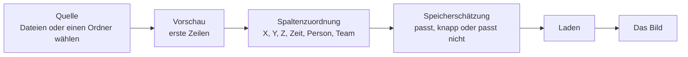

# Daten laden

Bevor 3DHeat etwas zeichnen kann, braucht es eine Tabelle: Jede Zeile sagt, wo etwas war und, falls du es hast, wann und wer. Dieser Abschnitt zeigt, wie aus einer Datei ein Bild wird. Noch keine Daten? Probiere die [Demodaten](demo-data.md).

**Mach das jetzt:**

1. Öffne in der Heatmap-Seitenleiste **Quelle** und drücke **Dateien…** (oder ziehe eine Datei oder einen Ordner auf die Ablagefläche).
2. Schau dir **Spaltenzuordnung** an: Die Felder sind meist schon ausgefüllt.
3. Prüfe, dass die **Speicherschätzung** *passt* sagt.
4. Drücke **Laden**.

Alles, was der Tab Heatmap zeigt, kommt aus einem **Datensatz**: einer Tabelle mit Zeilen, jede mit einer Position und optional einer Zeit, einer Person, einer Gruppe, einer Sitzung, einer Blickrichtung und beliebig vielen Zusatzspalten für Filter. Dieser Abschnitt erklärt, wie ein Datensatz entsteht.

## Der Weg von Dateien zum Bild {#the-path-from-files-to-picture}

1. **Dateien wählen** im Bereich **Quelle** – eine Datei, mehrere, einen Ordnerbaum oder per Ablegen. Parquet, CSV, Tacview, GPS-Spuren und mehr werden angenommen; die vollständige Liste steht unter [Datenformate](data-formats.md#files). Siehe [Dateien laden](loading-files.md).
2. **Vorschau.** Die erste Datei der Auswahl wird geöffnet: ihre Spaltennamen, ihre ersten 50 Zeilen, welche Spalten nach Zahlen aussehen und (bei Parquet) der logische Typ jeder Spalte sowie die eigene Leseanweisung der Datei, der Eintrag `heat3d` im Footer.
3. **Automatische Zuordnung.** Spalten werden Rollen zugewiesen – X, Y, Z, Zeit, Person, Sitzung, Gruppe, Blickrichtung – und einige bleiben für Filter erhalten. Jede Vermutung wird im Panel **Spaltenzuordnung** gezeigt und lässt sich ändern. Siehe [Spaltenzuordnung](column-mapping.md) und [Achsen, Einheiten und Zeit](axes-units-and-time.md).
4. **Zählen.** Die Zeilenzahl jeder Datei wird gelesen (bei Parquet genau aus dem Footer, bei CSV geschätzt). So kann das Panel, bevor etwas geladen wird, sagen, wie viel Speicher das Laden braucht und ob es passt. Passt es nicht, schlägt es vor, nur jede *N*-te Zeile zu laden. Siehe [Speicher und Budgets](memory-and-budgets.md).
5. **Laden.** Ein Hintergrund-Worker liest nur die zugeordneten Spalten jeder Datei – mehrere Dateien gleichzeitig, bis zum Budget der [Parser-Threads](memory-and-budgets.md#parser-threads) – und führt sie in der Reihenfolge der Auswahl zu einem Datensatz zusammen: ein gemeinsames Wörterbuch für Personen, Gruppen und Sitzungen über alle Dateien, ein gemeinsamer Zeitursprung, alle Zeilen nach Zeit sortiert. Siehe [Sitzungen, Personen und Gruppen](sessions-persons-groups.md).
6. **Hochladen.** Der Hauptthread meldet für einen Frame „Lade N Zeilen auf die GPU hoch“ und packt die Zeilen dann in den GPU-Speicher innerhalb des GPU-Budgets. Siehe [GPU-Speicherbelegung](gpu-memory.md).
7. **Erstes Bild.** Die Kamera rahmt die Daten, Sprite-Radius und Sättigung werden aus Ausdehnung und Zeilenzahl der Daten gesetzt, und nach 8 gezeichneten Frames wird die Sättigung aus dem Bild selbst gemessen ([Farbe und Belichtung](colour-and-exposure.md)).

## Voraussetzungen, vor dem Laden geprüft {#requirements-checked-before-a-load}

| Bedarf | Was ohne ihn passiert |
|---|---|
| **Mindestens zwei von X / Y / Z** | Das Laden wird abgelehnt. Mit genau zwei bleibt die dritte Achse bei 0, und die Daten werden als flache Ebene in der 3D-Szene gezeichnet – was eine Draufsicht-Heatmap braucht. |
| Eine Zeitspalte | Optional. Ohne sie ist die Zeitleiste deaktiviert, die Ansicht bleibt im Modus **Alle**, und die Seitenleiste sagt das. |
| Eine Personenspalte | Optional. Nötig für das [Figuren-Overlay](box-replay.md) (eine Figur pro Person), [Linien-Intensität](line-heat.md) (der Weg jeder Person), Interpolation, Spuren und den Verlauf **Lebensdauer**. |
| Eine Gruppenspalte | Optional. Nötig für [Team-Intensität](team-heat.md) und den Modus [Differenz](difference.md) (mindestens zwei Gruppen). |

Ein Modus, den die geladenen Daten nicht tragen, ist in der Modusleiste ausgegraut; wenn du mit der Maus darüber fährst, steht dort der Grund.

## Ohne eigene Daten {#without-your-own-data}

Das Panel **Datensatz** (unter **Quelle**) hat einen [synthetischen Generator](synthetic-generator.md), der einen Datensatz in Form eines Battle Royale in beliebiger Größe erzeugt. Das ist nützlich, um den Viewer auszuprobieren und um zu testen, was ein Rechner schafft.

## Seiten in diesem Abschnitt {#pages-in-this-section}

- [Dateien laden](loading-files.md) – Auswahldialoge, Ordner, Ziehen und Ablegen, Zusammenführen mehrerer Dateien, die Regel für Bewegungsdateien, Fortschritt und Abbrechen
- [Spaltenzuordnung](column-mapping.md) – jedes Feld des Zuordnungspanels, wie die automatische Zuordnung rät, die `heat3d`-Hinweise
- [Achsen, Einheiten und Zeit](axes-units-and-time.md) – Hochachse, Spiegelungen, Einheitenmaßstab, Zeiteinheiten, Blickrichtung
- [Sitzungen, Personen und Gruppen](sessions-persons-groups.md) – was jede tut, die Grenzen, gemeinsame Namen, Entitätsgröße, das Panel Datensatz
- [Synthetischer Generator](synthetic-generator.md)
- [Speicher und Budgets](memory-and-budgets.md) – das Speichermodell, die Passprüfung, Dezimierung, die Sortiergrenze, Ressourcenbudgets
