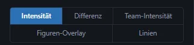

# Intensitätsmodi

Jeder Punkt fügt einen kleinen Glanz hinzu, die Glanzpunkte häufen sich, und der Haufen wird mit Farben gemalt. Die Modi sind fünf Arten, ihn zu malen, und jede beantwortet eine Frage.

Die Modusleiste oben in der Seitenleiste des Tabs Heatmap wählt, wie der [Datensatz](glossary.md) gezeichnet wird. Die Tasten 1-4 wählen Intensität, Differenz, Team-Intensität und Linien. Das Figuren-Overlay hat keine Taste.

| Modus | Frage, die er beantwortet |
|---|---|
| **Intensität** | Wo ist es passiert, und wie stark? |
| **Differenz** | Welche Seite hat es öfter getan? |
| **Team-Intensität** | Wessen war es? |
| **Linien** | Welchen Weg sind die Leute gegangen? |
| **Figuren-Overlay** | Wer war wo, und wann? |

| Modus (Leistenbeschriftung) | Taste | Was er zeichnet | Braucht |
|---|---|---|---|
| **Intensität** | 1 | Additive Dichte: Jede sichtbare Zeile fügt einen kameragewandten runden Sprite hinzu. [Intensität](heat.md) | einen Datensatz |
| **Differenz** | 2 | Vorzeichenbehaftete Dichte: Eine Gruppe addiert, eine andere subtrahiert. [Differenz](difference.md) | zwei Seiten: mindestens zwei Gruppen oder eine Aufteilung über eine behaltene Spalte |
| **Team-Intensität** | 3 | Dichte, nach Gruppe eingefärbt: ein Farbton pro Gruppe, gemischt, wo sich Gruppen überlappen. [Team-Intensität](team-heat.md) | eine Gruppenspalte |
| **Figuren-Overlay** | – | Eine Figur (oder ein Quader) pro Person, die sich entlang der Zeitleiste bewegt: das Replay. [Figuren-Overlay](box-replay.md), [Match-Replay](match-replay.md) | eine Personenspalte |
| **Linien** | 4 | Linien-Intensität: eine Linie von jeder Probe einer Person zu ihrer nächsten, seitlich abfallende Intensität. [Linien-Intensität](line-heat.md) | eine Personen- und eine Zeitspalte |

Ein Modus, den die Daten nicht tragen, ist ausgegraut, und sein Tooltip nennt den Grund, zum Beispiel *Nicht verfügbar – der Modus Differenz braucht zwei Gruppen oder eine behaltene Spalte zum Aufteilen; diese Daten haben eine Gruppe.* Kann ein neuer Datensatz den aktuellen Modus nicht tragen, fällt die Ansicht auf **Intensität** zurück.

Die Tasten 1-4 werden genauso gegen die Daten geprüft: Eine Taste für einen ausgegrauten Modus tut nichts.

## Welche Panels jeder Modus zeigt {#which-panels-each-mode-shows}

| Panel | Intensität | Differenz | Team-Intensität | Figuren-Overlay | Linien |
|---|---|---|---|---|---|
| Wege ([Linien-Intensität](line-heat.md)) | | | | | ja |
| Heatmap-Form (mit **Der Ansicht folgen** und **Gleiche Dichte bei jedem Zoom**), Heatmap-Farben, Sprite-Pixelgrenzen, Tiefe, Entfernungsbeschneidung | ja | ja | ja | | ja |
| Richtung ([gerichtete Intensität](directional-heat.md)), Wert ([Wertgewichtung](value-weighting.md)) | ja | ja | ja | | ja |
| Team-Ansicht ([Figuren-Overlay](box-replay.md)) | | | | ja | |
| Differenz-Aufteilung ([Differenz](difference.md)) | | ja | | | |
| [Teams](teams-list.md), [Entitäten](entities.md), [Filter](filters.md), Hintergrund / Level, [Schnitt](slice.md), [Messwert](measure.md), Kamerapfad und Video, Leistung, Kamera & Szene | ja | ja | ja | ja | ja |

## Was alle Intensitätsmodi gemeinsam haben {#what-every-heat-mode-shares}

Alle vier Intensitätsmodi (alles außer dem Figuren-Overlay) sind dieselbe Maschine mit verschiedenen Eingaben ([`engine.ts`](https://github.com/Holdi601/3DHeat/blob/main/src/render/engine.ts)):

1. **Welche Zeilen.** Das [Zeitleisten](timeline.md)-Fenster wählt einen zusammenhängenden Bereich zeitlich sortierter Zeilen; [Filter](filters.md), Gruppensichtbarkeit, die Differenz-Aufteilung, [Entfernungsbeschneidung](depth-and-culling.md#distance-culling) und der [Schnitt](slice.md) entscheiden im Vertex-Shader pro Zeile, ob und wie stark sie beiträgt.
2. **Splatting.** Jede beitragende Zeile wird als Sprite (oder im Modus Linien als Segment) in ein Fließkomma-**Intensitätsziel** gezeichnet und addiert ihren Verlaufswert. Sind mehr Zeilen da, als ein Frame schafft, wird eine geschichtete Stichprobe gezeichnet und gewichtet, um das auszugleichen. Siehe [Abtastung und Budgets](sampling-and-budgets.md).
3. **Akkumulation.** Solange sich nichts ändert, werden Frames zusammengeführt, bis jede Zeile genau einmal beigetragen hat. Siehe [Akkumulation](accumulation.md).
4. **Komposition.** Der akkumulierte Wert jedes Pixels wird durch den **Sättigungspunkt** geteilt, durch das **Dichteverhalten** geformt, um die **Mindestintensität** angehoben und im **Heatmap-Verlauf** nachgeschlagen; dessen Alpha mischt ihn über die Szene. Siehe [Farbe und Belichtung](colour-and-exposure.md).

Alles in Schritt 4 wird bei der Komposition angewendet, daher startet das Ziehen dieser Regler nie die Akkumulation neu; alles in den Schritten 1-2 tut es.

## Seiten in diesem Abschnitt {#pages-in-this-section}

- [Intensität](heat.md) – der einfache Intensitätsmodus und die Übersicht seiner Panels
  - [Sprite-Form](sprite-shape.md) – Radius, Intensitäten, Abfall, der Kurveneditor, Pixelgrenzen, Abflachen
  - [Farbe und Belichtung](colour-and-exposure.md) – Editor der Farbskala, Sättigungspunkt, Auto-Belichtung, Mindestintensität, Dichtereaktion
  - [Tiefe und Culling](depth-and-culling.md) – Verdeckung durch das Level, Verbergen hinter dem Gelände, Entfernungsbeschneidung
- [Differenz](difference.md) – die Differenz-Aufteilung
- [Team-Intensität](team-heat.md)
- [Linien-Intensität](line-heat.md) – Wege
- [Figuren-Overlay](box-replay.md) – der Replay-Modus (die Datei heißt noch box replay)
- [Gerichtete Intensität](directional-heat.md)
- [Wertgewichtung](value-weighting.md)
