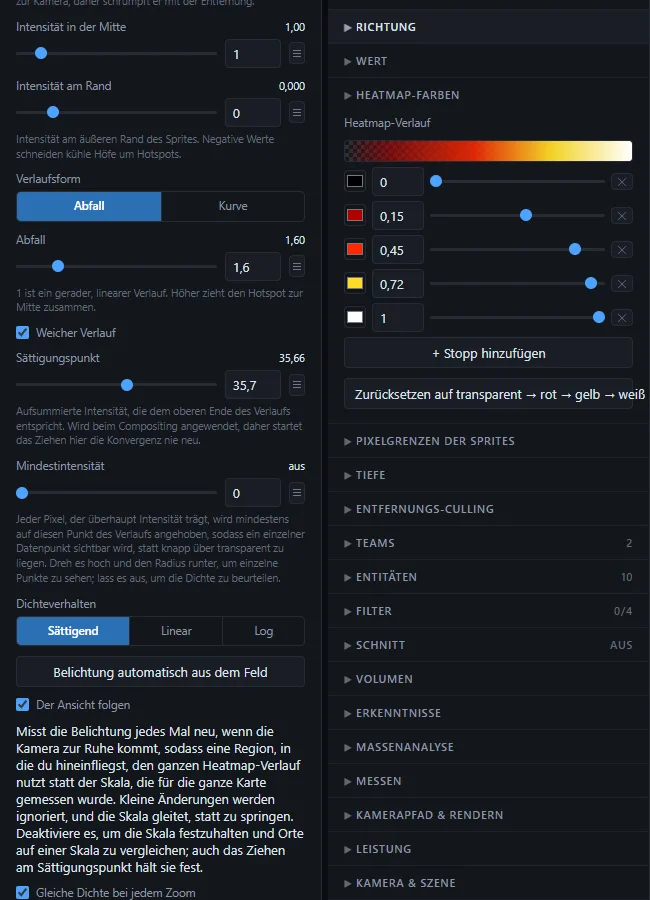

# Intensität

Die Intensität malt die Stellen, an denen viel passiert ist: rot, wo es ein bisschen passiert ist, weißglühend, wo es viel war. Sie beantwortet die Frage „wo passiert das, und wie viel?“.

**Intensität** (Taste 1) ist der Standardmodus. Jede sichtbare [Zeile](glossary.md) trägt einen zur Kamera gewandten runden [Sprite](glossary.md) bei; überlappende Sprites addieren sich in einem Gleitkomma-Puffer; die Summe wird durch einen Farbverlauf geschickt - standardmäßig transparent → rot → gelb → weiß - und über die Szene gelegt.

Das Bild zeigt die Intensität einer Shooter-Runde auf einem Level mit Gebäuden: Die heißen Stellen liegen in den Räumen und auf den Treppen, nicht nur auf dem Boden.

## So benutzt du es {#how-to-use-it}

1. Lade Daten und drücke `1` (oder wähle **Intensität** in der Modusleiste).
2. Ist alles weiß oder leer, drücke **Belichtung automatisch aus dem Feld** im Abschnitt **Heatmap-Form**.
3. Ändere den **Sprite-Radius**, bis benachbarte Punkte zu Bändern verschmelzen: Kleiner zeigt einzelne Flecken, größer zeigt Flächen.
4. Öffne **Heatmap-Farben**, um die Farben zu ändern, oder **Tiefe**, damit Hügel und Wände die Intensität dahinter verbergen.

Dieselben Felder formen [Differenz](difference.md), [Team-Intensität](team-heat.md) und [Linien-Intensität](line-heat.md); sie unterscheiden sich darin, was addiert wird (mit Vorzeichen, gefärbt oder entlang von Linien), nicht darin, wie.

## Die Felder und ihre Standardwerte {#the-panels-and-their-defaults}

Jeder Regler wird auf seiner eigenen Seite erklärt; die Spalte Details verlinkt dorthin. Schieberegler haben ein Eingabefeld daneben und einen Griff (den kleinen Anfasser rechts: nach oben oder unten ziehen, je weiter, desto schneller; Umschalt für Feineinstellung). Wo die Leiste eines Schiebereglers vor einer echten Grenze endet, kann der Griff bis zur hier angegebenen *Schrittweiten-Obergrenze* darüber hinaus gehen. Werte mit der Angabe *beim Laden* werden für jeden neuen Datensatz neu berechnet.

### Heatmap-Form (offen) {#heat-shape-open}

| Regler | Standard | Bereich (Obergrenze der Schrittweite) | Details |
|---|---|---|---|
| **Sprite-Radius** | 6 m; beim Laden Ausdehnung / 120 | 0,05-2000 m, logarithmisch (50.000) | [Sprite-Form](sprite-shape.md#sprite-radius) |
| **Intensität in der Mitte** | 1 | 0-10 (1000) | [Sprite-Form](sprite-shape.md#centre-and-edge-intensity) |
| **Intensität am Rand** | 0 | -2-10 (1000) | [Sprite-Form](sprite-shape.md#centre-and-edge-intensity) |
| **Verlaufsform** | *Abfall* | *Abfall* / *Kurve* | [Sprite-Form](sprite-shape.md#ramp-shape-falloff-or-curve) |
| **Abfall** (nur bei Abfall) | 1,6 | 0,1-8 (64) | [Sprite-Form](sprite-shape.md#falloff) |
| **Weicher Verlauf** (nur bei Abfall) | an | | [Sprite-Form](sprite-shape.md#falloff) |
| Kurven-Editor (nur bei Kurve) | Voreinstellung *Weich* | | [Sprite-Form](sprite-shape.md#the-curve-editor) |
| **Sättigungspunkt** | 24; beim Laden eine Schätzung, dann gemessen | 0,1-4000, logarithmisch (10.000.000) | [Farbe und Belichtung](colour-and-exposure.md#saturation-point) |
| **Mindestintensität** | aus (0) | 0-100 % | [Farbe und Belichtung](colour-and-exposure.md#minimum-heat) |
| **Dichteverhalten** | *Sättigend* | *Sättigend* / *Linear* / *Log* | [Farbe und Belichtung](colour-and-exposure.md#density-response) |
| **Belichtung automatisch aus dem Feld** | | Knopf | [Farbe und Belichtung](colour-and-exposure.md#auto-exposure) |
| **Der Ansicht folgen** | an | | Misst die Belichtung jedes Mal neu, wenn die Kamera zur Ruhe kommt, so dass eine Gegend, in die du hineinfliegst, den ganzen Farbverlauf nutzt. Kleine Änderungen werden ignoriert, und die Skala gleitet. Schalte es aus oder ziehe den **Sättigungspunkt**, um die Skala festzuhalten und Orte auf einer Skala zu vergleichen. [Farbe und Belichtung](colour-and-exposure.md#follow-the-view) |
| **Gleiche Dichte bei jedem Zoom** | an | | Eine Farbe bedeutet dieselbe Anzahl Zeilen pro Bodenfläche, egal wie nah du bist. Ein Sprite, den die Pixelgrenzen vergrößern (in der Ferne) oder verkleinern (nah dran), behält die Wärme, die seine wahre Größe hinzufügen würde, so dass ein Bild, das aus der Ferne belichtet wurde, nicht verblasst, wenn du hineinfliegst. Aus: Ein begrenzter Sprite fügt sein volles Gewicht in seiner begrenzten Größe hinzu. [Sprite-Form](sprite-shape.md#pixel-clamps) |
| **Auf die Bodenebene abflachen** | aus | | [Sprite-Form](sprite-shape.md#flatten-onto-ground-plane) |

### Heatmap-Farben (geschlossen) {#heat-colours-closed}

| Regler | Standard | Details |
|---|---|---|
| Gruppenfarbfelder und **Farbtrennung** (nur Team-Intensität) | 1,4 | [Team-Intensität](team-heat.md) |
| Editor des **Heatmap-Verlaufs** (*Positiv (additive Teams)* bei Differenz, *Deckkraft-Verlauf* bei Team-Intensität) | transparent → rot → gelb → weiß | [Farbe und Belichtung](colour-and-exposure.md#the-ramp-editor) |
| **Zurücksetzen auf transparent → rot → gelb → weiß** | | |
| Verlauf **Negativ (subtraktive Teams)** (nur Differenz) | transparent → grün → blau → violett | [Differenz](difference.md#colours) |

### Pixelgrenzen der Sprites (geschlossen) {#sprite-pixel-clamps-closed}

| Regler | Standard | Bereich (Obergrenze der Schrittweite) | Details |
|---|---|---|---|
| **Min. Pixelradius** | 1 px | 0-16 (512) | [Sprite-Form](sprite-shape.md#pixel-clamps) |
| **Max. Pixelradius** | 96 px | 2-1024, logarithmisch (8192) | [Sprite-Form](sprite-shape.md#pixel-clamps) |

### Tiefe (offen) {#depth-open}

| Regler | Standard | Details |
|---|---|---|
| **Hinter Gelände verbergen** | an | [Tiefe und Culling](depth-and-culling.md#hide-behind-terrain) |
| **Hinter Geometrie verborgen** | 0,8 (*80 % dunkler*) | [Tiefe und Culling](depth-and-culling.md#hidden-behind-geometry) |

### Entfernungs-Culling (geschlossen) {#distance-culling-closed}

| Regler | Standard | Bereich (Obergrenze der Schrittweite) | Details |
|---|---|---|---|
| **Nah** | aus (0) | 0,5-5000 m, logarithmisch; unteres Ende der Leiste = aus (200.000) | [Tiefe und Culling](depth-and-culling.md#distance-culling) |
| **Fern** | aus (0) | 1-200.000 m, logarithmisch; unten = aus (10.000.000) | [Tiefe und Culling](depth-and-culling.md#distance-culling) |
| **An einer Ebene schneiden** | an | | [Tiefe und Culling](depth-and-culling.md#distance-culling) |
| **Auch das Level schneiden** | an | | [Tiefe und Culling](depth-and-culling.md#distance-culling) |

Tasten: `[` und `]` schieben die ferne Grenze hinein und hinaus, `\` schaltet sie um ([Tiefe und Culling](depth-and-culling.md#keyboard)).

### Richtung und Wert {#direction-and-value}

Zwei weitere Abschnitte liegen unter Heatmap-Form. **Richtung** zeichnet jede Zeile als Keil und fügt Pfeile hinzu: siehe [Gerichtete Intensität](directional-heat.md). **Wert** gewichtet die Intensität nach dem, was jede Zeile gekostet oder eingebracht hat: siehe [Wertgewichtung](value-weighting.md).

## Was gespeichert wird {#what-is-saved}

Die Intensitäts-Einstellungen oben werden zwischen Sitzungen nicht gespeichert: Beim Neuladen der Seite kommen die Standardwerte zurück. Zwei Dinge bleiben im Browser erhalten: die letzte Wiedergabegeschwindigkeit (`heat3d.speed`, siehe [Zeitleiste](timeline.md)) und die Einstellungen der weit entfernten Figuren des [Figuren-Overlays](box-replay.md) (Symbolstil, Größe, Trefferzeichen und so weiter). Ebenso die Sprache, die [invertierten Weltachsen](camera.md#invert-world-axis), die gemerkten Fahrzeugnamen des Tabs Rennanalyse und die [Level-Bibliothek](level-library.md). Die vollständige Liste steht unter [Gespeicherte Einstellungen](ref-settings-storage.md).
