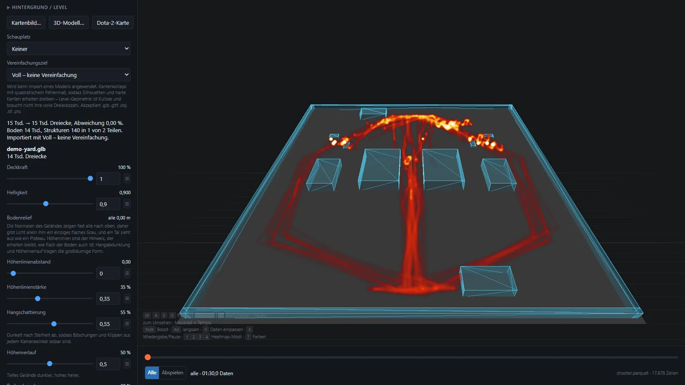

# Intensität

Intensität malt die Stellen, an denen viel passiert ist: rot, wo es ein bisschen passiert ist, weißglühend, wo es viel war. Sie beantwortet die Frage „wo passiert das, und wie stark?“.

**Intensität** (Taste 1) ist der Standardmodus. Jede sichtbare [Zeile](glossary.md) trägt einen kameragewandten runden [Sprite](glossary.md) bei; überlappende Sprites addieren sich in einem Fließkomma-Puffer; die Summe wird durch einen Farbverlauf geschickt – standardmäßig transparent → rot → gelb → weiß – und über die Szene gelegt.

Das Bild zeigt die Intensität einer Shooter-Runde auf einem Level mit Gebäuden: Die heißen Stellen liegen in den Räumen und auf den Treppen, nicht nur auf dem Boden.

## So benutzt du es {#how-to-use-it}

1. Lade Daten und drücke `1` (oder wähle **Intensität** in der Modusleiste).
2. Ist alles weiß oder leer, drücke **Belichtung automatisch aus dem Feld** im Abschnitt **Heatmap-Form**.
3. Ändere **Sprite-Radius**, bis benachbarte Punkte zu Bändern verschmelzen: Kleiner zeigt einzelne Flecken, größer zeigt Flächen.
4. Öffne **Heatmap-Farben**, um die Farben zu ändern, oder **Tiefe**, damit Hügel und Wände die Intensität dahinter verbergen.

Dieselben Panels formen auch [Differenz](difference.md), [Team-Intensität](team-heat.md) und [Linien-Intensität](line-heat.md); sie unterscheiden sich darin, was addiert wird (mit Vorzeichen, farbig oder entlang von Linien), nicht darin, wie es geschieht.

## Die Panels und ihre Voreinstellungen {#the-panels-and-their-defaults}

Jeder Regler unten entspricht einem Shader-Parameter, daher kostet eine Änderung nichts außer einem neuen Zeichnen. Regler haben ein Eingabefeld daneben und einen Ziehgriff (der kleine Griff rechts: nach oben oder unten ziehen, weiter ziehen ist schneller, Umschalt für fein); reicht die Leiste eines Reglers nicht bis zur echten Grenze, kann der Griff bis zur hier genannten *Griffgrenze* darüber hinaus gehen. Werte mit *beim Laden* werden für jeden neuen Datensatz neu berechnet.

### Heatmap-Form (offen) {#heat-shape-open}

| Regler | Voreinstellung | Bereich (Griffgrenze) | Details |
|---|---|---|---|
| **Sprite-Radius** | 6 m; beim Laden Ausdehnung / 120 | 0,05-2000 m, logarithmisch (50.000) | [Sprite-Form](sprite-shape.md#sprite-radius) |
| **Intensität in der Mitte** | 1 | 0-10 (1000) | [Sprite-Form](sprite-shape.md#centre-and-edge-intensity) |
| **Intensität am Rand** | 0 | -2-10 (1000) | [Sprite-Form](sprite-shape.md#centre-and-edge-intensity) |
| **Verlaufsform** | *Abfall* | *Abfall* / *Kurve* | [Sprite-Form](sprite-shape.md#ramp-shape-falloff-or-curve) |
| **Abfall** (nur bei Abfall) | 1,6 | 0,1-8 (64) | [Sprite-Form](sprite-shape.md#falloff) |
| **Weicher Verlauf** (nur bei Abfall) | ein | | [Sprite-Form](sprite-shape.md#falloff) |
| Kurveneditor (nur bei Kurve) | Voreinstellung *Weich* | | [Sprite-Form](sprite-shape.md#the-curve-editor) |
| **Sättigungspunkt** | 24; beim Laden eine Schätzung, danach gemessen | 0,1-4000, logarithmisch (10.000.000) | [Farbe und Belichtung](colour-and-exposure.md#saturation-point) |
| **Mindestintensität** | aus (0) | 0-100 % | [Farbe und Belichtung](colour-and-exposure.md#minimum-heat) |
| **Dichteverhalten** | *Sättigend* | *Sättigend* / *Linear* / *Log* | [Farbe und Belichtung](colour-and-exposure.md#density-response) |
| **Belichtung automatisch aus dem Feld** | | Schaltfläche | [Farbe und Belichtung](colour-and-exposure.md#auto-exposure) |
| **Der Ansicht folgen** | ein | | Misst die Belichtung neu, sobald die Kamera zur Ruhe kommt, damit eine Region, in die du hineinfliegst, die ganze Farbskala nutzt. Kleine Änderungen werden ignoriert, und der Maßstab gleitet sanft. Schalte es aus oder ziehe **Sättigungspunkt**, um den Maßstab festzusetzen und Orte auf einer Skala zu vergleichen. [Farbe und Belichtung](colour-and-exposure.md#follow-the-view) |
| **Gleiche Dichte bei jedem Zoom** | ein | | Eine Farbe bedeutet gleich viele Zeilen pro Bodenfläche, egal wie nah du bist. Ein Sprite, den die Pixelgrenzen vergrößern (aus der Ferne) oder verkleinern (aus der Nähe), behält die Intensität, die seine wahre Größe beitragen würde; so verblasst ein aus der Ferne belichtetes Bild nicht, wenn du hineinfliegst. Aus, trägt ein begrenzter Sprite sein volles Gewicht bei seiner begrenzten Größe bei. [Sprite-Form](sprite-shape.md#pixel-clamps) |
| **Auf die Bodenebene abflachen** | aus | | [Sprite-Form](sprite-shape.md#flatten-onto-ground-plane) |

### Heatmap-Farben (zu) {#heat-colours-closed}

| Regler | Voreinstellung | Details |
|---|---|---|
| Gruppenfarben und **Farbtrennung** (nur Team-Intensität) | 1,4 | [Team-Intensität](team-heat.md) |
| Editor **Heatmap-Verlauf** (*Positiv (additive Teams)* bei Differenz, *Deckkraftverlauf* bei Team-Intensität) | transparent → rot → gelb → weiß | [Farbe und Belichtung](colour-and-exposure.md#the-ramp-editor) |
| **Zurücksetzen auf transparent → rot → gelb → weiß** | | |
| Verlauf **Negativ (subtraktive Teams)** (nur Differenz) | transparent → grün → blau → lila | [Differenz](difference.md#colours) |

### Sprite-Pixelgrenzen (zu) {#sprite-pixel-clamps-closed}

| Regler | Voreinstellung | Bereich (Griffgrenze) | Details |
|---|---|---|---|
| **Min. Pixelradius** | 1 px | 0-16 (512) | [Sprite-Form](sprite-shape.md#pixel-clamps) |
| **Max. Pixelradius** | 96 px | 2-1024, logarithmisch (8192) | [Sprite-Form](sprite-shape.md#pixel-clamps) |

### Tiefe (offen) {#depth-open}

| Regler | Voreinstellung | Details |
|---|---|---|
| **Hinter Gelände verbergen** | ein | [Tiefe und Culling](depth-and-culling.md#hide-behind-terrain) |
| **Hinter Geometrie verborgen** | 0,8 (*80 % dunkler*) | [Tiefe und Culling](depth-and-culling.md#hidden-behind-geometry) |

### Entfernungsbeschneidung (zu) {#distance-culling-closed}

| Regler | Voreinstellung | Bereich (Griffgrenze) | Details |
|---|---|---|---|
| **Nah** | aus (0) | 0,5-5000 m, logarithmisch, unteres Ende der Leiste = aus (200.000) | [Tiefe und Culling](depth-and-culling.md#distance-culling) |
| **Fern** | aus (0) | 1-200.000 m, logarithmisch, unteres Ende = aus (10.000.000) | [Tiefe und Culling](depth-and-culling.md#distance-culling) |
| **An einer Ebene schneiden** | ein | | [Tiefe und Culling](depth-and-culling.md#distance-culling) |
| **Auch das Level schneiden** | ein | | [Tiefe und Culling](depth-and-culling.md#distance-culling) |

Tasten: `[` und `]` schieben die ferne Grenze hinein und heraus, `\` schaltet sie um ([Tiefe und Culling](depth-and-culling.md#keyboard)).

### Richtung und Wert {#direction-and-value}

Zwei weitere Abschnitte liegen unter der Heatmap-Form. **Richtung** zeichnet jede Zeile als Keil und fügt Pfeile hinzu: siehe [Gerichtete Intensität](directional-heat.md). **Wert** gewichtet die Intensität nach dem, was jede Zeile gekostet oder eingebracht hat: siehe [Wertgewichtung](value-weighting.md).

## Was gespeichert wird {#what-is-saved}

Die Intensitätseinstellungen oben werden zwischen Sitzungen nicht gespeichert: Beim Neuladen der Seite kommen die Voreinstellungen zurück. Zwei Dinge bleiben im Browser erhalten: die zuletzt gewählte Wiedergabegeschwindigkeit (`heat3d.speed`, siehe [Zeitleiste](timeline.md)) und die Einstellungen der fernen Figuren im [Figuren-Overlay](box-replay.md) (Symbolstil, Größe, Treffermarken und so weiter). Ebenso bleiben Sprache, die [invertierten Weltachsen](camera.md#invert-world-axis), die gemerkten Fahrzeugnamen des Tabs Rennanalyse und die [Level-Bibliothek](level-library.md) erhalten. Die vollständige Liste steht unter [Gespeicherte Einstellungen](ref-settings-storage.md).
