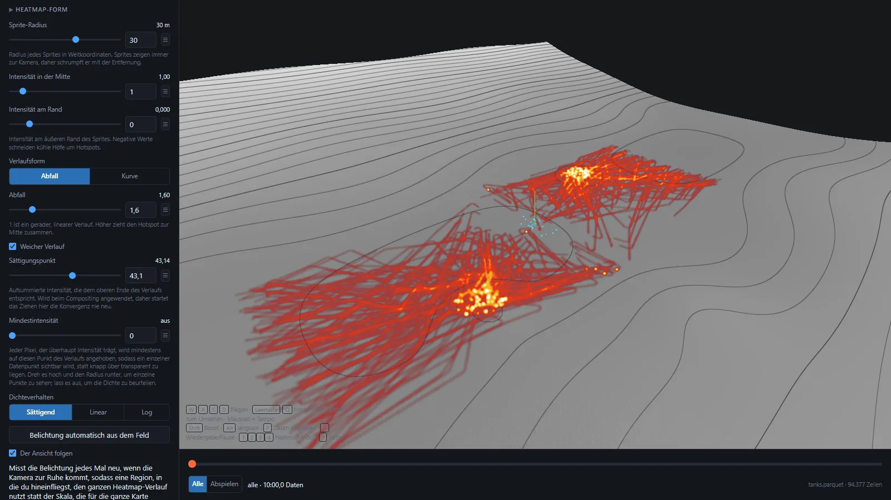
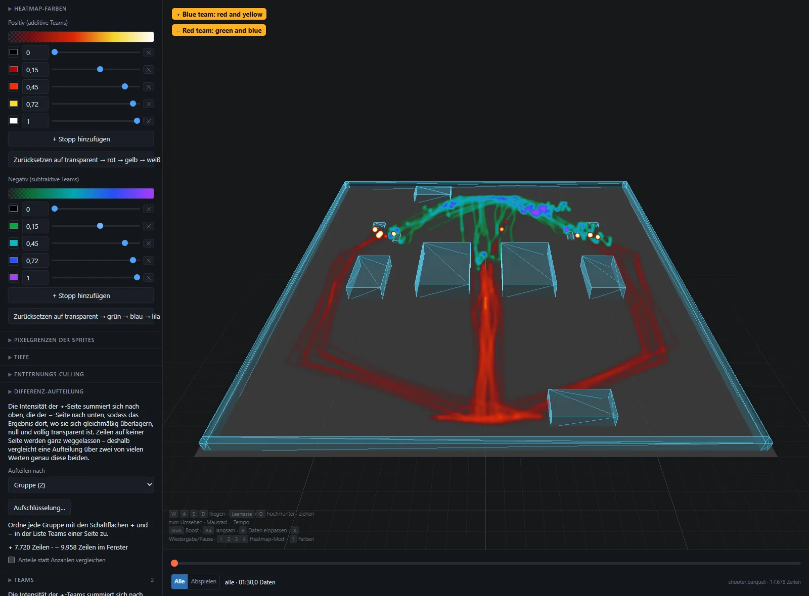
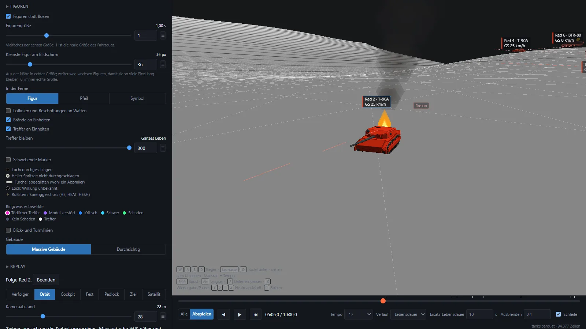
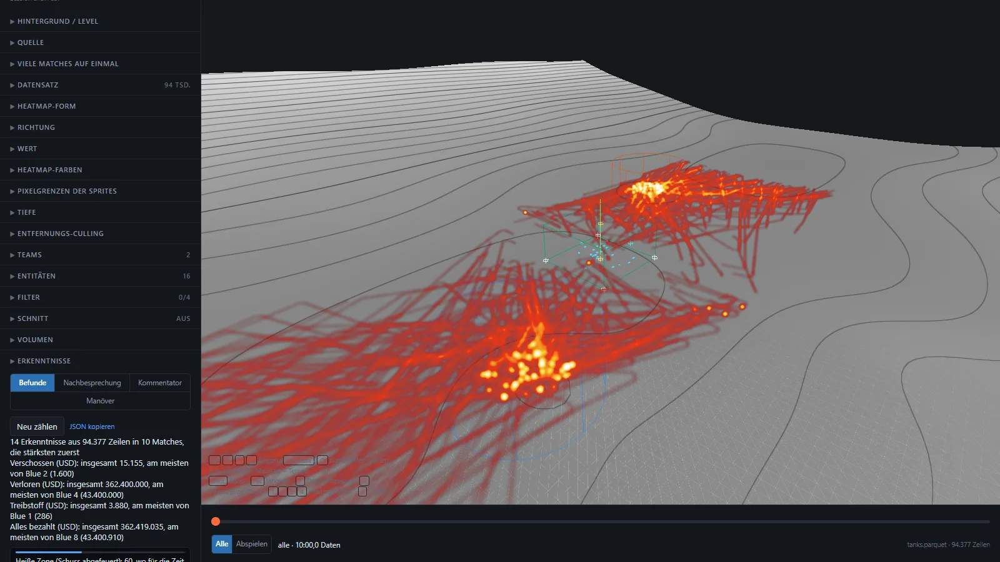
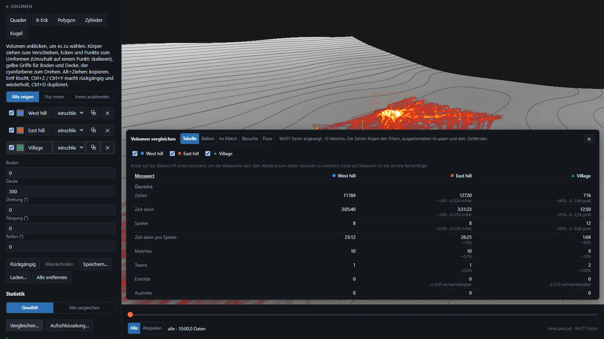
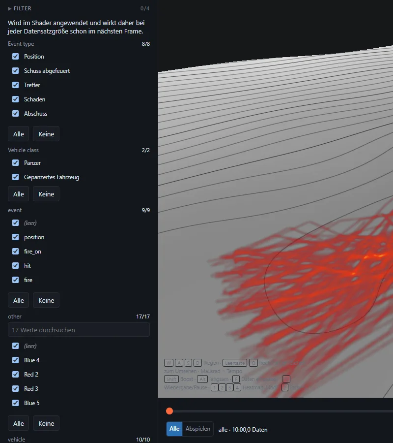
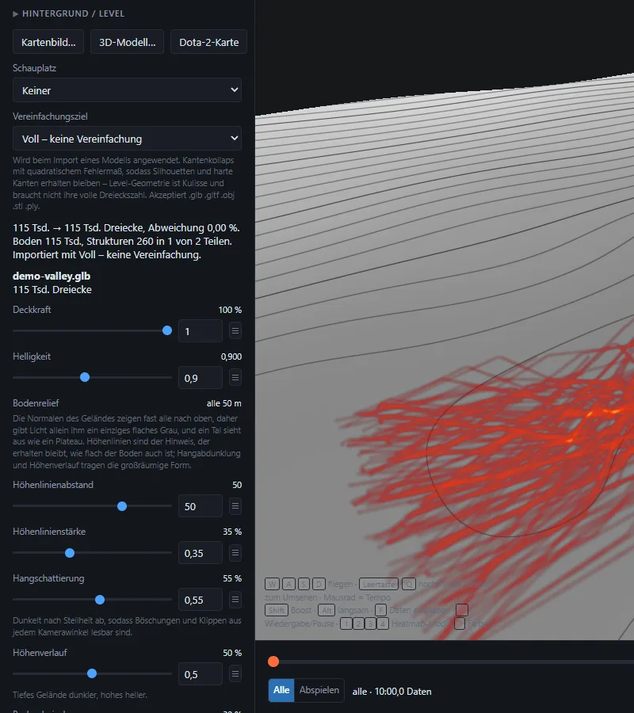

# 3DHeat

3DHeat zeigt, wo in einem Spiel etwas passiert ist – wohin Spieler gelaufen sind, wo sie gekämpft haben und wo sie gefallen sind. Als leuchtende Farben, durch die du fliegen kannst, oder als kleine 3D-Figuren, die das Match nachspielen.

Lade Positionen – CSV, Parquet, Tacview-Aufnahmen, konvertierte Replays, eine einzelne Datei, einen Ordner oder Tausende Matches – und sieh sie als **Heatmap, durch die du fliegen kannst**, als **Figuren, die das Match nachspielen**, als Linien entlang der Wege, die Leute genommen haben, oder als eine Gruppe gegen eine andere. Es findet selbst, was heraussticht, und läuft komplett in deinem Browser: Nichts wird irgendwohin hochgeladen. 3DHeat und alle seine Werkzeuge sind kostenlos und Open Source unter der [MIT-Lizenz](https://github.com/Holdi601/3DHeat/blob/main/LICENSE).



**Neu hier?** Erzeuge die [Demodaten](demo-data.md) und folge ihren sieben Schritten. Jedes Bild auf dieser Seite wurde damit gemacht.

## Was es kann {#what-it-does}

| | |
|---|---|
|  | **[Intensitätsmodi](heat-modes.md)** – Intensität, [Differenz](difference.md) (rot, wo eine Seite mehr hatte, grünblau, wo die andere mehr hatte), [Team-Intensität](team-heat.md), [Linien-Intensität](line-heat.md); [gerichtete Intensität](directional-heat.md) mit Keilen, Pfeilfeldern und Polardiagrammen; Intensität [nach Wert gewichtet](value-weighting.md): was Waffen, Fahrzeuge und Treibstoff kosten. |
|  | **[Match-Replay](match-replay.md)** – jede Einheit als [Figur](figures.md) von dem, was sie ist, NATO- oder russische Symbole aus der Ferne, Raketen und Leuchtspuren, Treffermarken, Wracks, Brände, Türme, Ziele und Kameras im Tacview-Stil sowie eine taktische Anzeige; [viele Matches auf einmal](many-matches.md). |
|  | **[Erkenntnisse](insights.md)** – starke Positionen, tödlicher Boden, Spawn-Fallen, Engpässe und herausragende Spieler, gefunden und mit Belegen geordnet; eine schriftliche Nachbesprechung, optional von einer KI deiner Wahl; ein Kommentator für ein Match; die [Wissenslinse](knowledge.md). |
|  | **[Volumen](volumes.md)** – Quader, Prismen, Zylinder und Kugeln zeichnen, nach ihnen filtern, zählen, was darin passiert, exportieren und Orte nebeneinander vergleichen; [Aufschlüsselung](breakdown.md), wer und was an einem Ort am besten abschneidet. |
|  | **[Filter](filters.md)** – nach Ereignistyp, Spieler oder KI, Fahrzeugklasse, Wert, jeder Spalte, auf der Grafikkarte bei jeder Datenmenge. |
|  | **[Levels](levels.md)** – Kartenbilder, 3D-Levels, die mit den [Datenwerkzeugen](#related-repositories) entstehen, Vereinfachung, der [Welt-Hintergrund](world-backdrop.md) mit echtem Gelände für Flugdaten. |

Außerdem: der Tab [Rennanalyse](race-analysis.md) für Runden von Rennspielen, der Tab [Match](match-analysis.md) für Zusammenfassungen von Counter-Strike 2, die [Taktik-Tafel](tactics-board.md) für Pläne auf einem Level, [Trefferanalyse](hit-analysis.md) pro Fahrzeug, [Massenanalyse](mass-analysis.md) von Tausenden Matches, [Kamerapfade und Video](camera-path-and-video.md), [40 Sprachen](languages.md), [metrische oder imperiale Einheiten](settings.md).

## Die Tabs {#the-tabs}

Die Tabs stehen oben in der Seitenleiste, unter dem Namen, den Einheiten und dem Sprachmenü.

| Tab | Wofür er da ist |
|---|---|
| **Heatmap** | Jede Positionstabelle: die Intensitätsmodi, das Figuren-Overlay, Filter, Volumen, Erkenntnisse, Levels, Messen und Video. |
| **Rennanalyse** | Zwei oder mehr Runden einer Strecke: wo Zeit verloren geht, warum, und was du ändern solltest. |
| **Match** | Das Figuren-Replay eines Matches und Zusammenfassungen von Counter-Strike-2-Matches. |
| **Taktik** | Pläne auf einem Level: Figuren, Wege, Wurfgeräte, Flächen und Notizen in Schritten, die abspielbar sind. |
| **Fahrzeuge** | Wo jede Einheit getroffen wurde, von wem und womit. |

## Installieren und starten {#install-and-run}

### Windows, der einfache Weg {#windows-the-easy-way}

Die Wurzel des Repositorys enthält drei Batch-Dateien.

| Datei | Was sie macht |
|---|---|
| `start.bat` | Startet den Viewer. Findet Node.js auch, wenn es nicht im `PATH` steht (es sucht in `%ProgramFiles%\nodejs`, `%ProgramFiles(x86)%\nodejs` und `%LOCALAPPDATA%\Programs\nodejs`). Fehlt Node.js, bietet es an, die LTS-Version mit `winget install -e --id OpenJS.NodeJS.LTS` zu installieren. Beim ersten Start fragt es, bevor es die Abhängigkeiten lädt (etwa 300 MB in den Ordner `node_modules\` im Ordner selbst, nichts systemweit). Es startet nicht, wenn schon etwas auf Port 5273 lauscht, und verweist dann auf `restart.bat`. Ist der Ordner ein Git-Checkout ohne lokale Änderungen und gibt es eine neuere Version, fragt es, ob aktualisiert werden soll (J/N; ohne Antwort nach 60 s bleibt diese Version; siehe [Updates](updates.md)). Dann startet es den Entwicklungsserver auf `http://127.0.0.1:5273/` und öffnet den Browser. **Das Fenster ist der Server**: Lass es offen, schließe es oder drücke Strg+C, um ihn zu beenden. |
| `restart.bat` | Führt `stop.bat quiet` aus, danach `start.bat`. Nur nötig nach Änderungen an `vite.config.ts`, beim Hinzufügen einer Abhängigkeit oder wenn der Server hängt – Quelltextänderungen werden im laufenden Betrieb neu geladen. |
| `stop.bat` | Beendet, was auf Port 5273 lauscht, über die Prozess-ID aus `netstat` – nie über den Programmnamen, damit andere Node.js-Prozesse auf dem Rechner unberührt bleiben. Wartet etwa zwei Sekunden, bis der Socket frei ist. Mit dem Argument `quiet` pausiert es am Ende nicht. |

### Von Hand (jedes Betriebssystem) {#by-hand-any-os}


```bash
git clone --recursive https://github.com/Holdi601/3DHeat.git
cd 3DHeat
npm install
npm run dev      # http://127.0.0.1:5273
```

Der Ordner `exporters/` enthält die separaten Datenwerkzeuge als Git-Submodule, jedes ein eigenes Repository; nach einem einfachen Klonen führe `git submodule update --init` aus. Der Viewer selbst braucht sie zum Starten nicht. `exporters/ext/` enthält die optionalen Konverter (Replays von War Thunder, World of Tanks, World of Warships und Squad; Karten von DCS und IL-2), getrennt gehalten, damit ein Problem mit einem davon keine anderen betrifft.

Keine Spieldaten liegen dem bei: Levels, Karten und Aufnahmen entstehen auf deinem eigenen Rechner mit den Werkzeugen, aus Spielen, die dir gehören.

### npm-Skripte {#npm-scripts}

| Skript | Was es ausführt |
|---|---|
| `npm run dev` | Der Vite-Entwicklungsserver auf Port 5273, nur an `127.0.0.1` gebunden. |
| `npm run build` | Typprüfung (`tsc --noEmit`) und ein Produktionspaket in `dist/`. |
| `npm run preview` | Liefert das Produktionspaket aus. |
| `npm run typecheck` | Nur die Typprüfung. |
| `npm test` / `npm run test:watch` | Unit- und Integrationstests (vitest). |
| `npm run smoke` | Steuert die echte App in einem Headless-Chromium und prüft, ob die Leinwand farbige Pixel mit Daten hat; Screenshots landen in `tools/.smoke/`. Erwartet, dass der Entwicklungsserver läuft. |
| `npm run smoke:f16` | Dieselbe Suite mit `?heat=f16`, sie erzwingt den Akkumulationspfad mit Half-Float (siehe [Akkumulation mit Half-Float](half-float-accumulation.md)). |
| `npm run bench` | Einlese-Benchmark, schreibt `tools/.smoke/ingest-bench.json`. |
| `npm run test:heavy` | Tests, die große echte Datendateien brauchen; sie überspringen sich selbst, wenn die Dateien fehlen. |
| `npm run inspect -- <file.parquet>` | Gibt Schema und einige Zeilen einer Parquet-Datei aus (`tools/inspect-parquet.mjs`). |

### Was der Entwicklungsserver hinzufügt {#what-the-dev-server-adds}

Der Viewer ist eine statische Webseite, aber der Entwicklungsserver (siehe `vite.config.ts`) fügt zwei lokale Routen hinzu, die eine statische Auslieferung von `dist/` nicht hat:

- `/__host/memory` meldet den installierten und freien Arbeitsspeicher des Rechners und, soweit lesbar, den Speicher der Grafikkarte (aus `nvidia-smi` oder unter Windows aus dem Registrierungseintrag des Grafikadapters). Dadurch können die [Speicherbudgets](memory-and-budgets.md) echte Werte statt der gedeckelten Schätzungen des Browsers nutzen.
- `/__heat3d/update` prüft, ob der Checkout zurückliegt, und kann ihn vorspulen ([Updates](updates.md)).

Der Server bindet nur an `127.0.0.1`, daher sind beide Routen aus dem Netzwerk nicht erreichbar. Öffne ihn als `http://127.0.0.1:5273`: `localhost` kann zur IPv6-Loopback-Adresse `::1` aufgelöst werden, dort lauscht nichts. Er sendet keine Cross-Origin-Isolations-Header (COOP/COEP): Nichts im Viewer nutzt `SharedArrayBuffer`, und die Worker übergeben ihre Daten per Transfer, dafür braucht es keine.

## Anforderungen an Browser und GPU {#browser-and-gpu-requirements}

- **Ein Browser mit WebGPU oder WebGL2.** WebGPU wird zuerst versucht (Chrome und Edge haben es); ohne es wird das WebGL2-Backend genutzt. WebGL2 muss `EXT_color_buffer_float` anbieten (Rendern in Fließkomma-Texturen), sonst zeigt der Viewer „Cannot initialise the renderer.“ Siehe [Die zwei Backends](backends.md). Der Viewer wird in Chromium entwickelt und getestet; andere Browser sind nicht geprüft.
- **Hardwarebeschleunigung eingeschaltet.** Zeichnet der Browser auf der CPU (SwiftShader, llvmpipe, der Microsoft Basic Render Driver und ähnliche), zeigt ein roter Balken oben in der Seitenleiste das an und wie es sich beheben lässt. Siehe [Erkennung von Software-Rendering](software-rendering.md).
- **Eine dedizierte GPU hilft, ist aber nicht nötig.** Beide Backends fordern den Adapter mit hoher Leistung an. Wie viele Daten auf der GPU gehalten werden können, ist ein Budget, das du sehen und ändern kannst ([Speicher und Budgets](memory-and-budgets.md)).
- **Optionale Funktionen** nutzen weitere Browser-APIs: Videoaufnahme braucht WebCodecs `VideoEncoder` mit VP9 oder VP8 ([Kamerapfad und Video](camera-path-and-video.md)); die Netzvereinfachung von Levels braucht WebAssembly; das Ablegen von Ordnern nutzt die File and Directory Entries API; die Level-Bibliothek nutzt IndexedDB; Gamepads nutzen die Gamepad-API.

## Dokumentationsübersicht {#documentation-map}

**Anfang**: [Demodaten](demo-data.md) · [Daten laden](getting-data-in.md) ([Dateien laden](loading-files.md), [Spaltenzuordnung](column-mapping.md), [Achsen, Einheiten und Zeit](axes-units-and-time.md), [Sitzungen, Personen und Gruppen](sessions-persons-groups.md), [Tacview](tacview-acmi.md), [Konverter](converters.md), [.3dheat](container.md), [Speicher und Budgets](memory-and-budgets.md))

**Ansehen**: [Intensitätsmodi](heat-modes.md) ([Intensität](heat.md), [Sprite-Form](sprite-shape.md), [Farbe und Belichtung](colour-and-exposure.md), [Tiefe und Culling](depth-and-culling.md), [Differenz](difference.md), [Team-Intensität](team-heat.md), [Linien-Intensität](line-heat.md), [Box-Replay](box-replay.md), [gerichtete Intensität](directional-heat.md), [Wertgewichtung](value-weighting.md)) · [Zeitleiste](timeline.md) · [Levels](levels.md) ([Kartenbilder](map-images.md), [3D-Levels](model-levels.md), [Aussehen](level-appearance.md), [Bibliothek](level-library.md), [Welt-Hintergrund](world-backdrop.md), [seine Quellen](world-backdrop-sources.md)) · [Kamera](camera.md) ([Gamepad](gamepad.md), [Tasten](keyboard-reference.md)) · [Kamerapfad und Video](camera-path-and-video.md)

**Analysieren**: [Filter und Werkzeuge](filters-and-tools.md) ([Filter](filters.md), [Teams](teams-list.md), [Entitäten](entities.md), [Schnitt](slice.md), [Messen](measure.md), [Volumen](volumes.md), [Aufschlüsselung](breakdown.md)) · [Erkenntnisse](insights.md) ([Wissenslinse](knowledge.md)) · [Massenanalyse](mass-analysis.md)

**Replay**: [Match-Replay](match-replay.md) · [Viele Matches auf einmal](many-matches.md) · [Figuren](figures.md) ([im Figuren-Overlay](figure-replay.md), [Nachweise](figure-credits.md)) · [Tacview-Parität](tacview-parity.md) · [Trefferanalyse](hit-analysis.md)

**Weitere Tabs**: [Rennanalyse](race-analysis.md) ([die Methode](race-analytics.md), [andere Spiele](other-games.md)) · [Match-Analyse](match-analysis.md) · [Taktik-Tafel](tactics-board.md) ([Geschwindigkeiten](tactics-speeds.md))

**Der Viewer**: [Glossar](glossary.md) · [Einstellungen, Einheiten und Tasten](settings.md) · [Sprachen](languages.md) · [Updates](updates.md) · [Interna des Renderings](rendering-internals.md) ([Backends](backends.md), [Akkumulation](accumulation.md), [Abtastung und Budgets](sampling-and-budgets.md), [Half-Float](half-float-accumulation.md), [GPU-Speicher](gpu-memory.md), [Software-Rendering](software-rendering.md), [Leistungsfenster und Statistik](performance-and-stats.md)) · [Datenformate](data-formats.md) · [Nachschlagewerk](reference.md) · [Pflege der Dokumentation](maintaining.md)

## Verwandte Repositories {#related-repositories}

Der Viewer liest Daten; diese Werkzeuge erzeugen sie. Jedes ist ein eigenes öffentliches Repository (MIT) mit eigener Dokumentation. Keines liefert Spieldaten mit: Levels, Karten und Aufnahmen entstehen auf deinem eigenen Rechner, aus Spielen, die dir gehören.

| Repository | Was es macht | Nützlich für | Dokumentation |
|---|---|---|---|
| [3DHeat-GameFiles](https://github.com/Holdi601/3DHeat-GameFiles) | Liest Strecken und Levels aus den Archiven, die Spiele ausliefern (Forza Horizon, BeamNG, Assetto Corsa Rally; Leser für Unreal, Unity, Frostbite und Source 2), als glTF | ein 3D-Level unter deiner Intensität oder deinem Replay | [Website](https://holdi601.github.io/3DHeat-GameFiles/) |
| [3DHeat-GameCapture](https://github.com/Holdi601/3DHeat-GameCapture) | Zeichnet Rundentelemetrie aus den Schnittstellen auf, die Rennspiele veröffentlichen, und baut Levels aus Spielvideos nach | Runden für die Rennanalyse; ein Level, wo keine Dateien lesbar sind | [Website](https://holdi601.github.io/3DHeat-GameCapture/) |
| [3DHeat-UnrealExporter](https://github.com/Holdi601/3DHeat-UnrealExporter) | Plugin für den Unreal Editor, das ein Level als eine glTF-Datei exportiert | Levels deiner eigenen Unreal-Projekte | [Website](https://holdi601.github.io/3DHeat-UnrealExporter/) |
| [3DHeat-CS2](https://github.com/Holdi601/3DHeat-CS2) | Counter-Strike-2-Demos in Intensitätstabellen und Match-Zusammenfassungen, CS2-Karten in Geometrie | CS2-Intensität, Replays und der Tab Match | [Website](https://holdi601.github.io/3DHeat-CS2/) |
| [3DHeat-Watcher](https://github.com/Holdi601/3DHeat-Watcher) | Zeichnet dein Spiel im Hintergrund auf, aus dem, was Spiele veröffentlichen: Telemetrie, Spielzustands-Integrationen, Protokolle, Replays | deine eigene Statistik, ohne etwas von Hand zu tun | [Website](https://holdi601.github.io/3DHeat-Watcher/) |
| [3DHeat-Ext-WarThunder](https://github.com/Holdi601/3DHeat-Ext-WarThunder) | War-Thunder-Replays (`.wrpl`) in Tabellen: Flug- und Bodenspuren, Schüsse, Treffer, Abschüsse, Türme, Ziele | War-Thunder-Replays, Treffermarken und Erkenntnisse | [Website](https://holdi601.github.io/3DHeat-Ext-WarThunder/) |
| [3DHeat-Ext-WoT](https://github.com/Holdi601/3DHeat-Ext-WoT) | World-of-Tanks-Replays in Tabellen: die Position jedes Fahrzeugs, Tode und Abschüsse | Intensität und Replays von World of Tanks | [Website](https://holdi601.github.io/3DHeat-Ext-WoT/) |
| [3DHeat-Ext-WoWs](https://github.com/Holdi601/3DHeat-Ext-WoWs) | World-of-Warships-Replays in Tabellen: die Position jedes Schiffs und die Versenkungen | Intensität und Replays von World of Warships | [Website](https://holdi601.github.io/3DHeat-Ext-WoWs/) |
| [3DHeat-Ext-Squad](https://github.com/Holdi601/3DHeat-Ext-Squad) | Squad-Serverdemos in Tabellen: die Position, das Team und der Trupp jedes Spielers | Intensität und Replays von Squad | [Website](https://holdi601.github.io/3DHeat-Ext-Squad/) |
| [3DHeat-Ext-DCS](https://github.com/Holdi601/3DHeat-Ext-DCS) | Gelände von DCS World aus deiner eigenen Installation zu Levels: Boden, Straßen, Städte, Flugplätze, Felder, Wasser | DCS- und Tacview-Aufnahmen auf ihrem echten Gelände | [Website](https://holdi601.github.io/3DHeat-Ext-DCS/) |
| [3DHeat-Ext-IL2](https://github.com/Holdi601/3DHeat-Ext-IL2) | Karten von IL-2 Great Battles als Levels | IL-2-Aufnahmen auf ihrer Karte | [Website](https://holdi601.github.io/3DHeat-Ext-IL2/) |

## Kurz zum Quellcode {#source-layout-briefly}

| Ordner | Inhalt |
|---|---|
| [`src/data/`](https://github.com/Holdi601/3DHeat/tree/main/src/data) | Dateiauswahl, CSV- und Parquet-Einlesen, automatische Zuordnung, Prüfung, Speichermodell, Datensatz-Aufbau, Modellverarbeitung, Klassifizierung, Vereinfachung, Level-Bibliothek |
| [`src/render/`](https://github.com/Holdi601/3DHeat/tree/main/src/render) | Die Bildschleife (`engine.ts`), Abtastung, beide Backends, Kamera, Gamepad, Messen, Kamerapfad, Videoaufnahme |
| [`src/state/`](https://github.com/Holdi601/3DHeat/tree/main/src/state) | Der Anwendungszustand (`store.ts`) mit allen Voreinstellungen, die Domänentypen (`types.ts`), die Sprite-Kurve |
| [`src/ui/`](https://github.com/Holdi601/3DHeat/tree/main/src/ui) | Die Panels der Seitenleiste, Zeitleiste, Overlays |
| [`src/race/`](https://github.com/Holdi601/3DHeat/tree/main/src/race), [`src/match/`](https://github.com/Holdi601/3DHeat/tree/main/src/match) | Die Tabs Rennanalyse und Match |
| [`src/i18n/`](https://github.com/Holdi601/3DHeat/tree/main/src/i18n) | Übersetzungen |
| [`src/insights/`](https://github.com/Holdi601/3DHeat/tree/main/src/insights) | Erkenntnisse: Detektoren, Nachbesprechung, Kommentator, KI-Anbieter, die Wissenslinse |
| [`src/mass/`](https://github.com/Holdi601/3DHeat/tree/main/src/mass) | Massenanalyse über viele Matches |
| [`src/volumes/`](https://github.com/Holdi601/3DHeat/tree/main/src/volumes) | Volumen, ihre Statistiken, Export und Vergleich |
| [`src/breakdown/`](https://github.com/Holdi601/3DHeat/tree/main/src/breakdown) | Aufschlüsselung und Faktoren |
| [`src/overlay/`](https://github.com/Holdi601/3DHeat/tree/main/src/overlay) | Das Overlay für viele Matches |
| [`src/figures/`](https://github.com/Holdi601/3DHeat/tree/main/src/figures) | Der Figurenkatalog und sein Aufbau |
| [`src/vehicle/`](https://github.com/Holdi601/3DHeat/tree/main/src/vehicle) | Trefferanalyse (Tab Fahrzeuge) |
| [`src/tactics/`](https://github.com/Holdi601/3DHeat/tree/main/src/tactics) | Die Taktik-Tafel |
| [`src/world/`](https://github.com/Holdi601/3DHeat/tree/main/src/world) | Der Welt-Hintergrund |
| [`src/units/`](https://github.com/Holdi601/3DHeat/tree/main/src/units) | Maßeinheiten |
