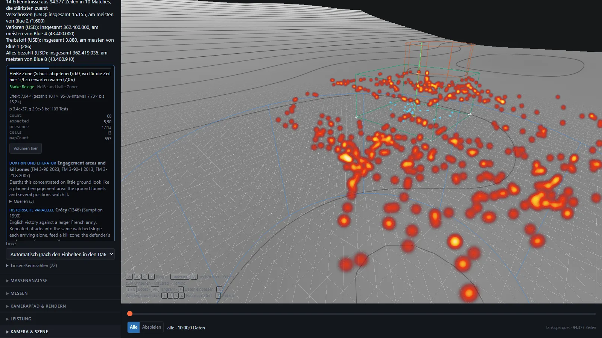
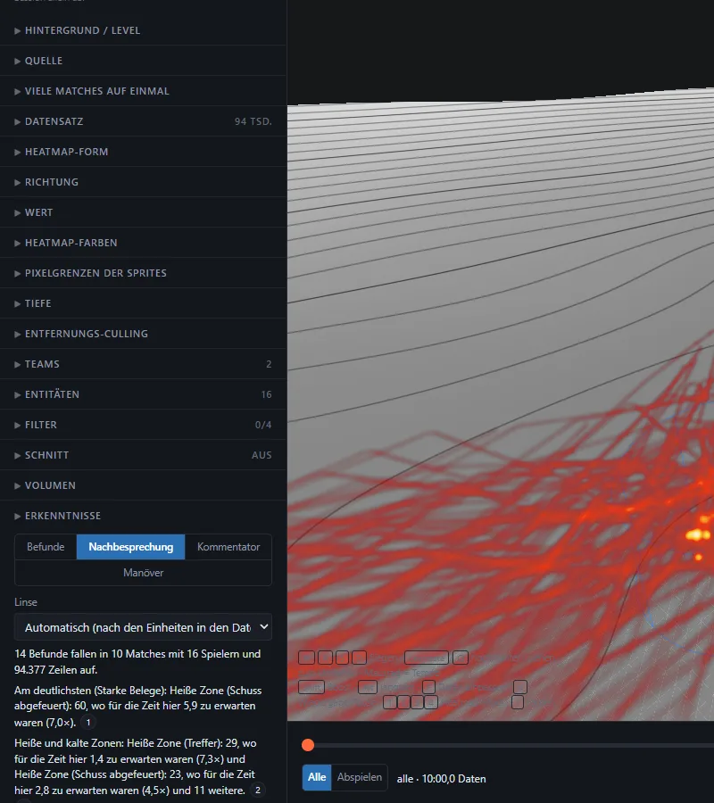
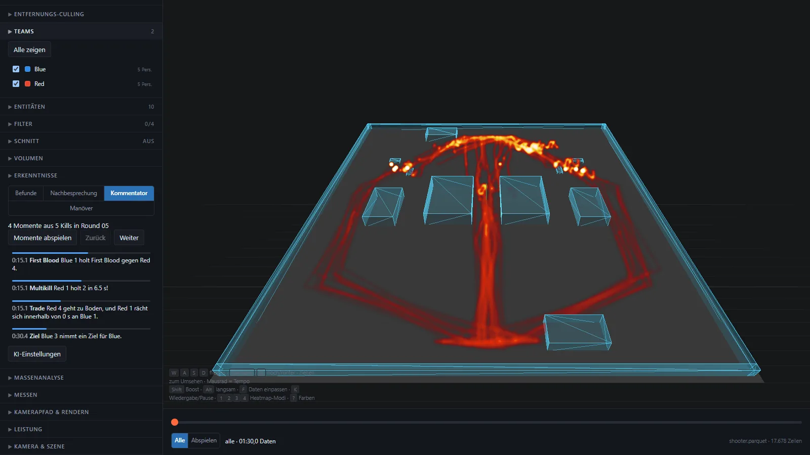

# Erkenntnisse

**Erkenntnisse** durchsucht die geladenen Daten nach dem, was heraussticht – starke Positionen, tödlicher Boden, Spawn-Fallen, Engpässe, Spieler, die weit über ihren Mitspielern liegen – und sagt dir das, das Stärkste zuerst, mit den Belegen. Damit lernst du in einer Minute, wo ein Match gewonnen oder verloren wurde. Danach kann es eine Nachbesprechung schreiben, und bei einem einzelnen Replay kann es als Kommentator auftreten, der zu den großen Momenten springt.

Alles wird in deinem Browser gezählt. Nichts verlässt deinen Rechner, außer du schaltest eine externe KI ein (siehe [Externe KI](#external-ai)).

Der Bereich **Erkenntnisse** steht in der Seitenleiste der Tabs Heatmap und Match. Er hat drei Reiter: **Befunde**, **Nachbesprechung** und **Kommentator**.

## Befunde {#findings}

1. Lade Daten und öffne **Erkenntnisse**. Drücke **Erkenntnisse finden** („Zähle… n %“ zeigt den Fortschritt).
2. Lies die Liste. Jeder Befund hat einen Stärkebalken, einen Satz, wie gut die Belege sind (*Starke Belege*, *Gute Belege* oder *Einige Belege*), welcher Detektor ihn gefunden hat und, wo es wichtig ist, die Fahrzeugklasse.
3. **Klicke einen Befund an**: Der Viewer wendet seine Filter an, fliegt die Kamera zum Ort und springt zur Zeit, und öffnet die Details: die Wirkung mit ihrem 95-%-Intervall, die p- und q-Werte, die gezählten Belege und **Volumen hier**, das ein [Volumen](volumes.md) um den Ort zieht.
4. **Filter zurücksetzen** setzt deine Filter zurück. **JSON kopieren** kopiert den ganzen Bericht.

Gezählt wird mit den aktuellen Filtern, ausgeblendeten Gruppen und dem gewählten Match über den gesamten Zeitraum. Änderst du danach die Filter, weist ein Hinweis darauf hin; drücke **Neu zählen**.

Die Zeilen oben in der Liste (zum Beispiel die Geldsummen) fassen die gesamten Daten zusammen, bevor die Befunde kommen.

### Die Detektoren {#the-detectors}

| Detektor | Was er findet | Braucht in den Daten |
|---|---|---|
| **Power-Positionen** | Orte mit deutlich besseren Abschuss-zu-Tod-Verhältnissen als der Rest der Karte, und *sicheren Boden*, wo in der Zeit dort nur wenige sterben | Abschuss- und Todesereignisse |
| **Heiße und kalte Zonen** | Orte, an denen eine Ereignisart (Schüsse, Treffer, Eroberungen ...) weit öfter oder seltener passiert, als die dort verbrachte Zeit erwarten lässt | eine Ereignisspalte |
| **Offenes Gelände und Deckung** | Tode im Freien nahe bei Levelgeometrie und langsam bei schneller Bewegung | Tode; für den Geometrieteil ein 3D-Level |
| **Spawns** | Starke Spawns, Spawn-Fallen, sichere Spawns, Zeit bis zum ersten Kontakt | Zeit und Personen |
| **Klasse nach Ort** | Eine Fahrzeugklasse oder Spieler gegen KI, die in einem Bereich deutlich besser oder schlechter abschneiden | Abschüsse plus eine Fahrzeugklassen- oder Spieler/KI-Spalte |
| **Spieler** | Spieler, die weit mehr oder weniger abschießen oder sterben als andere in derselben Klasse | Personen und Abschüsse |
| **Engpässe und Flanken** | Engpässe (weit mehr Durchgänge als das Gelände drumherum) und Flankenrouten (selten genutzt, führen aber zu Abschüssen) | Personen |
| **Wert** | *Teurer Boden* und *Ertragreicher Boden* | [Wertspalten](value-weighting.md) |
| **Was die Runden entschied** | Was gewonnene von verlorenen Runden trennte, und die Spieler, die am meisten Siegwahrscheinlichkeit hinzufügten oder kosteten (siehe [Wer gewann](#who-won-what-decided-the-rounds)) | Runden, Abschüsse und Tode sowie die [Ergebnisspalten](data-formats.md#outcome-columns) (`won`) |

Detektoren, die auf den Daten nicht laufen können, stehen unten mit dem Grund.

### So werden Befunde geordnet {#how-findings-are-ranked}

Jeder Ort und jede Gruppe wird gegen den Rest der Karte geprüft (exakte Binomial- oder Ratentests). Die Falsch-Entdeckungsrate wird bei 5 % gehalten (Benjamini-Hochberg). Zufall kann wie ein Muster aussehen; das hält Fehlalarme gering: Unter den gezeigten Befunden ist höchstens etwa einer von zwanzig als Zufall zu erwarten. Wirkungen aus wenigen Ereignissen werden vor dem Ordnen zu „keine Wirkung“ hingezogen. Höchstens 60 Befunde werden aufgelistet, und jeder Detektor bekommt ein paar Orte weit oben.

### Wer gewann: was die Runden entschied {#who-won-what-decided-the-rounds}

Wo die Daten sagen, wer jede Runde gewann (die [Ergebnisspalte](data-formats.md#outcome-columns) `won`: CS2, Rainbow Six Siege, War Thunder ...), geht es in den Erkenntnissen um das Ergebnis. Für jede Seite teilt es die Runden danach auf, was in ihnen geschah, und vergleicht die Siegquoten:

| Faktor | Runden der Seite mit ihm | ... und ohne ihn |
|---|---|---|
| Eröffnungsduell | sie machte den ersten Abschuss | sie starb zuerst |
| Kauf | ihr Kauf war besser als der der anderen Seite | schlechter |
| Vergoltener erster Tod | ihr erster Tod wurde binnen 5 s vergolten | nicht vergolten |
| Platzierung | sie platzierte | keine Platzierung |
| Hilfsmittel | mehr Granaten als in ihrer üblichen Runde | weniger |
| Früher Kontakt | das erste Duell kam vor der Medianzeit des Matches | später |
| Ein gehaltener Ort | ein Spieler stand 5 s oder länger an dem Ort | niemand |
| Ein früh erreichter Ort | ein Spieler kam in den ersten 25 s dorthin (die Route) | niemand |

Jeder Vergleich ist eine Differenz zweier Siegquoten mit ihrem 95-%-Intervall (Newcombe), Fishers exaktem p und einem q über alle geprüften Faktoren (Benjamini-Hochberg). Ein Zweig mit weniger als 8 Runden ist als *wenige Runden* markiert. Die unter der Falsch-Entdeckungsrate von 5 % werden zu Befunden; die stärksten stehen über denen der anderen Detektoren (ein Ergebnisbefund wiegt 1,35-mal so viel wie einer mit derselben Wirkung und denselben Belegen).

Ein erfundenes Beispiel über 40 Runden:

> **T** gewann 79 % der 19 Runden, in denen es **Mid** hielt, gegen 24 % von 21 ohne (55 Punkte, 95 % 26 bis 74) – q 0,004.

Es verfolgt auch die **Siegwahrscheinlichkeit** der Runde – die Chance, die jede Seite in jedem Moment hatte, aus den lebenden Spielern, der Platzierung und der Uhr: an die Runden angepasst, wenn es 30 oder mehr sind, sonst ein festes Vorab-Modell (und der Text sagt, welches). Daraus kommen die **Wendepunkte** (die Abschüsse und Platzierungen, die die Chance am meisten bewegten) und die **hinzugefügte Siegwahrscheinlichkeit** jedes Spielers: Die Abschüsse und Platzierungen, die er machte, zählen für ihn, seine Tode gegen ihn, in Runden über das Match gerechnet, eine Runde im Mittel mit ihrem Intervall, gegen null geprüft. Die Orte bekommen dieselbe Bilanz: welche Seite in den dort ausgetragenen Duellen am meisten gewann.

Die Daten brauchen Runden, Abschüsse und Tode mit beiden Seiten und die Spalte `won`; benannte Orte (`place`) für gehaltene Orte, eine Spalte `buy` für den Kauf.

## Nachbesprechung {#debrief}

Der Reiter **Nachbesprechung** schreibt die Befunde als kurzen Text auf: einen Einstieg, den klarsten Befund, einen für Taktik, einen für Balance, dann – wo die Daten sagen, wer gewann – was die Runden entschied, die übrigen gruppiert nach Detektor, und wie viele auf schwächeren Belegen beruhen.

Was die Runden entschied, kommt in vier Absätzen: der Spielstand und woher die Siegwahrscheinlichkeiten kommen; die stärksten Faktoren mit ihren Zahlen, Intervall und q (wenn keiner die Falsch-Entdeckungsrate besteht, sagt der Text *nichts davon ist schon sicher* und nennt trotzdem den stärksten); die drei größten Wendepunkte; und die Spieler, die am meisten Siegwahrscheinlichkeit hinzufügten und kosteten, mit den Orten, die am meisten gewannen. Ein erfundenes Beispiel:

> T gewann 23 und CT gewann 17 von 40 Runden mit bekanntem Ergebnis (T: 58 %, 95 % 42 % bis 72 %). Die Siegwahrscheinlichkeiten kommen aus einem an diese Runden angepassten Modell.
>
> Was gewonnene von verlorenen Runden trennte: T gewann 79 % der 19 Runden, in denen es Mid hielt, gegen 24 % von 21 ohne (55 Punkte, 95 % 26 bis 74) (q 0,004), ...
>
> Wendepunkte: Runde 17 bei 48 s, ein Abschuss von CT an B site bewegte seine Chance von 31 % auf 58 %, und es holte die Runde, ...

Jeder Absatz hat nummerierte Schaltflächen, die seine Befunde zeigen. **Text kopieren** kopiert ihn.

Der eingebaute Erzähler arbeitet offline, in deiner Sprache. Der Auswahlschalter **Linse** darüber (siehe [Die Wissenslinse](knowledge.md)) bestimmt, welche Literatur die Absätze zitieren.

### Externe KI {#external-ai}

**KI-Einstellungen** lässt stattdessen ein KI-Modell deiner Wahl die Nachbesprechung schreiben:

| Einstellung | Bedeutung |
|---|---|
| **Anbieter** | Anthropic (Claude), OpenAI (ChatGPT), OpenRouter, Ollama (lokal), LM Studio (lokal), llama.cpp-Server (lokal) oder jeder OpenAI-kompatible Endpunkt |
| **Basis-URL**, **Modell** | Vom Anbieter ausgefüllt; **Modelle auflisten** fragt den Server |
| **API-Schlüssel** | Wird nur an die Basis-URL gesendet. Nie protokolliert, nie in Ansichten, Exporten oder `.3dheat`-Dateien gespeichert. Die meisten lokalen Server brauchen keinen. |
| **Schlüssel in diesem Browser merken** | Standardmäßig aus: Der Schlüssel wird vergessen, wenn die Seite geschlossen wird |
| **Eine externe KI verwenden** | Standardmäßig aus |
| **Spielernamen senden** | Standardmäßig aus: Spieler werden als P1, P2 ... gesendet |

Dann tippe optional eine Frage und drücke **Mit KI schreiben**. Gesendet werden nur die Befunde und ihre Zahlen – nie die Zeilen deiner Daten. Die Antwort kommt Stück für Stück, und zitierte Befunde werden zu Schaltflächen. Wo die Daten sagen, wer gewann, soll das Modell mit dem beginnen, was die Runden entschied, mit Intervall und q jeder Zahl, und sagen, wenn ein Faktor auf wenigen Runden beruht oder die Siegwahrscheinlichkeiten aus dem Vorab-Modell kommen.

## Kommentator {#caster}

Für **ein Match** (wähle eines, wenn mehrere geladen sind) findet der **Kommentator** die Momente, die sich anzusehen lohnen: erstes Blut, Mehrfachabschüsse, Vergeltungen, Clutches, Wechsel bei Zielen, Comebacks, herausragende Spieler, weite Schüsse und **Wendepunkte** – die Abschüsse, die die Chance einer Seite, die Runde zu gewinnen, am meisten bewegten (nach den auf jeder Seite noch lebenden Spielern, in Runden ohne Respawns).

Wo die Daten sagen, wer jede Runde gewann, sagt es jeder Moment: *„Anna schaltet Ben aus: Die Chance von T, die Runde zu gewinnen, steigt von 38 % auf 62 % – und sie holen die Runde.“* Ein Moment der Seite, die danach gewann, zählt mehr, wenn der Kommentator auswählt, welche er behält, und ein Comeback wird in gewonnenen Runden gezählt.

- Klicke einen Moment an: Die Ansicht wechselt ins Replay, springt kurz davor, fliegt dorthin und folgt dem Spieler.
- **Momente abspielen** spielt jeden bis zu seinem Ende und geht weiter; **Zurück** / **Weiter** blättern durch sie.
- Ist eine externe KI an, schreibt **Kommentar von KI** einen Kommentar aus der Momentliste (Arten, Zeiten, Namen oder Pseudonyme, Teams, Klassen, Entfernungen).

Er braucht Personen und Abschuss-/Todesereignisse (oder Eroberungen); eine Spalte `other`/`victim` macht Vergeltungen und weite Schüsse möglich.

## Wissenslinse {#knowledge-lens}

Ein Befund lässt sich durch eine **Linse** etablierten Wissens lesen: Militärdoktrin, Luft- und Seekampf, Stadtoperationen, Spieldesign und E-Sport (oder *Auto*, gewählt nach den Einheiten in den Daten). Ein geöffneter Befund zeigt dann den nächstliegenden Eintrag zu **Doktrin und Literatur** und eine **historische Parallele** mit Quellen, und **Linsen-Kennzahlen** berechnet aus dieser Literatur Maße auf den Daten (Lanchester-Anpassungen, Austauschverhältnisse, Kräfteverhältnisse, Wirkungsfelder, Schlüsselgelände, Vergeltungen, Initiative). Nachbesprechung und KI-Anweisung enthalten sie. Alles dazu: [Die Wissenslinse](knowledge.md).

Die Linsen-Kennzahlen messen außerdem, wie sich die Spieler als Menge und als Gruppe verhalten – Ausrichtung und Kreisen, Routenlenkung, Spuren und Pfade, Gedränge, Anführer und Folgende, Nachzügler, der Bruchpunkt bei Verlusten, Risiko nach einem verlorenen Leben, Serien, Übereinstimmung beim Kauf und die Reaktion auf eingehendes Feuer – jeweils gegen ein eigenes Nullmodell: [Kollektives Verhalten](collective-behaviour.md).

## Daten, mit denen Erkenntnisse funktionieren {#data-that-makes-insights-work}

- Positionen mit einer **Zeit**-, einer **Person**- und einer **Team**-Spalte;
- eine **Ereignis**-Spalte mit Abschüssen und Toden (`kill`, `death`) und weiteren (`hit`, `fire`, `capture` ...);
- eine Spalte **Gegenpartei** (`other`, `victim`) für Vergeltungen und Richtungen;
- eine **Fahrzeug**- oder **Typ**-Spalte für Klassen; eine Spalte `ai` für Spieler gegen KI;
- eine Spalte **Sitzung** / **Match** / **Runde**, wenn es mehrere Matches gibt.

Die [Demodaten](demo-data.md) haben alle davon.
