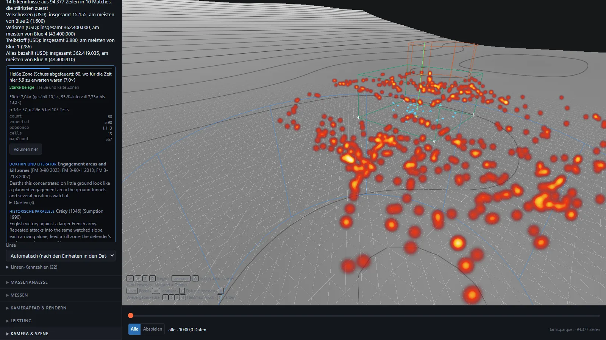

# Die Wissenslinse

Wenn [Erkenntnisse](insights.md) etwas findet, erklärt dieser Teil es mit Ideen aus der Militärgeschichte, dem Spieldesign und der Sportanalyse und nennt das Buch oder die Arbeit, aus der sie stammen. Nutze ihn, um zu lernen, *warum* ein Muster wichtig ist, nicht nur, dass es es gibt.

## Ausprobieren {#try-it}

1. Lade Daten und öffne **Erkenntnisse**, dann drücke **Erkenntnisse finden**.
2. Klicke auf einen Befund, um ihn zu öffnen.
3. Lies **Doktrin und Literatur** und **Historische Parallele**; die vollständigen Quellenangaben sind darunter eingeklappt.
4. Ändere die **Linse** (zum Beispiel auf *Militärdoktrin*), um denselben Befund durch eine andere Literatur zu lesen.

## So funktioniert es {#how-it-works}

Das Feld Erkenntnisse beurteilt seine Befunde so, wie es ein Fachanalyst täte: durch Militärdoktrin und Operations Research, historische Gefechte und die Literatur zu Spieldesign, Leveldesign und Analytik. Das geschieht offline, aus einer kuratierten Wissensbasis im Viewer, und dasselbe Material wird an ein externes Modell übergeben, wenn eines die Nachbesprechung schreibt.

## Was das Feld zeigt {#what-the-panel-shows}

- **Linse** wählt die Literatur, durch die die Befunde gelesen werden: *Auto* (gewählt nach den Arten von Einheiten in den Daten: Flugzeuge, Schiffe, Bodenfahrzeuge, Infanterie), *Militärdoktrin*, *Luftkampf*, *Marine*, *Stadtkampf*, *Spieldesign und Balance*, *E-Sport*. Einträge außerhalb der gewählten Linse werden weggelassen.
- Jeder geöffnete Befund zeigt seinen nächsten Eintrag aus **Doktrin und Literatur** und seine nächste **Historische Parallele**, mit den vollständigen Quellenangaben darunter eingeklappt.
- **Linsen-Kennzahlen** listet die Maße der Einsatzanalyse, die aus denselben Zeilen berechnet werden (unten), jede mit ihrer Bedeutung und ihrer Literatur.
- Die **Nachbesprechung** fügt Zeilen für die führenden Befunde und die Linsen-Kennzahlen hinzu: „Doktrin und Literatur: ...“ und „Historische Parallele: ...“, jede mit Autor-Jahr-Angaben und den Quellen darunter.
- **Mit KI schreiben** sendet die relevantesten Einträge (Zusammenfassung, Lehre, die Befunde, auf die sie sich beziehen, vollständige Quellen) mit dem Bericht und bittet das Modell, sie über ihre Kennung zu zitieren – `{concept.lanchester-square}` – und keine anderen Quellen zu verwenden.

Die Beschriftungen sind übersetzt; das Wissen selbst ist englisch.

## Linsen-Kennzahlen {#lens-metrics}

Berechnet im Erkenntnis-Worker, im selben Durchgang über die Zeilen wie die Detektoren (`src/insights/lensMetrics.ts`). Jede wird weggelassen, wenn die Daten sie nicht tragen können.

| Kennzahl | Was sie misst | Braucht |
|---|---|---|
| Lanchester-Anpassung | Die Verluste jeder Seite pro 20 s, regressiert auf die Kampfstärken beider Seiten (Poisson, Quasi-Likelihood-Fehler); die Exponenten auf feindliche und eigene Stärke, geprüft gegen das Quadratgesetz (gezieltes Feuer) und das lineare Gesetz (Flächenfeuer) | Zeit, Teams, Abschüsse und Tode |
| Austauschverhältnis | Abschüsse pro Tod nach Seite und nach Ort; der Anteil der Tode auf dem tödlichsten Boden, der 5 % der verbrachten Zeit hält, gegen den Anteil, den der Zufall allein bei so vielen Toden gibt; Gini der Tode gegen die Zeit; Morans I der Todesraten | Abschüsse und Tode |
| Lokales Kräfteverhältnis | Eigene und feindliche Einheiten, die innerhalb der Gefechtsreichweite jedes Abschusses noch leben (Reichweite aus den Daten gesetzt: das Doppelte des Medianabstands zum nächsten Feind); der Anteil der Abschüsse durch die lokal überlegene Seite und ihr Überschuss gegenüber dem, was die Zahlen allein vorhersagen | Zeit, Teams, Personen |
| Schussfelder | Sichtfelder der meistbefahrenen Abschussorte auf einer 2,5D-Verdeckungsfläche (Levelgeometrie bis Mauerhöhe oder der begangene Boden) gegen den Durchschnittsort, und die Rangkorrelation von Sicht und Abschussanteil | Positionen; eine geladene Karte schärft es; nicht für die Luft |
| Energiezustand | Spezifische Energie (Höhe plus die Höhe, die die Geschwindigkeit erkaufen könnte) von Luft-Abschützen und Luft-Opfern, verglichen über die Mann-Whitney-Statistik | Flugzeugklassen, Zeit, Höhe |
| Schlüsselgelände | Wie oft jeder Ort unter den drei meistbefahrenen Abschussorten eines Matches ist | mehrere Matches |
| Gegenseitige Unterstützung (Trades) | Tode, auf die ein Teamkamerad mit einem Abschuss innerhalb der Gefechtsreichweite und 5 s antwortet | Zeit, Teams |
| Erster Schlag | Gefechte – Abschüsse, nach Match, nach 20 s Ruhe und nach drei Gefechtsreichweiten des Abstands gruppiert – gewonnen von der Seite, die zuerst traf | Zeit, Teams |
| Salvenmodell | Hughes' Salvengleichung, angepasst an 20-s-Perioden von Schiffen im Kontakt: außer Gefecht gesetzte Schiffe pro angreifendem Schiff und gerettete pro verteidigendem Schiff; eine Lanchester-Anpassung nur an Schiffen | Schiffsklassen, Zeit, Teams |
| Kampfwirksamkeit | Abschüsse pro Einheiten-Stunde im Gefecht jeder Seite und das Verhältnis der beiden größten (ein Kampfwirksamkeitswert im Sinne Dupuys) mit seinem 95-%-Intervall, und der Anteil jeder Seite an den Abschüssen bei gleichen lokalen Zahlen | Zeit, Teams |
| Gefechtsreichweiten | Abstand zum nächsten Feind bei Abschüssen, bei Starts und beim ersten Schuss jedes Lebens (Entdeckung bis Gefecht), nach Art der Einheit | Zeit, Teams; Starts, wo die Daten sie haben |
| Abschusskette | Sekunden vom letzten Start des Schützen bis zum Abschuss und vom ersten Schuss des Gefechts bis zum Abschuss | Zeit; Starts oder Feuer-Ereignisse |
| Konzentration oder Zerstreuung | In jeder 20-s-Periode die Streuung der beiden größten Seiten und der Anteil der Abschüsse der enger stehenden | Zeit, Teams |
| Einsätze | Pro Seite: Einsätze (Starts oder Flugzeug-Erscheinungen), Landungen, verlorene Flugzeuge und Abschüsse durch Flugzeuge; Verlustrate und Abschüsse pro Einsatz | Flugzeugklassen; Starts oder Erscheinungen |

Daten mit Runden fügen die Maße des Nahkampfs und des E-Sports hinzu – Rundensiegwahrscheinlichkeit, Wert der Aktionen, Eröffnungsduelle, Trades, Angreifer gegen Halter, Zielen, Kreuzfeuer, Taktikmittel, Mann-Vorteil, Clutches, Aufstellungen, Zeit nach dem Setzen, Todestrichter und Spielerwirkung: siehe [Nahkampf und Runden](close-quarters.md).

Spuren und Teams fügen die Maße des kollektiven Verhaltens hinzu, aus Menschenmassenforschung, kollektiver Bewegung, Verhaltensökonomie und Militärpsychologie – Ausrichtung und Kreisen, Routenlenkung, Gassen und Spuren, Dichte, Anführer und Gefolgsleute, Nachzügler, der Bruchpunkt, Risiko nach Verlusten, Serien, Kaufübereinstimmung und Unterdrückung, jedes gegen sein eigenes Nullmodell: siehe [Kollektives Verhalten](collective-behaviour.md).

Waffen, Köder und Gebäude zählen nicht als Einheiten. Wo Waffenzeilen ihre abfeuernde Einheit nennen (eine Spalte `Shooter` oder `Launcher`, wie Daten aus Tacview sie haben), wird der Start dieser Einheit gutgeschrieben, zugeordnet über ihren Namen oder ihre Objektkennung.

## Wie Befunde auf die Literatur treffen {#how-findings-meet-the-literature}

Einträge und Befunde treffen sich über eine **Mustertaxonomie** (`src/insights/knowledge/patterns.ts`): Konzentration, lokale Überlegenheit, gezieltes und Flächenfeuer, Engpässe, Todeszonen, Schussfelder, Hinterhang, Flankierung, gegenseitige Unterstützung, Energievorteil, Spawn-Druck, Balance und so weiter. Jede Detektorart und jede Linsen-Kennzahl sagt, welche Muster ihre Zahlen zeigen (`src/insights/lens.ts`); jeder Wissenseintrag sagt, welche Muster er anspricht, mit einem Gewicht. Die Relevanz eines Eintrags für einen Befund ist die gewichtete Überschneidung, skaliert danach, wie gut das Gebiet des Eintrags (Land, Luft, See, Stadt) zu den Daten passt, und nach der eigenen Stärke des Befunds. Die angezeigte Begründung ist die Zahl des Befunds in einem Satz, gefolgt von der Lehre des Eintrags.

## Katalog {#catalogue}

Jedes Muster, jedes Konzept, jede Methode, jeder historische Fall, jedes Gestaltungsprinzip und jede Studie, mit der Bibliografie: siehe den [Wissenskatalog](knowledge-catalogue.md).

## Für Entwickler {#for-developers}

### Einträge hinzufügen {#adding-entries}

1. Wähle die Datei nach Art: `concepts.ts` und `concepts-more.ts`, `methods.ts`, `cases.ts`, `cases-land.ts`, `cases-air-sea.ts`, `cases-esports.ts`, `design.ts` (Gestaltungsprinzipien) oder `studies.ts` in `src/insights/knowledge/`.
2. Gib ihm eine neue Kennung `<art>.<slug>` (nie eine wiederverwenden), seine Linsen, Gebiete und die Muster, die er anspricht, mit Gewichten 0..1. Füge ein Muster nur zu `patterns.ts` hinzu, wenn ein Befund es zeigen kann, und ordne es in `lens.ts` einem Befund oder einer Kennzahl zu.
3. Schreibe die Zusammenfassung und die Lehre **mit deinen eigenen Worten**. Zitate nur aus gemeinfreien Werken (`pd: true` in der Quellenangabe), und kurz.
4. Zitiere: Füge jedes neue Werk in `refs.ts` mit Autoren, Jahr, Titel und Verlag hinzu (Zeitschrift mit Band und Seiten); eine URL oder DOI, wo es einen öffentlichen Nachweis gibt.
5. Führe `npx vitest run src/insights/lens.test.ts` aus (eindeutige Kennungen, bekannte Muster, auflösbare Quellen, gemeinfreie Zitate, Fälle mit Datum und Ausgang) und `node tools/knowledge-doc.mjs`, um den [Katalog](knowledge-catalogue.md) zu aktualisieren.
