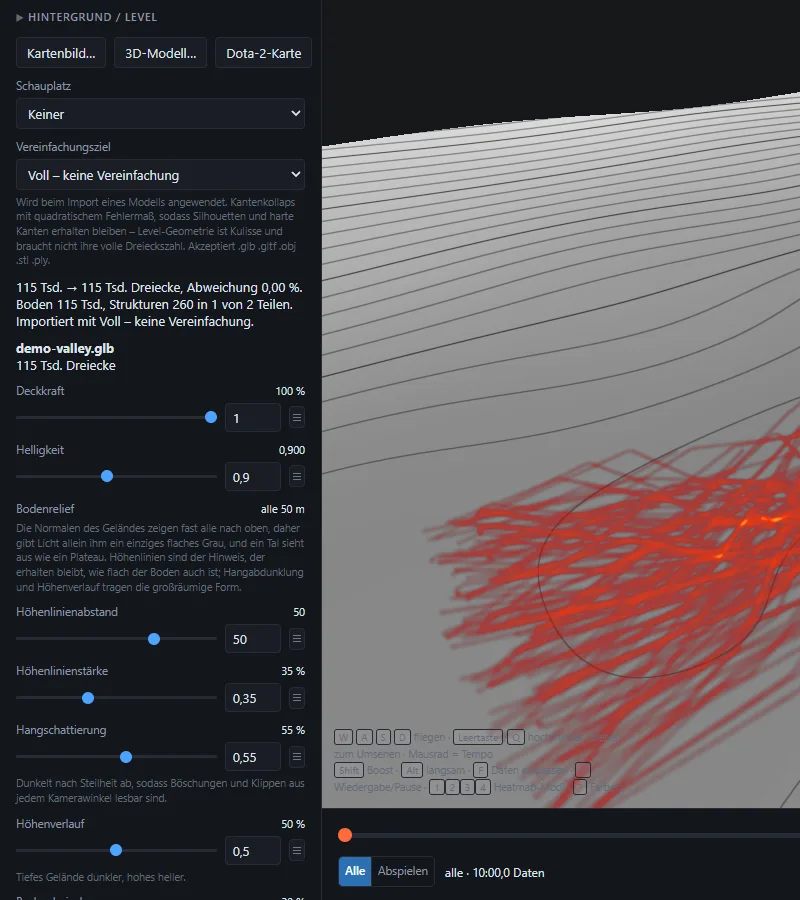

# Levels und Hintergrundgeometrie

Ein Level ist der 3D-Ort, an dem das Spiel stattfand - eine Karte, eine Stadt, eine Strecke. Legst du eines hinter deine Daten, siehst du, *wo* die Heatmap liegt. Das Feld **Hintergrund / Level** (siehe [Glossar](glossary.md) für „Level“) gibt dir drei Arten von Kontext:

- ein **Kartenbild**, mit zwei Ankern georeferenziert - siehe [Kartenbilder](map-images.md);
- ein **3D-Level** - `.glb`, `.gltf`, `.obj`, `.stl` oder `.ply` - beim Import in Boden, Strukturen und Wasser geteilt und vereinfacht - siehe [3D-Levels](model-levels.md) und [Aussehen des Levels](level-appearance.md);
- ein **Welt-Hintergrund** - für eine Aufnahme, die sagt, wo auf der Erde sie stattfand (eine Tacview-ACMI-Datei): das echte Gelände, Straßen, Gewässer, Flugplätze und Gebäude, aus offenen Daten geladen - siehe [Welt-Hintergrund](world-backdrop.md).

Ist nichts geladen, ist die Szene dunkel, mit einem Raster und farbigen Achsen (**Raster** und **Achsen** in [Kamera & Szene](camera.md)), und das Feld sagt *Nichts geladen - die Szene zeigt ein Raster und Achsen. Füge ein Kartenbild oder ein Level-Mesh hinzu, um der Heatmap Kontext zu geben.*

Das Level ist allen drei Tabs gemeinsam: Eine Strecke, die im Tab Rennanalyse geladen wurde, ist dasselbe Level, das die Heatmap zeigt.

## Ein Level hinter deine Daten legen {#put-a-level-behind-your-data}

1. Lade zuerst deine Daten ([Daten einlesen](getting-data-in.md)), damit das Level auf sie eingepasst wird.
2. Öffne **Hintergrund / Level** in der Seitenleiste.
3. Drücke **Kartenbild…** für ein Bild oder **3D-Modell…** für ein 3D-Level und wähle die Datei. Bei einer Aufnahme aus der echten Welt nutze stattdessen **Welt-Hintergrund** oder **Schauplatz**.
4. Warte, bis die Fortschrittszeile fertig ist. Ein großes Modell wird zuerst vereinfacht (siehe **Vereinfachungsziel** unten).
5. Drücke **F** in der Ansicht, um alles einzurahmen. Benutze **Deckkraft** und **Helligkeit**, bis sich die Heatmap vom Level abhebt.
6. Drücke **In Bibliothek speichern**, wenn du das Level noch einmal benutzen willst ([Level-Bibliothek](level-library.md)).

## Was ein Level für die Heatmap tut {#what-a-level-does-for-the-heat}

- Es **verdeckt**: Datenpunkte dahinter werden pro Fläche abgedunkelt, und Datenpunkte hinter dem Gelände sind verborgen ([Tiefe und Culling](depth-and-culling.md)). Ohne Level gibt es keine Verdeckung.
- Es wird vom [Schnitt](slice.md) geschnitten und, mit *Auch das Level schneiden*, vom [Entfernungs-Culling](depth-and-culling.md#distance-culling), zusammen mit der Heatmap.
- Es ist das Einzige, das die [Tiefenschärfe](camera.md#depth-of-field) verwischt, außer dem Raster und den Kästen.
- Ein 3D-Level **weitet die ferne Ebene der Kamera**, wenn es größer ist als die Daten: Nah und Fern werden aus dem Datensatz kalibriert, und eine exportierte Karte von mehreren Kilometern Breite läge sonst ganz hinter der fernen Ebene und ließe eine leere Ansicht zurück. Die ferne Ebene wird zum Dreifachen der horizontalen Ausdehnung des Levels, wenn das größer ist, die nahe Ebene wandert mit (mindestens fern / 100.000), um die Tiefengenauigkeit zu erhalten, von der die Verdeckung abhängt, und die Fluggeschwindigkeit wird auf mindestens Ausdehnung / 12 erhöht. Sie wird nur je weiter gemacht, nie enger.

## Das Feld von oben nach unten {#the-panel-top-to-bottom}

| Teil | Details |
|---|---|
| **Kartenbild…**, **3D-Modell…** | Eines laden; es ersetzt das aktuelle Level. |
| **Welt-Hintergrund**, **Kartenkacheln vergessen** | Nur für einen Datensatz mit geografischem Bezug: den echten Ort darunter als Level bauen oder die heruntergeladenen Kacheln löschen. [Welt-Hintergrund](world-backdrop.md) |
| **Vereinfachungsziel** | Das Dreiecksbudget für den nächsten Modellimport: *Voll - keine Vereinfachung* (Standard), *Hoch - 8 Mio.*, *Mittel - 3 Mio.*, *Niedrig - 800.000*, *Silhouette - 100.000*. [3D-Levels](model-levels.md#simplification) |
| Fortschritt und **Abbrechen** | Während Dekodieren oder Importieren. |
| Importhinweis | Dreiecke vorher und nachher, die Teilung in Boden / Strukturen / Wasser, der verwendete Detailgrad. |
| Name und Größe | `Breite×Höhe px · x × z m/px` für ein Bild, `N Dreiecke (von M)` für ein Modell. |
| **Deckkraft**, **Helligkeit** | Für beide Arten. |
| Bildregler | **Entsättigen**, **Nord/Süd spiegeln**, **Platzierung** (zwei Anker), **An Datengrenzen anpassen**, **Höhe**. [Kartenbilder](map-images.md) |
| Modellregler | Bodenrelief, Wasser, Bodendreiecke, Drahtgitter, Textur, erfasste Farbe, Strukturen, Teil-Klassifizierung. [Aussehen des Levels](level-appearance.md) |
| **In Bibliothek speichern**, **Entfernen** | [Level-Bibliothek](level-library.md); Entfernen lädt das Level wieder aus. |
| **Bibliothek** | Levels, die in diesem Browser gespeichert sind. [Level-Bibliothek](level-library.md) |

## Seiten in diesem Abschnitt {#pages-in-this-section}

- [Kartenbilder](map-images.md)
- [3D-Levels](model-levels.md) - Formate, Teile, Klassifizierung, Vereinfachung, Texturen
- [Aussehen des Levels](level-appearance.md) - jeder Regler für ein 3D-Level
- [Level-Bibliothek](level-library.md)
- [Welt-Hintergrund](world-backdrop.md) - die echte Welt unter einer Aufnahme, aus offenen Daten

Wie man Levels aus Spielen und Engines holt, ist Sache der eigenen Exporter-Werkzeuge (siehe das [README](https://github.com/Holdi601/3DHeat/blob/main/README.md) des Repositorys); der Vertrag, in den sie schreiben, ist in [3D-Levels](model-levels.md#the-exporter-contract) zusammengefasst.
