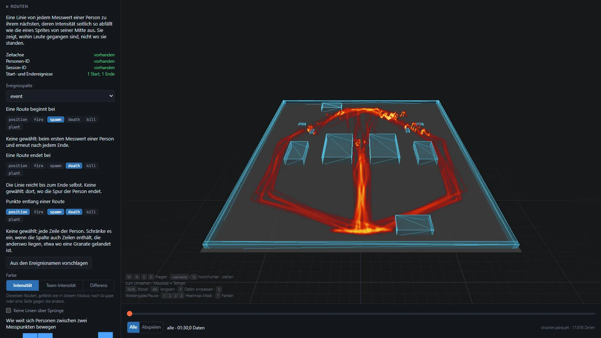

# Linien-Intensität

Die Intensität zeigt, wo Menschen standen. Linien zeigt die Wege, die sie gegangen sind.

**Linien** (Taste 4) ist die Linien-Intensität: eine Linie von jeder Probe einer [Person](glossary.md) zu ihrer nächsten, verteilt mit demselben Abfall, den ein [Sprite](glossary.md) hat – quer zur Linie statt rund um einen Punkt. Sie zeigt, wohin Menschen *gegangen* sind statt wo sie standen: Ein Korridor, der einmal durchquert wurde, ist genauso sichtbar wie ein Raum, in dem man gelagert hat, und die spärlichen Proben eines schnellen Spielers verbinden sich zu einer durchgehenden Route statt zu einer gepunkteten Spur. Sie braucht eine Personenspalte und eine Zeitspalte.

## So wird sie benutzt {#how-to-use-it}

1. Drücke `4` (oder wähle **Linien** in der Modusleiste).
2. Öffne **Routen** und prüfe die grüne Checkliste: Zeitachse und Personen-ID müssen vorhanden sein.
3. Drücke **Aus den Ereignisnamen vorschlagen**, um einzutragen, wo Routen beginnen und enden.
4. Lies die Statistikzeile: „N Routen, davon M, die ein Ende erreichen“.
5. Wenn Linien quer über die Karte springen, passe den **Längsten Schritt** an (siehe [Die Sprunggrenze](#the-jump-limit)).

Eine Linie ergibt nur zwischen einem Anfang und einem Ende Sinn, deshalb sagt das Feld **Routen**, was eine Route begrenzt. Alles von [Die Regeln einer Route](#the-rules-of-a-route) an ist Detail, das du überspringen kannst.

## Das Feld Routen {#the-routes-panel}

Oberhalb der Intensitätsfelder im Linien-Modus angezeigt.

### Was die Daten haben {#what-the-data-has}

Eine Checkliste, grün, wenn vorhanden, gelb, wenn nicht:

| Zeile | Zustände |
|---|---|
| **Zeitachse** | *vorhanden* / *fehlt – nötig* |
| **Personen-ID** | *vorhanden* / *fehlt – nötig* |
| **Session-ID** | *vorhanden* / *keine – alle Zeilen sind eine Sitzung* |
| **Start- und Endereignisse** | *N Starts, M Enden* / *keines gewählt – ganze Spuren* (grün nur mit einer Ereignisspalte und mindestens einem Start und einem Ende) |

### Bedienelemente {#controls}

| Bedienelement | Bedeutung |
|---|---|
| **Ereignisspalte** | Eine Kategoriespalte, deren Werte Ereignisse sind (Erscheinen, Tod, Position, ...). *Keine – ganze Spuren*: die Spur jeder Person in jeder Sitzung ist eine Route, unterbrochen, wo die Spur eine Lücke hat. Angeboten werden nur Spalten, die beim Laden zum Filtern behalten wurden. |
| **Eine Route beginnt bei** | Ereigniswerte, die eine Route beginnen (Erscheinen, Wiedererscheinen, Absetzen). Keiner gewählt: eine Route beginnt bei der ersten Probe einer Person und wieder nach jedem Ende. |
| **Eine Route endet bei** | Ereigniswerte, die eine Route beenden (Tod, Extraktion, Teleport). Die Linie läuft bis zur Endzeile selbst. Keiner gewählt: eine Route endet dort, wo die Spur der Person endet. |
| **Punkte entlang einer Route** | Ereigniswerte, deren Zeilen entlang der Route liegen. Keiner gewählt: jede Zeile der Person. Eingrenzen, wenn die Spalte auch Zeilen an anderer Stelle enthält, etwa wo eine Granate landete. |
| **Aus den Ereignisnamen vorschlagen** | Füllt die drei Listen aus den Namen der Werte (unten). |
| **Farbe** | *Intensität*, *Team-Intensität* oder *Differenz*. Dieselben Routen in der Färbung dieses Modus: jede Gruppe in ihrem eigenen Farbton oder eine Seite gegen die andere, mit der Gruppenliste, der Aufteilung und den Verläufen, die dort wie in diesen Modi arbeiten. Standard *Intensität*. Team-Intensität und Differenz brauchen eine Gruppenspalte. |
| **Keine Linien über Sprünge** / **Längster Schritt** | Eine nächste Probe einer Person, die weiter entfernt liegt, ist ein Wiedererscheinen, ein Teleport oder ein Absturz statt eines Weges, den sie gegangen ist, also verbindet keine Linie die beiden. Beim Laden gesetzt, wenn die Daten eine deutliche Lücke zeigen (unten), und aus, wenn nicht. Funktioniert mit oder ohne Ereignisspalte. |
| Statistikzeile | `N Routen, davon M mit einem Ende, K Segmente`, aktualisiert ein paarmal pro Sekunde. |

Jede Liste ist eine Reihe von Umschalt-Chips, einer pro Wert, die häufigsten zuerst; wenn du über einen Chip fährst, zeigt er seine Zeilenzahl. Höchstens 120 Werte werden angeboten (*N weitere Werte nicht gezeigt*).

Wenn eine andere Ereignisspalte gewählt wird, wird der Vorschlag angewendet, wenn er genau diese Spalte wählt; sonst beginnt es mit leeren Listen.

### Der Vorschlag {#the-suggestion}

Bei jedem Laden und bei **Aus den Ereignisnamen vorschlagen** ([`suggestLineSettings`](https://github.com/Holdi601/3DHeat/blob/main/src/data/lines.ts)):

- **Ereignisspalte:** die erste behaltene Kategoriespalte namens `event`, `eventname` oder `eventtype`; sonst `kind`, `type` oder `action`; sonst irgendeine, die *event*, *kind*, *action* oder *type* enthält.
- **Beginn:** Werte, die *spawn, deploy, join, enter, start, begin, respawn, revive, land/landed/landing, drop* enthalten – außer sie passen auch zu einem Endwort.
- **Enden:** Werte, die *death, died, dead, kill/killed, eliminat…, extract, evac, teleport, leave, left, disconnect, quit, exit, end, finish, downed* enthalten – außer den Werten `kill` und `kills` (ein Abschuss ist etwas, das der Schütze tut, nicht das Ende seiner Route).
- **Punkte:** Werte, die genau *position, location, player location, move, movement, tick, sample* oder *pos* sind; wenn einer gefunden wird, werden Starts und Enden auch zu den Punkten hinzugefügt. Wird keiner gefunden, bleiben die Punkte leer (jede Zeile).

### Die Sprunggrenze {#the-jump-limit}

Wo Menschen springen, fallen die Längen der Schritte in zwei Gruppen mit kaum etwas dazwischen: was eine Person zwischen zwei Proben zurücklegt, und die Breite der Karte. Beim Laden ([`suggestMaxJump`](https://github.com/Holdi601/3DHeat/blob/main/src/data/lines.ts)) werden die Schritte je Verdopplung ihrer quadrierten Länge gezählt, bis zu 16 Millionen, und die Grenze liegt in der Mitte des ersten Bereichs über dem Median, der mindestens eine Verdopplung der Länge breit ist, unter 0,02 % der Schritte je Klasse hält und Schritte darüber hat. Ohne einen solchen Bereich wird nichts geschnitten, da es dann keine Möglichkeit gäbe, einen Sprung von einem schnellen Auto zu unterscheiden; die Grenze von Hand einzuschalten beginnt dann bei einem Zehntel der Diagonale der Daten.

Das Diagramm über der Grenze zeigt, wie lang die Schritte wirklich sind, mit einer Linie an der Grenze: die Balken rechts davon werden nicht gezeichnet. Beide Achsen sind logarithmisch, denn die Sprünge können ein Hundertstel der Schritte sein und tausendmal so lang. Fahre über einen Balken für seinen Bereich und Anteil; ein Klick auf das Diagramm setzt die Grenze dorthin. Darunter der Anteil der Schritte über der Grenze.

## Die Regeln einer Route {#the-rules-of-a-route}

Zeilen werden in Zeitfolge je Person durchgegangen ([`buildLines`](https://github.com/Holdi601/3DHeat/blob/main/src/data/lines.ts)):

1. Zeilen eines [gemeinsamen Namens](sessions-persons-groups.md#names-worn-by-several-things-at-once) werden ganz übersprungen.
2. Mit gewählten Punkten wird eine Zeile, die weder Start, Ende noch Punkt ist, übersprungen.
3. Zeilen werden je Person und je Sitzung verfolgt, sodass eine Person, deren Sitzungen sich in der Zeitfolge verschachteln, in jeder eine Route hat. Eine Route wird geschlossen, wenn die vorige Zeile keinen Nachfolger hatte (ihre [Lebensdauer](sessions-persons-groups.md#person) ist „keine“) – eine Route überquert nie eine Sitzungsgrenze oder eine Lücke, die das Laden als ohne nächste Probe festgelegt hat. Welcher Route eine Zeile angehört, wird einmal berechnet und behalten, 4 Byte pro Zeile, sodass das Ändern des längsten Schritts diesen Teil nicht wiederholt.
4. Eine **Start**-Zeile schließt jede offene Route und öffnet dort eine neue.
5. Mit gewählten Starts wird eine Zeile außerhalb einer Route ignoriert. Ohne Starts öffnet jede Nicht-Ende-Zeile außerhalb einer Route eine.
6. Jede andere Zeile innerhalb einer Route fügt ein **Segment** von der vorigen Zeile der Route bis zu dieser hinzu.
7. Eine **Ende**-Zeile, die eine Route verlängert, schließt sie nach ihrem Segment; diese Route zählt als *erreicht ein Ende*.
8. Ein Schritt länger als **Längster Schritt** schließt die Route dort, wo sie war, und eine neue Route beginnt am fernen Ende, außer diese Zeile ist ein Ende. Über ihn wird keine Linie gezogen, und die Statistikzeile zählt ihn.

Jedes Segment wird auf seiner *Endzeile* gespeichert, sodass Segmente in Zeitfolge bleiben, und das [Zeitleisten-Fenster](timeline.md), der Abtaster, die [Filter](filters.md), die Sichtbarkeit der Gruppen und das Vorzeichen der Differenz arbeiten auf ihnen wie auf Punkten. Ein Filter wirkt daher auf die Zeile, auf der ein Segment endet.

## Wiedergabe {#playback}

Im Modus **Alle** wird jede Route ganz gezeichnet. Im Modus **Abspielen** ist jede Person ein Punkt, der sich zwischen ihren Proben bewegt und dahinter ihre Route zeichnet:

- ein Segment, das nach dem Abspielkopf beginnt, wird nicht gezeichnet;
- das Segment, in dem die Person gerade ist, wird bis zu ihrer interpolierten Position gezeichnet, mit einer Endkappe am Kopf;
- die Intensität verblasst über den **Schweif**: bei der Verlaufsart *Kumulativ* ist der Schweif unbegrenzt, und die ganze bisherige Route bleibt; bei *Fenster* verblasst er über die *Spanne* (Standard 30 s). Bei *Lebensdauer* ist der Schweif ebenfalls die *Spanne*, und im Linien-Modus zeigt die Zeitleiste das Feld *Spanne* für diesen Verlauf (anstelle von *Ersatzlebensdauer* und *Verblassen*, die die Linien-Intensität nicht nutzt).

Während der Wiedergabe wird jeder Frame ganz gezeichnet statt angesammelt, weil die Köpfe sich in jedem Frame bewegen und ein gleitender Mittelwert jeden zu einem Streifen verschmieren würde.

## Für Entwickler {#for-developers}

### Speicher {#memory}

Die Routen werden im Hauptthread gebaut, wenn der Linien-Modus betreten wird (oder sich die Routeneinstellungen ändern), und freigegeben, wenn er verlassen wird: 5 Byte pro Zeile im Speicher und 8 Byte pro Zeile auf der GPU (der Startpunkt jedes Segments, auf 16 Bit je Achse innerhalb der Begrenzung der Daten quantisiert, und seine Flags).

### Wie eine Linie gezeichnet wird {#how-a-line-is-drawn}

Beide Backends zeichnen jedes Segment von seiner Endzeile als **18 Eckpunkte** ([`lineHeatVs`](https://github.com/Holdi601/3DHeat/blob/main/src/render/webgl2/shaders.ts) und sein WGSL-Gegenstück):

- Die halbe Breite an jedem Ende ist der [Sprite-Radius](sprite-shape.md#sprite-radius) an der Entfernung dieses Endes, mit den angewendeten Pixelgrenzen. Eine Linie schmaler als 2,5 px wird 2,5 px breit gezeichnet, mit auf passend heruntergeskalierter Intensität, sodass dünne Linien weder verschwinden noch heller werden.
- Die Intensität fällt **quer** zur Linie mit demselben Verlauf wie ein Sprite ab – Abfall oder Kurve, Mitte- und Randintensität.
- Runde Kappen werden **nur** gezeichnet, wo eine Route beginnt oder endet, damit sich die Verbindungen aufeinanderfolgender Segmente nicht zu einer Perlenkette aufreihen.
- Die Geometrie wird im Bildschirmraum gebaut und dort linear interpoliert, sodass der Abfall auf der Linie zentriert bleibt, wie sie in die Tiefe läuft. Ein Segment, das die nahe Ebene kreuzt, wird dort geschnitten statt verworfen.

Punkt- und Linien-Intensität legen sehr unterschiedliche Mengen Intensität je Zeile ab, deshalb wird die Sättigung beim Wechseln zwischen ihnen neu bemessen ([Farbe und Belichtung](colour-and-exposure.md#auto-exposure)).
