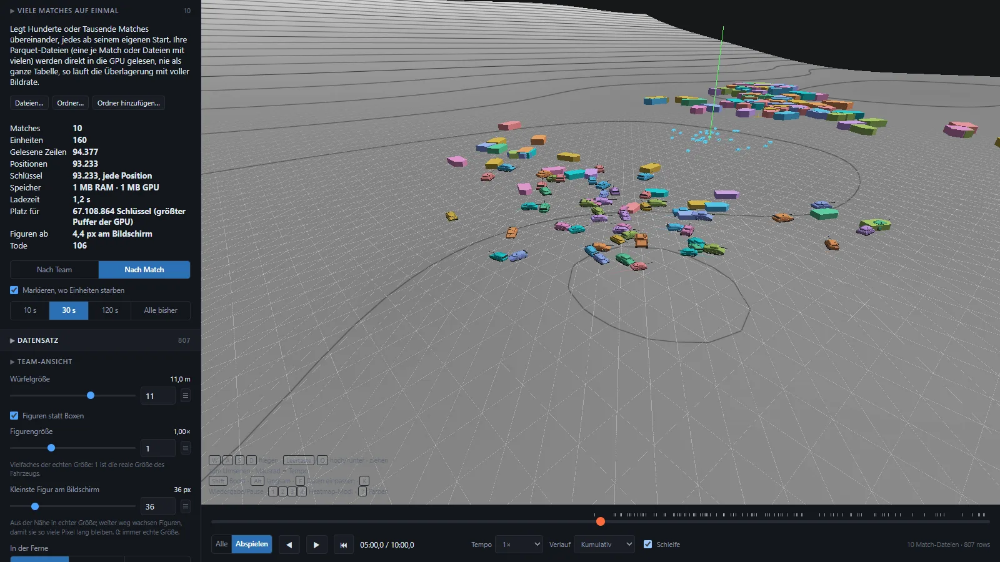

# Viele Matches auf einmal

**Viele Matches auf einmal** spielt viele Matches übereinander ab, damit du siehst, wohin die Spieler jedes Matches üblicherweise gehen. Nutze es, um Hunderte oder Tausende Matches in einem Bild zu vergleichen.

Jedes Match startet an seinem eigenen Anfang, und seine Einheiten bewegen sich als Figuren. Die Dateien gehen direkt in die Grafikkarte, und es wird keine vollständige Tabelle aufgebaut; so läuft es flüssig, wo ein normales Laden den Speicher ausgehen ließe.

## So benutzt du es {#how-to-use-it}

1. Öffne **Viele Matches auf einmal** in der Heatmap-Seitenleiste.
2. Drücke **Dateien…** (viele Dateien wählen), **Ordner…** (ein Ordner und seine Unterordner) oder **Ordner hinzufügen…** (zum Geladenen hinzufügen).
3. Der Viewer wechselt ins Figuren-Overlay und startet am Anfang. Drücke **Abspielen**.

Jede Datei ist ein Match (oder enthält mehrere). Parquet-Dateien und [`.3dheat`](container.md)-Container funktionieren. Eine Datei braucht eine Positions-, eine Zeit- und eine Einheitenspalte; Namens-, Typ- und Seitenspalten bleiben erhalten. Andere Dateien und die Begleitdateien von Konvertern (Flug, Nachrichten, Ereignisse, Chat, Ziele) werden übersprungen. Für eine normale Tabelle siehe [Daten laden](getting-data-in.md).

## Einstellungen {#settings}

| Einstellung | Was sie tut |
|---|---|
| **Nach Team** / **Nach Match** | Nach Seite einfärben oder eine Farbe pro Match. |
| **Markieren, wo Einheiten starben** | Eine Markierung dort, wo jede Einheit starb, für 10 s, 30 s, 120 s oder alle bisherigen. |

Das Panel zeigt, wie viele Matches, Einheiten, Zeilen und Positionen gelesen wurden, den verwendeten Speicher und die Ladezeit. *Platz für* ist, wie viele weitere Positionen die Grafikkarte noch aufnehmen könnte. *Figuren ab* ist die Größe am Bildschirm, unterhalb der eine Einheit als kleiner Pfeil statt als Figur gezeichnet wird.

Das Aussehen der Figuren nutzt dieselben Regler wie das [Match-Replay](match-replay.md#figures): **Figurengröße**, **Kleinste Figur am Bildschirm** und **In der Ferne**.

## Tipps {#tips}

- Wenn alles nicht in den Speicher passen würde, werden Positionen ausgedünnt (nur eine Position alle paar Meter bleibt) und das Panel sagt es.
- Die Intensitätsmodi funktionieren auch mit den Daten des Overlays.
- Für Statistiken über Tausende Matches ohne sie zu zeichnen, siehe [Massenanalyse](mass-analysis.md).
