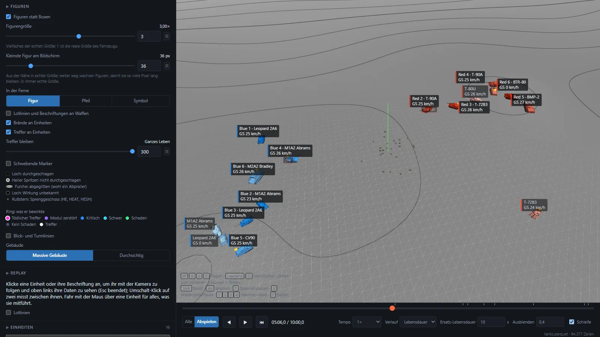
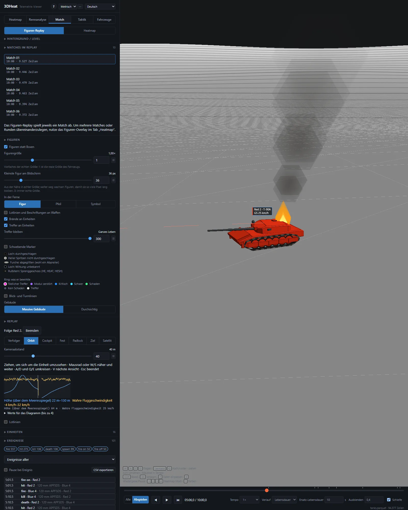
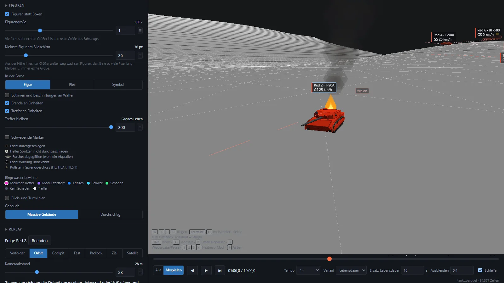
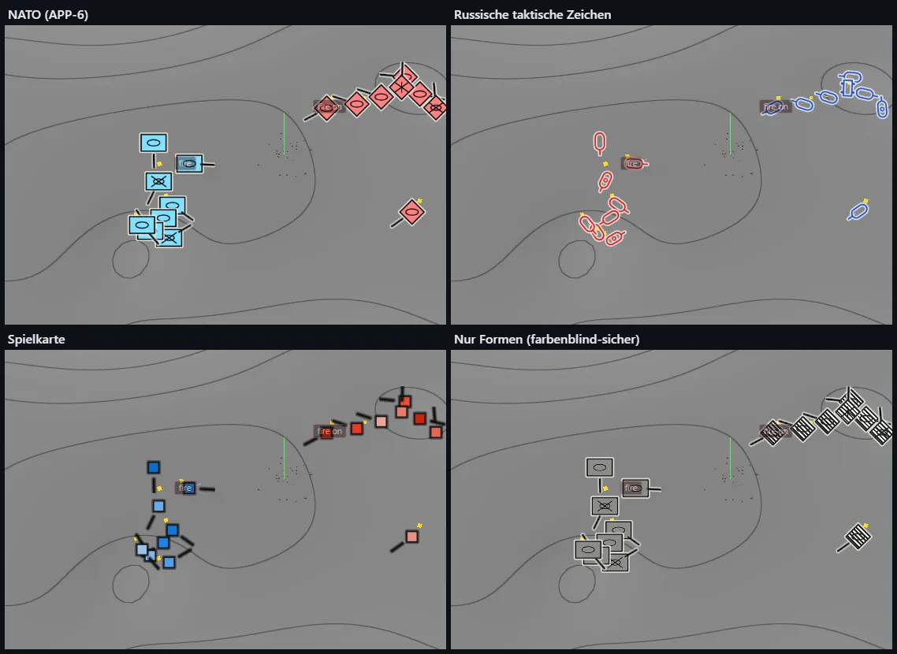
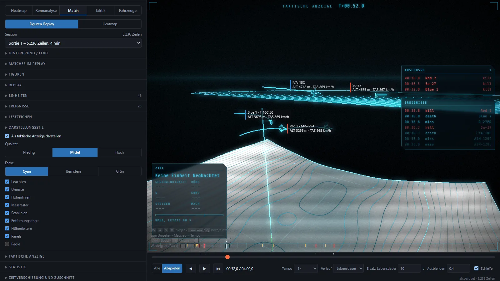
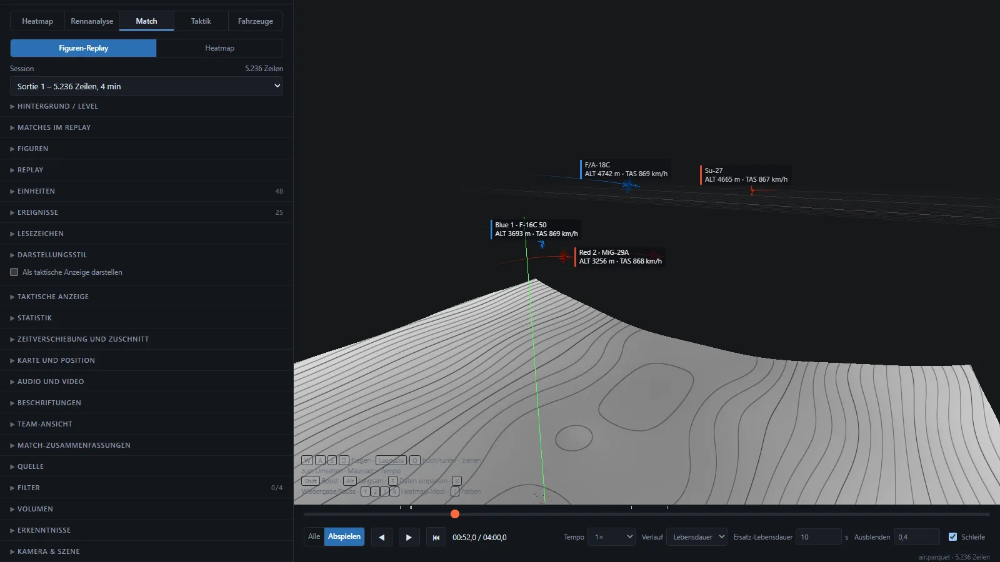

# Match-Replay

Das Replay ist ein Film des Matches, in dem jeder Spieler als das gezeichnet wird, was er gefahren hat. Nutze es, um einen Kampf noch einmal anzusehen, eine Einheit zu verfolgen und zu sehen, wer wen getroffen hat.

Schüsse, Treffer, Brände und Wracks werden auf den Einheiten und Zielen des Levels gezeichnet. Kameras, Beschriftungen und eine taktische Anzeige helfen dir, den Kampf zu lesen. Kennst du Tacview? [Tacview-Parität](tacview-parity.md) zeigt, wo jedes seiner Werkzeuge zu finden ist.

## Ein Replay starten {#start-a-replay}

1. Lade eine Aufnahme über **Quelle → Dateien…** oder indem du sie auf das Panel Quelle ziehst (jede Tabelle mit einer **Personen**- und einer **Zeit**-Spalte, eine Tacview-Datei, ein konvertiertes Replay, ein [`.3dheat`](container.md)-Match). Siehe [Daten laden](getting-data-in.md).
2. Öffne den Tab **Match** und wähle **Figuren-Replay**, oder wähle **Figuren-Overlay** in der Modusleiste des Tabs Heatmap.
3. Wähle unter **Matches im Replay** ein Match, alle auf einmal oder mehrere.
4. Drücke auf der Zeitleiste auf **Abspielen** (oder `K`). Ziehe die Zeitleiste, um zu springen.

Figuren ersetzen Quader für jede Einheit, deren Name oder Typ bekannt ist (siehe [Figuren](figures.md)). Daten ohne Namens- oder Typspalte werden als Soldaten gezeichnet.

## Figuren {#figures}

| Einstellung (Abschnitt **Figuren**) | Voreinstellung | Was sie tut |
|---|---|---|
| **Figuren statt Boxen** | ein | Aus zeichnet schlichte Quader. |
| **Figurengröße** (mal wahre Größe) | 1 | 1 ist wahre Größe; 0,25 bis 20-mal (logarithmische Skala). Größer hilft aus der Ferne. |
| **Kleinste Figur am Bildschirm** | 36 px | Ferne Figuren wachsen, damit sie so groß bleiben, 0 bis 200 px; 0 behält die wahre Größe. |
| **In der Ferne**: Figur, Pfeil, Symbol | Figur | Was eine ferne Einheit wird. |
| **Symbole** | NATO (APP-6) | NATO (APP-6), russische taktische Zeichen, Symbole der **Spielkarte** oder **Nur Formen (farbenblind-sicher)**. |
| **Symbolgröße**, **Meine Seite**, **Feindlich / Neutral**, **Kursstriche** | 28 px (12 bis 64), automatisch, feindlich, ein | Wie Symbole aussehen und welche Seite freundlich ist. |
| **Lotlinien** | ein | Eine Linie von jeder Einheit senkrecht zum Boden, damit Höhen in 3D lesbar sind. |
| **Lotlinien und Beschriftungen an Waffen** | aus | Linien zum Boden und Beschriftungen an Raketen und Bomben. |
| **Brände an Einheiten** | ein | Flammen von dem Moment an, in dem eine Einheit brennt, bis das Feuer gelöscht ist. |
| **Treffer an Einheiten** | ein | Markierungen, wo Schüsse trafen (unten). **Treffer bleiben**: 1 bis 300 Sekunden oder **Ganzes Leben**. **Schwebende Marker**: Markierungen oberhalb der Oberfläche. |
| **Blick- und Turmlinien** | aus | Gestrichelt: wohin der Spieler schaut; durchgezogen: wohin das Geschütz zeigt. |
| **Gebäude** | massiv | Massive oder durchsichtige Gebäude, wenn das Level sie malt. |

### Symbole in der Ferne {#symbols-at-a-distance}

Wäre eine Einheit kleiner als **Kleinste Figur am Bildschirm**, kann sie zu einem Symbol werden, das lesbar bleibt. Die Form zeigt die Art (zum Beispiel eine abgerundete Box mit einer Kettenmarke für Panzerung); die Farbe zeigt die Seite. Öffne das Menü **Symbole**, um den Stil zu ändern.

### Treffermarken, Wracks und Brände {#hit-marks-wrecks-and-fires}

- **Treffermarken** sitzen auf der Oberfläche, die der Schuss traf, im Maßstab der Figur. Ihr Aussehen zeigt, was passiert ist: ein Loch (durchgedrungen), ein heller Spritzer (nicht durchgedrungen), eine Furche (abgeprallt), ein Rußstern (Sprenggeschoss). Ein farbiger Ring sagt, was es bewirkt hat: tödlicher Schuss, Modul zerstört, kritisch, schwer, Schaden, kein Schaden, Treffer. Fahre über eine Markierung für den Namen der Runde.
- Eine zerstörte Einheit wird als **verkohltes** Wrack gezeichnet, von ihrem Tod an, bis sie wieder erscheint oder entfernt wird; ihr Symbol ist durchgestrichen.
- **Brände** brennen auf einer Einheit von dem Moment an, in dem sie Feuer fängt, bis es gelöscht ist.
- **Türme** drehen sich dorthin, wohin die Daten das Geschütz zeigen (oder, ohne diese, wohin der Spieler schaut).

### Waffen, Köder und Leuchtspuren {#weapons-decoys-and-tracers}

Mit **Waffen, Schüsse und Treffer** an (Abschnitt Team-Ansicht): Raketen, Lenkwaffen, Bomben und Torpedos fliegen als eigene Figuren mit einer Rauchspur; Kugeln und Granaten sind Leuchtspuren; Einschläge und Explosionen blitzen auf. Eine Leuchtspur, die **gestrichelt** gezeichnet wird, wurde aus einem Treffer abgeleitet, weil die Daten keinen Schuss hatten. Flares und Düppel werden als Köder gezeichnet; sie sind aus der Einheitenliste ausgeblendet, außer *Köder und Granaten* ist angekreuzt.

## Kameras {#cameras}

Klicke eine Einheit oder ihre Beschriftung an, um ihr zu **folgen**; der Abschnitt **Replay** bietet **Verfolger**, **Orbit**, **Cockpit** (mit einer Frontanzeige, `H`), **Fest**, **Padlock**, **Ziel** und **Satellit**. `V` schaltet durch sie, **Kameraabstand** legt fest, wie weit. Esc beendet.

- **Ansicht zweier Einheiten**: Wähle ein **Ziel** (oder Strg/Alt-Klick auf eine Einheit), um sie von der verfolgten aus zu sehen; **Tauschen** vertauscht beide.
- **Messwert**: Umschalt-Klick auf zwei Einheiten für Peilung, Entfernung und Höhenunterschied zwischen ihnen.
- **2D-Karte** (`M`): Ecken- oder Vollansicht, mit Spuren und Namen.
- **Lesezeichen** (`B`): Speichere den Moment und die Kamera; die eigenen Abschüsse, Tode und Markierungen der Aufnahme sind ebenfalls aufgelistet.
- **Ereignisse**: jedes Ereignis in zeitlicher Reihenfolge; ein Klick springt dorthin. `Bild auf` / `Bild ab` springen zwischen Ereignissen; **Pause bei Ereignis** hält an jedem an.

## Taktische Anzeige {#tactical-display}

Der Abschnitt **Taktische Anzeige** zeichnet für keine Einheit, die gewählten, alle oder eine Art (Luftfahrzeuge, Boden, Schiffe, Waffen): Geschwindigkeitsvektoren und die Strecke voraus, Nasen- und Auftriebslinien, Radarkegel, Zielerfassungen, Datenverbindungen, Wirkungszonen und -linien, Sichtlinien, wohin Spieler schauen (Sichtkegel), Turmausrichtung und die aufgezeichnete Kamera.

### Darstellungsstil {#display-style}

`T` (oder der Schalter **Als taktische Anzeige darstellen**) wechselt den Look zu einem Radarbildschirm: Glühen, Umrisse, Höhenlinien, ein Messgitter, Abtastlinien, Entfernungsringe, Höhenleitern, Panels mit Abschüssen und Ereignissen und eine **Regie**, die die Kamera selbst zu Ereignissen bewegt.

## Ziele {#objectives}

Wenn ein Match mit seinen Zielen kommt, zeichnet der Abschnitt **Ziele** sie auf dem Level: Eroberungszonen (mit Besitzer und Fortschritt der Eroberung), Spawns, Flugplätze, Gebiete und Bombenziele, jede Ebene einzeln ein- und ausschaltbar, mit Beschriftungen. Sie sind durch den Boden hindurch sichtbar. Sind mehrere Spielmodi geladen, filtert **Modus** die Matches nach Modus. Ziele kommen aus der Match-Datei eines Konverters neben der Aufnahme oder aus einem [`.3dheat`](container.md)-Container.

## Beschriftungen und Statistik {#labels-and-statistics}

- **Beschriftungen**: Regeln je Art (**Gewählte**, **Luftfahrzeuge**, **Boden**, **Schiffe**, **Waffen**, **KI**): gezeigt oder nicht, welche Werte, und eine **Priorität** dafür, wer den Platz bekommt, wenn sich Beschriftungen überlappen. **Beschriftungen auseinanderhalten** rückt eine Beschriftung neben ihre Einheit, wenn sie eine andere verdecken würde, und lässt sie dort weg, wo kein Platz ist. **Beschriftungsgröße** ist 60 bis 250 %. **Zurück zu Name, Fahrzeug, Höhe und Tempo** setzt die Regeln zurück.
  - Bodeneinheiten beginnen mit Name, Fahrzeug und Tempo.
  - Luftfahrzeuge beginnen mit Name, Fahrzeug, Höhe und Tempo.
  - Schiffe beginnen mit Name, Fahrzeug, Tempo und Kurs.
  - Fahre über eine Einheit, um jeden Wert zu sehen, den sie hat.
- **Statistik**: je Team und Einheit: Abschüsse, Tode, Schüsse, Treffer, Trefferquote, Starts, Landungen, Zeit in der Luft, Höchstgeschwindigkeit, Höhe und G, Entfernung. CSV-Export.
- **Diagramme**: die Werte einer Einheit über die Zeit, zwei Einheiten verglichen oder ein Wert gegen einen anderen.

## Viele Matches auf einmal {#many-matches-at-once}

Um Hunderte oder Tausende Matches übereinanderzulegen, siehe [Viele Matches auf einmal](many-matches.md). Details zu Figuren (Rauch, Feuer, andere zeitgesteuerte Effekte): [Figuren im Figuren-Overlay](figure-replay.md). Die Liste der Tacview-Funktionen: [Tacview-Parität](tacview-parity.md), eine Unterseite dieser hier.
