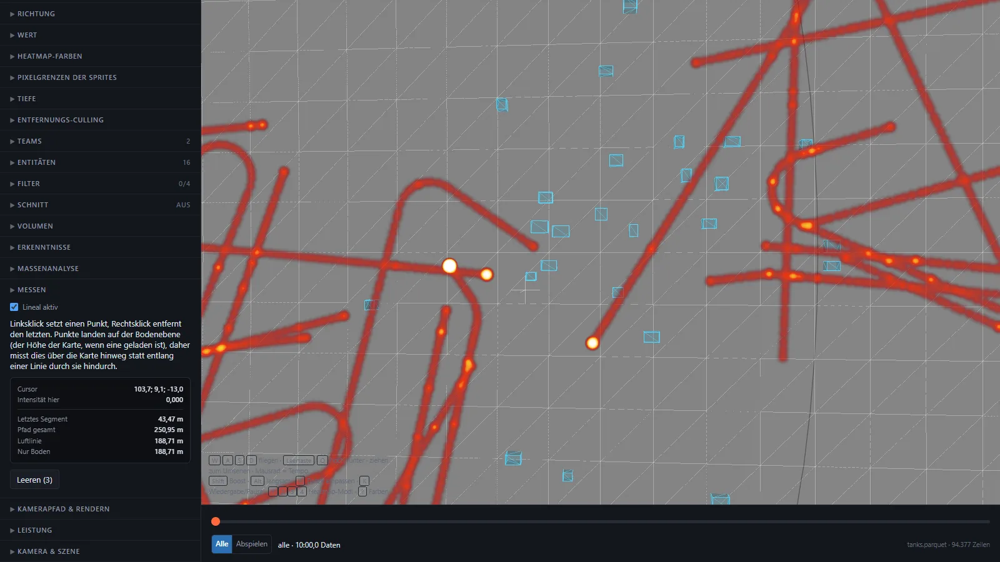

# Messwert

**Messwert** macht die Maus zu einem Lineal und sagt dir, wie stark der Punkt unter dem Cursor belegt ist. Nutze ihn, um herauszufinden, wie weit zwei Orte auseinander liegen, oder wie viel Verkehr ein Ort hat.

## Ausprobieren {#try-it}

1. Öffne **Messwert** in der Seitenleiste und setze den Haken bei **Lineal aktiv**.
2. Klicke dreimal mit der linken Taste auf die Karte. Jeder Klick setzt einen Punkt.
3. Lies **Pfad gesamt** (die Länge des ganzen Pfads) und **Letztes Segment** (der letzte Abschnitt).
4. Mit der rechten Taste entfernst du den letzten Punkt. Mit **Leeren (3)** entfernst du alle.

| Aktion | Wirkung |
|---|---|
| Linksklick | Setzt einen Punkt, wo der Cursor die Bodenebene trifft. Ein Klick, der sich zwischen Drücken und Loslassen um mehr als 4 Pixel bewegt hat, ist ein Ziehen der Kamera und kein Punkt. |
| Rechtsklick | Entfernt den letzten Punkt. |
| Bewegen | Die Cursorposition und die Intensität darunter aktualisieren sich live. |

Die Kamera arbeitet weiter, während das Lineal an ist. Ziehen dreht die Ansicht, Tasten fliegen weiter. Solange das Lineal an ist, nimmt es jeden Klick an. Deshalb wartet [Anklicken zum Auswählen](camera.md#click-to-pick), bis es aus ist.

**Die Bodenebene** ist die Höhe des [Kartenbilds](map-images.md), wenn ein Kartenbild geladen ist. Sonst ist es das tiefste Y des Datensatzes (0 ohne einen). Die Punkte landen darauf. So misst das Lineal über die Karte und nicht entlang einer Linie durch sie hindurch. Bei einem 3D-Level bleibt die Ebene das tiefste Y des Datensatzes, nicht die Oberfläche des Levels. Für einen Punkt auf der echten Oberfläche schalte das Lineal aus und klicke ihn an ([Anklicken zum Auswählen](camera.md#click-to-pick)). Das liest die Koordinaten aus den eigenen Dreiecken des Levels.

## Anzeigen {#readouts}

| Zeile | Bedeutung |
|---|---|
| **Cursor** | Welt-X, Y, Z des Punkts unter dem Cursor, auf der Ebene. |
| **Intensität hier** | Wie viel Intensität am Cursorpixel liegt. Eine größere Zahl heißt mehr Verkehr an dieser Stelle. Es ist der Wert, mit dem die Farbskala gespeist wird, bevor der Sättigungspunkt ihn teilt. So kannst du ihn mit dem [Sättigungspunkt](colour-and-exposure.md#saturation-point) vergleichen. |
| **Letztes Segment** | Abstand vom letzten Punkt zum Cursor (oder zwischen den letzten beiden Punkten). |
| **Pfad gesamt** | Länge des Linienzugs durch jeden Punkt und den Cursor. |
| **Luftlinie** | 3D-Abstand vom ersten Punkt zum Cursor (oder vom letzten Punkt). |
| **Nur Boden** | Dasselbe, nur auf X und Z. |
| **Leeren (N)** | Entfernt alle Punkte. |

Abstände werden unter 1 Einheit in Zentimetern angezeigt, unter 1.000 in Metern, darüber in Kilometern. Dabei gilt: eine Welteinheit ist ein Meter ([Achsen, Einheiten und Zeit](axes-units-and-time.md#unit-scale)). Koordinaten sind Weltkoordinaten. Das gilt auch, wenn eine Achse [für die Anzeige invertiert](camera.md#invert-world-axis) ist.

Die Punkte und die Linie zwischen ihnen werden als Overlay in der Ansicht gezeichnet, in der Größe aus dem Rasterabstand. Die Punkte des Lineals werden in Ansichten nicht gespeichert. Sie bleiben, wenn du andere Daten lädst.

## Für Entwickler {#for-developers}

**Intensität hier** wird höchstens alle 120 ms von der GPU gelesen, weil ein Lesevorgang eines einzelnen Pixels die Pipeline anhält. Es nutzt denselben Weg wie `engine.readHeatProbe()`: geteilt durch die Verstärkung, mit der das Bild geschrieben wurde. Auf dem Halbfloat-Akkumulationspfad (`?heat=f16`) ist es daher in denselben Einheiten wie auf einem 32-Bit-Ziel ([Halbfloat-Akkumulation](half-float-accumulation.md)).
