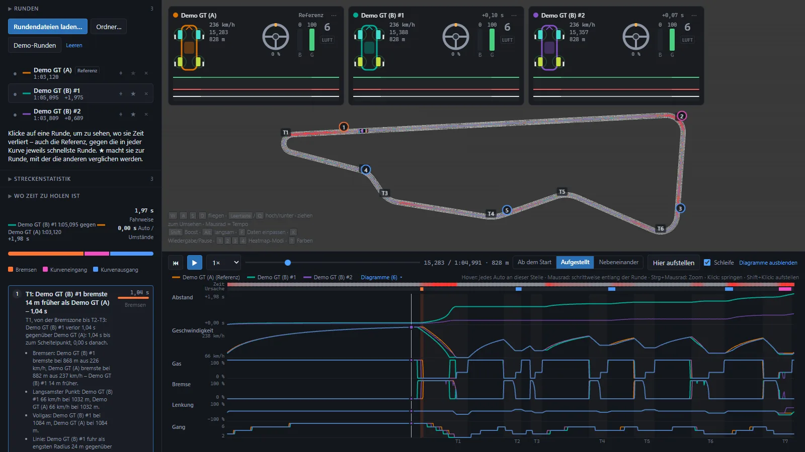

# Rennanalyse

Du bist dieselbe Strecke zweimal gefahren. Der Reiter **Rennanalyse** spielt beide Fahrten zusammen in 3D ab, zeigt, wo eine Runde langsamer war, und sagt dir, warum. Noch keine Runden? Drücke **Demo-Runden**.

Der Reiter vergleicht zwei oder mehr Runden einer Strecke. Er teilt sich die Zeichenfläche, die Kamera und das geladene Streckenmodell (**Hintergrund / Level**) mit der Heatmap; alles andere gehört ihm selbst: seine eigene Seitenleiste und seine eigene Leiste unter der Ansicht. Wörter wie *Runde*, *Referenz* und *Scheitelpunkt* stehen im [Glossar](glossary.md).

Diese Seite ist die Landkarte des Reiters. Jeder Teil hat seine eigene Seite:

| Seite | Was sie behandelt |
|---|---|
| [Runden laden](race-loading-laps.md) | jedes Dateiformat, Ordner und Strecken, Autonamen, Demo-Runden, die Rundenliste, Referenz und Fokus |
| [Replay und 3D-Szene](race-replay-and-scene.md) | die Transportleiste, die drei Replay-Modi, Autos ausrichten, die Verfolgerkamera, Linien, Karten, Autos, Beschriftungen, gespiegelte Welten |
| [Diagramme und HUD](race-charts-and-hud.md) | die Entfernungsdiagramme, die Graphenauswahl, Darüberfahren und Zoom, die Autokarten, die Kanaltabelle |
| [Ereignisse der Fahrzeugkontrolle](race-control-events.md) | Blockieren, Durchdrehen, Übersteuern, Dreher, Untersteuern, Treffer, Unfälle, ABS/TC, Handbremse, Luft – wie jedes erkannt wird, mit jeder Schwelle |
| [Analyse Kurve für Kurve](race-corner-analysis.md) | Ausrichtung nach Entfernung, Kurven und Abschnitte, die Zeitbilanz einer Kurve, jede Ursache und die Reihenfolge, in der sie geprüft werden, die Linienform und der Rat |
| [Autoprofile und Vergleich](race-car-profiles.md) | was jedes Auto kann, aus seinen Runden gemessen; *Autos im Vergleich*; was das Auto in jeder Kurve entscheidet |
| [Streckenstatistik](race-course-statistics.md) | viele Runden einer Strecke: Fehler je Kurve und je Art, die Fehlerkarte, der Export für die Heatmap, Leistungsgrenzen |
| [Rennanalytik: die Methode](race-analytics.md) | die Forschung hinter den Regeln, mit Quellen |
| [Andere Rennspiele](other-games.md) | was der Viewer mit Runden aus jedem Spiel macht: Schlupf und Drift, wo ein Spiel sie nicht sendet, gespiegelte Welten, die zusätzlichen Kanäle |

## Der Bildschirm {#the-screen}

**Seitenleiste**, von oben nach unten (Abschnitte lassen sich einklappen):

1. **Runden** – laden, auflisten, ein- und ausblenden, Referenz, Fokus, Verfolgung.
   Siehe [Runden laden](race-loading-laps.md).
2. **Streckenstatistik** – erst ab drei geladenen Runden.
   Siehe [Streckenstatistik](race-course-statistics.md).
3. **Wo Zeit zu holen ist** – die Befunde der fokussierten Runde, Kurve für Kurve.
   Siehe [Analyse Kurve für Kurve](race-corner-analysis.md).
4. **Kurve für Kurve** (oder *Kurve für Kurve – Klasse X*, wenn mehrere Klassen da sind) – die schnellste Runde durch jede Kurve und ihre Linie. Wird bei zwei oder mehr Runden gezeigt.
5. **Fahrzeugkontrolle** – Blockieren, Rutschen, Schieben und Treffer der fokussierten Runde.
   Siehe [Ereignisse der Fahrzeugkontrolle](race-control-events.md).
6. **Autos im Vergleich** (oder **Das Auto** bei einem einzigen Auto) – siehe
   [Autoprofile und Vergleich](race-car-profiles.md).
7. **Ansicht** – welche Karte auf die Strecke gemalt wird und was gezeichnet wird.
   Siehe [Replay und 3D-Szene](race-replay-and-scene.md).
8. Die gemeinsamen Felder **Level** und **Kamera & Szene** (Streckenmodell, Achsenumkehr, Kamera) – dokumentiert mit der Heatmap und der [Kamera](camera.md).

**Die Ansicht** zeigt die Strecke, die gefahrenen Linien, die Karte, die Autos, Beschriftungen, an die Strecke geheftet, und bis zu sechs Autokarten oben links (siehe [Diagramme und HUD](race-charts-and-hud.md)). Ohne geladene Runden steht dort: „Keine Runden geladen – ziehe zwei oder mehr Rundendateien hierher oder lade die Demo-Runden aus der Seitenleiste.“

**Die Leiste unter der Ansicht** enthält die Transportleiste des Replays und, sofern nicht ausgeblendet, die Entfernungsdiagramme.

## Schnellstart {#quick-start}

1. Öffne den Reiter **Rennanalyse** (neben **Heatmap** oben in der Seitenleiste).
2. Hol dir Runden. Drücke **Demo-Runden**, um zu sehen, was der Reiter mit drei erfundenen Runden macht. Für eigene Runden nimm sie zuerst auf ([Dateiformate und Aufnahmegeräte](race-loading-laps.md#file-formats)), dann drücke **Rundendateien laden…** oder **Ordner…**, oder ziehe Dateien oder Ordner auf die Ansicht.
3. Die schnellste vollständige Runde wird die Referenz; die langsamste andere Runde wird fokussiert. Klicke auf eine Runde in der Liste, um sie zu fokussieren; ★ macht eine Runde zur Referenz.
4. Lies **Wo Zeit zu holen ist**. Klicke auf einen Befund: Die Autos werden 40 m davor ausgerichtet, die Kamera rahmt ihn ein, das Replay spielt ihn durch und die Messungen öffnen sich.
5. Fahre über die Diagramme, um jedes Auto auf diesen Meter zu bewegen; Shift+Klick richtet sie dort aus.

## Tastatur {#keyboard}

Während der Reiter Rennen offen ist:

| Taste | Tut |
|---|---|
| **K** | Replay abspielen / pausieren |
| **Pos1** | zurück zum Anfang des Replays |
| Zifferntasten | nichts (in der Heatmap schalten sie die Modi um) |

Tasten, die in ein Textfeld oder ein Auswahlmenü getippt werden, werden ignoriert. Die Kamerataste funktionieren wie in der Heatmap (**W A S D**, **Leerzeichen** nach oben, **Q** nach unten, **Shift** schneller, **Alt** langsamer, Maus zum Umschauen; alles in der [Kamera](camera.md)); **F** rahmt die geladenen Runden (wie das Laden von Runden es tut).

## Viele Runden {#many-laps}

- Alle geladenen Runden werden analysiert und gezählt; dutzende brauchen eine oder zwei Sekunden.
- Ab **8** Runden (`SHOW_ALL_UP_TO`) werden neu hinzugefügte Runden nur gezeichnet, wenn sie die Referenz, die fokussierte Runde oder die beste Runde der Klasse der fokussierten Runde sind. *Alle zeigen* / *Nur die betrachteten* schalten um.
- Ab **10** sichtbaren Autos (`PLAIN_PAST`) werden die Runden, die nicht betrachtet werden (nicht der Fokus, das verfolgte Auto oder die Referenz), mit Linien gezeichnet, die auf einen Punkt alle 6 m statt 1,5 m ausgedünnt sind, und mit einfachen Autos.
- Die Diagramme zeichnen höchstens **8** Runden; das HUD zeigt höchstens **6** Karten.
- Die Streckenstatistik erscheint ab **3** Runden.

Einzelheiten: [Streckenstatistik](race-course-statistics.md#performance-with-many-laps).

## Standardeinstellungen der Ansicht {#default-view-settings}

| Einstellung | Standard |
|---|---|
| Karte | Zeitkarte |
| Gefahrene Linien, Autos, Reifen & Federung, Beschriftungen, Strecke aus den Runden | an |
| Alle Werte auf den Karten | aus |
| Autogröße | 1× |
| Diagramme | angezeigt |
| Replay-Modus | Ab der Linie |
| Replay-Geschwindigkeit | 1× |
| Schleife | an |

Keines davon wird gespeichert; ein Neuladen startet mit den Standardwerten. Im Browser gemerkt werden: die Sprache und die Autonamen, die aus Rundendateien gelernt wurden (siehe [Runden laden](race-loading-laps.md#car-names)).

## Für Entwickler {#for-developers}

### Was passiert, wenn Runden geladen werden {#what-happens-when-laps-are-loaded}

Jedes Mal, wenn sich die Menge der Runden, die Referenz oder die Sprache ändert, wird die ganze Analyse neu gemacht (`analyse` in [`src/race/analysis.ts`](https://github.com/Holdi601/3DHeat/blob/main/src/race/analysis.ts)):

1. Abgeleitete Kanäle werden zu jeder Runde hinzugefügt, wo das Spiel sie nicht sendet: Driftwinkel, Radschlupf aus den Raddrehzahlen, in der Luft, loser Untergrund, Gierrate ([`derive.ts`](https://github.com/Holdi601/3DHeat/blob/main/src/race/derive.ts)).
2. Die Referenz wird gewählt, und jede Runde wird auf deren Pfad projiziert und alle 2 m neu abgetastet ([`align.ts`](https://github.com/Holdi601/3DHeat/blob/main/src/race/align.ts)).
3. Es wird aus den Runden ermittelt, ob die Welt des Spiels gespiegelt ist ([`handedness.ts`](https://github.com/Holdi601/3DHeat/blob/main/src/race/handedness.ts)).
4. Kurven werden auf der Referenz gefunden und zu Abschnitten gruppiert, von einer Bremszone zur nächsten ([`segments.ts`](https://github.com/Holdi601/3DHeat/blob/main/src/race/segments.ts)).
5. Je Auto: seine Hülle (Grip, Bremsen, Zug je Geschwindigkeit), sein Profil, seine Reifenkurven ([`envelope.ts`](https://github.com/Holdi601/3DHeat/blob/main/src/race/envelope.ts), [`profile.ts`](https://github.com/Holdi601/3DHeat/blob/main/src/race/profile.ts), [`control.ts`](https://github.com/Holdi601/3DHeat/blob/main/src/race/control.ts)).
6. Je Runde und Abschnitt: was sie tat (Bremspunkt, langsamster Punkt, Vollgas, ...) und die Linie, die sie fuhr ([`line.ts`](https://github.com/Holdi601/3DHeat/blob/main/src/race/line.ts)).
7. Je Runde: ihre Ereignisse der Fahrzeugkontrolle, jedes dort gegen die Runde gelegt, mit der sie verglichen wird.
8. Je Runde und Abschnitt: die Zeitbilanz gegenüber ihrer Vergleichsrunde und der Befund in Worten.
9. Die Zeitkarte und die Ursachenkarte je Runde.

Die Texte entstehen in der aktuellen Sprache; ein Sprachwechsel führt die Analyse erneut aus (und benennt die Demo-Runden um). Ein Fehler in der Analyse wird unter den Knöpfen **Runden** als Fehler angezeigt, und die Runden bleiben geladen.

### Quelldateien {#source-files}

| Datei | Aufgabe |
|---|---|
| `src/race/adapters.ts`, `ibt.ts` | Lesen der Rundendateien |
| `src/race/lap.ts`, `carNames.ts`, `synthetic.ts` | der Rundentyp, Benennung, Demo-Runden |
| `src/race/derive.ts`, `handedness.ts` | abgeleitete Kanäle, gespiegelte Welten |
| `src/race/align.ts`, `segments.ts`, `line.ts` | Entfernungsachse, Kurven, Linien |
| `src/race/analysis.ts` | verglichene Kurven, Ursachen, Befunde |
| `src/race/envelope.ts`, `profile.ts` | was ein Auto kann |
| `src/race/control.ts`, `impacts.ts` | Fahrzeugkontrolle, Treffer und Unfälle |
| `src/race/stats.ts` | viele Runden |
| `src/race/replay.ts`, `scene.ts`, `glyph.ts`, `geometry.ts` | Replay und Zeichnen |
| `src/race/schema.ts`, `graphs.ts` | die Kanaltabelle, die Zeilen der Diagramme |
| `src/ui/race/*` | die Seitenleiste, die Diagramme, das HUD, die Beschriftungen |
| `src/state/raceStore.ts` | der Zustand des Reiters und die Replay-Uhr |
